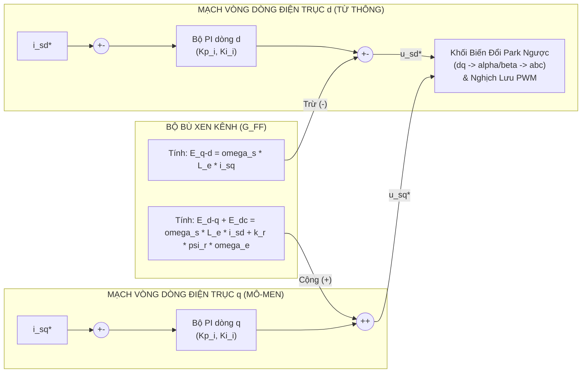

# BÁO CÁO CHUYÊN ĐỀ LÝ THUYẾT & NGUỒN GỐC THUẬT TOÁN TRUYỀN ĐỘNG ĐIỆN
## PHỤC VỤ THIẾT KẾ HỆ TRUYỀN ĐỘNG XE CON CẦU TRỤC DẦM ĐÔI ($x = 2$)

**Học phần:** EE4332 – Thiết kế Hệ thống Truyền động điện  
**Giảng viên hướng dẫn:** TS. Nguyễn Duy Đỉnh – PGS.TS. Bùi Quốc Khánh  
**Đơn vị:** Viện Điện lực / Trường Điện – Điện tử, ĐHBK Hà Nội  
**Hồ sơ tham chiếu:** Bộ slide bài giảng Thầy Đỉnh ([`Class_3_AC_Motor_Drive.pptx`](file:///d:/Tài%20liệu%20học%20tập/Kỳ%202026.1/Thiết%20Kế%20TĐĐ/Project/Lưu%20đồ%20dự%20án/Tài%20liệu%20tham%20khảo/Thầy%20Đỉnh/Class_3_AC_Motor_Drive.pptx), [`Bài 2.1.pdf`](file:///d:/Tài%20liệu%20học%20tập/Kỳ%202026.1/Thiết%20Kế%20TĐĐ/Project/Lưu%20đồ%20dự%20án/Tài%20liệu%20tham%20khảo/Thầy%20Đỉnh/Bài%202.1.pdf), [`Bài 2.2.pdf`](file:///d:/Tài%20liệu%20học%20tập/Kỳ%202026.1/Thiết%20Kế%20TĐĐ/Project/Lưu%20đồ%20dự%20án/Tài%20liệu%20tham%20khảo/Thầy%20Đỉnh/Bài%202.2.pdf), [`Bài 2.3.pdf`](file:///d:/Tài%20liệu%20học%20tập/Kỳ%202026.1/Thiết%20Kế%20TĐĐ/Project/Lưu%20đồ%20dự%20án/Tài%20liệu%20tham%20khảo/Thầy%20Đỉnh/Bài%202.3.pdf), [`Bài 4.pdf`](file:///d:/Tài%20liệu%20học%20tập/Kỳ%202026.1/Thiết%20Kế%20TĐĐ/Project/Lưu%20đồ%20dự%20án/Tài%20liệu%20tham%20khảo/Thầy%20Đỉnh/Bài%204.pdf)).

---

## MỤC LỤC
1. [Chuyên đề 1: Nguồn gốc và 14 công thức ước lượng tham số động cơ](#chuyen-de-1)
2. [Chuyên đề 2: Ước lượng vị trí ban đầu và từ hóa trước (Initial Position & Pre-excitation)](#chuyen-de-2)
3. [Chuyên đề 3: So sánh và lựa chọn chiến lược điều khiển FOC vs. DTC](#chuyen-de-3)
4. [Chuyên đề 4: Nâng cao chất lượng động học bằng bù xen kênh (Decoupling)](#chuyen-de-4)
5. [Tổng kết: Xâu chuỗi logic và ứng dụng vào đồ án xe con cầu trục ($x = 2$)](#tong-ket)

---

<a name="chuyen-de-1"></a>
## 1. CHUYÊN ĐỀ 1: NGUỒN GỐC & 14 CÔNG THỨC ƯỚC LƯỢNG THAM SỐ ĐỘNG CƠ

### 1.1. Nguồn gốc tài liệu viện dẫn
Trong các buổi giảng trên lớp và trên từng trang slide của file [`Class_3_AC_Motor_Drive.pptx`](file:///d:/Tài%20liệu%20học%20tập/Kỳ%202026.1/Thiết%20Kế%20TĐĐ/Project/Lưu%20đồ%20dự%20án/Tài%20liệu%20tham%20khảo/Thầy%20Đỉnh/Class_3_AC_Motor_Drive.pptx) (Slide 6 đến Slide 11), TS. Nguyễn Duy Đỉnh trích dẫn trực tiếp nguồn học thuật:
* **Tài liệu quốc tế:** Nguyen Phung Quang, Jörg-Andreas Dittrich (2008), *Vector Control of Three-Phase AC Machines – System Development in the Practice*, Nhà xuất bản Springer, Heidelberg, Đức (ISBN 978-3-540-79080-8).
* **Tài liệu trong nước (ĐHBK Hà Nội):** GS.TSKH. Nguyễn Phùng Quang, *Truyền động điện thông minh*, NXB Khoa học và Kỹ thuật Hà Nội; kết hợp với giáo trình *Điều chỉnh tự động truyền động điện* (PGS.TS. Bùi Quốc Khánh, PGS.TS. Nguyễn Văn Liễn...).

### 1.2. WHY — Tại sao phải ước lượng tham số động cơ?
Khi thiết kế một hệ truyền động biến tần thực tế, kỹ sư chọn động cơ bằng cách tra cứu Catalogue thương mại từ các hãng (Siemens, ABB, Schneider, SEW-Eurodrive...). Tấm nhãn sắt gắn trên vỏ máy (**Nameplate** — như hình nhãn động cơ ABB mà thầy Đỉnh chiếu ở Slide 12 của [`Class_3_AC_Motor_Drive.pptx`](file:///d:/Tài%20liệu%20học%20tập/Kỳ%202026.1/Thiết%20Kế%20TĐĐ/Project/Lưu%20đồ%20dự%20án/Tài%20liệu%20tham%20khảo/Thầy%20Đỉnh/Class_3_AC_Motor_Drive.pptx)) **chỉ cung cấp các thông số định mức bên ngoài**:
* Công suất cơ định mức $P_n$ ($\text{kW}$)
* Điện áp dây định mức $U_n$ ($\text{V}$) và kiểu đấu dây ($\text{Y}$ hoặc $\Delta$)
* Dòng điện định mức $I_n$ ($\text{A}$)
* Tần số nguồn điện $f_n$ ($50\text{ Hz}$)
* Tốc độ quay định mức $N_n$ ($\text{vòng/phút}$)
* Hệ số công suất định mức $\cos\varphi$ và Hiệu suất $\eta$

Nhà sản xuất **không bao giờ cung cấp** các tham số mạch tương đương bên trong ruột động cơ: điện trở Stator $R_s$, điện trở Rotor $R_r$, điện cảm Stator $L_s$, điện cảm Rotor $L_r$, hỗ cảm $L_m$, hệ số tản từ $\sigma$ và hằng số thời gian rotor $T_r$.  
Tuy nhiên, thuật toán điều khiển Vector FOC và khối mô phỏng động cơ trong MATLAB/Simulink bắt buộc phải có đầy đủ các tham số này để:
1. Tính toán góc quay của từ thông rotor $\theta_e = \int (p\omega_m + \omega_{sl}) dt$.
2. Chỉnh định thông số bộ điều khiển PI dòng điện ($K_{pi}, K_{ii}$) theo chuẩn Tối ưu Module (MO).
3. Thiết lập ma trận trạng thái giải tích trong khối mô phỏng Simscape.

Do đó, kỹ sư bắt buộc phải sử dụng **14 công thức giải tích** để chuyển đổi từ 6 thông số nhãn máy Nameplate thành toàn bộ các tham số điện từ bên trong.

### 1.3. Bản chất về "Số cực ($2p = 2, 4, 6, 8$ cực)" và "$L_d, L_q$" thầy Đỉnh giảng trên lớp
1. **Quy luật tốc độ và số cực:**  
   Tốc độ từ trường quay của Stator là $N_s = \frac{60 \cdot f_n}{p}$, trong đó $p$ là số đôi cực từ (số cực là $2p$). Tốc độ rotor $N_n$ của động cơ không đồng bộ luôn trượt chậm hơn $N_s$ từ $2\% \div 5\%$:
   * **Động cơ 2 cực ($2p = 2, p = 1$):** $N_s = 3000\text{ rpm} \implies N_n \approx 2850 \div 2950\text{ rpm}$ (dùng cho bơm cao áp, quạt gió tốc độ cao).
   * **Động cơ 4 cực ($2p = 4, p = 2$):** $N_s = 1500\text{ rpm} \implies N_n \approx 1420 \div 1465\text{ rpm}$ (chuẩn tối ưu nhất về kích thước và hiệu suất, được chọn cho xe con cầu trục của ta).
   * **Động cơ 6 cực ($2p = 6, p = 3$):** $N_s = 1000\text{ rpm} \implies N_n \approx 940 \div 980\text{ rpm}$.
   * **Động cơ 8 cực ($2p = 8, p = 4$):** $N_s = 750\text{ rpm} \implies N_n \approx 700 \div 730\text{ rpm}$ (như loại ABB M3AA 160 mà Nhóm 2 chọn nhầm do tính sai lực cản).
2. **Khái niệm $L_d, L_q$ so với $L_s, L_r, L_m$:**
   * **Động cơ đồng bộ nam châm vĩnh cửu (PMSM):** Rotor gắn nam châm có cấu trúc hình học cực lồi (IPMSM) hoặc cực ẩn (SPMSM). Do từ trở dọc trục cực từ ($d$) và ngang trục cực từ ($q$) khác nhau, cuộn dây Stator có hai giá trị điện cảm khác nhau là **$L_d$ (điện cảm trục $d$)** và **$L_q$ (điện cảm trục $q$)**.
   * **Động cơ không đồng bộ rotor lồng sóc (IM):** Khe hở không khí tròn đều đối xứng hoàn toàn, không có cực lồi cơ học. Vì vậy động cơ IM không có $L_d, L_q$ cơ học mà đặc trưng bởi **$L_s$ (điện cảm Stator), $L_r$ (điện cảm Rotor), $L_m$ (hỗ cảm từ hóa)** và **$L_\sigma$ (điện cảm tản tương đương)**.

### 1.4. Trọn bộ 14 công thức ước lượng của thầy Đỉnh (Slide 9, 10, 11 – `Class_3_AC_Motor_Drive.pptx`)
Bảng công thức tuần tự xuất phát từ các giá trị điện áp pha $U_{ph}$ và dòng điện pha $I_{ph}$ (đấu $\text{Y}$: $U_{ph} = U_n/\sqrt{3}, I_{ph} = I_n$; đấu $\Delta$: $U_{ph} = U_n, I_{ph} = I_n/\sqrt{3}$):

| STT | Tên đại lượng | Ký hiệu | Công thức tính toán | Đơn vị | Ý nghĩa vật lý (WHY) |
| :---: | :--- | :---: | :---: | :---: | :--- |
| **1** | Công suất điện đầu vào | $P_{e,n}$ | $P_{e,n} = 3 \cdot U_{ph} \cdot I_{ph} \cdot \cos\varphi$ | $\text{W}$ | Tổng công suất điện 3 pha động cơ hút từ lưới ở định mức. |
| **2** | Tổng trở 1 pha định mức | $Z_{ph}$ | $Z_{ph} = \frac{U_{ph}}{I_{ph}}$ | $\Omega$ | Trở kháng toàn phần nhìn từ cực Stator vào động cơ. |
| **3** | Hệ số trượt định mức | $s_n$ | $s_n = \frac{N_s - N_n}{N_s}$ | - | Độ trễ tương đối của rotor so với từ trường quay ($N_s = 60f_n/p$). |
| **4** | Điện trở Rotor quy đổi | $R_r$ | $R_r \approx s_n \cdot Z_{ph}$ | $\Omega$ | Ước lượng từ công suất cơ tiêu thụ trên nhánh tương đương $R_r/s$. |
| **5a** | Dòng kích từ trục $d$ | $I_{sd,n}$ | $I_{sd,n} \approx \sqrt{2} \cdot I_{ph} \cdot \sqrt{1 - \cos\varphi}$ | $\text{A}$ | Thành phần dòng điện hình chiếu trục $d$ đảm nhiệm tạo từ thông rotor. |
| **5b** | Dòng mô-men trục $q$ | $I_{sq,n}$ | $I_{sq,n} \approx \sqrt{2 \cdot I_{ph}^2 - I_{sd,n}^2}$ | $\text{A}$ | Thành phần dòng điện hình chiếu trục $q$ vuông góc sinh mô-men kéo. |
| **6** | Tốc độ trượt góc điện | $\omega_{sl,n}$ | $\omega_{sl,n} = 2\pi f_n - p \cdot \frac{2\pi N_n}{60}$ | $\text{rad/s}$ | Vận tốc góc tương đối giữa từ thông rotor và trục cơ rotor. |
| **7** | Hằng số thời gian Rotor | $T_r$ | $T_r = \frac{I_{sq,n}}{\omega_{sl,n} \cdot I_{sd,n}}$ | $\text{s}$ | Độ trễ tự nhiên của mạch từ rotor khi nạp/xả từ trường ($T_r = L_r / R_r$). |
| **8** | Điện kháng tản tổng | $X_\sigma$ | $X_\sigma \approx \left(\sin\varphi - \cos\varphi \frac{I_{sd,n}}{I_{sq,n}}\right) \frac{U_{ph}}{I_{ph}}$ | $\Omega$ | Tổng trở kháng rò của cuộn dây Stator và thanh dẫn Rotor. |
| **9** | Điện kháng chính Stator | $X_s$ | $X_s = \frac{\sqrt{2} \cdot U_{ph}}{I_{sd,n}} - X_\sigma$ | $\Omega$ | Trở kháng từ hóa Stator ở tần số lưới ($X_s = 2\pi f_n L_s$). |
| **10** | Điện trở Stator | $R_s$ | $R_s \approx R_r \approx \frac{\omega_{sl,n}}{2\pi f_n} \cdot \frac{I_{sd,n}}{I_{sq,n}} \cdot X_s$ | $\Omega$ | Tổn hao đồng trên dây quấn vỏ máy Stator. |
| **11** | Hệ số từ tản | $\sigma$ | $\sigma = 1 - \frac{L_m^2}{L_s L_r} \approx \frac{X_\sigma}{X_s}$ | - | Tỷ lệ từ thông rò không tham gia sinh lực kéo ($\sigma \approx 0.05 \div 0.08$). |
| **12** | Hằng số thời gian Stator | $T_s$ | $T_s = \frac{L_s}{R_s} \approx \frac{X_s}{2\pi f_n \cdot R_s}$ | $\text{s}$ | Hằng số quán tính điện từ của cuộn Stator. |
| **13** | Điện cảm Rotor | $L_r$ | $L_r = T_r \cdot R_r$ | $\text{H}$ | Tổng điện cảm cuộn dây Rotor quy đổi ($L_r = X_s / (2\pi f_n)$). |
| **14** | Điện cảm hỗ cảm (Từ hóa) | $L_m$ | $L_m = \sqrt{L_s \cdot L_r \cdot (1 - \sigma)}$ | $\text{H}$ | Khả năng tương tác từ trường qua khe hở không khí giữa vỏ và ruột. |

### 1.5. Giới hạn của bộ 14 công thức
1. **CT 13 có hai định nghĩa không trùng nhau:** $L_r = T_r R_r$ và $L_r = X_s/(2\pi f_n)$. Với DRN80M4 hai giá trị là 0.709 H và 0.726 H.
2. **CT 10 giả thiết $R_s \approx R_r$** và không dùng hiệu suất định mức $\eta_N$ của catalogue, nên tổn hao đồng không được đối chiếu với cân bằng công suất.
3. **Dải $\sigma \approx 0.05 \div 0.08$ chỉ đúng với động cơ công suất lớn.** Động cơ 0.75 kW cho $\sigma$ = 0.136.

### 1.6. Áp dụng cho động cơ đã chọn (SEW DRN80M4, 0.75 kW, 400 V Y, 1.75 A, 1440 vg/ph, $\cos\varphi_N$ = 0.74, $\lambda_K$ = 3.4)

| Tham số | $R_s$ | $R_r$ | $L_s$ | $L_r$ | $L_m$ | $\sigma$ | $T_r$ | $\psi_r$ |
| :---: | :---: | :---: | :---: | :---: | :---: | :---: | :---: | :---: |
| Kết quả 14 công thức | 5.40 Ω | 5.28 Ω | 0.726 H | 0.709 H | 0.667 H | 0.136 | 0.134 s | 0.84 Wb |

**Kiểm chứng với catalogue** (mạch thay thế hình T ở 400 V, $s_N$ = 0.04):

| Bộ tham số | $I_N$ (1.75 A) | $\cos\varphi_N$ (0.74) | $M$ tại $s_N$ (4.95 N·m) | $\lambda_K$ (3.4) |
| :--- | :---: | :---: | :---: | :---: |
| 14 công thức | 1.875 A (+7%) | 0.745 | 5.80 N·m (+17%) | 2.47 (−27%) |
| Sơ đồ vòng tròn (Excel v1.4, khối J) | 1.535 A (−12%) | 0.752 | 4.72 N·m (−5%) | 2.68 (−21%) |
| Hiệu chỉnh: $R_s$ = 8.386 Ω, $R_r$ = 6.641 Ω, $L_{\sigma s} = L_{\sigma r}$ = 0.0294 H, $L_m$ = 0.603 H | 1.722 A (−2%) | 0.725 (−2%) | 5.03 N·m (+2%) | 3.40 (0%) |

**Phương pháp thống nhất (Người dùng duyệt 28/10/2026):** 14 công thức là phương pháp ước lượng chính theo bài giảng; kết quả được kiểm chứng theo 4 chỉ tiêu $I_N$, $\cos\varphi_N$, $M_N$, $\lambda_K$; bộ tham số dùng cho mô phỏng là bộ hiệu chỉnh (sai số ≤ 2%, loại `[B]`), vì bộ 14 công thức cho mô-men tới hạn thấp hơn catalogue 27%, làm sai kết quả vùng giảm từ thông ở lưới −10%.

---

<a name="chuyen-de-2"></a>
## 2. CHUYÊN ĐỀ 2: ƯỚC LƯỢNG VỊ TRÍ BAN ĐẦU & TỪ HÓA TRƯỚC (INITIAL POSITION & PRE-EXCITATION)

### 2.1. WHAT — Khái niệm này là gì?
Ước lượng vị trí ban đầu và từ hóa trước là quá trình **xác lập trạng thái từ trường danh định** bên trong khe hở không khí và **định vị chính xác góc pha $\theta_0$** của vector từ thông tại thời điểm khởi động ($t = 0$), trước khi bộ điều khiển mở phanh cơ khí và phát lệnh tăng tốc.

### 2.2. WHY — Tại sao bắt buộc phải có bước này đối với Xe con Cầu trục ($14.2\text{ tấn}$)?
1. **Toán học biến đổi tọa độ:**  
   Thuật toán FOC biến đổi dòng điện 3 pha sang hệ tọa độ $d-q$ qua ma trận Park nhân với $\cos\theta_e$ và $\sin\theta_e$. Nếu tại thời điểm $t = 0$, biến tần không biết góc $\theta_e$ đang nằm ở đâu, vector dòng điện sinh mô-men $i_{sq}$ sẽ bị bơm lệch trục $\implies$ triệt tiêu sức kéo. Đối với động cơ đồng bộ PMSM, nếu góc $\theta_0$ bị đoán sai lệch $> 90^\circ$, động cơ sẽ **giật lùi ngược chiều** trước khi quay thuận!
2. **Hiện tượng "Tụt tải / Trôi xe" (Roll-back) trong truyền động nâng hạ & di chuyển:**  
   Khác với động cơ PMSM (vốn có sẵn nam châm vĩnh cửu), động cơ không đồng bộ (IM) khi đứng yên thì trong ruột rotor **hoàn toàn không có từ thông** ($\psi_r(0) = 0\text{ Wb}$).  
   Phương trình mô-men điện từ:
   $$M_e = \frac{3}{2} p \frac{L_m}{L_r} \psi_r \cdot i_{sq}$$
   Nếu biến tần nhả phanh đĩa cơ khí ngay khi vừa bấm nút RUN mà chưa kịp tạo từ thông ($\psi_r = 0$), thì dù bộ điều khiển có vặn tối đa dòng $i_{sq} = I_{\max}$, mô-men sinh ra vẫn bằng $0\text{ Nm}$! Khi đó, khối hàng $14.2\text{ tấn}$ đang đỗ trên ray sẽ bị rung giật hoặc trôi tự do, gây hư hại nghiêm trọng cơ cấu truyền lực.

```
+---------------------------------------------------------------------------------+
|  NẾU KHÔNG CÓ TỪ HÓA TRƯỚC:                                                    |
|  t = 0s: Bấm RUN -> Nhả phanh cơ ngay                                          |
|          Psi_r(0) = 0 Wb -> Mô-men Me = 0 Nm                                    |
|          -> 14.2 tấn hàng bị trôi tụt (Roll-back), rung lắc cáp giật cơ khí!     |
|                                                                                 |
|  CÓ TỪ HÓA TRƯỚC (CHUẨN CÔNG NGHIỆP):                                          |
|  t = 0 -> 0.2s: Phanh cơ VẪN KẸP CỨNG TRỤC                                     |
|          Bơm dòng DC: Isd = Isd,n ; Isq = 0; omega = 0                         |
|          -> Từ thông nạp đầy: Psi_r -> Psi_rN và KHÓA GÓC Theta_0 = 0          |
|  t = t_mag = 0.5 s (>= 3T_r): thử mô-men giữ khi phanh còn kẹp -> NHẢ PHANH    |
|          -> Bơm Isq -> Xe chuyển động êm! (trình tự FSM: SDD §5)               |
+---------------------------------------------------------------------------------+
```

### 2.3. HOW — Quy trình thực hiện chi tiết trong biến tần công nghiệp
Phương pháp được trình bày ở đồ thị `Start-up` tại Slide 36 của [`Bài 2.3.pdf`](file:///d:/Tài%20liệu%20học%20tập/Kỳ%202026.1/Thiết%20Kế%20TĐĐ/Project/Lưu%20đồ%20dự%20án/Tài%20liệu%20tham%20khảo/Thầy%20Đỉnh/Bài%202.3.pdf):

1. **Bước 1: Khóa góc ban đầu $\theta_e(0) = 0$ và Từ hóa trước (Pre-magnetizing) lúc $\omega = 0$:**
   * Trong khoảng thời gian $t_{\text{pre}} \approx (2 \div 3) T_r \approx 200 \div 300\text{ ms}$, phanh cơ khí vẫn kẹp chặt trục động cơ.
   * Biến tần cố định góc điều chế $\theta_e = 0^\circ$ (trục $d$ trùng với trục cuộn dây pha A của Stator).
   * Đặt dòng mô-men $i_{sq}^* = 0$ và bơm dòng kích từ một chiều $i_{sd}^* = I_{sd,n}$.
   * Dòng điện này tạo ra từ thông rotor tích lũy dần theo hàm số mũ $\psi_r(t) = L_m I_{sd,n} (1 - e^{-t/T_r})$ đạt đến $100\%$ định mức ($0.85\text{ Wb}$) và nằm cố định đúng trục pha A ($\theta_0 = 0$).
2. **Bước 2: Mở phanh và Ước lượng góc từ thông liên tục (Indirect FOC):**
   * Khi từ thông đã dựng đầy, khối logic gửi tín hiệu mở cuộn hút phanh điện từ.
   * Ngay khi phanh nhả, bộ tích phân bắt đầu tính toán góc từ thông rotor $\theta_e(t)$ theo mô hình dòng Stator (Current Model):
     $$\omega_{sl}(t) = \frac{L_m}{T_r \cdot \psi_r} i_{sq} = \frac{1}{T_r} \frac{i_{sq}}{i_{sd}}$$
     $$\theta_e(t) = \theta_0 + \int_0^t \left(p\cdot \omega_m(\tau) + \omega_{sl}(\tau)\right) d\tau$$
   * Nhờ có Encoder đo chính xác tốc độ góc cơ $\omega_m$, biến tần luôn biết được vị trí chính xác của vector từ thông để thực hiện biến đổi Park thời gian thực.

*(Mở rộng đối với động cơ PMSM: Nếu dùng động cơ đồng bộ cực nam châm, người ta tiêm các xung điện áp tần số cao HFI vào cuộn Stator khi đứng yên, đo dòng phản hồi để phát hiện vị trí cực nam châm dựa trên độ bão hòa mạch từ mà không cần làm quay trục).*

---

<a name="chuyen-de-3"></a>
## 3. CHUYÊN ĐỀ 3: SO SÁNH & LỰA CHỌN CHIẾN LƯỢC ĐIỀU KHIỂN FOC VS. DTC

Trong [`Bài 2.3.pdf`](file:///d:/Tài%20liệu%20học%20tập/Kỳ%202026.1/Thiết%20Kế%20TĐĐ/Project/Lưu%20đồ%20dự%20án/Tài%20liệu%20tham%20khảo/Thầy%20Đỉnh/Bài%202.3.pdf) (Slide 6, Slide 30–54), thầy Khánh và thầy Đỉnh đặt lên bàn cân 2 trường phái điều khiển AC hiện đại nhất: **FOC (Field-Oriented Control)** và **DTC (Direct Torque Control)**.

### 3.1. Bản chất kỹ thuật của từng phương pháp
* **FOC (Định hướng trường Rotor — Vector Control):**
  * **WHAT:** Điều khiển gián tiếp thông qua việc chiếu dòng điện lên hệ tọa độ quay $d-q$ đồng bộ với từ thông rotor. Tách hoàn toàn bài toán thành: $i_{sd}$ khống chế từ thông, $i_{sq}$ khống chế mô-men.
  * **HOW:** Dùng các khối biến đổi tọa độ **Clarke ($abc \to \alpha\beta$)**, **Park ($\alpha\beta \to dq$)**, sử dụng **bộ điều khiển PI tuyến tính**, qua khâu điều chế **SVPWM** đóng cắt van IGBT ở tần số cố định ($f_{sw} = \text{const} \approx 4 \div 8\text{ kHz}$).
* **DTC (Điều khiển trực tiếp Mô-men — Direct Torque Control):**
  * **WHAT:** Điều khiển trực tiếp độ lớn từ thông Stator $|\vec{\psi}_s|$ và mô-men điện từ $M_e$ ngay trên hệ tọa độ tĩnh $(\alpha, \beta)$ gắn trên vỏ máy.
  * **HOW:** Dựa vào góc tải $\delta$ giữa $\vec{\psi}_s$ và $\vec{\psi}_r$ ($M_e \propto |\vec{\psi}_s| |\vec{\psi}_r| \sin\delta$). Sai số từ thông đưa vào **Rơ-le trễ 2 vị trí ($d_\psi \in \{0, 1\}$)**, sai số mô-men đưa vào **Rơ-le trễ 3 vị trí ($d_m \in \{-1, 0, 1\}$)**. Bộ xử lý tra **Bảng đóng cắt tối ưu (Switching Table)** để xuất thẳng trạng thái đóng/cắt cho 6 van IGBT mà **không cần bộ điều chế PWM và không cần phép quay trục Park**.

### 3.2. Bảng so sánh toàn diện 10 tiêu chí kỹ thuật

| Tiêu chuẩn so sánh | FOC (Field-Oriented Control) | DTC (Direct Torque Control) |
| :--- | :--- | :--- |
| **Hệ tọa độ tính toán** | Hệ tọa độ quay $d-q$ đồng bộ vector $\vec{\psi}_r$ | Hệ tọa độ tĩnh $\alpha-\beta$ gắn trên Stator |
| **Cấu trúc bộ điều khiển** | 2 vòng PI dòng điện trong + 1 vòng PI tốc độ ngoài | Bộ so sánh rơ-le trễ (Hysteresis) từ thông và mô-men |
| **Bộ băm xung nghịch lưu** | Có bộ điều chế PWM / SVPWM | Không có PWM (đóng cắt trực tiếp từ bảng Switching Table) |
| **Tần số đóng cắt IGBT** | **Cố định** ($f_{sw} = \text{const}$), dễ lọc nhiễu sóng hài | **Biến thiên bất định** theo tần số đóng cắt của rơ-le trễ |
| **Dạng sóng dòng điện** | **Hình sin thuần khiết**, sóng hài bậc cao rất thấp | Dòng điện bị răng cưa, méo sóng ở vùng tốc độ thấp |
| **Độ đập mạch mô-men (Torque Ripple)** | **Cực thấp ($< 2\%$)**, trục quay rất êm | **Cao ($5\% \div 15\%$)**, gây rung động và ồn cơ khí |
| **Thời gian đáp ứng mô-men** | $5 \div 10\text{ ms}$ (bị trễ qua bộ lọc và mạch vòng PI) | **Siêu nhanh ($1 \div 2\text{ ms}$)** |
| **Độ nhạy với tham số rotor ($R_r$)** | Rất nhạy (sai $R_r$ làm lệch góc từ thông $\theta_e$) | Ít phụ thuộc vào tham số rotor (chỉ phụ thuộc $R_s$) |
| **Điều khiển ở vùng tốc độ cực thấp ($0\text{ rpm}$)** | **Rất tốt**, giữ được $100\%$ mô-men đứng yên nhờ Encoder | Khó điều khiển ổn định ở tốc độ rất thấp do sai số tích phân $R_s$ |
| **Ứng dụng công nghiệp đặc trưng** | **Xe con cầu trục, thang máy, cánh tay robot, máy CNC** | Máy cán thép, máy nghiền quặng, máy đùn công suất lớn |

### 3.3. WHY — Tại sao đồ án Xe con Cầu trục bắt buộc phải chọn FOC?
Mặc dù DTC có ưu điểm đáp ứng mô-men cực nhanh ($1\text{ ms}$), nhưng đối với hệ truyền động di chuyển xe con cầu trục:
1. **Triệt tiêu hiện tượng cộng hưởng lắc tải treo cáp dài $12\text{ m}$:**  
   Hàng hóa $12.2\text{ tấn}$ treo lơ lửng dưới sợi cáp $12\text{ m}$ là một hệ dao động con lắc với tần số góc riêng rất bé $\omega_p = \sqrt{g/h} = \sqrt{9.81/12} \approx 0.904\text{ rad/s}$ ($T_p \approx 6.95\text{ s}$).  
   Nếu sử dụng DTC, hiện tượng đập mạch mô-men (Torque ripple $10\%$) sẽ truyền qua bánh xe lên kết cấu dầm cầu, tạo ra các xung lực giật kích thích làm tải hàng bị chao đảo dữ dội! FOC phát ra mô-men phẳng lì, kết hợp với quỹ đạo làm mềm gia tốc **S-Curve 7 đoạn** sẽ đảm bảo hàng hóa đứng im thẳng đứng.
2. **Dừng đỗ định vị chính xác và khóa an toàn phanh đĩa:**  
   Xe con cầu trục yêu cầu khả năng chạy bò định vị ở tốc độ rất thấp ($v_{\text{creep}} = 0.03\text{ m/s}$) và giữ dừng mềm không trôi trước khi sập phanh cơ. FOC với phản hồi Encoder đáp ứng hoàn hảo yêu cầu này, trong khi DTC bị trôi ở dải tốc độ sát $0$.

---

<a name="chuyen-de-4"></a>
## 4. CHUYÊN ĐỀ 4: NÂNG CAO CHẤT LƯỢNG ĐỘNG HỌC BẰNG BÙ XEN KÊNH (DECOUPLING)

Đây là nội dung kỹ thuật trọng tâm, quyết định chất lượng đáp ứng quá độ của hệ thống khi tăng tốc hoặc đảo chiều, được nêu ở **Slide 7 file [`Class_3_AC_Motor_Drive.pptx`](file:///d:/Tài%20liệu%20học%20tập/Kỳ%202026.1/Thiết%20Kế%20TĐĐ/Project/Lưu%20đồ%20dự%20án/Tài%20liệu%20tham%20khảo/Thầy%20Đỉnh/Class_3_AC_Motor_Drive.pptx)** và **Slide 18, 19, 33, 35, 37, 38 file [`Bài 2.3.pdf`](file:///d:/Tài%20liệu%20học%20tập/Kỳ%202026.1/Thiết%20Kế%20TĐĐ/Project/Lưu%20đồ%20dự%20án/Tài%20liệu%20tham%20khảo/Thầy%20Đỉnh/Bài%202.3.pdf)**.

### 4.1. WHAT — Hiện tượng "Xen kênh" (Cross-Coupling) là gì?
Khi phân tích mô hình toán học của động cơ KĐB trên hệ tọa độ quay $d-q$ tựa theo từ thông rotor ($\psi_{rq} = 0, \psi_{rd} = \psi_r$), phương trình điện áp Stator được viết thành:
$$\begin{cases}
U_{sd} = \underbrace{R_e (T_e s + 1) I_{sd}}_{\text{Kênh riêng trục } d} \quad \underbrace{- \omega_s L_e I_{sq} - \frac{k_r}{T_r}\psi_r}_{\text{Nhiễu chéo từ kênh } q \text{ chọc sang } d:\ -(E_{q-d} + E_m)} \\
U_{sq} = \underbrace{R_e (T_e s + 1) I_{sq}}_{\text{Kênh riêng trục } q} \quad \underbrace{+ \omega_s L_e I_{sd} + k_r \psi_r \omega_e}_{\text{Nhiễu chéo từ kênh } d \text{ chọc sang } q:\ +(E_{d-q} + E_{dc})}
\end{cases}$$

Trong đó, các tham số quy đổi mạch Stator:
* $k_r = \frac{L_m}{L_r} = \frac{L_m}{L_m + L_{lr}'}$
* $L_e = \sigma L_s = L_\sigma$ (Điện cảm tản tương đương)
* $R_e = R_s + k_r^2 R_r$ (Điện trở tương đương $R_{eq}$)
* $T_e = \frac{L_e}{R_e} = T_\sigma$ (Hằng số thời gian điện từ tương đương)

**Định nghĩa hiện tượng:**
Nhìn vào sơ đồ khối cấu trúc động cơ ở **Slide 19 và Slide 33 của [`Bài 2.3.pdf`](file:///d:/Tài%20liệu%20học%20tập/Kỳ%202026.1/Thiết%20Kế%20TĐĐ/Project/Lưu%20đồ%20dự%20án/Tài%20liệu%20tham%20khảo/Thầy%20Đỉnh/Bài%202.3.pdf)**, ta thấy rõ **2 nhánh nhân chéo hình chữ X**:
* Nhánh 1: Dòng điện mô-men $I_{sq}$ nhân với vận tốc góc từ thông $\omega_s$ sinh ra sức điện động $E_{q-d} = \omega_s L_e I_{sq}$ tác động ngược vào điện áp trục $d$.
* Nhánh 2: Dòng điện từ hóa $I_{sd}$ nhân với $\omega_s$ sinh ra $E_{d-q} = \omega_s L_e I_{sd}$, kết hợp cùng sức phản điện động quay $E_{dc} = k_r \psi_r \omega_e$ tác động ngược vào điện áp trục $q$.

Hiện tượng mà sự thay đổi dòng điện ở trục này làm thay đổi điện áp và dòng điện ở trục kia được gọi là **Hiện tượng Xen kênh (Cross-Coupling)**.

### 4.2. WHY — Tại sao bắt buộc phải bù xen kênh?
1. **Phá hủy tính độc lập của FOC khi tăng tốc hoặc đổi chiều:**  
   Xem biểu đồ quá độ ở Slide 36 của [`Bài 2.3.pdf`](file:///d:/Tài%20liệu%20học%20tập/Kỳ%202026.1/Thiết%20Kế%20TĐĐ/Project/Lưu%20đồ%20dự%20án/Tài%20liệu%20tham%20khảo/Thầy%20Đỉnh/Bài%202.3.pdf): Khi động cơ đang quay với tốc độ cao ($\omega_s$ lớn), người vận hành vặn ga tăng tốc hoặc bấm nút đảo chiều xe con làm dòng mô-men $I_{sq}$ thay đổi đột ngột. Đại lượng $E_{q-d} = \omega_s L_e I_{sq}$ sẽ giáng một cú sốc điện áp lớn vào trục $d$, làm dòng từ hóa $I_{sd}$ bị sụt giảm và dao động méo mó. Một khi từ thông $\psi_r$ bị tụt, mô-men kéo sẽ bị suy giảm ngay lúc xe cần lực nhất!
2. **Khôi phục tính đúng đắn cho phương pháp Tối ưu Module (MO):**  
   Khi ta dùng chuẩn Tối ưu Module để tính bộ điều khiển PI dòng ($K_{pi} = \frac{L_e}{2 T_{\mu i}}, T_{ii} = T_e$), ta đã **giả định cuộn dây chỉ là một khâu quán tính bậc nhất độc lập**:
   $$G(s) = \frac{1}{R_e (T_e s + 1)}$$
   Nếu không triệt tiêu 2 thành phần xen kênh chéo, đối tượng điều khiển thực tế bị méo mó, bộ PI tính theo MO sẽ không còn tối ưu, gây ra dao động và vọt lố dòng điện quá mức cho phép ($M_p > 5\%$).

### 4.3. HOW — Cấu trúc mạch bù xen kênh (Feedforward Decoupling)
Nguyên lý giải quyết triệt để vấn đề này là sử dụng **Mạch bù tiền điều khiển (Feedforward Decoupling)** theo đúng sơ đồ Slide 38 của [`Bài 2.3.pdf`](file:///d:/Tài%20liệu%20học%20tập/Kỳ%202026.1/Thiết%20Kế%20TĐĐ/Project/Lưu%20đồ%20dự%20án/Tài%20liệu%20tham%20khảo/Thầy%20Đỉnh/Bài%202.3.pdf):



**Phương trình điều khiển thực tế nạp vào bộ vi xử lý biến tần:**
$$\begin{cases}
u_{sd}^* = \underbrace{u_{PI,d}}_{\text{Đầu ra bộ PI dòng } d} \underbrace{- \omega_s L_e i_{sq}}_{\text{Lượng bù trừ xen kênh } (-\tilde{E}_{q-d})} \\
u_{sq}^* = \underbrace{u_{PI,q}}_{\text{Đầu ra bộ PI dòng } q} \underbrace{+ \omega_s L_e i_{sd} + k_r \psi_r \omega_e}_{\text{Lượng bù cộng xen kênh } (+\tilde{E}_{d-q} + \tilde{E}_{dc})}
\end{cases}$$

Khi các tín hiệu bù này được đưa vào trước khâu băm xung PWM, chúng sẽ **triệt tiêu hoàn toàn** các sức điện động cảm ứng chéo sinh ra bên trong động cơ. Kết quả là mạch vòng dòng điện trục $d$ và trục $q$ trở nên **tách biệt 100%**, đáp ứng động học đạt tốc độ tối đa theo chuẩn Tối ưu Module!

---

<a name="tong-ket"></a>
## 5. TỔNG KẾT: XÂU CHUỖI LOGIC & BỐ TRÍ VÀO HỒ SƠ ĐỒ ÁN ($x = 2$)

Toàn bộ 4 chuyên đề lý thuyết trên sẽ được tích hợp thống nhất vào đồ án của bạn theo cấu trúc sau:

```
[Đề bài x = 2] -> [Tính lực cản lăn w0 = 0.015 & Lực quán tính đề-pa 14.2t]
                      │
                      ▼
[Chọn Động cơ SEW DRN80M4 0.75 kW + hộp số R87 (i = 155.34) -> Lấy thông số Nameplate]
                      │
                      ▼
[Chuyên đề 1: 14 công thức ước lượng ra Rs, Rr, Ls, Lr, Lm, Tr, sigma -> kiểm chứng với catalogue -> hiệu chỉnh (§1.6)]
                      │
                      ▼
[Chuyên đề 3: Lập luận kỹ thuật chọn FOC (loại bỏ DTC để chống lắc cáp 12m)]
                      │
                      ▼
[Chuyên đề 4: Tích hợp thuật toán Bù xen kênh Decoupling]
                      │
                      ▼
[Tính bộ điều khiển PI dòng điện theo MO & PI tốc độ theo SO]
                      │
                      ▼
[Chuyên đề 2: Thiết lập thời gian từ hóa trước t_mag = 0.5 s & Logic nhả phanh cơ]
                      │
                      ▼
[Mô phỏng Simulink linh kiện thực tế (Simscape) -> Nghiệm thu đồ thị]
```

### Ánh xạ vào file tính toán `Block 3/00_Tinh_toan_Xe_con_x2_v1.4.xlsx`:
1. **`Params`:** thông số gốc P-01..P-20 ($Q = 12,222\text{ kg}, M_\Sigma = 14,244\text{ kg}, v = 0.12\text{ m/s}, a = 0.5\text{ m/s}^2, \rho = 2\text{ m/s}^3, h = 12\text{ m}$).
2. **`Tính chọn` khối A–I:** phụ tải tĩnh ($F_c = 2,096\text{ N}$), phụ tải động ($F_{\max} = 9,218\text{ N}$), công suất đỉnh ($P_{\max} = 1.23\text{ kW}$), nhiệt S3-40% ($k_{dt}$ = 3.61), DRN80M4, $i_{\text{thực}}$ = 155.34, biến tần, $R_h$, phanh.
3. **`Tính chọn` khối J:** ước lượng tham số động cơ theo Chuyên đề 1 (14 công thức → kiểm chứng catalogue → bộ hiệu chỉnh, §1.6).
4. **`Tính chọn` khối K, L, P:** PI dòng (MO), PI tốc độ (SO), bù xen kênh (Chuyên đề 4), giảm từ thông; khối E: S-curve 7 đoạn.
5. **`Mo_phong`:** tổng hợp biến xuất sang `init_params.m` cho mô hình Simulink.
