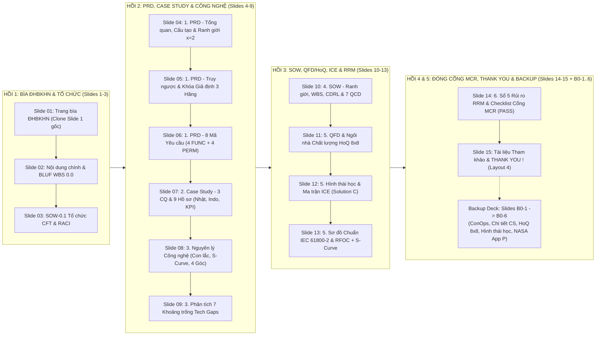

# BÁO CÁO KỊCH BẢN & BẢN THIẾT KẾ SLIDE POWERPOINT KHỐI 0 — TIỀN KHẢ THI (`PRE-A`) & CỔNG SOÁT XÉT `MCR` (CHUẨN TEMPLATE ĐHBKHN)

**Tên đề tài:** Thiết Kế Hệ Truyền Động Cơ Cấu Xe Con Cầu Trục ($x = 2$)  
**Lịch sử:** v2.0 — bản trình bày Cổng MCR · **v2.1 (26/10/2026, Người dùng duyệt nhóm A)** — hiệu đính số liệu theo SSoT v1.2 và SRS Baseline A.1: $\mu = 0.20$ → $w_0 = 0.015$ ($F_c$ 27,947 → 2,096 N; 3,967 → 298 N), $\eta$ 0.96 → 0.90, $k_{dt} \in [1.20;\ 1.50]$ → $k_{dt} \ge 1.20$, `QCD-C01` theo QĐ-08, dải công suất 1.5 ÷ 3.7 kW → kết quả 0.75 kW; viết lại câu vấn đáp về hệ số cản. Các nhãn nguồn `[Nội bộ: … v3.0 / v1.0]` trong lời dẫn giữ nguyên vì ghi lại nguồn tại thời điểm MCR.  
**Mã bộ Slide:** `DECK-B0-MCR-8.5EMG-v2.1` | **Cổng xét duyệt:** **Cổng 1 — `MCR` (*Mission / Management Concept Review* — Thẩm quyền: CTO / GVHD)**  
**Nhóm thực hiện:** Nhóm 8.5-EMG (STT 22: Nghiêm Trọng Đông — Đề $x = 2$) | **Giảng viên hướng dẫn:** TS. Nguyễn Duy Đỉnh  
**Template PowerPoint gốc bắt buộc:** `D:\Tài liệu học tập\Kỳ 2026.1\Thiết Kế TĐĐ\Project\Báo cáo hàng tuần\Mô tả nguyên lý công nghệ.pptx` (16:9, `13.33" × 7.50"`, Font Tiếng Việt chống lỗi dấu: **`Arial`** hoặc **`Segoe UI`**)  
**Tài liệu Baseline Khối 0 Đầu vào (`Frozen`):**
1. `PRD-8.5EMG-TROLLEY-v3.0` (`prd_xe_con_cau_truc_x2_nhom_8_5_emg.md`)
2. `SOW-8.5EMG-TROLLEY-v1.0` (`sow_xe_con_cau_truc_x2_nhom_8_5_emg.md`)
3. `BCA-QFD-8.5EMG-TROLLEY-v1.0` (`bao_cao_case_study_qfd_hoq_ice_xe_con_x2_nhom_8_5_emg.md`)
4. `Mô tả nguyên lý công nghệ.pptx` & `loi_thoai_thuyet_trinh.md` (Đã hiệu đính 100% số liệu theo `SE_RULES.md`)
5. `FLOW_REVIEW.md` (Khối 0 — §4.2, §4.3, §5.1) & `SLIDE_PPTX_RULES_SE.md`

---

## TỔNG QUAN CẤU TRÚC BỘ SLIDE KHỐI 0 (`MCR`) — CẤU TRÚC 2 TẦNG (21 SLIDES = 15 MAIN + 6 BACKUP)



* **Bảng Khóa Cứng Font & Cỡ Chữ Tiếng Việt Chống Lỗi Dấu (Áp dụng xuyên suốt 21 Slides):**
  * **Font chữ bắt buộc:** **`Arial`** hoặc **`Segoe UI`** (tuyệt đối không để lẫn `Lato` làm nhảy dấu Tiếng Việt hoặc lỗi ký hiệu toán học `≤, ≥, ω, ρ, η, λ, Σ`).
  * **Cỡ chữ khóa cứng:** Tên đề tài Slide 1: **`44–48pt Bold (#C00000)`** | Phụ đề Khối/Gate Slide 1: **`20pt Bold (#0E2841)`** | Thành viên & MSSV Slide 1: **`20pt (#C00000)`** | Thanh Header Xanh trên cùng: **`24–28pt Bold, ALL CAPS (#FFFFFF)`** | Câu khẳng định `Action Title` dưới vạch đỏ: **`20–22pt Bold (#C00000 / #0E2841)`** | Tiêu đề mục con: **`18–20pt Bold`** | Văn bản thân bài: **`16–18pt Regular`** | Tiêu đề bảng: **`15–16pt Bold (#FFFFFF trên nền #0E2841)`** | Ô dữ liệu bảng: **`14–15pt Regular`** | Chú thích `Hình X.`: **`14–16pt Italic`** | Số trang góc dưới phải: **`11–12pt`**.

---

# PHẦN I. KỊCH BẢN CHI TIẾT 15 SLIDES CHÍNH (`MAIN GATE REVIEW DECK — KHỐI 0`)

---

## SLIDE 01: TRANG BÌA CHUẨN ĐHBKHN — CLONE 100% SLIDE 1 CỦA `MÔ TẢ NGUYÊN LÝ CÔNG NGHỆ.PPTX`

* **1. Cấu hình Template ĐHBKHN, Header, Title & Toạ độ Gốc:**
  * **Layout gốc sử dụng:** **`slideLayout1.xml` (`1_Title and Content`)** — Nền trắng có vòng tròn chấm đỏ ĐHBKHN bên phải (`image1.png`) và dòng chữ `"ONE LOVE. ONE FUTURE."` ở góc dưới bên trái.
  * **Logo ĐHBKHN (`Shape 101 / image5.png`):** Giữ nguyên tại `pos = (1.00", 0.37")`, `size = (2.23" × 0.67")`.
  * **Tiêu đề Đề tài Chính (`Shape 102`):** Giữ nguyên tại `pos = (0.81", 1.75")`, `size = (9.71" × 1.40")`, Font **`Arial` / `Segoe UI` `46pt–48pt Bold`**, màu Đỏ Bách Khoa **`#C00000`**.
  * **Dòng Phụ đề Định danh Khối & Cổng (`Subtitle Box` bổ sung ngay dưới tiêu đề chính):** Đặt tại `pos = (0.81", 3.18")`, `size = (9.71" × 0.48")`, Font **`Arial` / `Segoe UI` `20pt Bold`**, màu Xanh Navy ĐHBKHN **`#0E2841`**.
  * **Tên Nhóm (`Shape 106`):** Giữ nguyên tại `pos = (0.81", 3.79")`, `size = (4.29" × 0.39")`, Font **`Arial` / `Segoe UI` `20pt Bold`**, màu **`#C00000`**.
  * **Danh sách 6 Thành viên (`Shape 103`) & Cột MSSV (`Shape 104`):** Giữ nguyên tại `pos_name = (0.81", 4.19"), size = (3.50" × 1.65")` và `pos_id = (4.38", 4.19"), size = (1.60" × 1.65")`, Font **`Arial` / `Segoe UI` `20pt Regular`**, màu **`#C00000`**.
  * **Giảng viên Hướng dẫn (`Shape 105`):** Giữ nguyên tại `pos = (0.68", 6.18")`, `size = (6.50" × 0.55")`, Font **`Arial` / `Segoe UI` `20pt Bold`**, màu **`#C00000`**.
* **2. Hướng dẫn Bố cục Trực quan & Cỡ chữ Tiếng Việt (Visual Layout & Font Size Guide):**
  * Sao chép nguyên bản Slide 1 của `Mô tả nguyên lý công nghệ.pptx` để giữ đồng bộ 100% nhận diện thương hiệu ĐHBKHN của nhóm, đồng thời chuyển font từ `Lato` sang **`Arial` / `Segoe UI`** để dấu chữ `"THIẾT KẾ HỆ TRUYỀN ĐỘNG CƠ CẤU XE CON CẦU TRỤC"` và tên các thành viên (`Nguyễn Bá Hưng, Đặng Nguyên Bình, Trần Đỗ Khải, Phạm Văn Hưng, Nguyễn Hải Trung, Nghiêm Trọng Đông`) hiển thị đều tăm tắp trên mọi máy chiếu.
* **3. 🖼️ [GHI CHÚ CHÈN HÌNH ẢNH CHO NGƯỜI DÙNG] (Image Placeholder Guide):**
  * **Không cần chèn thêm ảnh mới:** Khi lấy trực tiếp `Mô tả nguyên lý công nghệ.pptx` làm Template, **Slide 1 đã có sẵn Logo ĐHBKHN (`image5.png`) và nền vòng tròn chấm đỏ (`image1.png`)**. Bạn chỉ cần giữ nguyên Slide 1 đó và thêm dòng phụ đề nhỏ màu xanh đậm `#0E2841` ghi tên Khối 0 bên dưới tiêu đề chính.
* **4. Nội dung Hiển thị Trực tiếp trên Mặt Slide (On-Slide Copy-Paste Ready):**

```text
[Logo ĐHBKHN — pos=(1.00", 0.37"), size=(2.23" × 0.67")]

THIẾT KẾ HỆ TRUYỀN ĐỘNG CƠ CẤU XE CON CẦU TRỤC
(Arial / Segoe UI 46pt Bold, Màu Đỏ #C00000 — pos=(0.81", 1.75"))

BÁO CÁO TIẾN ĐỘ KHỐI 0 — SOÁT XÉT CỔNG MCR (PRD, CASE STUDY, CÔNG NGHỆ, SOW & QFD/HoQ/ICE)
(Arial / Segoe UI 20pt Bold, Màu Xanh Navy #0E2841 — pos=(0.81", 3.18"))

NHÓM 8.5-EMG (Phương án 8 — Đề x = 2: Q = 12,222 kg)
(Arial / Segoe UI 20pt Bold, Màu Đỏ #C00000 — pos=(0.81", 3.79"))

Nguyễn Bá Hưng        20232107
Đặng Nguyên Bình      20231937
Trần Đỗ Khải          20232131
Phạm Văn Hưng         20232109
Nguyễn Hải Trung      20232344
Nghiêm Trọng Đông     20232001
(Arial / Segoe UI 20pt, Màu Đỏ #C00000 — Cột tên pos=(0.81", 4.19") | Cột MSSV pos=(4.38", 4.19"))

Giảng viên hướng dẫn: TS. Nguyễn Duy Đỉnh
(Arial / Segoe UI 20pt Bold, Màu Đỏ #C00000 — pos=(0.68", 6.18"))
```

* **5. Lời dẫn Thuyết trình (Speaker Notes — 45 giây) & Nhãn Nguồn (`SE_RULES.md`):**
  * *"Kính chào thầy TS. Nguyễn Duy Đỉnh và các bạn. Chúng em là **Nhóm 8.5-EMG**, gồm 6 thành viên: Nguyễn Bá Hưng, Đặng Nguyên Bình, Trần Đỗ Khải, Phạm Văn Hưng, Nguyễn Hải Trung và Nghiêm Trọng Đông (`[Nội bộ: Mô tả nguyên lý công nghệ.pptx, Slide 1]`, `[Nội bộ: loi_thoai_thuyet_trinh.md, Slide 1]`)."*
  * *"Hôm nay nhóm xin trình bày báo cáo tiến độ và soát xét **Khối 0 — Tiền khả thi (`Pre-A`) tại Cổng 1 (`MCR`)** cho đề tài **Thiết kế hệ truyền động điện cơ cấu di chuyển ngang xe con cầu trục** với tham số đề bài $x = 2$ ($Q = 12,222\text{ kg}$), nhằm chứng minh bài toán kỹ thuật khả thi ở mức $\text{TRL } 1\text{--}2$ và xin phê duyệt có hiệu lực cho bộ hồ sơ `PRD v3.0`, `SOW v1.0` và `BCA/QFD/HoQ/ICE v1.0` (`[Nội bộ: FLOW_REVIEW.md, Khối 0]`)."*
* **6. Điểm Bắt lỗi tại Cổng (`FLOW_REVIEW.md`) & Câu hỏi Phản biện Dự kiến:**
  * **Điểm bắt lỗi Cổng `MCR`:** Kiểm tra tính đồng nhất thông tin thành viên giữa Trang bìa Slide 1 và Ma trận RACI ở Slide 3 (đặc biệt định danh rõ người phụ trách đề $x=2$: Nghiêm Trọng Đông — MSSV `20232001` — PM/SE Lead).

---

## SLIDE 02: NỘI DUNG CHÍNH & TÓM TẮT ĐIỀU HÀNH KHỐI 0 (`EXECUTIVE SUMMARY — BLUF`)

* **1. Cấu hình Template ĐHBKHN, Header Xanh, Action Title & Footer:**
  * **Layout gốc sử dụng:** **`slideLayout2.xml` (`1_Section Header`)** — Kế thừa Slide 2 (`NỘI DUNG CHÍNH`) của `Mô tả nguyên lý công nghệ.pptx`.
  * **Thanh Header Xanh Trên Cùng (`pos=(0.30", 0.10")`, `Arial 26pt Bold, Trắng #FFFFFF`):** `NỘI DUNG CHÍNH & TỔNG QUAN TIẾN ĐỘ KHỐI 0 | CỔNG 1: MCR`
  * **Dòng Action Title Dưới Vạch Đỏ (`pos=(0.34", 0.88")`, `Arial 20pt Bold, Đỏ #C00000`):** **Báo cáo cấu trúc theo 6 phần logic (`DMAIC`), hoàn thành 100% gói `SOW-0.1..0.3` để trình duyệt Cổng `MCR`**
  * **Chân trang phải (`pos=(6.50", 7.12")`, `Arial 12pt`):** `Nhóm 8.5-EMG (x=2) | Hồ sơ: WBS 0.0 (Frozen) | Phụ trách: Nghiêm Trọng Đông | Slide 02/15`
* **2. Hướng dẫn Bố cục Trực quan & Cỡ chữ Tiếng Việt (Visual Layout & Font Size Guide):**
  * **Nửa trên (`y = 1.55" .. 2.25"`):** Sơ đồ thanh tiến trình ngang 6 Khối – 7 Cổng (`Khối 0 [★ Cổng MCR]` $\to$ `Khối 1 [SRR]` $\to$ `Khối 2 [PDR]` $\to$ `Khối 3 [CDR]` $\to$ `Khối 4 [TRR]` $\to$ `Khối 5 [SIR/SAR]`), tô nền Xanh lá đậm (`#196B24`) tại **Khối 0 — Cổng 1 (`MCR`)**.
  * **Nửa dưới (`y = 2.35" .. 6.55"`):** Bảng 6 dòng kết hợp 4 mục nội dung của `Mô tả nguyên lý công nghệ.pptx` (Slide 2) với 2 mục nâng cao của `SE_Hoc` (`QFD/HoQ/ICE` & `RRM/Checklist MCR`), cỡ chữ Header bảng `15pt Bold`, ô dữ liệu `14pt Regular`.
* **3. 🖼️ [GHI CHÚ CHÈN HÌNH ẢNH CHO NGƯỜI DÙNG] (Image Placeholder Guide):**
  * **Không cần chèn ảnh ngoài:** Sơ đồ 6 Khối – 7 Cổng và Bảng 6 phần báo cáo hiển thị trực tiếp bằng bảng/hộp chuẩn của PowerPoint.
* **4. Nội dung Hiển thị Trực tiếp trên Mặt Slide (On-Slide Copy-Paste Ready):**

```text
[LƯU ĐỒ ĐỊNH VỊ CỔNG]: [★ KHỐI 0: PRE-A / CỔNG 1: MCR (ĐANG XÉT DUYỆT) ★] ──► [KHỐI 1: SRR-EVT] ──► [KHỐI 2: PDR-EVT] ──► [KHỐI 3–5: CDR / TRR / SIR / SAR]
```

| Phần Báo cáo (Kế thừa `Mô tả nguyên lý công nghệ.pptx` & Chuẩn `FLOW_REVIEW.md`) | Mã WBS & Pha DMAIC | Hồ sơ Minh chứng Đã Khóa (`Frozen`) | Kết quả Định lượng Chốt tại Cổng `MCR` | Trạng thái |
| :--- | :---: | :--- | :--- | :---: |
| **Mở đầu: Tổ chức Nhóm liên chức năng CFT & Ma trận RACI** | `SOW-0.1` *(Define)* | `PRD v3.0` (§2.1) & `SOW v1.0` (§1.3) | Lập CFT **6 thành viên / 3 tiểu ban**; phân định rõ quyền thực hiện (`R`) và phê duyệt cổng (`A`). | **100% (`PASS`)** |
| **Phần 1: Tài liệu Yêu cầu Sản phẩm (`PRD v3.0`)** | `SOW-0.3` *(Define & Measure)* | `PRD-8.5EMG-TROLLEY-v3.0` | Khóa 6 thông số đề $x=2$ ($Q=12,222\text{ kg}$), 6 giả định từ 3 hãng ($M_\Sigma=14,244\text{ kg}$) & **8 mã `FUNC/PERM`**. | **100% (`PASS`)** |
| **Phần 2: Phân tích Case Study Thực tế (3 Câu hỏi `CQ1–CQ3`)** | `SOW-0.2` *(Analyze)* | `BCA-QFD v1.0` (§1–§3) | Khảo sát **6 công trình khoa học** (`Mita 1979`, `Feto 2025`, `Shevchenko 2024`...) & **3 Catalogue hãng**. | **100% (`PASS`)** |
| **Phần 3: Mô tả Nguyên lý Công nghệ & 7 Khoảng trống (`Tech Gaps`)** | `SOW-0.2` *(Analyze)* | `BCA-QFD v1.0` (§4) & Slide 15–17 | Phân tích chuỗi động học con lắc $h=12\text{ m}$, quỹ đạo **S-curve 7 pha**, **4 góc phần tư** & **7 mã `GAP-01..07`**. | **100% (`PASS`)** |
| **Phần 4: Phạm vi Công việc Triển khai (`SOW v1.0` & `QCD`)** | `SOW-0.3` *(Define)* | `SOW-8.5EMG-TROLLEY-v1.0` | Khóa ranh giới *In/Out-of-Scope*, **18 gói `WBS`**, **5 bộ `CDRL`** và **7 chỉ tiêu `QCD-Q01..D01`** đo được. | **100% (`PASS`)** |
| **Phần 5 & 6: Ma trận `QFD/HoQ`, Quyết định `ICE` & Sổ Rủi ro `RRM`** | `SOW-0.2` *(Improve & Control)* | `BCA-QFD v1.0` (§5–§8) | Chấm **HoQ 8×8** $\to$ **ICE chốt `Solution C` ($812/1000$, $\text{TRL } 2$)** + 2 sơ đồ `IEC 61800-2` + **5 rủi ro `RRM`**. | **100% (`PASS`)** |

* **5. Lời dẫn Thuyết trình (Speaker Notes — 60 giây) & Nhãn Nguồn (`SE_RULES.md`):**
  * *"Slide 2 là bản đồ toàn bài báo cáo Khối 0 (`[Nội bộ: loi_thoai_thuyet_trinh.md, Slide 2]`). Thay vì chỉ dừng ở 4 phần sơ bộ như báo cáo hàng tuần (`PRD`, `Case Study`, `Nguyên lý công nghệ`, `SOW`), bộ hồ sơ xét duyệt Cổng `MCR` hôm nay được nâng cấp hoàn chỉnh theo đúng chuẩn `FLOW_REVIEW.md` và `NASA/SP-2007-6105 Rev 1` (Table 6.7-4) (`[Chuẩn: NASA/SP-2007-6105 Rev 1, Table 6.7-4 MCR]`, `[Nội bộ: FLOW_REVIEW.md, Khối 0]`)."*
  * *"Sợi dây logic xuyên suốt gồm 6 phần: từ tổ chức CFT (`SOW-0.1`) $\to$ xác định bài toán trong `PRD` $\to$ học từ 9 `Case Studies` thực chứng $\to$ phân tích `Nguyên lý công nghệ & 7 Tech Gaps` $\to$ khóa phạm vi `SOW & QCD` $\to$ dùng `Ngôi nhà chất lượng HoQ` và `Ma trận ICE` để chốt phương án `Solution C` ($812/1000$ điểm) cùng sổ 5 rủi ro `RRM`."*
* **6. Điểm Bắt lỗi tại Cổng (`FLOW_REVIEW.md`) & Câu hỏi Phản biện Dự kiến:**
  * **Câu hỏi Cổng `MCR`:** *"Nếu thiếu 1 trong 4 đầu mục của Khối 0 trong `FLOW_REVIEW.md` thì sao?"* $\to$ **Trả lời:** Cổng `MCR` sẽ đánh giá **`KHÔNG ĐẠT`** và trả về đáy Khối 0 theo nhánh **`cập nhật BCA / Điều lệ`**; khi đủ cả 4 đầu mục đạt 100% thì **`Điều lệ / SOW có hiệu lực`** để mở Khối 1.

---

## SLIDE 03: ĐỊNH DANH TỔ CHỨC DỰ ÁN — NHÓM LIÊN CHỨC NĂNG `CFT` & MA TRẬN `RACI` (`SOW-0.1`)

* **1. Cấu hình Template ĐHBKHN, Header Xanh, Action Title & Footer:**
  * **Layout gốc sử dụng:** **`slideLayout2.xml` (`1_Section Header`)**
  * **Thanh Header Xanh Trên Cùng (`pos=(0.30", 0.10")`, `Arial 26pt Bold, Trắng #FFFFFF`):** `MỞ ĐẦU: TỔ CHỨC NHÓM LIÊN CHỨC NĂNG CFT & RACI | SOW-0.1`
  * **Dòng Action Title Dưới Vạch Đỏ (`pos=(0.34", 0.88")`, `Arial 20pt Bold, Đỏ #C00000`):** **Nhóm liên chức năng CFT 8.5-EMG (6 thành viên – 3 tiểu ban) phân định rõ trách nhiệm RACI xuyên suốt 6 Khối**
  * **Chân trang phải (`pos=(6.50", 7.12")`, `Arial 12pt`):** `Nhóm 8.5-EMG (x=2) | Hồ sơ: PRD v3.0 (§2.1) & SOW v1.0 (§1.3) | Phụ trách: Nghiêm Trọng Đông | Slide 03/15`
* **2. Hướng dẫn Bố cục Trực quan & Cỡ chữ Tiếng Việt (Visual Layout & Font Size Guide):**
  * **Bố cục:** Bảng ma trận 6 thành viên chia theo 3 tiểu ban chuyên môn (`y = 1.60" .. 6.45"`, rộng `12.65"`).
  * **Cỡ chữ:** Header bảng `15pt Bold` (nền `#0E2841`, chữ trắng); các dòng dữ liệu `14pt Regular`; tô nền vàng nhạt (`#FEF9E7`) cho dòng số 1 (`PM / SE Lead — Nghiêm Trọng Đông, STT 22, đề x=2`).
* **3. 🖼️ [GHI CHÚ CHÈN HÌNH ẢNH CHO NGƯỜI DÙNG] (Image Placeholder Guide):**
  * **Không cần chèn ảnh ngoài:** Bảng ma trận CFT & RACI hiển thị trực tiếp chiếm trọn vùng thân slide.
* **4. Nội dung Hiển thị Trực tiếp trên Mặt Slide (On-Slide Copy-Paste Ready):**

| Tiểu ban Chuyên môn | Thành viên & MSSV | Vai trò SE (`Role`) | Hạng mục Phụ trách Chính (`Responsible — R`) | Quyền Duyệt / Kiểm soát Cổng (`A / C`) |
| :--- | :--- | :---: | :--- | :--- |
| **Tiểu ban 3: Quản trị SE & Tài liệu** | **1. Nghiêm Trọng Đông** *(20232001 — STT 22, $x=2$)* | **PM / SE Lead** | Quản trị WBS, RACI; dựng `Boundary & P-Diagram`; chốt `CTQ/CTS`; điều phối tích hợp & đóng `NCR`. | **Accountable (`A`)** tại `MCR`, `SRR-EVT`, `PDR-EVT`, `SIR-EVT` |
| **Tiểu ban 3: Quản trị SE & Tài liệu** | **2. Nguyễn Hải Trung** *(20232344)* | **Tech Writer / Doc Lead** | Soạn thảo chuẩn hóa `PRD v3.0`, `SOW v1.0`, `SRS Baseline A`, `RTM`; đóng gói thuyết minh & Slide. | Đồng thực hiện (`R`) hồ sơ `CDRL-01` & `CDRL-05` |
| **Tiểu ban 1: Phần cứng & Logic** | **3. Đặng Nguyên Bình** *(20231937)* | **PE-Hardware / Power** | Tính lực cản $F_c$, quy đổi $M_{qđ}, J_{qđ}$; chọn Động cơ KĐB, Biến tần, Điện trở hãm $R_h$; vẽ mạch lực, lập `BOM`. | Chủ trì kỹ thuật phần cứng tại Cổng **`CDR-EVT`** (`CDRL-02, 03, 04`) |
| **Tiểu ban 1: Phần cứng & Logic** | **4. Nguyễn Bá Hưng** *(20232107)* | **PE-Logic** | Thiết kế đồ thị phụ tải 4 góc phần tư $M_c(t)$; máy trạng thái logic, khóa chéo Tiến/Lùi & đồng bộ phanh cơ. | Phụ trách logic vận hành & S-Curve (`SOW-3.4`) |
| **Tiểu ban 2: Điều khiển & Mô phỏng** | **5. Trần Đỗ Khải** *(20232131)* | **PE-Control Loop** | Tính 14 tham số động cơ; thiết kế cấu trúc **Vector FOC + Encoder**; tổng hợp PI dòng (`MO`), PI tốc độ (`SO`). | Chủ trì thuật toán điều khiển tại Cổng **`CDR-EVT`** (`SOW-3.3`) |
| **Tiểu ban 2: Điều khiển & Mô phỏng** | **6. Phạm Văn Hưng** *(20232109)* | **QE-Simulation** | Lập kế hoạch `DVP&R L0`; chuẩn hóa môi trường Simulink (`Solver`, lọc $\rho$); chạy 4 kịch bản `TS-01..04` độc lập. | Chủ trì Cổng **`TRR-EVT`**; kiểm thử độc lập (`C / Verifier`) |

* **5. Lời dẫn Thuyết trình (Speaker Notes — 60 giây) & Nhãn Nguồn (`SE_RULES.md`):**
  * *"Thực hiện gói công việc `SOW-0.1`, Nhóm 8.5-EMG được thành lập theo mô hình Nhóm liên chức năng (`CFT — Cross-Functional Team`) gồm 6 thành viên chia thành 3 tiểu ban chuyên môn độc lập theo chuẩn `NASA SE Handbook` (§4.1) và `EVLEP003_HBK` (`[Nội bộ: PRD-8.5EMG-TROLLEY-v3.0, Mục 2.1]`)."*
  * *"Cơ cấu này tách biệt rõ người thiết kế (`PE-HW` Bình, `PE-Logic` Bá Hưng, `PE-Control` Khải) với người kiểm thử mô phỏng độc lập (`QE-Simulation` Văn Hưng) và người quản trị cấu hình/yêu cầu (`PM/SE Lead` Đông, `Doc Lead` Trung), đảm bảo tính khách quan khi nghiệm thu mô phỏng ở các khối sau (`[Nội bộ: FLOW_REVIEW.md, Khối 4.4]`)."*
* **6. Điểm Bắt lỗi tại Cổng (`FLOW_REVIEW.md`) & Câu hỏi Phản biện Dự kiến:**
  * **Câu hỏi:** *"Tại sao phải tách riêng vai trò PE và QE ngay từ Khối 0?"* $\to$ **Trả lời:** Để tại Cổng `TRR-EVT` (Khối 4), PE Lead ký bàn giao cấu hình đã khóa cho QE Lead kiểm tra độc lập, tránh lỗi kỹ sư thiết kế tự sửa thông số Simulink giờ chót.

---

## SLIDE 04: PHẦN 1 (`PRD`) — TỔNG QUAN CẤU TẠO XE CON, BÀI TOÁN AN TOÀN & GIẢI MÃ ĐỀ BÀI ($x = 2$)

* **1. Cấu hình Template ĐHBKHN, Header Xanh, Action Title & Footer:**
  * **Layout gốc sử dụng:** **`slideLayout2.xml` (`1_Section Header`)** — Cô đọng và chuẩn hóa từ **Slides 3, 4, 5, 6, 9** của `Mô tả nguyên lý công nghệ.pptx`.
  * **Thanh Header Xanh Trên Cùng (`pos=(0.30", 0.10")`, `Arial 26pt Bold, Trắng #FFFFFF`):** `1. TÀI LIỆU YÊU CẦU SẢN PHẨM (PRD) | PHA D (DEFINE) — CỔNG MCR`
  * **Dòng Action Title Dưới Vạch Đỏ (`pos=(0.34", 0.88")`, `Arial 20pt Bold, Đỏ #C00000`):** **Xe con cầu trục dầm đôi ($x=2$) di chuyển ngang tải $Q = 12,222\text{ kg}$, tách biệt rõ với cơ cấu nâng hạ ($h = 12\text{ m}$)**
  * **Chân trang phải (`pos=(6.50", 7.12")`, `Arial 12pt`):** `Nhóm 8.5-EMG (x=2) | Hồ sơ: PRD v3.0 (§1.1, §2.2) | Phụ trách: Đông & Trung | Slide 04/15 | Backup: [B0-1]`
* **2. Hướng dẫn Bố cục Trực quan & Cỡ chữ Tiếng Việt (Visual Layout & Font Size Guide):**
  * **Bố cục Lưới 2 Cột (`Split 55/45`):**
    * **Cột Trái (`x = 0.34", y = 1.58", w = 6.80", h = 5.00"`):** Bảng giải mã 6 thông số đề bài ($x=2$) kết hợp bối cảnh thực trạng lắc tải gây mất an toàn (từ Slide 6 & Slide 9 của `Mô tả nguyên lý công nghệ.pptx`). Cỡ chữ Header bảng `15pt Bold`, nội dung bảng `14pt Regular`.
    * **Cột Phải (`x = 7.30", y = 1.58", w = 5.65", h = 5.00"`):** Khung chờ chèn hình ảnh cấu tạo bên trong xe con & thống kê tai nạn cầu trục.
* **3. 🖼️ [GHI CHÚ CHÈN HÌNH ẢNH CHO NGƯỜI DÙNG] (Image Placeholder Guide):**
  * **Cần chèn 2 hình ảnh sẵn có từ file `Báo cáo hàng tuần\Mô tả nguyên lý công nghệ.pptx` vào cột bên phải:**
    1. **Khung ảnh trên (`pos = (7.30", 1.58")`, `size = (5.65" × 2.35")`):** Copy **Hình 2 (Cấu tạo bên trong xe con gồm 5 bộ phận: Khung xe con, Động cơ nâng hạ *[Out-of-Scope]*, Hộp giảm tốc & phanh, Bánh xe di chuyển, Trục truyền động)** từ **Slide 4 (`image8.png`)** của `Mô tả nguyên lý công nghệ.pptx`. Đặt dòng Caption dưới ảnh: `Hình 1. Cấu tạo cụm xe con cầu trục dầm đôi 1 móc (Nguồn: Slide 4 báo cáo tuần)`.
    2. **Khung ảnh dưới (`pos = (7.30", 4.15")`, `size = (5.65" × 2.10")`):** Copy **Hình 5 (Thống kê số ca tử vong do tai nạn cầu trục theo năm — U.S. BLS CFOI)** từ **Slide 6 (`image11.png`)** của `Mô tả nguyên lý công nghệ.pptx`. Đặt dòng Caption: `Hình 2. Thống kê tai nạn cầu trục do lắc tải & mất kiểm soát (Nguồn: U.S. BLS)`.
* **4. Nội dung Hiển thị Trực tiếp trên Mặt Slide (On-Slide Copy-Paste Ready):**

| Mã & Thông số Đề bài ($x=2$, STT 22) | Giá trị Khóa | Bản chất Vật lý & Ranh giới Thiết kế (`In-Scope` vs. `Out-of-Scope`) |
| :--- | :---: | :--- |
| **`INP-01` — Tải nâng định mức ($Q$)** | **$12,222\text{ kg}$** | Cấp tải nặng ($> 12.2\text{ tấn}$), dùng **xe con dầm đôi 1 móc**; tạo lực cản lăn và quán tính ngang lớn. *(Cấm làm tròn $12,000\text{ kg}$)* |
| **`INP-02` — Bộ phận mang tải ($m_{nh}$)** | **$222\text{ kg}$** | Khối lượng cụm móc treo & cáp luôn đi cùng xe con ($\Rightarrow$ Tổng khối lượng treo cáp **$m_{\text{treo}} = Q + m_{nh} = 12,444\text{ kg}$**). |
| **`INP-03` — Chiều cao nâng ($h$)** | **$12\text{ m}$** | **`[OUT-OF-SCOPE CƠ CẤU NÂNG]`:** Không tính động cơ nâng; $h=12\text{ m}$ là **chiều dài con lắc cáp** ($\omega_p = \sqrt{g/h} \approx 0.904\text{ rad/s}$, $T_p \approx 6.95\text{ s}$). |
| **`MOP-01` — Vận tốc tối đa ($v_{\max}$)** | **$0.12\text{ m/s}$** | Tương đương **$7.2\text{ m/phút}$** — vận tốc di chuyển ngang tiêu chuẩn để định vị tải nặng chính xác trong nhà xưởng. |
| **`MOP-02` — Gia tốc cực đại ($a_{\max}$)** | **$\le 0.5\text{ m/s}^2$** | Giới hạn $\lvert \text{d}v/\text{d}t \rvert$: Chống trượt quay bánh xe trên ray ($a_{\max} \ll \varphi g \approx 1.96\text{ m/s}^2$) và giữ góc lắc tĩnh $\theta_0 \le 2.92^\circ$. |
| **`MOP-03` — Độ giật cực đại ($\rho_{\max}$)** | **$\le 2.0\text{ m/s}^3$** | Giới hạn $\lvert \text{d}a/\text{d}t \rvert$: Chống va đập gãy răng hộp số và triệt tiêu nguồn kích thích cộng hưởng lắc tải gây tai nạn (Hình 2). |

* **5. Lời dẫn Thuyết trình (Speaker Notes — 75 giây) & Nhãn Nguồn (`SE_RULES.md`):**
  * *"Bước vào Phần 1 (`PRD`), nhóm đặt bối cảnh công nghệ từ cấu tạo thực tế của xe con cầu trục dầm đôi (Hình 1) và thống kê tai nạn lao động của Cục Thống kê Lao động Hoa Kỳ `BLS` (Hình 2) (`[Nội bộ: Mô tả nguyên lý công nghệ.pptx, Slide 3, 4, 6, 9]`, `[Nội bộ: loi_thoai_thuyet_trinh.md, Slide 4, 6, 9]`). Thực trạng các cầu trục dùng điều khiển cũ tăng/giảm tốc đột ngột làm khối hàng hơn 12 tấn văng lắc mạnh ở cáp dài $12\text{ m}$, gây nguy cơ tai nạn nghiêm trọng."*
  * *"Bảng bên trái khóa cứng **6 thông số pháp lý của đề bài ($x = 2$)**: $Q = 12,222\text{ kg}$, $m_{nh} = 222\text{ kg}$, $h = 12\text{ m}$, $v_{\max} = 0.12\text{ m/s}$, $a_{\max} \le 0.5\text{ m/s}^2$ và $\rho_{\max} \le 2.0\text{ m/s}^3$ (`[Nội bộ: PRD-8.5EMG-TROLLEY-v3.0, Mục 1.1]`). Đặc biệt, theo `TCVN 4244:2005`, nhóm phân định rõ ranh giới: **cơ cấu nâng hạ là Out-of-Scope**, còn chiều cao nâng $h = 12\text{ m}$ đóng vai trò điều kiện biên chiều dài con lắc đơn với chu kỳ lắc tự nhiên $T_p \approx 6.95\text{ s}$ (`[Chuẩn: TCVN 4244:2005, Mục 1.3.7]`)."*
* **6. Điểm Bắt lỗi tại Cổng (`FLOW_REVIEW.md`) & Câu hỏi Phản biện Dự kiến:**
  * **Bẫy trượt Cổng `MCR` (`FLOW_REVIEW.md`):** *"Đưa chiều cao nâng $h = 12\text{ m}$ thành yêu cầu thiết kế cơ cấu nâng hạ"* hoặc *"Làm tròn $Q = 12,222\text{ kg}$ thành $12,000\text{ kg}$"*. Cả hai lỗi đều đã được khóa chặn trực tiếp trên bảng.

---

## SLIDE 05: PHẦN 1 (`PRD`) — PHA M (`MEASURE`): TRUY NGƯỢC VẬT LÝ & KHÓA 6 GIẢ ĐỊNH TỪ 3 HÃNG CẦU TRỤC

* **1. Cấu hình Template ĐHBKHN, Header Xanh, Action Title & Footer:**
  * **Layout gốc sử dụng:** **`slideLayout2.xml` (`1_Section Header`)**
  * **Thanh Header Xanh Trên Cùng (`pos=(0.30", 0.10")`, `Arial 26pt Bold, Trắng #FFFFFF`):** `1. TÀI LIỆU YÊU CẦU SẢN PHẨM (PRD) | PHA M (MEASURE) — KHÓA GIẢ ĐỊNH`
  * **Dòng Action Title Dưới Vạch Đỏ (`pos=(0.34", 0.88")`, `Arial 20pt Bold, Đỏ #C00000`):** **Truy ngược công thức động lực học & khảo sát 3 hãng cầu trục giúp khóa 6 giả định cốt lõi ($M_\Sigma = 14,244\text{ kg}$)**
  * **Chân trang phải (`pos=(6.50", 7.12")`, `Arial 12pt`):** `Nhóm 8.5-EMG (x=2) | Hồ sơ: PRD v3.0 (§1.2, §3.2) | Phụ trách: Đông & Bình | Slide 05/15`
* **2. Hướng dẫn Bố cục Trực quan & Cỡ chữ Tiếng Việt (Visual Layout & Font Size Guide):**
  * **Hộp công thức ở trên (`y = 1.55" .. 2.15"`):** Nền xám nhạt `#F3F3F3`, viền xanh `#0E2841`, cỡ chữ `16pt Bold`, nêu rõ phương trình truy ngược các thông số ẩn chưa có trong đề bài ($m_{xc}, d, w_0, \eta$).
  * **Bảng 6 dòng ở dưới (`y = 2.25" .. 6.55"`):** Khóa cứng 6 giả định kỹ thuật (`ASM-01..04`, `CON-01..02`), cỡ chữ Header `15pt Bold`, ô dữ liệu `14pt Regular`, tô nền vàng nhạt (`#FEF9E7`) hàng **`ASM-01 ($m_{xc} = 1,800\text{ kg} \Rightarrow M_\Sigma = 14,244\text{ kg}$)`** để đính chính triệt để con số ước lượng thô `3–4 tấn / ~16 tấn` ở bản nháp tuần cũ.
* **3. 🖼️ [GHI CHÚ CHÈN HÌNH ẢNH CHO NGƯỜI DÙNG] (Image Placeholder Guide):**
  * **Không cần chèn ảnh ngoài:** Công thức và bảng 6 dòng hiển thị trực tiếp. (Nếu muốn minh họa thực tế xe con đang chạy trên ray dầm đôi, bạn có thể chèn ảnh thực tế từ **Slide 8 (`image12.png`)** của `Mô tả nguyên lý công nghệ.pptx` vào góc phải hoặc để ở Slide Backup).
* **4. Nội dung Hiển thị Trực tiếp trên Mặt Slide (On-Slide Copy-Paste Ready):**

$$\text{Phương trình truy ngược thông số ẩn: } \quad M_\Sigma = Q + m_{nh} + \mathbf{m_{xc}} \quad ; \quad F_c = M_\Sigma \cdot g \cdot \boldsymbol{w_0} \quad ; \quad M_{c.\text{qđ}} = \frac{F_c \cdot \mathbf{d}}{2 \cdot i \cdot \boldsymbol{\eta}}$$

| Mã ID | Thông số Giả định & Ràng buộc Kỹ thuật | Giá trị Khóa cứng | Nguồn Tham chiếu Thực tế (Catalogue Hãng & Tiêu chuẩn Quốc tế) | Ý nghĩa Định lượng cho Thiết kế ($x = 2$) |
| :---: | :--- | :---: | :--- | :--- |
| **`ASM-01` ★** | **Tự trọng bản thân xe con dầm đôi ($m_{xc}$)** | **$1,800\text{ kg}$** | Catalogue **KG-Cranes / Sungdo Hàn Quốc** (cụm xe con dầm đôi $15\text{ tấn}$ nặng $1,820\text{ kg}$) | Chốt **$M_\Sigma = 14,244\text{ kg}$** (đầy tải) và **$m_{\text{tĩnh}} = 2,022\text{ kg}$** (không tải $\to$ biến thiên **$7.04\text{ lần}$**). |
| **`ASM-02`** | **Đường kính bánh xe con ($d$)** | **$0.25\text{ m}$** ($250\text{ mm}$) | Catalogue **Demag DR/EZDR (Đức)** & **Feto et al. (2025)** cho xe con cấp tải $10\text{--}15\text{ tấn}$ | Xác định tốc độ góc trục bánh xe ở $v_{\max}=0.12\text{ m/s}$: **$\omega_{\text{bx}} = 2v_{\max}/d = 0.96\text{ rad/s}$ ($9.17\text{ rpm}$)**. |
| **`ASM-03`** | **Suất cản lăn riêng ($w_0$)** — không nhầm với hệ số bám $\varphi = 0.20$ | **$w_0 = 0.015$** | TCVN 4244:2005 §2.4.7.2.2: bánh thép lăn trên ray thép có ổ lăn (SSoT P-13) | Xác định lực cản tĩnh đầy tải **$F_{c.\text{đầy}} \approx 2,096\text{ N}$** và không tải **$F_{c.\text{không}} \approx 298\text{ N}$**. |
| **`ASM-04`** | **Hiệu suất truyền động cơ khí ($\eta$)** | **$\eta = 0.90$** | Tổ hợp hộp giảm tốc 3 cấp + khớp nối + ổ lăn (SSoT P-15) | Quy đổi chính xác công suất và mô-men cản từ bánh xe về trục động cơ KĐB. |
| **`CON-01`** | **Nguồn lưới điện công nghiệp 3 pha** | **$380\text{V} \pm 10\% / 50\text{Hz}$** | Tiêu chuẩn lưới điện xưởng Việt Nam & **TCVN 4244:2005** ($342\text{V} \div 418\text{V AC}$) | Biên dưới $342\text{V}$ dùng kiểm tra sụt mô-men; biên trên $418\text{V}$ dùng tính xả hãm $R_h$ ($U_{\text{dc}} < 780\text{V}$). |
| **`CON-02`** | **Chế độ làm việc & Cấp cơ cấu** | **$S3\text{--}40\%$** (`ISO M5`) | Chuẩn **IEC 60034-1** (Ngắn hạn lặp lại $S3$, $CD=40\%$), **ISO 4301-1** & **FEM 2m** | Cơ sở tính công suất đẳng trị nhiệt $P_{\text{đt}}$ và khóa hệ số dự trữ nhiệt **$k_{dt} \ge 1.20$**. |

* **5. Lời dẫn Thuyết trình (Speaker Notes — 75 giây) & Nhãn Nguồn (`SE_RULES.md`):**
  * *"Từ 6 con số của đề bài, nếu muốn tính lực cản $F_c$ và mô-men quy đổi $M_{c.\text{qđ}}$ thì ta còn thiếu tự trọng xe con $m_{xc}$, đường kính bánh xe $d$, suất cản lăn $w_0$ và hiệu suất $\eta$. Thay vì ước lượng cảm tính `3–4 tấn` như bản nháp tuần đầu, nhóm đã khảo sát trực tiếp Catalogue của 3 hãng cầu trục quốc tế là `KG-Cranes/Sungdo (Hàn Quốc)`, `Demag (Đức)` và `Yuantai/Konecranes` (`[Nội bộ: PRD-8.5EMG-TROLLEY-v3.0, Mục 1.2 & Mục 3.2]`)."*
  * *"Kết quả tra cứu Catalogue cụm xe con dầm đôi 15 tấn của Sungdo ($1,820\text{ kg}$) cho phép nhóm khóa chính xác tự trọng bản thân xe con $m_{xc} = 1,800\text{ kg}$. Khi cộng với $m_{nh} = 222\text{ kg}$ và tải $Q = 12,222\text{ kg}$, tổng khối lượng chuyển động đầy tải là **$M_\Sigma = 14,244\text{ kg}$** ($F_{c.\text{đầy}} \approx 2,096\text{ N}$) và khi không tải là **$m_{\text{tĩnh}} = 2,022\text{ kg}$** ($F_{c.\text{không}} \approx 298\text{ N}$) — tức tải trọng biến thiên **$7.04\text{ lần}$**."*
* **6. Điểm Bắt lỗi tại Cổng (`FLOW_REVIEW.md`) & Câu hỏi Phản biện Dự kiến:**
  * **Câu hỏi:** *"Vì sao lực cản dùng $w_0 = 0.015$ mà không dùng $\mu = 0.20$ như mẫu khóa trước?"* $\to$ **Trả lời:** $0.20$ là hệ số bám (ma sát trượt thép – thép) $\varphi$, chỉ dùng để kiểm tra chống trượt bánh dẫn. Bánh xe lăn trên ray có ổ lăn chỉ chịu cản lăn và ma sát ổ, suất cản tổng hợp $w_0 \approx 0.01 \div 0.02$ (TCVN 4244 §2.4.7.2.2). Nếu lấy $0.20$ làm hệ số cản thì lực kéo cần khi tăng tốc $\approx 35.1\text{ kN}$, lớn hơn cả lực bám khi cả 4 bánh đều dẫn ($0.20 \cdot 14,244 \cdot 9.81 \approx 27.9\text{ kN}$): bánh sẽ quay trượt, xe không chạy được — mâu thuẫn vật lý.

---

## SLIDE 06: PHẦN 1 (`PRD`) — KHÓA 8 MÃ YÊU CẦU CỐT LÕI (`4 FUNC + 4 PERM`) & TÙY BIẾN PHẠM VI (`SOW-0.3`)

* **1. Cấu hình Template ĐHBKHN, Header Xanh, Action Title & Footer:**
  * **Layout gốc sử dụng:** **`slideLayout2.xml` (`1_Section Header`)** — Chuẩn hóa từ **Slide 7 & Slide 9** của `Mô tả nguyên lý công nghệ.pptx`.
  * **Thanh Header Xanh Trên Cùng (`pos=(0.30", 0.10")`, `Arial 26pt Bold, Trắng #FFFFFF`):** `1. TÀI LIỆU YÊU CẦU SẢN PHẨM (PRD) | SOW-0.3: 8 MÃ YÊU CẦU IN-SCOPE`
  * **Dòng Action Title Dưới Vạch Đỏ (`pos=(0.34", 0.88")`, `Arial 20pt Bold, Đỏ #C00000`):** **Từ 19 yêu cầu tổng thể trong `PRD v3.0`, `SOW v1.0` tinh gọn phạm vi vào 8 mã cốt lõi (`4 FUNC + 4 PERM`)**
  * **Chân trang phải (`pos=(6.50", 7.12")`, `Arial 12pt`):** `Nhóm 8.5-EMG (x=2) | Hồ sơ: PRD v3.0 (§4) & SOW v1.0 (§1.1) | Phụ trách: Trung & Đông | Slide 06/15 | Backup: [B0-6]`
* **2. Hướng dẫn Bố cục Trực quan & Cỡ chữ Tiếng Việt (Visual Layout & Font Size Guide):**
  * **Bố cục:** Bảng 8 dòng (`4 FUNC + 4 PERM`) đặt tại `y = 1.58" .. 5.75"`, bên dưới (`y = 5.85" .. 6.55"`) là hộp ghi chú **Scope Tailoring** giải thích vì sao 11 mã `SAFE/INTF/ENVI/RELI` (như công tắc hành trình vật lý, nút E-Stop phần cứng ở Slide 7 cũ) được đưa vào *Out-of-Scope* và lưu tại **Slide Backup `B0-6`**.
  * **Cỡ chữ:** Header bảng `15pt Bold`, ô dữ liệu `14pt Regular`, hộp ghi chú đáy `15pt Regular`.
* **3. 🖼️ [GHI CHÚ CHÈN HÌNH ẢNH CHO NGƯỜI DÙNG] (Image Placeholder Guide):**
  * **Không cần chèn ảnh ngoài:** Bảng 8 mã `PRD` và hộp Scope Tailoring hiển thị trực tiếp.
* **4. Nội dung Hiển thị Trực tiếp trên Mặt Slide (On-Slide Copy-Paste Ready):**

| Mã Yêu cầu (`PRD v3.0`) | Nhóm Phạm vi (`In-Scope SOW`) | Nội dung Yêu cầu Khách hàng Cốt lõi (`WHATs` — Giữ đúng *WHAT, not HOW*) | Ngưỡng Định lượng Khóa Cứng |
| :---: | :---: | :--- | :--- |
| **`PRD-FUNC-01`** | **Chức năng (`FUNC`)** | Điều khiển xe con di chuyển 2 chiều (Tiến/Lùi) và làm việc đầy đủ trên **4 góc phần tư** $(\omega, M)$. | Đủ 4 góc I, II, III, IV; cấm đảo chiều khi $v \ne 0$ (`TCVN 4244`) |
| **`PRD-FUNC-02`** | **Chức năng (`FUNC`)** | Thay đổi tốc độ liên tục, làm mềm tăng/giảm tốc và có **cấp tốc độ bò định vị (*Creep speed*)**. | Dải $0 \to 0.12\text{ m/s}$; tốc độ bò **$25\% \div 30\%\ v_{\max}$** ($0.030 \div 0.036\text{ m/s}$) |
| **`PRD-FUNC-03`** | **Chức năng (`FUNC`)** | Tự động tiếp nhận và **tiêu tán năng lượng cơ học trả ngược** về mạch điện khi hãm tái sinh (Góc II & IV). | Giữ áp thanh cái DC-Link **$U_{\text{dc}}(t) < 780\text{ V DC}$** |
| **`PRD-FUNC-04`** | **Chức năng (`FUNC`)** | **Phối hợp đồng bộ đóng/mở phanh cơ điện từ** thường đóng với trạng thái mô-men động cơ. | Mở phanh khi đủ mô-men giữ tại $0\text{ rpm}$; khóa tại $v = 0\text{ m/s}$ |
| **`PRD-PERM-01`** | **Hiệu năng (`PERM`)** | Sản sinh đủ lực kéo và mô-men truyền động cho cả trạng thái **đầy tải và không tải**. | Kéo **$M_\Sigma = 14,244\text{ kg}$** ($27.95\text{ kN}$) & **$m_{\text{tĩnh}} = 2,022\text{ kg}$** ($3.97\text{ kN}$) |
| **`PRD-PERM-02`** | **Hiệu năng (`PERM`)** | Đạt vận tốc di chuyển ngang tối đa định mức và đảm bảo **độ chính xác điều khiển tốc độ tĩnh/động**. | **$v_{\max} = 0.12\text{ m/s}$**, sai số tĩnh **$e_{xl} \le 5\%$**, vọt lố **$M_p \le 10\%$** |
| **`PRD-PERM-03`** | **Hiệu năng (`PERM`)** | Giới hạn **gia tốc ngang và độ giật ngang** để chống trượt bánh xe và chống lắc tải treo ở $h = 12\text{ m}$. | **$\lvert a(t) \rvert \le 0.50\text{ m/s}^2$** và **$\lvert \rho(t) \rvert \le 2.00\text{ m/s}^3$** |
| **`PRD-PERM-04`** | **Hiệu năng (`PERM`)** | Đáp ứng khả năng làm việc bền bỉ ở **chế độ nhiệt ngắn hạn lặp lại $S3$** dưới lưới công nghiệp. | Chế độ **$S3\text{--}40\%$**, dự trữ nhiệt **$k_{dt} \ge 1.20$**, quá tải $\lambda_{\max} \ge 2.0$ |

> **Chiến lược Tùy biến Phạm vi (`Scope Tailoring` — `SOW v1.0` §1.1):** Nhóm khóa phạm vi vào **8 mã `FUNC + PERM`** (kiểm chứng được 100% bằng tính toán giải tích & mô phỏng Simulink); 11 mã thuộc phần cứng hiện trường (`SAFE, INTF, ENVI, RELI` như công tắc hành trình cơ khí, nút E-Stop vật lý, vỏ `IP54`) được tách rõ sang **Out-of-Scope** (xem **Slide Backup `B0-6`**).

* **5. Lời dẫn Thuyết trình (Speaker Notes — 75 giây) & Nhãn Nguồn (`SE_RULES.md`):**
  * *"Slide 6 trình bày 8 mã yêu cầu cốt lõi của `PRD v3.0` sau khi đã thực hiện `Scope Tailoring` với Giảng viên hướng dẫn (`[Nội bộ: PRD-8.5EMG-TROLLEY-v3.0, Mục 4]`, `[Nội bộ: SOW-8.5EMG-TROLLEY-v1.0, Mục 1.1]`)."*
  * *"Lưu ý rằng mọi phát biểu trên bảng đều tuân thủ nghiêm ngặt nguyên tắc **WHAT, not HOW** của Cổng `MCR`: chỉ nêu hệ thống phải đạt chức năng gì và ngưỡng hiệu năng bao nhiêu (ví dụ `PRD-FUNC-03` chỉ yêu cầu tiêu tán năng lượng trả ngược giữ $U_{\text{dc}} < 780\text{ V DC}$, chưa áp đặt tên hãng biến tần hay cấu trúc FOC). Từ 8 mã `PRD` này, ba câu hỏi kỹ thuật lớn xuất hiện dẫn nhóm sang **Phần 2 — Phân tích Case Study**."*
* **6. Điểm Bắt lỗi tại Cổng (`FLOW_REVIEW.md`) & Câu hỏi Phản biện Dự kiến:**
  * **Bẫy trượt Cổng `MCR` (`FLOW_REVIEW.md`):** *"Viết giải pháp kỹ thuật (HOW) vào PRD thay vì yêu cầu khách hàng (WHAT)"*. Đã kiểm tra 100% 8 mã `PRD` chỉ nêu yêu cầu vận hành & ngưỡng vật lý.

---

## SLIDE 07: PHẦN 2 (`CASE STUDY`) — 3 CÂU HỎI NGHIÊN CỨU (`CQ1–CQ3`) & KHẢO SÁT 9 CASE STUDIES THỰC CHỨNG (`SOW-0.2`)

* **1. Cấu hình Template ĐHBKHN, Header Xanh, Action Title & Footer:**
  * **Layout gốc sử dụng:** **`slideLayout2.xml` (`1_Section Header`)** — Tích hợp trực tiếp **Slides 10, 11, 12, 13, 14** của `Mô tả nguyên lý công nghệ.pptx` với **Mục 1–3** của `BCA-QFD v1.0`.
  * **Thanh Header Xanh Trên Cùng (`pos=(0.30", 0.10")`, `Arial 26pt Bold, Trắng #FFFFFF`):** `2. PHÂN TÍCH CASE STUDY | PHA A (ANALYZE) — 3 CÂU HỎI NGHIÊN CỨU & 9 HỒ SƠ`
  * **Dòng Action Title Dưới Vạch Đỏ (`pos=(0.34", 0.88")`, `Arial 20pt Bold, Đỏ #C00000`):** **Từ 3 câu hỏi nghiên cứu (`CQ1–CQ3`), khảo sát 6 công trình quốc tế & 3 Catalogue hãng cung cấp bộ lời giải thực chứng**
  * **Chân trang phải (`pos=(6.50", 7.12")`, `Arial 12pt`):** `Nhóm 8.5-EMG (x=2) | Hồ sơ: BCA-QFD v1.0 (§1–§3) & Slide 10–14 | Phụ trách: CFT | Slide 07/15 | Backup: [B0-2]`
* **2. Hướng dẫn Bố cục Trực quan & Cỡ chữ Tiếng Việt (Visual Layout & Font Size Guide):**
  * **Khối trên (`y = 1.55" .. 2.40"`):** 3 Thẻ ngang (`3 Cards`) trình bày **3 Câu hỏi Nghiên cứu Kỹ thuật (`CQ1: Cấu hình chuỗi truyền động`, `CQ2: Động học & chống lắc tải`, `CQ3: Tải động & chế độ làm việc $S3$`)** kế thừa nguyên văn từ **Slide 10** của `Mô tả nguyên lý công nghệ.pptx` (`Arial 14pt`).
  * **Khối dưới (`y = 2.50" .. 6.55"`):** Chia 2 cột:
    * **Cột Trái (`x = 0.34", w = 7.80"`):** Bảng tổng hợp 6 công trình khoa học (`CS-01..06`) + 3 Catalogue hãng (`CS-07..09`), tô nền vàng hàng **`CS-06 (Shevchenko — KPI 2024)`**.
    * **Cột Phải (`x = 8.30", w = 4.65"`):** Khung chờ chèn hình minh họa từ Case Study 1 (Nhật Bản 1979) và Case Study 2 (Indonesia 2025).
* **3. 🖼️ [GHI CHÚ CHÈN HÌNH ẢNH CHO NGƯỜI DÙNG] (Image Placeholder Guide):**
  * **Cần chèn 2 hình ảnh sẵn có từ `Báo cáo hàng tuần\Mô tả nguyên lý công nghệ.pptx` vào cột bên phải (`x = 8.30"`):**
    1. **Khung ảnh trên (`pos = (8.30", 2.50")`, `size = (4.65" × 1.85")`):** Copy **Hình 6 (Hệ thống xe con cầu trục — Mita & Kanai 1979)** từ **Slide 11 (`image13.png`)** hoặc **Hình 7 (3 chế độ vận hành xe con)** từ **Slide 12 (`image15.png`)** của `Mô tả nguyên lý công nghệ.pptx`. Caption: `Hình 3. Mô hình con lắc xe con & quy luật 3 pha (Mita & Kanai, 1979)`.
    2. **Khung ảnh dưới (`pos = (8.30", 4.55")`, `size = (4.65" × 1.85")`):** Copy **Hình 8 (Thiết kế 6 bánh răng hộp giảm tốc 3 cấp)** từ **Slide 13 (`image17.png`)** hoặc **Hình 9 (Cấu tạo khớp nối)** từ **Slide 14 (`image18.png`)** của `Mô tả nguyên lý công nghệ.pptx`. Caption: `Hình 4. Hộp giảm tốc bánh răng trụ 3 cấp i = 101.6 (Feto et al., 2025)`.
* **4. Nội dung Hiển thị Trực tiếp trên Mặt Slide (On-Slide Copy-Paste Ready):**

> **3 Câu hỏi Nghiên cứu Kỹ thuật (`Slide 10 báo cáo tuần`):** **`CQ1 (Cấu hình):`** Chuỗi truyền động xe con 10–15 tấn bố trí ra sao? | **`CQ2 (Động học):`** Tăng/giảm tốc ảnh hưởng thế nào đến lắc tải $h=12\text{ m}$ & dùng quỹ đạo nào? | **`CQ3 (Tải & Chế độ):`** Tải động và chế độ ngắn hạn lặp lại $S3$ đưa vào tính chọn ra sao?

| Mã CS & Giải đáp CQ | Công trình Nghiên cứu / Hồ sơ Hãng | Thông số Gốc | Phương pháp & Bài học Kế thừa cho Nhóm 8.5-EMG ($x = 2$) |
| :---: | :--- | :--- | :--- |
| **`CS-01`** *(Giải `CQ2`)* | **Mita & Kanai** *(ĐH Chiba, Nhật Bản, 1979 — Slide 11–12)* | Cáp $l = 3\text{ m}$, tải $2.1\text{ kg}$ | Mô hình con lắc $\ddot{\theta} + (g/l)\theta = \ddot{X}/l$; luật *Bang-Bang* dập lắc $< \pm 0.2^\circ$ nhưng **Jerk $\rho \to \infty$ gây va đập cơ khí** $\to$ Đặt ra nhu cầu dùng **S-Curve**. |
| **`CS-02`** *(Giải `CQ1`)* | **Feto, Wartono et al.** *(ITNY, Indonesia, 2025 — Slide 13–14)* | Tải **$10,047\text{ kg}$**, $v = 0.25\text{ m/s}$ | Chuỗi cơ khí: ĐC $970\text{ rpm}$ $\to$ Khớp nối $\to$ **Hộp số 3 cấp ($i = 101.6$)** $\to$ Bánh xe $9.55\text{ rpm}$. *(Không chép số $30\text{ kW}$ vì $v$ của nhóm chậm hơn gấp đôi)*. |
| **`CS-03`** *(Giải `CQ1,3`)* | **Serap Özhan Doğan** *(Elsevier JRRAS, Thổ Nhĩ Kỳ, 2023)* | Cầu trục **$10\text{ tấn}$**, $h = 5\text{ m}$ | Phân tích theo `EN 13001`: ĐC nâng $65\text{ kW}$, ĐC dầm $10\text{ kW}$, **ĐC kéo ngang xe con chỉ $4\text{ kW}$** $\to$ Xác nhận công suất kéo ngang nhỏ ($1.5 \div 4\text{ kW}$). |
| **`CS-04`** *(Giải `CQ2`)* | **Valtchev et al.** *(IEEE DAS, 2024)* | Tải **$5\text{ tấn}$**, cáp **$l = 5\text{ & }10\text{ m}$** | Chứng minh dốc tuyến tính (*Linear Ramp*) làm tải lắc tới $\theta_{\max} \approx 23^\circ$; khẳng định bắt buộc dùng **Biến tần Vector** và loại bỏ *Linear Ramp*. |
| **`CS-05`** *(Giải `CQ2`)* | **Zheng, Yang et al.** *(Sensors & Materials, 2021)* | Cầu trục 2-DOF đổi $l(t)$ | Chứng minh PID cố định bị vọt lố $> 8\%$ khi $\omega_0 = \sqrt{g/l}$ đổi $\to$ Luận cứ kiểm soát **độ quá điều chỉnh tốc độ $M_p \le 10\%$**. |
| **`CS-06` ★** *(Giải `CQ1,2,3`)* | **Y. O. Shevchenko** *(ĐH Bách Khoa Kiev — KPI, 2024)* | Tải $7.6\text{t}$, xe $3.0\text{t}$, **$S3\text{--}25\%$** | **Bản thiết kế mẫu hạt nhân (*Core Reference*):** Tính nhiệt chế độ $S3$ + Biến tần có **Braking Chopper $R_h$** + **RFOC + Encoder + S-Curve + PI (MO/SO)**. |
| **`CS-07..09`** *(Giải `CQ1,3`)* | **3 Catalogue Hãng** *(Demag, KG-Cranes, Yuantai)* | Xe con **$10\text{t} \div 20\text{t}$**, $h = 12\text{ m}$ | Chuẩn công nghiệp: ĐC tích hợp sẵn **Pulse Encoder**, biến tần có **$R_h$**, phanh đĩa thường đóng, 2 cấp tốc độ Nhanh / Bò định vị. |

* **5. Lời dẫn Thuyết trình (Speaker Notes — 90 giây) & Nhãn Nguồn (`SE_RULES.md`):**
  * *"Phần 2 bắt đầu bằng nguyên tắc phương pháp luận: nhóm không dùng Case Study để sao chép thông số, mà dùng như công cụ nghiên cứu thực chứng để trả lời 3 câu hỏi `CQ1, CQ2, CQ3` (`[Nội bộ: Mô tả nguyên lý công nghệ.pptx, Slide 10–14]`, `[Nội bộ: loi_thoai_thuyet_trinh.md, Slide 10–14]`)."*
  * *"Với **`CQ2 (Động học & lắc tải)`**, `Case Study 1` của `Mita & Kanai (1979)` (Hình 3) dùng điều khiển *Bang-Bang* triệt tiêu góc lắc dư xuống $< \pm 0.2^\circ$, nhưng phát hiện ra giới hạn chí mạng: gia tốc đảo dấu đột ngột làm độ giật $\rho \to \infty$ gây va đập cơ khí. Với **`CQ1 (Cấu hình)`**, `Case Study 2` của `Feto et al. (2025)` (Hình 4) cung cấp khung tính chọn chuỗi hộp giảm tốc bánh răng trụ 3 cấp ($i = 101.6$). Đặc biệt, nhóm mở rộng khảo sát thêm 4 công trình (`CS-03..06`) và 3 Catalogue hãng (`CS-07..09`), trong đó đồ án của **`Shevchenko (ĐH Bách Khoa Kiev — KPI, 2024)` (`CS-06`)** là *Bản thiết kế mẫu hạt nhân* giải quyết trọn vẹn cả bài toán nhiệt $S3$, xả hãm $R_h$ lẫn cấu trúc điều khiển `RFOC + Encoder + S-Curve` (`[Nội bộ: BCA-QFD-8.5EMG-TROLLEY-v1.0, Mục 3]`)."*
* **6. Điểm Bắt lỗi tại Cổng (`FLOW_REVIEW.md`) & Câu hỏi Phản biện Dự kiến:**
  * **Câu hỏi:** *"Tại sao nhóm tiếp thu quy trình tính của Case 2 (Feto 2025) và Case 6 (Shevchenko 2024) nhưng tuyệt đối không chép con số động cơ 30 kW hay 15 kW của họ?"* $\to$ **Trả lời:** Vì vận tốc đề bài của nhóm ($v_{\max} = 0.12\text{ m/s}$) nhỏ hơn vận tốc của Feto ($0.25\text{ m/s}$) hơn 2 lần và nhỏ hơn Shevchenko ($0.90\text{ m/s}$) tới $7.5\text{ lần}$ — nhóm chỉ kế thừa phương pháp luận và tính toán độc lập cho bộ số $x = 2$ (Xem chi tiết tại **Slide Backup `B0-2`**).

---

## SLIDE 08: PHẦN 3 (`NGUYÊN LÝ CÔNG NGHỆ`) — CHUỖI ĐỘNG HỌC, QUỸ ĐẠO S-CURVE & VẬN HÀNH 4 GÓC PHẦN TƯ

* **1. Cấu hình Template ĐHBKHN, Header Xanh, Action Title & Footer:**
  * **Layout gốc sử dụng:** **`slideLayout3.xml` (`1_Comparison`)** — Hợp nhất và hiệu đính chuẩn xác **Slides 15, 16, 17** của `Mô tả nguyên lý công nghệ.pptx`.
  * **Thanh Header Xanh Trên Cùng (`pos=(0.30", 0.10")`, `Arial 26pt Bold, Trắng #FFFFFF`):** `3. MÔ TẢ NGUYÊN LÝ CÔNG NGHỆ | QUY ĐỔI YÊU CẦU TRUYỀN ĐỘNG ĐIỆN`
  * **Dòng Action Title Dưới Vạch Đỏ (`pos=(0.34", 0.88")`, `Arial 20pt Bold, Đỏ #C00000`):** **Hệ truyền động phải điều khiển 4 đại lượng ($v, a/\rho, s, M$) theo quỹ đạo S-Curve 7 pha trên cả 4 góc phần tư**
  * **Chân trang phải (`pos=(6.50", 7.12")`, `Arial 12pt`):** `Nhóm 8.5-EMG (x=2) | Hồ sơ: Slide 15–17 (Đã hiệu đính SE_RULES) & BCA-QFD | Phụ trách: Bình, Bá Hưng, Khải | Slide 08/15 | Backup: [B0-1]`
* **2. Hướng dẫn Bố cục Trực quan & Cỡ chữ Tiếng Việt (Visual Layout & Font Size Guide):**
  * **Bố cục Lưới 2 Cột (`Split 55/45`):**
    * **Cột Trái (`x = 0.34", y = 1.58", w = 6.90", h = 5.00"`):** Bảng 3 trụ cột công nghệ (tương ứng đúng 3 Slide 15, 16, 17 của `Mô tả nguyên lý công nghệ.pptx`: (1) Chuỗi động học & Tải con lắc $M_\Sigma = 14,244\text{ kg}$, (2) 4 Đại lượng điều khiển & Quỹ đạo S-curve 7 pha, (3) Phụ tải $S3\text{--}40\%$ & Vận hành 4 góc phần tư). Cỡ chữ `14pt–15pt`.
    * **Cột Phải (`x = 7.40", y = 1.58", w = 5.55", h = 5.00"`):** Ba khung chờ xếp dọc hoặc lưới 3 ảnh cho 3 hình vẽ cốt lõi của nhóm (`Hình 3.1`, `Hình 3.2`, `Hình 3.3`).
* **3. 🖼️ [GHI CHÚ CHÈN HÌNH ẢNH CHO NGƯỜI DÙNG] (Image Placeholder Guide):**
  * **Cần chèn bộ 3 file ảnh gốc chất lượng cao có sẵn trong thư mục `D:\Tài liệu học tập\Kỳ 2026.1\Thiết Kế TĐĐ\Project\Báo cáo hàng tuần\` vào cột bên phải (`x = 7.40"`):**
    1. **Khung ảnh 1 (`pos = (7.40", 1.55")`, `size = (2.70" × 2.10")`):** Chèn file **`Hinh_3_1_Co_cau_xe_con.jpg`** *(hoặc lấy từ Slide 15 — Hình 10)*. Caption: `Hình 3.1. Chuỗi động học & tải con lắc l ≤ 12m`.
    2. **Khung ảnh 2 (`pos = (10.25", 1.55")`, `size = (2.70" × 2.10")`):** Chèn file **`Hinh_3_2_Quy_dao_S_curve.jpg`** *(hoặc lấy từ Slide 16 — Hình 11)*. Caption: `Hình 3.2. Quỹ đạo S-curve 7 pha (v, a, ρ)`.
    3. **Khung ảnh 3 (`pos = (7.40", 3.95")`, `size = (5.55" × 2.40")`):** Chèn file **`Hinh_3_3_Dac_tinh_4_goc_phan_tu.jpg`** *(hoặc lấy từ Slide 17 — Hình 12)*. Caption: `Hình 3.3. Đặc tính cơ 4 góc phần tư (Động cơ Góc I, III & Hãm máy phát Góc II, IV)`.
* **4. Nội dung Hiển thị Trực tiếp trên Mặt Slide (On-Slide Copy-Paste Ready):**

| Trụ cột Phân tích Công nghệ (`Slide 15–17`) | Bản chất Vật lý & Thông số Đã Hiệu đính Chuẩn Hóa 100% theo `SE_RULES.md` | Yêu cầu Đặt ra cho Hệ Truyền động Điện |
| :--- | :--- | :--- |
| **1. Chuỗi động học & Tải con lắc (`Hình 3.1`)** | • **Chuỗi truyền lực:** Động cơ KĐB $\to$ Khớp nối (kèm phanh cơ thường đóng) $\to$ Hộp số 3 cấp ($\eta=0.90$) $\to$ Trục $\to$ Bánh xe ($d=0.25\text{ m}$).<br>• **Khối lượng chuẩn hóa:** Xe con **$m_{xc} = 1,800\text{ kg}$** + Tải treo cáp **$m_{\text{treo}} = Q + m_{nh} = 12,444\text{ kg}$** $\Rightarrow$ **Tổng đầy tải $M_\Sigma = 14,244\text{ kg}$** (không tải $m_{\text{tĩnh}} = 2,022\text{ kg}$), cáp dài $h \le 12\text{ m}$. | Phải thắng lực cản lăn tĩnh ($F_{c.\text{đầy}} \approx 2.10\text{ kN}$) và lực quán tính lớn khi tăng tốc ($F_{\max} \approx 9.22\text{ kN}$) và chịu được biến thiên quán tính **$7.04\text{ lần}$** giữa đầy tải và không tải. |
| **2. Bốn đại lượng điều khiển & S-Curve (`Hình 3.2`)** | • **Tốc độ ($v$):** Định mức **$0.12\text{ m/s}$**; cấp tốc độ bò định vị **$v_{\text{creep}} \in [0.030;\ 0.036]\text{ m/s}$** ($25\text{--}30\%\ v_{\max}$, dải $D \ge 10:1$, $e_{xl} \le 5\%, M_p \le 10\%$).<br>• **Gia tốc ($a$) & Độ giật ($\rho$):** Khống chế **$\lvert a(t) \rvert \le 0.50\text{ m/s}^2$** và **$\lvert \rho(t) \rvert \le 2.00\text{ m/s}^3$**.<br>• **Vị trí ($s$) & Mô-men ($M$):** Dừng chính xác tại $v=0\text{ m/s}$, khóa phanh không trôi tải. | Bắt buộc tích hợp **Bộ tạo quỹ đạo S-Curve 7 phân đoạn** ($a(t)$ hình thang cân liên tục, $\rho(t)$ hữu hạn) để triệt tiêu dao động con lắc cáp $12\text{ m}$. |
| **3. Phụ tải $S3$ & Vận hành 4 Góc phần tư (`Hình 3.3`)** | • **Phụ tải phản kháng + quán tính lớn:** Mô-men cản ma sát không đổi dấu theo chiều chuyển động; chế độ ngắn hạn lặp lại **$S3\text{--}40\%$**.<br>• **4 Góc phần tư:** Góc I & III (Chế độ Động cơ khi tăng tốc Tiến/Lùi); **Góc II & IV (Chế độ Hãm tái sinh máy phát** khi giảm tốc khối lượng $14,244\text{ kg}$). | Bắt buộc trang bị **Braking Chopper + Điện trở xả hãm $R_h$** trên DC-Link giữ **$U_{\text{dc}}(t) < 780\text{ V DC}$**; ĐC chuyên dụng chế độ $S3$ ($k_{dt} \ge 1.20$). |

* **5. Lời dẫn Thuyết trình (Speaker Notes — 90 giây) & Nhãn Nguồn (`SE_RULES.md`):**
  * *"Phần 3 là bước chuyển hóa từ bài học Case Study sang yêu cầu vật lý cụ thể cho hệ truyền động điện (`[Nội bộ: Mô tả nguyên lý công nghệ.pptx, Slide 15, 16, 17]`, `[Nội bộ: loi_thoai_thuyet_trinh.md, Slide 15–17]`). Tại đây, nhóm đã rà soát và hiệu đính thống nhất 100% số liệu với `PRD v3.0` và `SE_RULES.md`: tổng khối lượng chuyển động gồm khung xe con $m_{xc} = 1,800\text{ kg}$ và khối hàng treo móc cáp $12,444\text{ kg}$ ($Q = 12,222\text{ kg} + m_{nh} = 222\text{ kg}$), tạo thành tổng khối lượng đầy tải **$M_\Sigma = 14,244\text{ kg}$** gắn với con lắc cáp dài tới $12\text{ m}$ (Hình 3.1)."*
  * *"Để điều khiển khối lượng $14.24\text{ tấn}$ này êm và chính xác, Hình 3.2 minh họa **Quỹ đạo S-Curve 7 phân đoạn** khống chế gia tốc $\lvert a \rvert \le 0.50\text{ m/s}^2$ và độ giật $\lvert \rho \rvert \le 2.00\text{ m/s}^3$, kết hợp cấp tốc độ bò $v_{\text{creep}} = 0.030 \div 0.036\text{ m/s}$ ($D \ge 10:1$). Đặc biệt, Hình 3.3 chứng minh hệ làm việc trên **cả 4 góc phần tư**: ở Góc II và IV khi hãm giảm tốc, động cơ biến thành máy phát bơm động năng lớn về thanh cái một chiều, do đó bắt buộc phải có **Braking Chopper và Điện trở xả hãm $R_h$** để kẹp áp $U_{\text{dc}}(t) < 780\text{ V DC}$ (`[Nội bộ: BCA-QFD-8.5EMG-TROLLEY-v1.0, Mục 4]`)."*
* **6. Điểm Bắt lỗi tại Cổng (`FLOW_REVIEW.md`) & Câu hỏi Phản biện Dự kiến:**
  * **Câu hỏi:** *"Bản chất phụ tải của cơ cấu di chuyển ngang xe con khác gì cơ cấu nâng hạ?"* $\to$ **Trả lời:** Cơ cấu nâng hạ là phụ tải thế năng (mô-men cản giữ nguyên một dấu từ trên xuống dưới), còn cơ cấu di chuyển ngang xe con là **phụ tải phản kháng ma sát kết hợp quán tính lớn** (mô-men cản tĩnh đổi dấu khi đảo chiều Tiến $\leftrightarrow$ Lùi, nhưng khi giảm tốc ở Góc II & IV thì mô-men quán tính $J_{\text{qđ}}\frac{\text{d}\omega}{\text{d}t}$ vượt xa mô-men ma sát nên đẩy động cơ sang chế độ máy phát hãm tái sinh).

---

## SLIDE 09: PHẦN 3 (`TECH GAPS`) — ĐỐI CHIẾU 9 CASE STUDIES VỚI ĐỀ BÀI $x=2$ CHỈ RA 7 KHOẢNG TRỐNG CÔNG NGHỆ

* **1. Cấu hình Template ĐHBKHN, Header Xanh, Action Title & Footer:**
  * **Layout gốc sử dụng:** **`slideLayout2.xml` (`1_Section Header`)**
  * **Thanh Header Xanh Trên Cùng (`pos=(0.30", 0.10")`, `Arial 26pt Bold, Trắng #FFFFFF`):** `3. MÔ TẢ NGUYÊN LÝ CÔNG NGHỆ | PHA A (ANALYZE): 7 KHOẢNG TRỐNG TECH GAPS`
  * **Dòng Action Title Dưới Vạch Đỏ (`pos=(0.34", 0.88")`, `Arial 20pt Bold, Đỏ #C00000`):** **Đối chiếu 9 Case Studies với đề bài $x = 2$ chỉ ra 7 Khoảng trống Công nghệ (`GAP-01..07`) cần lấp đầy**
  * **Chân trang phải (`pos=(6.50", 7.12")`, `Arial 12pt`):** `Nhóm 8.5-EMG (x=2) | Hồ sơ: BCA-QFD v1.0 (§4) | Phụ trách: Đông, Bình, Khải | Slide 09/15`
* **2. Hướng dẫn Bố cục Trực quan & Cỡ chữ Tiếng Việt (Visual Layout & Font Size Guide):**
  * **Bảng 7 dòng (`y = 1.58" .. 6.55"`, rộng `12.65"`):** Cỡ chữ Header `15pt Bold`, ô dữ liệu `14pt Regular`. Tô nền vàng nhạt (`#FEF9E7`) viền đỏ cho `GAP-01` (Quy luật tỷ lệ công suất theo vận tốc) và `GAP-04` (Giới hạn độ giật $\rho_{\max} \le 2.0\text{ m/s}^3$).
* **3. 🖼️ [GHI CHÚ CHÈN HÌNH ẢNH CHO NGƯỜI DÙNG] (Image Placeholder Guide):**
  * **Không cần chèn ảnh ngoài:** Bảng 7 mã `GAP-01..07` hiển thị trực tiếp.
* **4. Nội dung Hiển thị Trực tiếp trên Mặt Slide (On-Slide Copy-Paste Ready):**

| Mã Tech Gap | Hạn chế / Sự Lệch pha trong các Case Study Gốc (`CS-01..06`) | Đòi hỏi Đặc thù của Đề bài $x = 2$ & Hướng Lấp đầy (`Kaizen`) của Nhóm 8.5-EMG | Liên kết `PRD` |
| :---: | :--- | :--- | :---: |
| **`GAP-01` ★** | `CS-06 (Shevchenko)` chạy ở $v = 0.9\text{ m/s}$ nên chọn ĐC tới **$15\text{ kW}$**; `CS-02 (Feto)` chạy ở $v = 0.25\text{ m/s}$; thiếu kiểm nghiệm nhiệt $S3\text{--}40\%$. | Đề $x=2$ có **$v_{\max} = 0.12\text{ m/s}$ (chậm hơn $7.5\text{ lần}$)** nhưng tổng khối lượng **$M_\Sigma = 14,244\text{ kg}$** $\to$ Mô-men bánh xe lớn nhưng công suất ĐC sau hộp số 3 cấp nhỏ: $P_{\text{tĩnh}} \approx 0.28\text{ kW}$, $P_{\max} \approx 1.23\text{ kW}$ (Khối 3 chốt **$0.75\text{ kW}$**, QĐ-04; $k_{dt} \ge 1.20$). | `PRD-PERM-01`<br>`PRD-PERM-04` |
| **`GAP-02`** | Hệ biến tần $U/f$ truyền thống hoặc vòng hở bị sụt mô-men ở tần số thấp ($< 5\text{ Hz}$) khi nhiệt độ làm tăng điện trở rotor $R_2$. | Phải chạy ổn định ở **cấp tốc độ bò $v_{\text{creep}} = 0.030 \div 0.036\text{ m/s}$** ($D \ge 10:1$) và giữ sai số tĩnh **$e_{xl} \le 5\%$** dưới biến thiên tải $7.04\text{ lần}$ $\to$ Cần **RFOC + Encoder vòng kín**. | `PRD-FUNC-02`<br>`PRD-PERM-02` |
| **`GAP-03`** | Đa số bài báo điều khiển (`CS-01, 04, 05`) bỏ qua trình tự phối hợp **phanh cơ điện từ thường đóng** và khóa chéo đảo chiều tại $v = 0$. | Bắt buộc **tạo đủ mô-men giữ $100\% \div 150\%\ M_{\text{đm}}$ tại $0\text{ rpm}$ trước khi mở phanh cơ**, khóa phanh ngay khi $v = 0\text{ m/s}$ và cấm đảo chiều khi $v \ne 0$ (`TCVN 4244:2005`). | `PRD-FUNC-01`<br>`PRD-FUNC-04` |
| **`GAP-04` ★** | `CS-01` dùng luật *Bang-Bang* ($\rho \to \infty$); `CS-04` chỉ ra bộ tạo dốc tuyến tính (*Linear Ramp*) làm tải lắc tới $23^\circ$ do nhảy bậc gia tốc. | Đề $x=2$ khóa cứng **$\lvert a(t) \rvert \le 0.5\text{ m/s}^2$** và **$\lvert \rho(t) \rvert = \lvert \text{d}a/\text{d}t \rvert \le 2.0\text{ m/s}^3$** $\to$ Bắt buộc thiết kế **Bộ tạo quỹ đạo S-Curve 7 đoạn** có đạo hàm bậc hai liên tục, hữu hạn. | `PRD-FUNC-02`<br>`PRD-PERM-03` |
| **`GAP-05`** | Các bài báo thường xét cáp ngắn ($l = 1 \div 5\text{ m}$); khi cáp dài $h = 12\text{ m}$, chu kỳ lắc kéo dài tới $T_p \approx 6.95\text{ s}$ rất dễ cộng hưởng. | Làm mềm sườn dốc gia tốc với thời gian chuyển tiếp $t_j = a_{\max}/\rho_{\max} \ge 0.25\text{ s}$ để cắt nguồn kích thích tần số cao truyền xuống cáp dài **$h = 12\text{ m}$** ($\omega_p \approx 0.904\text{ rad/s}$). | `PRD-PERM-03` |
| **`GAP-06`** | Nhiều mô hình học thuật lý tưởng hóa nguồn DC biến tần là hằng số, bỏ qua năng lượng trả ngược khi hãm khối lượng $14.24\text{ tấn}$. | Ở Góc phần tư II & IV, động năng khối lượng $14,244\text{ kg}$ bơm ngược về tụ DC-Link $\to$ Bắt buộc tính chọn **Braking Chopper + Điện trở xả hãm $R_h$** giữ **$U_{\text{dc}}(t) < 780\text{ V DC}$**. | `PRD-FUNC-03` |
| **`GAP-07`** | `CS-04, CS-05` đòi hỏi lắp thêm Camera tốc độ cao hoặc cảm biến góc lắc $\theta$ trên cáp treo — dễ hỏng trong bụi bẩn xưởng luyện kim. | Tuân thủ phạm vi `SOW v1.0`: Giải quyết bài toán êm và chính xác **chỉ bằng 01 Encoder gắn trên trục động cơ** kết hợp quy hoạch quỹ đạo **S-Curve 7 đoạn** trong tủ biến tần (**$0$ cảm biến trên cáp**). | `PRD-FUNC-02`<br>`QCD-C02` |

* **5. Lời dẫn Thuyết trình (Speaker Notes — 75 giây) & Nhãn Nguồn (`SE_RULES.md`):**
  * *"Slide 9 kết nối trực tiếp phần Case Study và phần Nguyên lý công nghệ bằng bảng **7 Khoảng trống Công nghệ (`GAP-01..07`)** (`[Nội bộ: BCA-QFD-8.5EMG-TROLLEY-v1.0, Mục 4]`)."*
  * *"Điểm nhấn quan trọng nhất là **`GAP-01`**: Tại sao tải của chúng ta nặng $14,244\text{ kg}$ mà không chọn động cơ $15\text{ kW}$ như `Shevchenko (CS-06)` hay $30\text{ kW}$ như `Feto (CS-02)`? Vì vận tốc đề bài $x=2$ là $v_{\max} = 0.12\text{ m/s}$ (chậm hơn Shevchenko $7.5\text{ lần}$). Do công suất tĩnh $P = F \cdot v / \eta$ tỷ lệ thuận với vận tốc, công suất cản tĩnh chỉ $\approx 0.28\text{ kW}$ và công suất đỉnh khi tăng tốc $\approx 1.23\text{ kW}$; Khối 3 đã chốt động cơ $0.75\text{ kW}$ theo phát nhiệt ($k_{dt} \ge 1.20$) kèm kiểm tra quá tải $\lambda$. Đồng thời **`GAP-04` và `GAP-07`** khẳng định việc dùng **S-Curve 7 đoạn + 01 Encoder trên trục động cơ** giúp đạt $\lvert \rho \rvert \le 2.0\text{ m/s}^3$ mà không cần lắp camera trên dây cáp $12\text{ m}$."*
* **6. Điểm Bắt lỗi tại Cổng (`FLOW_REVIEW.md`) & Câu hỏi Phản biện Dự kiến:**
  * **Câu hỏi:** *"Tại sao nhóm không dùng Camera đo góc lắc như bài báo IEEE 2024 (`CS-04`)?"* $\to$ **Trả lời:** Theo `GAP-07` và ranh giới `SOW v1.0`, lắp cảm biến quang học trên dây cáp cầu trục $12\text{ m}$ trong xưởng công nghiệp nặng rất dễ bám bụi/đứt cáp và vượt phạm vi đề bài; việc giới hạn $a \le 0.5\text{ m/s}^2, \rho \le 2.0\text{ m/s}^3$ bằng **S-Curve 7 đoạn** ngay từ đầu vào đã giữ góc lệch tĩnh $\theta_0 \le 2.92^\circ$.

---

## SLIDE 10: PHẦN 4 (`SOW`) — RANH GIỚI THIẾT KẾ, KHỐI LƯỢNG CÔNG VIỆC 4 GIAI ĐOẠN, BÀN GIAO `CDRL` & 7 CHỈ TIÊU `QCD` (`SOW-0.3`)

* **1. Cấu hình Template ĐHBKHN, Header Xanh, Action Title & Footer:**
  * **Layout gốc sử dụng:** **`slideLayout2.xml` (`1_Section Header`)** — Cô đọng và nâng cấp từ **Slides 18, 19, 20, 21, 22** của `Mô tả nguyên lý công nghệ.pptx` kết hợp `SOW v1.0`.
  * **Thanh Header Xanh Trên Cùng (`pos=(0.30", 0.10")`, `Arial 26pt Bold, Trắng #FFFFFF`):** `4. PHẠM VI CÔNG VIỆC TRIỂN KHAI (SOW) | SOW-0.3: WBS, CDRL & MỤC TIÊU QCD`
  * **Dòng Action Title Dưới Vạch Đỏ (`pos=(0.34", 0.88")`, `Arial 20pt Bold, Đỏ #C00000`):** **`SOW v1.0` khóa rõ ranh giới Phần lực/Điều khiển, 4 giai đoạn triển khai, 5 bộ `CDRL` và 7 mục tiêu `QCD` định lượng**
  * **Chân trang phải (`pos=(6.50", 7.12")`, `Arial 12pt`):** `Nhóm 8.5-EMG (x=2) | Hồ sơ: SOW v1.0 (§1–§3) & Slide 18–22 | Phụ trách: Đông & Trung | Slide 10/15 | Backup: [B0-5]`
* **2. Hướng dẫn Bố cục Trực quan & Cỡ chữ Tiếng Việt (Visual Layout & Font Size Guide):**
  * **Khối trên (`y = 1.55" .. 2.75"`):** 3 Hộp ngang tóm tắt **4 Giai đoạn triển khai & Ranh giới Phần lực / Phần điều khiển / Loại trừ** (kế thừa từ Slides 18, 19, 21 của `Mô tả nguyên lý công nghệ.pptx`, cỡ chữ `14pt`).
  * **Khối dưới (`y = 2.85" .. 6.55"`):** Bảng 7 chỉ tiêu **Quality – Cost – Delivery (`QCD-Q01..D01`)** gắn với **5 bộ hồ sơ bàn giao (`CDRL-01..05`)** (nâng cấp Slide 20 & Slide 22 cũ từ định tính sang định lượng 100% theo `FLOW_REVIEW.md`). Cỡ chữ Header `15pt Bold`, ô dữ liệu `14pt Regular`.
* **3. 🖼️ [GHI CHÚ CHÈN HÌNH ẢNH CHO NGƯỜI DÙNG] (Image Placeholder Guide):**
  * **Không cần chèn ảnh ngoài:** Toàn bộ nội dung của 5 slide SOW rời rạc trong báo cáo tuần (Slides 18–22) đã được nén gọn thành 3 hộp ngang + 1 bảng chuẩn 7 dòng trên cùng 1 slide.
* **4. Nội dung Hiển thị Trực tiếp trên Mặt Slide (On-Slide Copy-Paste Ready):**

> **Ranh giới & 4 Giai đoạn Triển khai (`Slides 18–21 báo cáo tuần`):**  
> • **GĐ 1 (Động lực học & Đồ thị phụ tải):** Tính lực cản $F_c$, quy đổi $M_{qđ}, J_{qđ}$, lập đồ thị chu kỳ $S3\text{--}40\%$ | **GĐ 2 (Phần lực):** Chọn ĐC KĐB, Biến tần, $R_h$, Hộp số, Phanh cơ (`BOM`) | **GĐ 3 (Điều khiển & Logic):** Thiết kế FOC, 2 mạch vòng PI (`MO/SO`), chọn Encoder, logic khóa chéo & S-Curve | **GĐ 4 (Mô phỏng):** Tính 14 tham số ĐC & kiểm nghiệm Simulink. *(Loại trừ: Không tính kết cấu dầm/cáp nâng hạ, không lập trình PLC/tủ vật lý).*

| Mã QCD | Hạng mục Nghiệm thu (`Quality – Cost – Delivery`) | Ngưỡng Đo lường Định lượng Khóa Cứng trong `SOW v1.0` | Sản phẩm Bàn giao (`CDRL-01..05`) |
| :---: | :--- | :--- | :--- |
| **`QCD-Q01`** | **Chất lượng Hồ sơ SE & Độ phủ Truy xuất** | **100% (8/8 mã)** `PRD-FUNC/PERM` chuyển hóa sang `SRS` & `DVP&R L0`; **0 yêu cầu mồ côi**. | • **`CDRL-01`:** Hồ sơ Quản trị SE (`PRD, SOW, BCA/HoQ/ICE, SRS, RTM, DVP&R`). |
| **`QCD-Q02`** | **Chất lượng Định cỡ Phần lực ($S3\text{--}40\%$)** | Kéo đủ tải $14,244\text{ kg}$ & $2,022\text{ kg}$; dự trữ nhiệt **$k_{dt} \ge 1.20$**; quá tải mô-men **$\lambda_{\max} \ge 2.0$**. | • **`CDRL-02`:** Bản thuyết minh tính toán & File tính `.m / .xlsx`. |
| **`QCD-Q03`** | **Chất lượng Động học & Chống lắc tải** | Đạt **$v_{\max} = 0.12\text{ m/s}$**, **$e_{xl} \le 5\%$**, **$M_p \le 10\%$**, **$\lvert a \rvert \le 0.5\text{ m/s}^2$**, **$\lvert \rho \rvert \le 2.0\text{ m/s}^3$** ($h=12\text{ m}$). | • **`CDRL-03`:** Hồ sơ Bản vẽ Kỹ thuật (`Boundary, P-Diagram, SAD/ICD, Mạch lực`). |
| **`QCD-Q04`** | **Chất lượng Vận hành 4 Góc phần tư & Hãm** | Bò ổn định **$25\% \div 30\%\ v_{\max}$** ($D \ge 10:1$); áp DC-Link **$U_{\text{dc}} < 780\text{ V}$**; độ trôi phanh **$= 0\text{ m}$**. | • **`CDRL-04`:** Danh mục Thiết bị & Vật tư (`BOM` mã hiệu, thông số, hãng). |
| **`QCD-C01`** | **Chi phí Kỹ thuật — Định cỡ Kinh tế (*Right-Sizing*)** | Công suất định mức **$P_{đm} \le 1.5\,P_{\max} \approx 1.84\text{ kW}$** (QĐ-08; cận trên $k_{dt} \le 1.50$ của v2.0 đã bỏ theo SRS A.1, CR-01). | • **`CDRL-05`:** Mô hình `Simulink (.slx)`, Báo cáo `DVP&R` & Slide Bảo vệ. |
| **`QCD-C02`** | **Chi phí Nỗ lực — Giới hạn Vòng lặp Mẫu EVT** | Tối đa **$\le 2$ vòng lặp** tinh chỉnh tích hợp mô hình Simulink (`EVLEP003_HBK`); chỉ dùng **01 Encoder**. | • **Mốc Giữa kỳ (Tuần 10–12):** Đóng gói Khối 0, 1, 2 (`MCR, SRR, PDR`). |
| **`QCD-D01`** | **Tiến độ Bàn giao (*On-Time Delivery*)** | Hoàn thành **100% (18/18 gói `SOW-0.1..5.3`)** và nộp đủ 5 bộ `CDRL` đúng hạn quy định. | • **Mốc Cuối kỳ (Tuần 15–16):** Đóng gói Khối 3, 4, 5 (`CDR, TRR, SIR, SAR`). |

* **5. Lời dẫn Thuyết trình (Speaker Notes — 75 giây) & Nhãn Nguồn (`SE_RULES.md`):**
  * *"Slide 10 hợp nhất toàn bộ 5 slide Phần 4 (`SOW`) của báo cáo hàng tuần (Slides 18–22) và nâng cấp lên chuẩn `NASA SE Handbook Appendix P` (`[Nội bộ: Mô tả nguyên lý công nghệ.pptx, Slide 18–22]`, `[Nội bộ: SOW-8.5EMG-TROLLEY-v1.0, Mục 1–3]`)."*
  * *"Ở Slide 22 cũ, tiêu chí nghiệm thu mới chỉ ghi định tính ('Thỏa mãn công suất & mô-men, đạt chỉ tiêu động học'). Để không rơi vào bẫy trượt Cổng `MCR` của `FLOW_REVIEW.md` (Mục Khối 0.4), nhóm đã lượng hóa toàn bộ thành **7 chỉ tiêu `QCD-Q01..D01`** có con số đo kiểm rõ ràng: đặc biệt chặn công suất định mức **$P_{đm} \le 1.5\,P_{\max}$** (`QCD-C01`, QĐ-08) và giới hạn **$\le 2$ vòng lặp mẫu EVT** (`QCD-C02`) (`[Nội bộ: FLOW_REVIEW.md, Khối 0.4]`)."*
* **6. Điểm Bắt lỗi tại Cổng (`FLOW_REVIEW.md`) & Câu hỏi Phản biện Dự kiến:**
  * **Câu hỏi:** *"Làm sao chứng minh SOW của nhóm đạt chuẩn NASA?"* $\to$ **Trả lời:** Bật ngay **Slide Backup `B0-5`** trình bày bảng đối chiếu 12/12 tiêu chí Phụ lục P của `NASA SE Handbook` (18 câu lệnh giao việc chủ động `SOW-0.1..5.3`).

---

## SLIDE 11: PHẦN 5 (`QFD / HoQ`) — TRIỂN KHAI NGÔI NHÀ CHẤT LƯỢNG (`HoQ 8×8`) TÍNH TRỌNG SỐ PARETO (`SOW-0.2`)

* **1. Cấu hình Template ĐHBKHN, Header Xanh, Action Title & Footer:**
  * **Layout gốc sử dụng:** **`slideLayout2.xml` (`1_Section Header`)**
  * **Thanh Header Xanh Trên Cùng (`pos=(0.30", 0.10")`, `Arial 26pt Bold, Trắng #FFFFFF`):** `5. TRIỂN KHAI QFD, HOQ & QUYẾT ĐỊNH ICE | PHA I (IMPROVE): NGÔI NHÀ CHẤT LƯỢNG`
  * **Dòng Action Title Dưới Vạch Đỏ (`pos=(0.34", 0.88")`, `Arial 20pt Bold, Đỏ #C00000`):** **Ngôi nhà Chất lượng (`HoQ 8×8`) dịch 8 yêu cầu `PRD` sang 8 Đặc tính Kỹ thuật (`EC-01..08`) có trọng số Pareto**
  * **Chân trang phải (`pos=(6.50", 7.12")`, `Arial 12pt`):** `Nhóm 8.5-EMG (x=2) | Hồ sơ: BCA-QFD v1.0 (§5) | Phụ trách: Đông & Trung | Slide 11/15 | Backup: [B0-3]`
* **2. Hướng dẫn Bố cục Trực quan & Cỡ chữ Tiếng Việt (Visual Layout & Font Size Guide):**
  * **Hộp công thức ở trên (`y = 1.55" .. 2.05"`):** Công thức tính điểm tuyệt đối $S_j$ và trọng số $w_j(\%)$ theo chuẩn `NASA SE Toolbox §7.12` (`Arial 15pt Bold`).
  * **Bảng xếp hạng Pareto 8 hàng ở giữa (`y = 2.15" .. 5.80"`):** Sắp xếp từ Hạng 1 (`EC-01: 22.30%`) xuống Hạng 8 (`EC-03: 8.19%`), tô nền vàng nhạt (`#FEF9E7`) cho Top 3 (`EC-01, EC-02, EC-08`). Cỡ chữ Header `15pt Bold`, ô dữ liệu `14pt Regular`.
  * **Hộp giải thích Mái nhà HoQ ở dưới (`y = 5.90" .. 6.55"`):** Giải thích cách hóa giải 2 cặp mâu thuẫn kỹ thuật (`Arial 14pt`).
* **3. 🖼️ [GHI CHÚ CHÈN HÌNH ẢNH CHO NGƯỜI DÙNG] (Image Placeholder Guide):**
  * **Không cần chèn ảnh ngoài:** Bảng xếp hạng Pareto 8 `EC` hiển thị trực tiếp (Ma trận lưới 8×8 đầy đủ nằm sẵn tại **Slide Backup `B0-3`** để chữ không bị nhỏ).
* **4. Nội dung Hiển thị Trực tiếp trên Mặt Slide (On-Slide Copy-Paste Ready):**

$$\text{Công thức tính Trọng số Kỹ thuật HoQ (NASA SE Toolbox §7.12):} \quad S_j = \sum_{i=1}^{8} d_i \cdot r_{ij} \ \ (r_{ij} \in \{0, 1, 3, 9\}) \quad \Longrightarrow \quad w_j (\%) = \frac{S_j}{\sum_{k=1}^{8} S_k} \times 100\%$$

| Hạng Ưu tiên | Mã `HOWs` (`EC`) | Tên Đặc tính Kỹ thuật Hệ thống (`Engineering Characteristics`) | Hướng & Ngưỡng Đích Kỹ thuật (Trần nhà HoQ) | Điểm $S_j$ | Trọng số $w_j$ (%) |
| :---: | :---: | :--- | :--- | :---: | :---: |
| **Hạng 1 ★** | **`EC-01`** | **Khả năng điều khiển tách kênh độc lập Từ thông ($\Psi_r$) – Mô-men ($M_e$) trên 4 góc phần tư** | ($\uparrow$) Đáp ứng mô-men tức thời **$< 10\text{ ms}$** | $238$ | **$22.30\%$** |
| **Hạng 2 ★** | **`EC-02`** | **Độ chính xác khép kín mạch vòng tốc độ dưới biến thiên tải $7.04\text{ lần}$ & nhiệt $R_2$** | ($\downarrow$) Sai lệch tĩnh **$e_{xl} \le 5\%$**, vọt lố **$M_p \le 10\%$** | $159$ | **$14.90\%$** |
| **Hạng 3 ★** | **`EC-08`** | **Độ tối giản cảm biến ngoài & Mức độ chuẩn hóa trên MATLAB/Simulink** | ($\downarrow$) **$0$ cảm biến trên cáp**; chuẩn hóa $\le 2$ vòng lặp | $125$ | **$11.67\%$** |
| **Hạng 4** | **`EC-05`** | **Năng lực băm xung và tiêu tán công suất hãm tái sinh trên thanh cái DC-Link** | ($\text{O}$) Giữ điện áp DC-Link **$U_{\text{dc}}(t) < 780\text{ V DC}$** | $122$ | **$11.41\%$** |
| **Hạng 5** | **`EC-04`** | **Bậc liên tục của Bộ tạo quỹ đạo tốc độ đặt (Giới hạn đạo hàm bậc 1 & bậc 2)** | ($\text{O}$) **S-Curve 7 đoạn**: $\lvert a \rvert \le 0.5\text{ m/s}^2$, $\lvert \rho \rvert \le 2.0\text{ m/s}^3$ | $121$ | **$11.32\%$** |
| **Hạng 6** | **`EC-06`** | **Khả năng chịu quá tải mô-men khởi động & Dự trữ công suất nhiệt chế độ $S3$** | ($\uparrow$) **$\lambda_{\max} \ge 2.0$**; hệ số dự trữ **$k_{dt} \ge 1.20$** | $108$ | **$10.10\%$** |
| **Hạng 6** | **`EC-07`** | **Dải điều chỉnh tốc độ ổn định mô-men ($D = \omega_{\max}/\omega_{\min}$) phục vụ chế độ bò** | ($\uparrow$) **$D \ge 10:1$** ($v_{\text{creep}} = 0.030 \div 0.036\text{ m/s}$) | $108$ | **$10.10\%$** |
| **Hạng 8** | **`EC-03`** | **Khả năng sinh mô-men giữ tải tại tốc độ $0\text{ rpm}$ (*Zero-Speed Holding Torque*)** | ($\uparrow$) Đạt **$100\% \div 150\%\ M_{\text{đm}}$ tại $0\text{ rpm}$** trước khi mở phanh | $88$ | **$8.19\%$** |

> **Giải quyết Mâu thuẫn trên Mái nhà HoQ (*Roof Trade-offs*):** `EC-04` (Làm mềm S-Curve giảm giật) mâu thuẫn nhẹ (`-`) với thời gian tăng tốc, và `EC-08` (Không lắp cảm biến góc lắc trên cáp) mâu thuẫn với yêu cầu dập lắc $\to$ Hóa giải bằng cách chọn thời gian giật tối ưu $t_j = a_{\max}/\rho_{\max} = 0.25\text{ s}$ kết hợp vòng kín `EC-01 + EC-02`.

* **5. Lời dẫn Thuyết trình (Speaker Notes — 75 giây) & Nhãn Nguồn (`SE_RULES.md`):**
  * *"Sau khi phân tích Nguyên lý công nghệ và 7 Tech Gaps, làm sao chuyển từ mong muốn của khách hàng (`WHATs`) sang các thông số kỹ thuật (`HOWs`) để chấm điểm phương án một cách khách quan? Nhóm áp dụng công cụ **QFD — Ngôi nhà Chất lượng (House of Quality — HoQ)** theo chuẩn `NASA System Engineering Toolbox` (Mục 7.12) (`[Chuẩn: NASA SE Toolbox, Section 7.12 QFD/HoQ]`, `[Nội bộ: BCA-QFD-8.5EMG-TROLLEY-v1.0, Mục 5]`)."*
  * *"Kết quả tính toán ma trận tương quan 8×8 (bảng đầy đủ tại **Slide Backup `B0-3`**) cho thấy 2 đặc tính kỹ thuật chiếm trọng số quyết định cao nhất là **`EC-01` (Tách kênh độc lập từ thông – mô-men trên 4 góc phần tư, $22.30\%$)** và **`EC-02` (Khép kín mạch vòng tốc độ chính xác, $14.90\%$)**. Bộ trọng số $w_j$ này được truyền thẳng sang tính điểm cột **Impact** của ma trận `ICE` ở Slide 12."*
* **6. Điểm Bắt lỗi tại Cổng (`FLOW_REVIEW.md`) & Câu hỏi Phản biện Dự kiến:**
  * **Câu hỏi:** *"Cách tính ra điểm $S_1 = 238$ ($22.30\%$) của `EC-01` cụ thể như thế nào?"* $\to$ **Trả lời:** Bật ngay **Slide Backup `B0-3`** chiếu ma trận 8×8 đầy đủ với các mức tương quan $\{9, 3, 1, 0\}$.

---

## SLIDE 12: PHẦN 5 (`ICE MATRIX`) — TỔ HỢP HÌNH THÁI HỌC & CHẤM ĐIỂM `ICE` CHỐT PHƯƠNG ÁN `SOLUTION C` (`SOW-0.2`)

* **1. Cấu hình Template ĐHBKHN, Header Xanh, Action Title & Footer:**
  * **Layout gốc sử dụng:** **`slideLayout2.xml` (`1_Section Header`)**
  * **Thanh Header Xanh Trên Cùng (`pos=(0.30", 0.10")`, `Arial 26pt Bold, Trắng #FFFFFF`):** `5. TRIỂN KHAI QFD, HOQ & QUYẾT ĐỊNH ICE | PHA I (IMPROVE): MA TRẬN ICE`
  * **Dòng Action Title Dưới Vạch Đỏ (`pos=(0.34", 0.88")`, `Arial 20pt Bold, Đỏ #C00000`):** **Đánh giá đa tiêu chí `ICE` (tích hợp trọng số `HoQ`) chốt chọn `Solution C` đạt điểm cao nhất ($812/1000$, $\text{TRL } 2$)**
  * **Chân trang phải (`pos=(6.50", 7.12")`, `Arial 12pt`):** `Nhóm 8.5-EMG (x=2) | Hồ sơ: BCA-QFD v1.0 (§6, §7) | Phụ trách: CFT (Đông chủ trì) | Slide 12/15 | Backup: [B0-4]`
* **2. Hướng dẫn Bố cục Trực quan & Cỡ chữ Tiếng Việt (Visual Layout & Font Size Guide):**
  * **Thanh quy trình ở trên (`y = 1.55" .. 2.00"`):** `8 Đặc tính HoQ (EC-01..08)` $\longrightarrow$ `Bảng Hình thái học (Morphological Box)` $\longrightarrow$ `4 Phương án (Solutions A, B, C, D)` $\longrightarrow$ `Ma trận ICE`.
  * **Bảng so sánh 4 phương án ở giữa (`y = 2.10" .. 6.45"`):** Cỡ chữ Header `15pt Bold`, ô dữ liệu `14pt Regular`. Tô nền vàng hổ phách (`#FEF9E7`) + chữ Xanh lục đậm (`#196B24`) cho hàng **`Solution C`**.
* **3. 🖼️ [GHI CHÚ CHÈN HÌNH ẢNH CHO NGƯỜI DÙNG] (Image Placeholder Guide):**
  * **Không cần chèn ảnh ngoài:** Bảng quyết định `ICE` 4 phương án hiển thị trực tiếp (Bảng Hình thái học 8×4 đầy đủ nằm tại **Slide Backup `B0-4`**).
* **4. Nội dung Hiển thị Trực tiếp trên Mặt Slide (On-Slide Copy-Paste Ready):**

| Phương án Cấu hình Hệ Truyền động (Từ Bảng Hình thái học `B0-4`) | Điểm **I** (*Impact* từ HoQ $w_j$) | Điểm **C** (*Confidence* từ CS) | Điểm **E** (*Ease* trên Simulink) | Trung bình $\text{ICE}_{\text{avg}}$ ($/10$) | Tích số $\text{ICE}_{\text{prod}}$ ($/1000$) | Quyết định tại Cổng `MCR` & Lý giải Kỹ thuật Cốt lõi |
| :--- | :---: | :---: | :---: | :---: | :---: | :--- |
| **`Solution A`:** ĐC KĐB + Biến tần Vô hướng **$U/f$ (Vòng hở)** + Dốc tuyến tính (*Linear Ramp*) | $3.55$ | $6.00$ | $9.00$ | $6.18$ | $192$ | ❌ **LOẠI:** Không tách kênh từ thông – mô-men; sụt mô-men ở vùng bò; *Linear Ramp* gây lắc tải $23^\circ$ (`CS-04`). |
| **`Solution B`:** ĐC KĐB + **Sensorless Vector** (Ước lượng tốc độ vòng hở) + S-Curve 7 đoạn | $6.87$ | $7.00$ | $8.00$ | $7.29$ | $385$ | ❌ **LOẠI:** Khi nhiệt độ chu kỳ $S3$ làm tăng $R_2$, bộ quan sát bị trôi ở $\omega \to 0$, không giữ nổi tải $14.24\text{t}$ lúc mở phanh. |
| **`Solution C` ★ (CHỌN):** ĐC KĐB + **Vector FOC + Encoder (Vòng kín đo thực tế)** + **S-Curve 7 đoạn** + **Braking Chopper $R_h$** | **$9.55$** | **$9.50$** | **$8.95$** | **$9.33 / 10$** | **$812 / 1000$** | ✅ **CHỌN LÀM BASELINE ($\text{TRL } 2$):** Lấp đầy **7/7 Tech Gaps**; giữ $150\%\ M_{\text{đm}}$ tại $0\text{ rpm}$; đạt chuẩn `Demag CS-07` & `Shevchenko CS-06`. |
| **`Solution D`:** ĐC KĐB + Vector FOC + Encoder + **Bộ điều khiển Mờ / Camera đo góc lắc cáp $\theta$** | $9.80$ | $7.50$ | $4.50$ | $7.27$ | $331$ | ❌ **LOẠI:** Vi phạm ràng buộc `SOW v1.0` & `GAP-07` (phải lắp cảm biến quang học trên cáp treo $12\text{ m}$, quá phức tạp). |

* **5. Lời dẫn Thuyết trình (Speaker Notes — 75 giây) & Nhãn Nguồn (`SE_RULES.md`):**
  * *"Từ 8 đặc tính kỹ thuật `EC-01..08` của HoQ, nhóm lập **Bảng Hình thái học (Morphological Box)** (xem **Slide Backup `B0-4`**) để tổ hợp thành 4 phương án ứng viên (`Solution A, B, C, D`) và chấm điểm bằng ma trận **ICE (Impact – Confidence – Ease)** (`[Nội bộ: BCA-QFD-8.5EMG-TROLLEY-v1.0, Mục 6 & Mục 7]`)."*
  * *"Tại sao **`Solution C`** vượt trội với $\text{ICE}_{\text{avg}} = 9.33/10$ và $\text{ICE}_{\text{prod}} = 812/1000$? Thứ nhất, so với `Solution A` ($U/f$) và `Solution B` (*Sensorless*), `Solution C` có **01 Encoder xung gắn trên trục động cơ** nên đo chính xác tốc độ thực tại $0\text{ rpm}$ bất chấp nhiệt độ chu kỳ $S3$ làm thay đổi điện trở rotor $R_2$, đảm bảo tạo đủ mô-men giữ tải $14,244\text{ kg}$ trước khi nhả phanh cơ. Thứ hai, so với `Solution D` (dùng Camera đo góc lắc), `Solution C` giải quyết triệt để bài toán chống giật $\lvert \rho \rvert \le 2.0\text{ m/s}^3$ ngay từ đầu vào nhờ **Bộ tạo quỹ đạo S-Curve 7 đoạn** mà không cần lắp thêm bất kỳ cảm biến nào trên dây cáp treo $12\text{ m}$."*
* **6. Điểm Bắt lỗi tại Cổng (`FLOW_REVIEW.md`) & Câu hỏi Phản biện Dự kiến:**
  * **Câu hỏi:** *"Xe con chỉ di chuyển ngang trên ray phẳng, tại sao không dùng `Solution B (Sensorless Vector)` cho rẻ mà bắt buộc phải có `Encoder (Solution C)`?"* $\to$ **Trả lời:** Vì 3 lý do: (1) Xe con kéo khối lượng $M_\Sigma = 14,244\text{ kg}$ phải chạy ở **cấp tốc độ bò rất thấp ($0.030\text{ m/s}$)** với dải $D \ge 10:1$ và sai số tĩnh $e_{xl} \le 5\%$; (2) Ở chế độ $S3\text{--}40\%$, điện trở rotor $R_2$ nóng lên làm hệ *Sensorless* tính sai tốc độ trượt; (3) Catalogue thực tế của **Demag DR/EZDR (12.5t–20t)** (`CS-07`, trang 4) quy định động cơ xe con tích hợp sẵn *Pulse Encoder as standard*.

---

## SLIDE 13: PHẦN 5 (`KIẾN TRÚC SOLUTION C`) — 2 SƠ ĐỒ CẤU TRÚC HỆ TRUYỀN ĐỘNG TIÊU CHUẨN (`IEC 61800-2` & `RFOC`)

* **1. Cấu hình Template ĐHBKHN, Header Xanh, Action Title & Footer:**
  * **Layout gốc sử dụng:** **`slideLayout2.xml` (`1_Section Header`)**
  * **Thanh Header Xanh Trên Cùng (`pos=(0.30", 0.10")`, `Arial 26pt Bold, Trắng #FFFFFF`):** `5. KIẾN TRÚC PHƯƠNG ÁN CHỌN (SOLUTION C) | SƠ ĐỒ CHUẨN IEC 61800-2 & RFOC`
  * **Dòng Action Title Dưới Vạch Đỏ (`pos=(0.34", 0.88")`, `Arial 20pt Bold, Đỏ #C00000`):** **`Solution C` được chuẩn hóa bằng 2 sơ đồ kiến trúc `PDS (IEC 61800-2)` và cấu trúc 3 mạch vòng `RFOC + S-Curve`**
  * **Chân trang phải (`pos=(6.50", 7.12")`, `Arial 12pt`):** `Nhóm 8.5-EMG (x=2) | Hồ sơ: BCA-QFD v1.0 (§8.1, §8.2) | Phụ trách: Bình, Khải, Bá Hưng | Slide 13/15`
* **2. Hướng dẫn Bố cục Trực quan & Cỡ chữ Tiếng Việt (Visual Layout & Font Size Guide):**
  * **Chia 2 tầng ngang (`Top-Bottom Split`):**
    * **Tầng trên (`y = 1.55" .. 3.95"`):** Sơ đồ 1 — Kiến trúc phân lớp Hệ truyền động điện (`PDS`) theo chuẩn quốc tế `IEC 61800-2` (tách rõ đường Năng lượng `━━►`, đường Cơ học `══►` và đường Tín hiệu `- - ►`).
    * **Tầng dưới (`y = 4.10" .. 6.55"`):** Sơ đồ 2 — Cấu trúc điều khiển 3 mạch vòng `RFOC + S-Curve 7 đoạn + Logic Phanh cơ` (kế thừa từ `Shevchenko CS-06`). Cỡ chữ trong các khối sơ đồ `13pt–14pt Bold`.
* **3. 🖼️ [GHI CHÚ CHÈN HÌNH ẢNH CHO NGƯỜI DÙNG] (Image Placeholder Guide):**
  * **Tùy chọn chèn hình hoặc dùng trực tiếp Sơ đồ khối Native PowerPoint:**
    * Bạn có thể dùng trực tiếp các hộp chữ nhật bo góc (*Rounded Shapes*) mà AI tạo sẵn theo đúng sơ đồ dưới đây, **HOẶC** chèn ảnh cắt sơ đồ khối từ **Slide 7 (`image7.png` — Khối Hệ truyền động xe con)** của file `Báo cáo hàng tuần\SRS-diagram.pptx` vào khung `pos = (0.34", 1.55"), size = (12.65" × 4.95")`.
* **4. Nội dung Hiển thị Trực tiếp trên Mặt Slide (On-Slide Copy-Paste Ready):**

```text
[SƠ ĐỒ 1: KIẾN TRÚC PHÂN LỚP PDS CHUẨN QUỐC TẾ IEC 61800-2 (TÁCH LUỒNG CÔNG SUẤT & LUỒNG TÍN HIỆU)]
Lưới 3 pha 380V±10% ━━► [Chỉnh lưu] ━━► [Thanh cái DC-Link (<780V)] ━━► [Nghịch lưu IGBT (SVPWM)] ━━► [Động cơ KĐB 3 pha (S3)] ══► [Hộp số 3 cấp (η=0.90)] ══► [Bánh xe d=0.25m & Tải 14,244kg]
                                              ║                                   ▲                         ║                           ▲
                                      [Braking Chopper + R_h]                     ║ Xung kích               ╠══ [Phanh cơ Thường đóng]  ║ Nhiễu con lắc cáp h=12m
                                      (Tiêu tán hãm Góc II, IV)         [Khối Điều khiển FOC & Logic] ◄ - - ╩ - [01 Pulse Encoder]      ╚ (ω_p ≈ 0.904 rad/s)

[SƠ ĐỒ 2: CẤU TRÚC ĐIỀU KHIỂN VECTOR TỰA TỪ THÔNG ROTOR (RFOC) + QUỸ ĐẠO S-CURVE 7 ĐOẠN + LOGIC PHANH]
Lệnh Tiến/Lùi & Cấp tốc độ ──► [Khối Logic Trạng thái & Khóa chéo (v=0)] ──► [Bộ tạo Quỹ đạo S-Curve 7 đoạn (|a|≤0.5, |ρ|≤2.0)] ──► ω*(t) ──► (+) ──► [PI Tốc độ (SO)] ──► i_sq* ──► [PI Dòng i_sq (MO)] ──┐
                                              │                                                                                                ▲                                                             ├──► [dq -> αβ / SVPWM]
                                              └──► Lệnh Mở/Đóng Phanh cơ (khi M_hold ≥ M_c.tĩnh tại 0 rpm)           i_sd* (Từ thông định mức) ┼─────────► [PI Dòng i_sd (MO)] ──────────────────────────────┘
```

* **5. Lời dẫn Thuyết trình (Speaker Notes — 75 giây) & Nhãn Nguồn (`SE_RULES.md`):**
  * *"Tại Mục 8 của báo cáo `BCA-QFD v1.0`, nhóm thiết lập **2 Sơ đồ Cấu trúc Hệ truyền động Tiêu chuẩn** cho `Solution C` (`[Nội bộ: BCA-QFD-8.5EMG-TROLLEY-v1.0, Mục 8.1 & 8.2]`)."*
  * *"Sơ đồ 1 tuân thủ tiêu chuẩn quốc tế `IEC 61800-2` (`[Chuẩn: IEC 61800-2:1998]`), phân định rõ Mô-đun truyền động `CDM` (tích hợp nhánh `Braking Chopper + Điện trở xả hãm Rh` trên DC-Link), Động cơ KĐB gắn `01 Pulse Encoder` và Thiết bị công tác gồm `Phanh cơ điện từ thường đóng` + `Hộp giảm tốc 3 cấp`. Sơ đồ 2 kế thừa cấu trúc điều khiển từ `Đồ án Shevchenko (KPI, 2024)` (`[Chuẩn: Shevchenko KPI 2024, CS-06]`), đặt **Bộ tạo quỹ đạo S-Curve 7 đoạn** và **Khối Logic Phanh cơ** ngay phía trước mạch vòng **PI tốc độ (Tối ưu Đối xứng — SO)** và **2 mạch vòng PI dòng điện $i_{sd}, i_{sq}$ (Tối ưu Module — MO)**."*
* **6. Điểm Bắt lỗi tại Cổng (`FLOW_REVIEW.md`) & Câu hỏi Phản biện Dự kiến:**
  * **Câu hỏi:** *"Vì sao phải tách riêng kênh dòng $i_{sd}$ và $i_{sq}$ trong cấu trúc RFOC của `Solution C`?"* $\to$ **Trả lời:** Trong động cơ KĐB 3 pha, dòng $i_{sd}$ giữ từ thông rotor $\Psi_r$ không đổi, còn dòng $i_{sq}$ điều khiển trực tiếp mô-men điện từ $M_e = \frac{3}{2} p \frac{L_m}{L_r} \Psi_r i_{sq}$ phản ứng nhanh $< 10\text{ ms}$ trên cả 4 góc phần tư mà không bị trễ từ thông.

---

## SLIDE 14: PHẦN 6 (`PHA CONTROL & ĐÓNG CỔNG MCR`) — SỔ 5 RỦI RO `RRM-01..05` & CHECKLIST NGHIỆM THU CỔNG `MCR`

* **1. Cấu hình Template ĐHBKHN, Header Xanh, Action Title & Footer:**
  * **Layout gốc sử dụng:** **`slideLayout2.xml` (`1_Section Header`)**
  * **Thanh Header Xanh Trên Cùng (`pos=(0.30", 0.10")`, `Arial 26pt Bold, Trắng #FFFFFF`):** `6. QUẢN TRỊ RỦI RO (RRM) & CHECKLIST NGHIỆM THU CỔNG 1 (MCR)`
  * **Dòng Action Title Dưới Vạch Đỏ (`pos=(0.34", 0.88")`, `Arial 20pt Bold, Đỏ #C00000`):** **Sổ rủi ro `RRM` khóa đủ 5 nguy cơ trọng yếu; hồ sơ Khối 0 đạt 100% tiêu chí Cổng `MCR` (`PASS` $\to$ Mở Khối 1)**
  * **Chân trang phải (`pos=(6.50", 7.12")`, `Arial 12pt`):** `Nhóm 8.5-EMG (x=2) | Hồ sơ: PRD v3.0 (§7), BCA-QFD (§8.4), FLOW_REVIEW | Phụ trách: Đông | Slide 14/15`
* **2. Hướng dẫn Bố cục Trực quan & Cỡ chữ Tiếng Việt (Visual Layout & Font Size Guide):**
  * **Khối trên (`y = 1.55" .. 4.15"`):** Bảng 5 rủi ro `RRM-01..05` (đáp ứng tiêu chí bắt buộc thứ 4 của Khối 0 trong `FLOW_REVIEW.md`: *"Ghi tối thiểu 5 rủi ro kỹ thuật/tiến độ vào sổ RRM"*). Cỡ chữ Header `14pt Bold`, ô dữ liệu `13.5pt–14pt Regular`.
  * **Khối dưới (`y = 4.25" .. 6.55"`):** Bảng đối chiếu 4 tiêu chí đóng Cổng `MCR` (`FLOW_REVIEW.md` & `NASA SP-2007-6105 Table 6.7-4`) kèm hộp quyết định **`ĐẠT (PASS) — ĐIỀU LỆ / SOW CÓ HIỆU LỰC — MỞ KHỐI 1 (SRR-EVT)`** màu Xanh lá đậm (`#196B24`).
* **3. 🖼️ [GHI CHÚ CHÈN HÌNH ẢNH CHO NGƯỜI DÙNG] (Image Placeholder Guide):**
  * **Không cần chèn ảnh ngoài:** Bảng 5 rủi ro `RRM` và Checklist Cổng `MCR` hiển thị trực tiếp.
* **4. Nội dung Hiển thị Trực tiếp trên Mặt Slide (On-Slide Copy-Paste Ready):**

| Mã RRM | Tên Rủi ro Kỹ thuật / Tiến độ Nhận diện tại Khối 0 (`≥ 5 Rủi ro`) | Mức Đầu vào | Biện pháp Phòng ngừa & Cơ chế Kiểm soát (Pha `Control` — `Solution C`) | Chủ sở hữu (`Owner`) |
| :---: | :--- | :---: | :--- | :---: |
| **`RRM-01`** | **Văng lắc tải treo $12,222\text{ kg}$ ở cáp dài $h = 12\text{ m}$ ($\omega_p \approx 0.904\text{ rad/s}$) & sốc hộp số** | **CAO** | Dùng **Bộ tạo quỹ đạo S-Curve 7 đoạn** giới hạn cứng $\lvert a(t) \rvert \le 0.5\text{ m/s}^2$ và $\lvert \rho(t) \rvert \le 2.0\text{ m/s}^3$. | Khải & Bá Hưng |
| **`RRM-02`** | **Quá áp thanh cái `DC-Link` làm nổ tụ / cắt lỗi biến tần khi hãm tái sinh $14,244\text{ kg}$** | **CAO** | Tích hợp **Braking Chopper + Điện trở xả hãm $R_h$** tự động băm xung giữ đỉnh áp **$U_{\text{dc}}(t) < 780\text{ V DC}$**. | Đặng Nguyên Bình |
| **`RRM-03`** | **Trôi tải, giật cục lúc mở/đóng phanh cơ hoặc xoắn trục do đảo chiều khi $v \ne 0$** | **CAO** | **RFOC + Encoder** sinh mô-men giữ $100\text{--}150\%\ M_{\text{đm}}$ tại $0\text{ rpm}$ trước khi mở phanh; **khóa chéo $v=0$**. | Bá Hưng & Khải |
| **`RRM-04`** | **Quá nhiệt cháy cuộn dây ĐC ở chế độ $S3\text{--}40\%$ hoặc chọn dư công suất lãng phí** | **TRUNG BÌNH** | Tính công suất đẳng trị nhiệt $P_{\text{đt}}$ (`IEC 60034-1`), khóa hệ số dự trữ **$k_{dt} \ge 1.20$** & $\lambda_{\max} \ge 2.0$. | Đặng Nguyên Bình |
| **`RRM-05`** | **Trễ tiến độ ghép nối mô hình & Sai số gai đạo hàm độ giật $\rho(t)$ trên Simulink** | **TRUNG BÌNH** | Khóa sớm **ICD**; quy định bước giải **$T_s \le 10^{-4}\text{ s}$** và bộ lọc thực tế $G_d(s) = \frac{s}{T_f s + 1}$ ($\le 2$ vòng lặp). | Đông & Văn Hưng |

> **KẾT LUẬN ĐỐI CHIẾU CHECKLIST CỔNG 1 (`MCR` — Thẩm quyền: CTO / GVHD TS. Nguyễn Duy Đỉnh):**  
> **(1) CFT & RACI hợp lệ (`SOW-0.1`) ✅ | (2) BCA, 9 Case Studies, HoQ 8×8 & ICE chốt `Solution C` đạt $\text{TRL } 2$ (`SOW-0.2`) ✅ | (3) `PRD v3.0` & `SOW v1.0` có 7 chỉ tiêu `QCD` đo được (`SOW-0.3`) ✅ | (4) Sổ `RRM` đủ 5 rủi ro ✅ $\Longrightarrow$ ĐẠT (`PASS`) — MỞ KHỐI 1 (`SRR-EVT`).**

* **5. Lời dẫn Thuyết trình (Speaker Notes — 75 giây) & Nhãn Nguồn (`SE_RULES.md`):**
  * *"Slide 14 tổng kết Pha C (`Control`) với sổ **5 rủi ro kỹ thuật và tiến độ `RRM-01..05`** cùng bảng đối chiếu nghiệm thu Cổng 1 (`MCR`) (`[Nội bộ: FLOW_REVIEW.md, Khối 0.2 & 0.5]`, `[Nội bộ: PRD-8.5EMG-TROLLEY-v3.0, Mục 7]`)."*
  * *"Toàn bộ 4 nhóm tiêu chí bắt buộc của `FLOW_REVIEW.md` và `NASA/SP-2007-6105 Rev 1` (Table 6.7-4) đều đã hoàn thành 100% (`PASS`), không vướng bất kỳ lỗi trả về nào trên nhánh `KHÔNG ĐẠT — cập nhật BCA / Điều lệ`. Nhóm kính trình Thầy phê duyệt đóng băng Baseline Khối 0 để chính thức mở khóa sang **Khối 1 — Yêu cầu Hệ thống (`Cổng SRR-EVT`)**."*
* **6. Điểm Bắt lỗi tại Cổng (`FLOW_REVIEW.md`) & Câu hỏi Phản biện Dự kiến:**
  * **Câu hỏi:** *"5 rủi ro `RRM-01..05` ở Khối 0 sẽ đi về đâu ở Khối 1 và Khối 2?"* $\to$ **Trả lời:** Được chuyển tiếp trực tiếp thành 4 yếu tố nhiễu `N1..N4` và 4 trạng thái lỗi `E1..E4` trên sơ đồ `P-Diagram` ở Khối 1 (`SRR-EVT`), sau đó định lượng chỉ số `RPN` trong bảng `DFMEA L1` ở Khối 2 (`PDR-EVT`).

---

## SLIDE 15: TÀI LIỆU THAM KHẢO & SLIDE KẾT THÚC `THANK YOU !` (CHUẨN LAYOUT 4 ĐHBKHN)

* **1. Cấu hình Template ĐHBKHN, Header, Title & Toạ độ Gốc:**
  * **Layout gốc sử dụng:** **`slideLayout4.xml` (`1_Content with Caption`)** — Kế thừa trực tiếp **Slide 23 (Tài liệu tham khảo) & Slide 24 (`THANK YOU !`)** của `Mô tả nguyên lý công nghệ.pptx`.
  * **Đặc trưng nền `slideLayout4` (`image4.png`):** 1/3 bên trái (`x = 0.00" .. 4.85"`) là mảng màu Xanh Navy đậm `#0E2841` có vòng tròn chấm đỏ ĐHBKHN, chữ **`HUST`** lớn màu trắng ở giữa và thông tin `hust.edu.vn` / `fb.com/dhbkhn` ở đáy; 2/3 bên phải (`x = 5.00" .. 13.33"`) là nền trắng.
  * **Khung Danh mục Tài liệu Tham khảo Tinh gọn (`pos = (5.10", 0.55")`, `size = (7.90" × 3.10")`):** Font `Arial` / `Segoe UI` `13pt–14pt Regular`, màu `#202122`.
  * **Khung Chữ `THANK YOU !` (`Shape 492` gốc tại `pos = (5.10", 4.10")`, `size = (7.90" × 1.10")`):** Font **`Arial` / `Segoe UI` `54pt–60pt Bold`**, màu Đỏ Bách Khoa **`#C00000`**.
  * **Khung Thông báo Phiên Phản biện Cổng `MCR` (`pos = (5.10", 5.35")`, `size = (7.90" × 1.35")`):** Font `Arial` / `Segoe UI` `16pt Bold`, màu `#0E2841`, liệt kê danh mục 6 Slide Phụ lục Phòng thủ (`Backup B0-1 -> B0-6`) đặt ngay phía sau.
* **2. Hướng dẫn Bố cục Trực quan & Cỡ chữ Tiếng Việt (Visual Layout & Font Size Guide):**
  * Sử dụng đúng `slideLayout4` của Template ĐHBKHN (như Slide 24 của `Mô tả nguyên lý công nghệ.pptx` và Slide 10 của `SRS-diagram.pptx`), kết hợp hiển thị gọn danh mục 8 tài liệu tham khảo cốt lõi ở nửa trên bên phải và dòng chữ **`THANK YOU !`** cỡ lớn màu đỏ `#C00000` ở nửa dưới bên phải.
* **3. 🖼️ [GHI CHÚ CHÈN HÌNH ẢNH CHO NGƯỜI DÙNG] (Image Placeholder Guide):**
  * **Không cần chèn thêm ảnh:** Nền `slideLayout4` đã có sẵn đồ họa `HUST` bên trái (`image4.png`).
* **4. Nội dung Hiển thị Trực tiếp trên Mặt Slide (On-Slide Copy-Paste Ready):**

```text
[BÊN TRÁI (x = 0.00" .. 4.85"): NỀN XANH NAVY + VÒNG TRÒN CHẤM ĐỎ + LOGO HUST CỦA SLIDELAYOUT4]

[BÊN PHẢI — PHẦN TRÊN (pos=(5.10", 0.55")): TÀI LIỆU THAM KHẢO CHÍNH (REFERENCES)]
1. NASA/SP-2016-6105 Rev 2 & NASA/SP-2007-6105 Rev 1 — NASA Systems Engineering Handbook (Table 6.7-4 MCR & Appendix P).
2. TCVN 4244:2005 — Thiết bị nâng — Thiết kế, chế tạo và kiểm tra kỹ thuật; IEC 61800-2:1998 & IEC 60034-1 (Chế độ nhiệt S3).
3. Bùi Quốc Khánh, Nguyễn Văn Liễn, Nguyễn Thị Hiền — Cơ sở truyền động điện, NXB Khoa học và Kỹ thuật.
4. Tsutomu Mita & Takashi Kanai (1979), "Optimal Control of the Crane System Using the Maximum Speed of the Trolley", Trans. SICE, 15(6): 833–838.
5. Petrus G. Feto, Wartono, Sutrisna (2025), "Perencanaan Sistem Trolley dan Bridge Pada Overhead Travelling Crane 10 Ton", Jurnal Cendekia ITNY.
6. Serap Özhan Doğan (2023), "Design and analysis of double girder overhead crane system", J. Radiation Research & Applied Sciences, 16(4): 100701.
7. Y. O. Shevchenko (2024), Електропривод візка мостового крана з векторним керуванням (Trolley Electric Drive with Vector Control), NTUU KPI, Kyiv.
8. Demag Cranes & Components (DR/EZDR 12.5t–20t), KG-Cranes / Sungdo (Double Girder Trolley 15t) & Yuantai Crane Technical Catalogues.

[BÊN PHẢI — PHẦN GIỮA (pos=(5.10", 4.10"), Arial 56pt Bold, Đỏ #C00000)]:
THANK YOU !

[BÊN PHẢI — PHẦN DƯỚI (pos=(5.10", 5.35"), Arial 15pt Bold, Xanh Navy #0E2841)]:
KÍNH MỜI THẦY VÀ HỘI ĐỒNG ĐẶT CÂU HỎI PHẢN BIỆN CỔNG 1 (MCR)
► Hệ thống 6 Slide Phụ lục Phòng thủ (Backup Deck): [B0-1: ConOps 6 pha] | [B0-2: Chi tiết 6 bài báo] | [B0-3: HoQ 8×8] | [B0-4: Hình thái học] | [B0-5: NASA App. P] | [B0-6: 11 mã PRD Out-of-Scope]
```

* **5. Lời dẫn Thuyết trình (Speaker Notes — 30 giây) & Nhãn Nguồn (`SE_RULES.md`):**
  * *"Trên đây là toàn bộ báo cáo tiến độ và hồ sơ xét duyệt Cổng 1 (`MCR`) của Nhóm 8.5-EMG cho Khối 0 (`[Nội bộ: Mô tả nguyên lý công nghệ.pptx, Slide 23 & 24]`). Phía sau slide này, nhóm đã chuẩn bị sẵn 6 Slide Phụ lục Phòng thủ (`Backup B0-1` đến `B0-6`) chứa toàn bộ bảng dữ liệu gốc để phục vụ phiên hỏi đáp. Em xin chân thành cảm ơn Thầy và các bạn đã lắng nghe!"*
* **6. Điểm Bắt lỗi tại Cổng (`FLOW_REVIEW.md`) & Câu hỏi Phản biện Dự kiến:**
  * Sẵn sàng bấm phím mũi tên sang phải để mở các Slide `B0-1` $\to$ `B0-6` khi có câu hỏi phản biện.

---

# PHẦN II. HỆ THỐNG 6 SLIDES PHỤ LỤC PHÒNG THỦ (`BACKUP / APPENDIX DECK — KHỐI 0`)

*(Tất cả 6 Slide Backup dưới đây đều sử dụng **`slideLayout2.xml` (`1_Section Header`)** của Template ĐHBKHN, font **`Arial` / `Segoe UI`**, đặt ngay sau Slide 15 `THANK YOU !`)*

---

## SLIDE BACKUP B0-1: KỊCH BẢN VẬN HÀNH THỰC TẾ 6 PHA TRÊN 4 GÓC PHẦN TƯ (`CONOPS`)
* **Layout & Header Xanh (`pos=(0.30", 0.10")`, `Arial 24pt Bold, #FFFFFF`):** `BACKUP B0-1 | KỊCH BẢN VẬN HÀNH CONOPS 6 PHA TRÊN 4 GÓC PHẦN TƯ (PRD §2.2)`
* **Action Title Dưới Vạch Đỏ (`pos=(0.34", 0.88")`, `Arial 20pt Bold, #C00000`):** **Chu trình vận hành `ConOps` chế độ $S3\text{--}40\%$ gồm 6 pha liên tiếp hoạt động trên đủ 4 góc phần tư $(\omega, M)$**
* **Liên kết từ:** `Slide 04 & Slide 08` (Khi Hội đồng hỏi: *"Mô tả chi tiết 1 chu kỳ làm việc chế độ S3 trên 4 góc phần tư của xe con diễn ra như thế nào?"*).
* **Nội dung Hiển thị trên Slide Backup `B0-1` (`Table Header 15pt Bold, Cell 14pt Regular`):**

| Pha Vận hành | Góc phần tư $(\omega, M)$ | Trạng thái Tải & Vận tốc | Diễn biến Vật lý – Cơ – Điện & Phối hợp Phanh cơ (`PRD v3.0` §2.2) |
| :--- | :---: | :---: | :--- |
| **Pha 0: Chờ & Liên khóa (`STOP / READY`)** | Điểm gốc $(0, 0)$ | Đứng yên ($v = 0\text{ m/s}$) | Phanh cơ thường đóng kẹp chặt trục (`TCVN 4244`). Kiểm tra lưới $380\text{V} \pm 10\%$, không kẹt nút nhấn $\to$ Đèn `READY` sáng. |
| **Pha 1: Tiền từ hóa & Tăng tốc Tiến** | **Góc I** ($\omega > 0, M > 0$) | Đầy tải $M_\Sigma = 14,244\text{ kg}$ ($0 \to +0.12\text{ m/s}$) | Biến tần cấp $i_{sd}$ tạo từ thông & $i_{sq}$ sinh mô-men giữ $\ge M_{c.\text{tĩnh}}$ tại $0\text{ rpm}$ $\to$ Mở phanh cơ $\to$ Tăng tốc theo **S-Curve 7 đoạn** ($\lvert a \rvert \le 0.5, \lvert \rho \rvert \le 2.0$). |
| **Pha 2: Chạy đều & Bò định vị (`CREEP`)** | **Góc I & II** | Đầy tải $14,244\text{ kg}$ ($0.12 \to 0.03\text{ m/s}$) | Chạy xác lập ở $+0.12\text{ m/s}$ ($e_{xl} \le 5\%, M_p \le 10\%$). Gần đích chuyển êm xuống **cấp tốc độ bò $25\% \div 30\%\ v_{\max}$** ($0.030 \div 0.036\text{ m/s}$) để căn tâm tải. |
| **Pha 3: Giảm tốc Hãm tái sinh & Khóa phanh** | **Góc II** ($\omega > 0, M < 0$) | Đầy tải $14,244\text{ kg}$ ($+0.03 \to 0\text{ m/s}$) | Động cơ phát điện trả động năng về DC-Link $\to$ **Braking Chopper + $R_h$** xả nhiệt giữ $U_{\text{dc}} < 780\text{V}$. Ngay khi $v = 0\text{ m/s}$ $\to$ Phanh cơ đóng khóa trục. |
| **Pha 4: Nghỉ giữa chu kỳ & Tháo tải** | Điểm gốc $(0, 0)$ | Tháo tải $Q = 12,222\text{ kg}$ ($v = 0\text{ m/s}$) | Ngắt dòng động cơ trong thời gian nghỉ $t_{\text{nghỉ}}$ của chu kỳ **$S3\text{--}40\%$** để tản nhiệt cuộn dây (`IEC 60034-1`). |
| **Pha 5: Chạy Lùi Không tải về Đầu xưởng** | **Góc III & IV** ($\omega < 0$) | Không tải $m_{\text{tĩnh}} = 2,022\text{ kg}$ ($0 \to -0.12 \to 0$) | Chỉ cho phép đảo chiều sau khi $v = 0$ (`TCVN 4244` §1.5.7.2.9). Tăng tốc Lùi ở **Góc III** ($\omega < 0, M < 0$) và hãm tái sinh Lùi ở **Góc IV** ($\omega < 0, M > 0$). |

---

## SLIDE BACKUP B0-2: BẢNG ĐỐI CHIẾU THÔNG SỐ CHI TIẾT 6 BÀI BÁO KHOA HỌC (`CS-01` $\to$ `CS-06`)
* **Layout & Header Xanh (`pos=(0.30", 0.10")`, `Arial 24pt Bold, #FFFFFF`):** `BACKUP B0-2 | CHI TIẾT 6 CÔNG TRÌNH KHOA HỌC QUỐC TẾ (CS-01 .. CS-06)`
* **Action Title Dưới Vạch Đỏ (`pos=(0.34", 0.88")`, `Arial 20pt Bold, #C00000`):** **Chi tiết thông số vật lý, mô hình toán và kết quả thực nghiệm của 6 công trình học thuật quốc tế (`CS-01..06`)**
* **Liên kết từ:** `Slide 07 & Slide 09` (Khi Hội đồng hỏi sâu về thông số toán học của một bài báo cụ thể).
* **Nội dung Hiển thị trên Slide Backup `B0-2` (`Table Header 15pt Bold, Cell 14pt Regular`):**

| Mã CS | Tác giả & Nguồn Công bố | Bộ Thông số Vật lý trong Bài báo | Công thức / Cấu trúc Kỹ thuật Đặc trưng | Kết quả Kiểm chứng trong Bài báo Gốc |
| :---: | :--- | :--- | :--- | :--- |
| **`CS-01`** | **Mita & Kanai** *(Chiba Univ., 1979)* | $v_{\max} = 15\text{ m/s}, a_{\max} = 3\text{ m/s}^2, l = 3\text{ m}$; mô hình $2.1\text{ kg}, l = 1\text{ m}$ | $\ddot{\theta} + (g/l)\theta = \ddot{X}/l$; tham số $K_m = X_m\sqrt{g/l}/\alpha_m$; điều khiển tối ưu Pontryagin 3 giai đoạn. | Góc lắc dư sau khi dừng xe con $< \pm 0.2^\circ$. |
| **`CS-02`** | **Feto et al.** *(Cendekia Mekanika, 2025)* | $Q = 10,047\text{ kg}$, tự trọng xe $G_t = 4,000\text{ kg}$, $v = 0.25\text{ m/s}$, 4 bánh xe | Hộp giảm tốc bánh răng trụ 3 cấp $i_{\text{tổng}} = 101.6$ ($970\text{ rpm} \to 9.55\text{ rpm}$); hệ số an toàn phanh $v = 3$. | Đạt độ bền uốn/xoắn trục S45C và giữ tải tĩnh an toàn. |
| **`CS-03`** | **S. Ö. Doğan** *(Elsevier JRRAS, 2023)* | Cầu trục dầm đôi $10,000\text{ kg}$, $h = 5\text{ m}$, nhịp $6\text{ m}$ (`TS EN 13001-3-2`) | ĐC nâng $65\text{ kW}$; ĐC dầm $10\text{ kW}$; **ĐC xe con $4\text{ kW}, 1000\text{ rpm}$**; nhân hệ số động lực học $1.14 \div 1.15$. | Kiểm nghiệm FEM trên ANSYS đạt biên an toàn ứng suất. |
| **`CS-04`** | **Valtchev et al.** *(IEEE DAS, 2024)* | Tải $M = 5,000\text{ kg}$, cáp mềm **$l = 5\text{ m}$ và $l = 10\text{ m}$** | So sánh biến tần dùng *Linear Ramp* với biến tần **Vector Control** kết hợp bộ bù gia tốc $\Delta a$. | Giảm $> 50\%$ góc lắc ($\theta_{\max}$ từ $0.4\text{ rad}$ xuống $0.18\text{ rad}$). |
| **`CS-05`** | **Zheng et al.** *(Sensors & Materials, 2021)* | Cầu trục 2-DOF: chạy ngang $0 \to 1\text{ m}$ đồng thời thu cáp $1.0 \to 0.5\text{ m}$ | Phương trình Lagrange 2-DOF khi $\omega_0(t) = \sqrt{g/l(t)}$ biến thiên; bộ điều khiển VUFAPID. | Khử hoàn toàn vọt lố (**Overshoot $= 0\%$** vs. $> 8\%$ của PID thường). |
| **`CS-06`** | **Y. O. Shevchenko** *(NTUU KPI, Ukraine, 06/2024)* | Tải $74.5\text{ kN}$ ($\sim 7.6\text{t}$), xe $29.4\text{ kN}$ ($\sim 3\text{t}$), $v = 0.9\text{ m/s}, a = 0.25\text{ m/s}^2, S3\text{--}25\%$ | ĐC KĐB **4A180M8U3** ($15\text{ kW}$) + **ABB ACS380** + Chopper $R_h$; **RFOC + Encoder + S-Curve + PI (MO/SO)**. | Khóa dòng khởi động $\le 1.5 I_{\text{nom}}$, từ thông phẳng, bám sát S-Curve. |

---

## SLIDE BACKUP B0-3: MA TRẬN NGÔI NHÀ CHẤT LƯỢNG (`HoQ 8×8`) ĐẦY ĐỦ & TƯƠNG QUAN MÁI NHÀ
* **Layout & Header Xanh (`pos=(0.30", 0.10")`, `Arial 24pt Bold, #FFFFFF`):** `BACKUP B0-3 | MA TRẬN NGÔI NHÀ CHẤT LƯỢNG (HOUSE OF QUALITY 8×8 ĐẦY ĐỦ)`
* **Action Title Dưới Vạch Đỏ (`pos=(0.34", 0.88")`, `Arial 20pt Bold, #C00000`):** **Ma trận tương quan `HoQ 8×8` (`WHATs` $\times$ `HOWs`) tính trọng số kỹ thuật $w_j$ theo thang điểm chuẩn $\{9, 3, 1, 0\}$**
* **Liên kết từ:** `Slide 11` (Khi Hội đồng hỏi: *"Cách tính ra điểm $S_j = 238$ (22.30%) của `EC-01` trong Ngôi nhà chất lượng như thế nào?"*).
* **Nội dung Hiển thị trên Slide Backup `B0-3` (`Table Header 14pt Bold, Cell 13.5pt–14pt Regular`):**

| Mã `PRD` (`WHATs`) | Trọng số $d_i$ | `EC-01` (Tách kênh 4 góc) | `EC-02` (Vòng kín tốc độ) | `EC-03` (Mô-men giữ $0\text{ rpm}$) | `EC-04` (Quỹ đạo S-Curve) | `EC-05` (Chopper xả hãm $R_h$) | `EC-06` (Quá tải & Nhiệt $S3$) | `EC-07` (Dải $D \ge 10:1$ & Bò) | `EC-08` ($0$ cảm biến cáp & Simulink) |
| :--- | :---: | :---: | :---: | :---: | :---: | :---: | :---: | :---: | :---: |
| **`PRD-FUNC-01`** *(4 góc & Đảo chiều)* | **9** | **9** *(81)* | **3** *(27)* | **1** *(9)* | **1** *(9)* | **3** *(27)* | **1** *(9)* | **1** *(9)* | **1** *(9)* |
| **`PRD-FUNC-02`** *(Êm & Tốc độ bò)* | **8** | **3** *(24)* | **9** *(72)* | **1** *(8)* | **3** *(24)* | **0** *(0)* | **0** *(0)* | **9** *(72)* | **3** *(24)* |
| **`PRD-FUNC-03`** *(Hãm tái sinh)* | **9** | **3** *(27)* | **1** *(9)* | **0** *(0)* | **1** *(9)* | **9** *(81)* | **1** *(9)* | **0** *(0)* | **1** *(9)* |
| **`PRD-FUNC-04`** *(Đồng bộ Phanh cơ)* | **8** | **3** *(24)* | **1** *(8)* | **9** *(72)* | **0** *(0)* | **1** *(8)* | **0** *(0)* | **1** *(8)* | **1** *(8)* |
| **`PRD-PERM-01`** *(Kéo tải $14.24\text{t}$)* | **9** | **9** *(81)* | **1** *(9)* | **3** *(27)* | **0** *(0)* | **0** *(0)* | **3** *(27)* | **1** *(9)* | **1** *(9)* |
| **`PRD-PERM-02`** ($v_{\max}, e_{xl}, M_p$) | **9** | **3** *(27)* | **9** *(81)* | **0** *(0)* | **3** *(27)* | **0** *(0)* | **1** *(9)* | **3** *(27)* | **3** *(27)* |
| **`PRD-PERM-03`** ($a \le 0.5, \rho \le 2.0$) | **10** | **1** *(10)* | **3** *(30)* | **0** *(0)* | **9** *(90)* | **1** *(10)* | **0** *(0)* | **0** *(0)* | **3** *(30)* |
| **`PRD-PERM-04`** *(Chế độ nhiệt $S3$)* | **8** | **1** *(8)* | **0** *(0)* | **0** *(0)* | **0** *(0)* | **1** *(8)* | **9** *(72)* | **0** *(0)* | **1** *(8)* |
| **Tổng điểm tuyệt đối $S_j$** | *( Chuẩn hóa )* | **$238$** | **$159$** | **$88$** | **$121$** | **$122$** | **$108$** | **$108$** | **$125$** |
| **Trọng số tương đối $w_j$ (%)** | **$100\%$** | **$22.30\%$** | **$14.90\%$** | **$8.19\%$** | **$11.32\%$** | **$11.41\%$** | **$10.10\%$** | **$10.10\%$** | **$11.67\%$** |

---

## SLIDE BACKUP B0-4: BẢNG HÌNH THÁI HỌC (`MORPHOLOGICAL BOX`) TỔ HỢP 4 PHƯƠNG ÁN `SOLUTION A..D`
* **Layout & Header Xanh (`pos=(0.30", 0.10")`, `Arial 24pt Bold, #FFFFFF`):** `BACKUP B0-4 | BẢNG HÌNH THÁI HỌC (MORPHOLOGICAL BOX — SOLUTIONS A..D)`
* **Action Title Dưới Vạch Đỏ (`pos=(0.34", 0.88")`, `Arial 20pt Bold, #C00000`):** **Bảng Hình thái học (*Morphological Box*) tổ hợp 8 chức năng kỹ thuật `EC-01..08` thành 4 phương án cấu hình rõ rệt**
* **Liên kết từ:** `Slide 12` (Khi Hội đồng hỏi: *"Các phương án A, B, C, D được cấu thành từ những mảnh ghép công nghệ nào?"*).
* **Nội dung Hiển thị trên Slide Backup `B0-4` (`Table Header 15pt Bold, Cell 14pt Regular`):**

| Đặc tính Kỹ thuật (`EC`) | `Solution A` (Vô hướng Vòng hở) | `Solution B` (Sensorless Vector) | **`Solution C` ★ (CHỌN: FOC + Encoder)** | `Solution D` (FOC + Fuzzy/Camera) |
| :--- | :--- | :--- | :--- | :--- |
| **`EC-01` (Luật điều khiển)** | Biến tần $U/f = \text{const}$ vòng hở | Vector không cảm biến (*Sensorless*) | **Vector tựa từ thông rotor (`RFOC`)** | `RFOC` + Bộ điều khiển Mờ (*Fuzzy*) |
| **`EC-02` (Phản hồi tốc độ)** | Không có phản hồi ($\omega$ thả nổi) | Bộ quan sát ước lượng $\hat{\omega}$ từ $U, I$ | **01 Pulse Encoder đo trực tiếp $\omega(t)$** | Pulse Encoder + Camera đo góc $\theta(t)$ |
| **`EC-03` (Giữ tải ở $0\text{ rpm}$)** | Không tạo được mô-men giữ ở $0\text{ Hz}$ | Kém ổn định tại $0\text{ rpm}$ khi $R_2$ nóng | **Khóa từ thông & giữ $100\text{--}150\%\ M_{\text{đm}}$ tại $0\text{ rpm}$** | Giữ $100\text{--}150\%\ M_{\text{đm}}$ tại $0\text{ rpm}$ |
| **`EC-04` (Bộ tạo quỹ đạo)** | Bộ tạo dốc tuyến tính (*Linear Ramp*) | Bộ tạo quỹ đạo **S-Curve 7 đoạn** | **Bộ tạo quỹ đạo S-Curve 7 đoạn ($\lvert a \rvert \le 0.5, \lvert \rho \rvert \le 2.0$)** | S-Curve + Bù gia tốc $\Delta a$ từ góc lắc $\theta$ |
| **`EC-05` (Xử lý hãm tái sinh)** | Điện trở xả hãm cơ bản | **Braking Chopper + Điện trở $R_h$** | **Braking Chopper + Điện trở $R_h$ ($U_{\text{dc}} < 780\text{V}$)** | Braking Chopper + $R_h$ (hoặc AFE) |
| **`EC-06` (Động cơ & Nhiệt $S3$)** | ĐC KĐB 3 pha chế độ $S3\text{--}40\%$ | ĐC KĐB 3 pha chế độ $S3\text{--}40\%$ | **ĐC KĐB 3 pha $S3\text{--}40\%$ ($k_{dt} \ge 1.20$)** | ĐC KĐB 3 pha chế độ $S3\text{--}40\%$ |
| **`EC-07` (Cấp tốc độ bò)** | Sụt mô-men khi bò ở tần số thấp | Dải $D \approx 10:1$ (nhạy cảm nhiệt $R_2$) | **Dải $D \ge 10:1$, bò êm $25\% \div 30\%\ v_{\max}$** | Dải $D \ge 10:1$, bò êm + chống lắc chủ động |
| **`EC-08` (Cảm biến ngoài cáp)** | $0$ cảm biến | $0$ cảm biến | **$0$ cảm biến trên cáp treo** (chỉ 01 Encoder ĐC) | ❌ Phải lắp Camera / IMU trên cáp $12\text{ m}$ |

---

## SLIDE BACKUP B0-5: ĐỐI CHIẾU 12/12 TIÊU CHÍ PHỤ LỤC P (`NASA SE HANDBOOK`) CỦA TÀI LIỆU `SOW v1.0`
* **Layout & Header Xanh (`pos=(0.30", 0.10")`, `Arial 24pt Bold, #FFFFFF`):** `BACKUP B0-5 | ĐỐI CHIẾU 12/12 TIÊU CHÍ NASA SE HANDBOOK APPENDIX P (SOW v1.0)`
* **Action Title Dưới Vạch Đỏ (`pos=(0.34", 0.88")`, `Arial 20pt Bold, #C00000`):** **`SOW-8.5EMG-TROLLEY-v1.0` thỏa mãn tuyệt đối 12/12 tiêu chí kiểm tra chất lượng SOW tại Phụ lục P (`NASA SE Handbook`)**
* **Liên kết từ:** `Slide 10` (Khi Hội đồng hỏi: *"Làm sao biết bản SOW của nhóm viết đúng chuẩn kỹ thuật hệ thống của NASA?"*).
* **Nội dung Hiển thị trên Slide Backup `B0-5` (`Table Header 15pt Bold, Cell 14pt Regular`):**

| Nhóm Tiêu chí (`NASA SP-2007-6105 Appendix P, p.313–315`) | Các Tiêu chí Cụ thể Đã Kiểm tra Đạt (`PASS`) trong `SOW-8.5EMG-TROLLEY-v1.0` | Vị trí Minh chứng trong `SOW v1.0` |
| :--- | :--- | :--- |
| **1. Tách biệt Yêu cầu Công việc vs. Yêu cầu Sản phẩm (Tiêu chí 1, 2, 3)** | • **100% (18/18 mã `SOW-0.1..5.3`)** dùng câu chủ động giao việc (*"Thành viên [X] phải (shall) [hành động]..."*).<br>• Không nhầm lẫn câu đặc tả kỹ thuật sản phẩm (thuộc PRD/SRS) vào SOW.<br>• Khớp 1–1 với cấu trúc 6 khối `WBS 0.0` $\to$ `WBS 5.0` của `FLOW_REVIEW.md`. | Mục 1.2 (Bảng WBS) & Mục 1.3 (`SOW-0.1` $\to$ `SOW-5.3`) |
| **2. Ranh giới Phạm vi & Mục tiêu Định lượng `QCD` (Tiêu chí 4, 5, 6)** | • Phân định rạch ròi bảng **In-Scope** (6 yêu cầu đề bài + `FUNC & PERM`) và **Out-of-Scope** (`SAFE, INTF, ENVI, RELI` + chế tạo phần cứng).<br>• Thiết lập **7 chỉ tiêu `QCD-Q01..D01`** có ngưỡng số học đo kiểm cụ thể, không dùng từ cảm tính. | Mục 1.1 (Bảng Scope Tailoring) & Mục 2.1 (Bảng QCD) |
| **3. Hồ sơ Bàn giao `CDRL`, Lịch trình & Từ viết tắt (Tiêu chí 7, 8, 9)** | • Quy định rõ **5 bộ hồ sơ bàn giao (`CDRL-01..05`)** kèm định dạng file (`.md, .pdf, .xlsx, .m, .slx`).<br>• Lộ trình tiến độ 16 tuần gắn với 7 cổng (`MCR` $\to$ `SAR-EVT`).<br>• Có bảng giải thích từ viết tắt (*Acronyms*) ngay đầu tài liệu. | Bảng Từ viết tắt, Mục 2.2 (Tiến độ) & Mục 3.1 (`CDRL`) |
| **4. Truy xuất Nguồn gốc, Tiêu chuẩn & Kiểm soát Thay đổi (Tiêu chí 10, 11, 12)** | • Ánh xạ khép kín từng gói `SOW` với `PRD`, `CDRL` và người ký duyệt theo `RACI`.<br>• Dẫn chiếu chuẩn `TCVN 4244:2005`, `IEC 61800-2`, `IEC 60034-1`.<br>• Quy định cơ chế kiểm soát cấu hình và giới hạn $\le 2$ vòng lặp mẫu EVT (`ECR / CCB`). | Mục 1.3 (Cột Rationale), Mục 3.2 & Mục 4 (Checklist NASA App. P) |

---

## SLIDE BACKUP B0-6: DANH MỤC 11 MÃ YÊU CẦU `PRD` NGOÀI PHẠM VI (`OUT-OF-SCOPE`) & LÝ GIẢI KỸ THUẬT
* **Layout & Header Xanh (`pos=(0.30", 0.10")`, `Arial 24pt Bold, #FFFFFF`):** `BACKUP B0-6 | DANH MỤC 11 MÃ YÊU CẦU PRD NGOÀI PHẠM VI (OUT-OF-SCOPE TAILORING)`
* **Action Title Dưới Vạch Đỏ (`pos=(0.34", 0.88")`, `Arial 20pt Bold, #C00000`):** **11/19 mã yêu cầu trong `PRD v3.0` thuộc về phần cứng tủ điện, cơ khí hiện trường và độ bền dài hạn nên được loại trừ có kiểm soát**
* **Liên kết từ:** `Slide 06` (Khi Hội đồng hỏi: *"11 mã yêu cầu trong PRD mà nhóm đưa vào Out-of-Scope cụ thể là những mã nào và vì sao loại trừ?"*).
* **Nội dung Hiển thị trên Slide Backup `B0-6` (`Table Header 15pt Bold, Cell 14pt Regular`):**

| Nhóm Yêu cầu Loại trừ khỏi `SOW v1.0` | Mã Yêu cầu trong `PRD v3.0` | Nội dung Tóm tắt trong `PRD v3.0` | Lý do Kỹ thuật Đưa vào `Out-of-Scope` (Không đưa sang `SRS Baseline A`) |
| :--- | :---: | :--- | :--- |
| **Nhóm 3: An toàn Phần cứng Hiện trường (`PRD-SAFE`)** | `PRD-SAFE-01` $\to$ `PRD-SAFE-04` *(4 mã)* | Phanh cơ hệ số an toàn tĩnh $\ge 1.1\text{--}1.8$; công tắc hành trình cơ khí & giảm chấn đầu dầm; dừng khẩn cấp phần cứng `E-Stop` (`STO/SS1`); khóa liên động chống tự khởi động lại. | Thuộc mạch điện khí cụ phần cứng tủ điều khiển hiện trường và cơ khí dầm chính; trong khi các an toàn vận hành công nghệ (mô-men giữ mở phanh, khóa chéo $v=0$, giới hạn $U_{\text{dc}} < 780\text{V}$, chống lắc $a, \rho$) **đã nằm trọn trong `PRD-FUNC` & `PRD-PERM`**. |
| **Nhóm 4: Giao diện Lắp đặt Vật lý (`PRD-INTF`)** | `PRD-INTF-01` $\to$ `PRD-INTF-03` *(3 mã)* | Giao diện đấu nối nguồn 3 pha & cáp sâu đo (*Festoon cable*); giao diện tay bấm cáp treo / điều khiển vô tuyến ($48\text{V}$); gờ bánh xe chống trật ray và chống sụt $\le 3\text{ cm}$. | Thuộc thiết kế lắp đặt cơ khí – điện công trường, không thuộc 6 nội dung tính toán và mô phỏng hệ truyền động điện trên MATLAB/Simulink của học phần. |
| **Nhóm 5: Môi trường Nhà xưởng (`PRD-ENVI`)** | `PRD-ENVI-01` $\to$ `PRD-ENVI-02` *(2 mã)* | Nhiệt độ môi trường xưởng $10^\circ\text{C} \div 40^\circ\text{C}$, độ ẩm $\le 85\%$; cấp bảo vệ vỏ động cơ và tủ điện đạt tối thiểu $\text{IP54} / \text{IP55}$. | Chỉ dùng làm thông số tra cứu nhãn thiết bị khi lập bảng `BOM`, không thể kiểm chứng bằng mô phỏng toán học trên Simulink. |
| **Nhóm 6: Độ tin cậy & Tuổi thọ (`PRD-RELI`)** | `PRD-RELI-01` $\to$ `PRD-RELI-02` *(2 mã)* | Tuổi thọ thiết kế cơ cấu nhóm `ISO M5 / FEM 2m` đạt $63,000 \div 125,000$ chu kỳ làm việc ($\approx 10\text{ năm}$); thuận tiện bảo trì thay má phanh và kiểm định định kỳ. | Yêu cầu thử nghiệm độ bền mỏi dài hạn thực tế; phần kiểm nghiệm nhiệt chu kỳ ngắn hạn lặp lại $S3\text{--}40\%$ đã được giữ lại tại mã **`PRD-PERM-04`**. |
