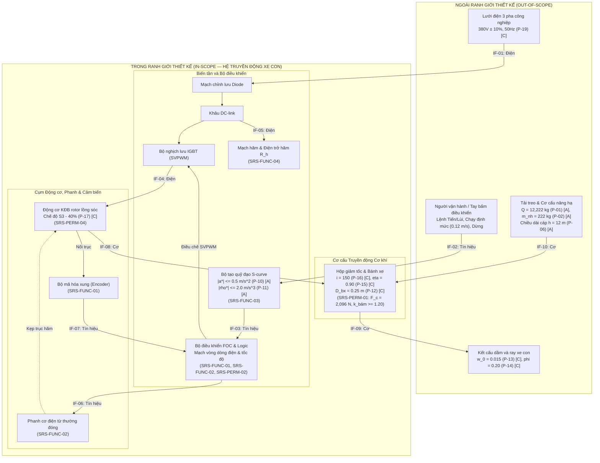
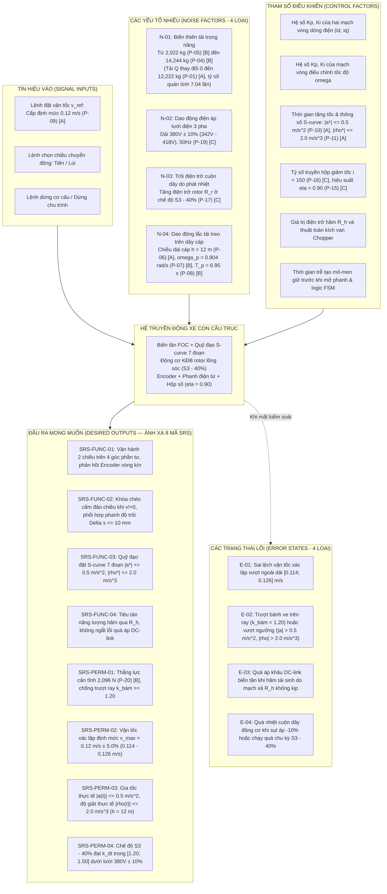

# SƠ ĐỒ RANH GIỚI (BOUNDARY DIAGRAM) VÀ SƠ ĐỒ THAM SỐ (P-DIAGRAM)

**Học phần:** Thiết kế hệ thống truyền động điện (ĐH Bách khoa Hà Nội)  
**Giảng viên hướng dẫn:** TS. Nguyễn Duy Đỉnh  
**Đề tài:** Hệ truyền động di chuyển xe con cầu trục dầm đôi (Động cơ KĐB rotor lồng sóc + Biến tần, điều khiển FOC, quỹ đạo S-curve)  
**Nhóm sinh viên thực hiện:** Nhóm 8.5-EMG (Đề bài ứng với STT 22, tham số $x = 2$)  
**Nguồn số liệu duy nhất:** `Block 1/00_Bang_thong_so_goc.md` và `Block 1/01_SRS_Baseline_A.md` (Đã duyệt)  
**Công cụ kiểm chứng:** Phân tích giải tích (A), Mô phỏng MATLAB/Simulink (S), Tra cứu catalogue (I).

---

## QUY ƯỚC QUẢN LÝ DỮ LIỆU VÀ PHƯƠNG PHÁP KIỂM CHỨNG

1. **Phân loại nguồn số liệu bắt buộc:**
   - **[A] Đề bài:** Số liệu do giảng viên giao trực tiếp trong đề bài tập dài ($x = 2$).
   - **[B] Tính toán:** Số liệu tính ra từ số liệu [A] bằng công thức cơ học / truyền động điện rõ ràng.
   - **[C] Giả định của nhóm:** Số liệu nhóm tự chọn (lấy số tròn, kèm 1 câu lý do kỹ thuật và ghi rõ mốc kiểm tra lại ở các khối sau).
2. **Phương pháp kiểm chứng:** Chỉ sử dụng Phân tích giải tích (A), Mô phỏng Simulink (S), Kiểm tra catalogue (I). Không sử dụng các phương pháp đo đạc thực nghiệm hay bàn thử phần cứng HIL ngoài khả năng của sinh viên.
3. **Tuân thủ quy chuẩn số liệu SSoT:** Sử dụng lực cản lăn tĩnh đầy tải $F_{c.\text{đầy}} = 2,096\text{ N}$ và hiệu suất cơ khí $\eta = 0.90$. Yêu cầu hãm tái sinh giữ ở mức chức năng (xả năng lượng qua điện trở hãm, bảo vệ biến tần), không ấn định cứng chi tiết điện áp DC-link 780 V. Toàn bộ sơ đồ ánh xạ thống nhất theo bộ 8 mã SRS mới (`SRS-FUNC-01..04` và `SRS-PERM-01..04`).

---

## PHẦN 1: SƠ ĐỒ RANH GIỚI HỆ THỐNG (BOUNDARY DIAGRAM)

### 1.1. Phân định phạm vi thiết kế

- **Trong ranh giới thiết kế (In-Scope — Nhóm chịu trách nhiệm tính chọn, thiết kế và mô phỏng):**
  1. *Biến tần bán dẫn:* Mạch chỉnh lưu, khâu trung gian một chiều (DC-link), bộ nghịch lưu áp IGBT điều chế SVPWM và nhánh van hãm bán dẫn kèm điện trở xả hãm $R_h$.
  2. *Hệ thống điều khiển:* Bộ tạo quỹ đạo chuyển động hình chữ S 7 đoạn (7-segment S-curve), khối điều khiển vector tựa từ thông rotor (RFOC) với các mạch vòng điều chỉnh dòng điện, tốc độ và khối logic chuyển trạng thái FSM.
  3. *Động cơ chấp hành:* Động cơ không đồng bộ 3 pha rotor lồng sóc làm việc ở chế độ ngắn hạn lặp lại S3 - 40% (P-17) [C].
  4. *Cảm biến phản hồi:* 01 Bộ mã hóa xung vòng quay (Pulse Encoder) gắn đồng trục động cơ đo tốc độ và vị trí góc rotor (0 cảm biến trên cáp treo).
  5. *Cơ cấu dừng đỗ an toàn:* Phanh cơ điện từ kiểu thường đóng (tự động đóng kẹp trục khi mất điện hoặc khi vận tốc dừng hẳn).
  6. *Cơ cấu truyền động cơ khí:* Hộp giảm tốc bánh răng trụ 3 cấp ($\eta = 0.90$, $i = 150$) và cụm bánh xe di chuyển ($D_{bx} = 0.25\text{ m}$) gắn trên khung xe con ($m_{xc} = 1,800\text{ kg}$).

- **Ngoài ranh giới thiết kế (Out-of-Scope — Môi trường ngoài và hệ thống phối thuộc, đóng vai trò điều kiện biên):**
  1. *Lưới điện 3 pha nhà xưởng:* Nguồn hạ thế công nghiệp $380\text{ V} \pm 10\%$, $50\text{ Hz}$ (P-19) [C].
  2. *Người vận hành / Tay bấm điều khiển:* Cung cấp lệnh phát động chạy Tiến/Lùi, lệnh chạy vận tốc định mức $0.12\text{ m/s}$ và lệnh dừng.
  3. *Kết cấu dầm cầu trục và ray:* Cung cấp bề mặt lăn chịu lực ($w_0 = 0.015$) và lực ma sát bám cho bánh xe dẫn hướng ($\varphi = 0.20$).
  4. *Cơ cấu nâng hạ:* Cụm tời nâng, cáp nâng và móc treo mang khối lượng $m_{nh} = 222\text{ kg}$ (P-02) [A].
  5. *Tải trọng hàng hóa nâng:* Khối lượng vật nâng định mức $Q = 12,222\text{ kg}$ (P-01) [A] treo dưới móc cáp có chiều dài tối đa $h = 12\text{ m}$ (P-06) [A].

---

### 1.2. Sơ đồ ranh giới hệ thống

---

### 1.3. Bảng phân định 10 giao diện liên kết (Interface Table)

| Mã IF | Điểm đầu → Điểm cuối | Loại | Nội dung tương tác vật lý / tín hiệu | Mã SSoT / SRS liên quan | Phương pháp KC |
| :---: | :--- | :---: | :--- | :---: | :---: |
| **IF-01** | Lưới điện 3 pha → Biến tần (Chỉnh lưu) | Điện | Cấp nguồn xoay chiều 3 pha $380\text{ V} \pm 10\%$, tần số $50\text{ Hz}$ phục vụ nắn dòng thành điện áp DC. | P-19 [C] / SRS-PERM-04 | A / I |
| **IF-02** | Tay bấm điều khiển → Bộ tạo quỹ đạo S-curve | Tín hiệu | Truyền lệnh chọn chiều di chuyển Tiến/Lùi, lệnh chạy vận tốc định mức $0.12\text{ m/s}$ và lệnh dừng. | P-09 [A] / SRS-FUNC-01, SRS-FUNC-02 | S |
| **IF-03** | Bộ tạo S-curve → Bộ điều khiển FOC | Tín hiệu | Cung cấp tín hiệu đặt tốc độ và gia tốc trơn liên tục với giới hạn $\lvert a^* \rvert \le 0.5\text{ m/s}^2$ và $\lvert \rho^* \rvert \le 2.0\text{ m/s}^3$. | P-10 [A], P-11 [A] / SRS-FUNC-03, SRS-PERM-03 | A / S |
| **IF-04** | Bộ nghịch lưu biến tần → Động cơ KĐB | Điện | Cấp điện áp xoay chiều 3 pha điều chế SVPWM với tần số và biên độ biến đổi theo thuật toán vector RFOC. | P-17 [C], P-19 [C] / SRS-FUNC-01, SRS-PERM-02, SRS-PERM-04 | S / I |
| **IF-05** | Khâu DC-link → Mạch van và Điện trở hãm | Điện | Dẫn dòng điện xả năng lượng hãm tái sinh từ DC-link qua điện trở hãm $R_h$ để bảo vệ quá áp biến tần khi giảm tốc. | SRS-FUNC-04 | A / S |
| **IF-06** | Bộ điều khiển logic → Phanh cơ điện từ | Tín hiệu | Lệnh mở cuộn hút phanh khi động cơ đã sinh đủ mô-men giữ và lệnh cắt điện đóng phanh kẹp khi tốc độ về dừng hẳn. | SRS-FUNC-02 | S |
| **IF-07** | Encoder → Bộ điều khiển FOC | Tín hiệu | Phản hồi các chuỗi xung tốc độ và góc quay trục rotor về bộ điều khiển để khép kín mạch vòng vector. | SRS-FUNC-01, SRS-PERM-02 | S / I |
| **IF-08** | Động cơ KĐB → Hộp giảm tốc | Cơ | Truyền mô-men xoắn và tốc độ quay từ trục động cơ sang trục sơ cấp của hộp số với hiệu suất $\eta = 0.90$. | P-15 [C], P-16 [C] / SRS-PERM-01 | A / S |
| **IF-09** | Hộp giảm tốc / Bánh xe ↔ Ray cầu trục | Cơ | Bánh xe thép ($D_{bx} = 0.25\text{ m}$) truyền lực kéo tiếp tuyến thắng cản tĩnh $2,096\text{ N}$ và nhận lực bám chống trượt ($k_{\text{bám}} \ge 1.20$). | P-12 [C], P-13 [C], P-14 [C], P-20 [B] / SRS-PERM-01 | A / S |
| **IF-10** | Tải nâng & Cáp treo ↔ Khung xe con | Cơ | Truyền tải trọng nâng tĩnh ($Q = 12,222\text{ kg}$, $m_{nh} = 222\text{ kg}$) và lực kéo lắc ngang do con lắc cáp $h = 12\text{ m}$ lên bánh xe. | P-01 [A], P-02 [A], P-04 [B], P-06 [A], P-07 [B], P-08 [B] / SRS-PERM-01, SRS-PERM-03 | A / S |

---

## PHẦN 2: SƠ ĐỒ THAM SỐ (P-DIAGRAM)

### 2.1. Cấu trúc tổng thể P-Diagram

Sơ đồ tham số (Parameter Diagram) mô tả mối quan hệ giữa tín hiệu đầu vào, các yếu tố nhiễu không mong muốn, các thông số thiết kế điều khiển, đầu ra mong muốn bám sát từng mã yêu cầu kỹ thuật SRS và các trạng thái lỗi cần ngăn ngừa.

---

### 2.2. Chi tiết các khối trong P-Diagram

#### A. Khối Tín hiệu vào (Signal Inputs)
- **Lệnh đặt vận tốc ($v_{ref}$):** Tín hiệu đặt tốc độ chuyển động ngang theo cấp tốc độ làm việc định mức $v_{\max} = 0.12\text{ m/s}$ (P-09) [A].
- **Lệnh chọn chiều chuyển động:** Tín hiệu logic chọn chiều quay Tiến (Forward) hoặc Lùi (Reverse) phát đi từ tay bấm điều khiển.
- **Tín hiệu an toàn và dừng cơ cấu:** Lệnh dừng chủ động theo đường dốc giảm tốc của S-curve.

#### B. Khối Tham số điều khiển (Control Factors)
- **Hệ số bộ điều khiển dòng điện ($K_{p\_i}, K_{i\_i}$):** Tham số vòng kín dòng điện $i_d, i_q$ tổng hợp theo chuẩn tối ưu module nhằm điều khiển độc lập từ thông và mô-men quay.
- **Hệ số bộ điều khiển tốc độ ($K_{p\_\omega}, K_{i\_\omega}$):** Tham số vòng kín tốc độ góc tổng hợp theo chuẩn tối ưu đối xứng nhằm đảm bảo hệ thống bám tốc độ và triệt tiêu sai lệch tĩnh nhờ khâu tích phân.
- **Tham số quy hoạch quỹ đạo S-curve 7 đoạn:** Giới hạn gia tốc đặt $\lvert a^* \rvert \le 0.5\text{ m/s}^2$ (P-10) [A] và độ giật đặt $\lvert \rho^* \rvert \le 2.0\text{ m/s}^3$ (P-11) [A] giúp chuyển động êm thuận không có xung giật vô hạn.
- **Tỷ số truyền và hiệu suất cơ khí ($i = 150$ (P-16) [C], $\eta = 0.90$ (P-15) [C]):** Biến đổi mô-men và tốc độ từ trục động cơ sang trục bánh xe xe con.
- **Giá trị điện trở hãm ($R_h$) và van hãm Chopper:** Đảm bảo khả năng tiêu tán nhiệt an toàn động năng hãm, bảo vệ tụ điện DC-link và van IGBT biến tần.
- **Thời gian trễ tạo mô-men giữ và logic FSM:** Đảm bảo động cơ sinh đủ mô-men trước khi mở phanh cơ để chống tụt/trôi tải, và kẹp phanh khi xe đã dừng hẳn.

#### C. Khối Đầu ra mong muốn (Desired Outputs — Ánh xạ 8 mã SRS)
Mỗi đầu ra mong muốn của hệ thống được kiểm soát trực tiếp bởi một mã yêu cầu kỹ thuật trong `SRS Baseline A`:
1. **SRS-FUNC-01:** Hệ thống vận hành 2 chiều Tiến/Lùi ổn định trên 4 góc phần tư, sử dụng tín hiệu từ 01 Encoder khép kín mạch vòng điều khiển.
2. **SRS-FUNC-02:** Mạch khóa chéo cấm đảo chiều khi $v \ne 0\text{ m/s}$; phanh cơ chỉ mở khi có mô-men giữ và tự động đóng khi dừng hẳn với độ trôi $\Delta s \le \pm 10\text{ mm}$ (danh định không trôi $\Delta s = 0$).
3. **SRS-FUNC-03:** Quỹ đạo đặt tốc độ tham chiếu biến thiên liên tục theo đường cong chữ S 7 đoạn với $\lvert a^*(t) \rvert \le 0.5\text{ m/s}^2$ và $\lvert \rho^*(t) \rvert \le 2.0\text{ m/s}^3$.
4. **SRS-FUNC-04:** Năng lượng hãm tái sinh được tiêu tán an toàn qua điện trở xả hãm $R_h$, biến tần duy trì vận hành bình thường không báo lỗi quá áp DC-link.
5. **SRS-PERM-01:** Động cơ sinh đủ lực kéo thắng lực cản lăn tĩnh đầy tải $F_{c.\text{đầy}} = 2,096\text{ N}$ (P-20) [B], vận hành an toàn ở cả trạng thái đầy tải $14,244\text{ kg}$ (P-04) [B] và không tải $2,022\text{ kg}$ (P-05) [B] mà không trượt ray ($k_{\text{bám}} \ge 1.20$ với $\varphi = 0.20$ (P-14) [C]).
6. **SRS-PERM-02:** Vận tốc dài xác lập thực tế của xe con đạt giá trị định mức $v_{\max} = 0.12\text{ m/s} \pm 5.0\%$ ($[0.114;\ 0.126]\text{ m/s}$) theo cả hai chiều di chuyển.
7. **SRS-PERM-03:** Gia tốc thực tế $\lvert a(t) \rvert \le 0.5\text{ m/s}^2$ (P-10) [A] và độ giật thực tế $\lvert \rho(t) \rvert \le 2.0\text{ m/s}^3$ (P-11) [A] khi treo tải ở chiều cao nâng lớn nhất $h = 12\text{ m}$ (P-06) [A].
8. **SRS-PERM-04:** Động cơ và biến tần định cỡ thỏa mãn hệ số dự trữ phát nhiệt $k_{dt} \in [1.20;\ 1.50]$ ở chế độ làm việc ngắn hạn lặp lại S3 - 40% (P-17) [C] dưới nguồn lưới dao động $380\text{ V} \pm 10\%$ (P-19) [C] mà không bị quá nhiệt cuộn dây.

#### D. Khối Yếu tố nhiễu (Noise Factors — 4 loại)
- **N-01 (Biến thiên tải trọng nâng):** Khối lượng toàn hệ thống thay đổi từ trạng thái không tải $m_{\text{tĩnh}} = 2,022\text{ kg}$ (P-05) [B] đến đầy tải $M_\Sigma = 14,244\text{ kg}$ (P-04) [B], tương ứng tải hàng hóa $Q$ thay đổi từ $0\text{ kg}$ đến $12,222\text{ kg}$ (P-01) [A] (quán tính biến thiên xấp xỉ $7.04\text{ lần}$).
- **N-02 (Dao động điện áp lưới cấp):** Điện áp xoay chiều 3 pha dao động trong dải $380\text{ V} \pm 10\%$ ($342\text{ V} \div 418\text{ V}$), tần số $50\text{ Hz}$ (P-19) [C], gây ảnh hưởng trực tiếp đến điện áp khâu DC-link và từ thông stato.
- **N-03 (Nhiệt độ cuộn dây làm trôi điện trở):** Phát nhiệt trong chu trình làm việc ngắn hạn lặp lại S3 - 40% (P-17) [C] làm thay đổi điện trở rotor $R_r$ (và stator $R_s$), làm sai lệch vị trí vector từ thông nếu không có bù trôi nhiệt.
- **N-04 (Dao động lắc tải treo trên cáp):** Dao động con lắc của cụm tải treo với chiều dài cáp cực đại $h = 12\text{ m}$ (P-06) [A], tương ứng tần số góc riêng $\omega_p = 0.904\text{ rad/s}$ (P-07) [B] và chu kỳ lắc riêng $T_p = 6.95\text{ s}$ (P-08) [B], tạo lực kéo phản hồi dao động lên xe con.

#### E. Khối Trạng thái lỗi (Error States — 4 loại)
- **E-01 (Sai lệch vận tốc xác lập vượt ngoài dải cho phép):** Vận tốc dài xác lập thực tế không đạt hoặc vượt ngoài dải $[0.114;\ 0.126]\text{ m/s}$ khi chuyển đổi tải trọng giữa không tải ($2,022\text{ kg}$) và đầy tải ($14,244\text{ kg}$).
- **E-02 (Trượt bánh xe trên ray hoặc giật cơ khí):** Lực kéo gia tốc vượt quá giới hạn bám ray ($k_{\text{bám}} < 1.20$ tại $\varphi = 0.20$) dẫn đến trượt quay bánh xe, hoặc gia tốc và độ giật thực tế vượt quá giới hạn ($\lvert a \rvert > 0.5\text{ m/s}^2$, $\lvert \rho \rvert > 2.0\text{ m/s}^3$).
- **E-03 (Quá áp khâu DC-link khi hãm tái sinh):** Năng lượng hãm từ động cơ trả về quá nhanh mà mạch van và điện trở hãm $R_h$ không tiêu tán kịp, khiến biến tần ngắt mạch lực để tự bảo vệ.
- **E-04 (Quá nhiệt cuộn dây động cơ):** Động cơ phát nhiệt vượt quá giới hạn cách điện khi nguồn điện lưới sụt áp $-10\%$ ($342\text{ V}$) hoặc khi tần suất chu kỳ làm việc thực tế vượt quá mức định mức S3 - 40% (P-17) [C].

---

## PHẦN 3: BẢNG TRUY VẾT VÀ TÀI LIỆU THAM KHẢO

### 3.1. Bảng đối chiếu thông số gốc (SSoT) với Sơ đồ Ranh giới & P-Diagram

| Mã | Thông số vật lý | Giá trị chuẩn hóa | Nhãn loại | Vai trò trong Boundary / P-Diagram | Ánh xạ mã SRS mới |
| :---: | :--- | :---: | :---: | :--- | :---: |
| **P-01** | Tải trọng nâng định mức | 12,222 kg | **[A]** | Biên ngoài (Tải treo); Nhiễu N-01; Đầu vào tính quán tính tải | SRS-PERM-01 |
| **P-02** | Khối lượng cơ cấu nâng hạ | 222 kg | **[A]** | Biên ngoài (Cơ cấu nâng); Nhiễu N-01; Tính tổng khối lượng | SRS-PERM-01 |
| **P-03** | Khối lượng bản thân xe con | 1,800 kg | **[C]** | Trong biên (Khung xe); Tính quán tính tịnh tiến; Kiểm tra lại ở Khối 2 | SRS-PERM-01 |
| **P-04** | Tổng khối lượng đầy tải | 14,244 kg | **[B]** | Tương tác IF-10; Cận trên nhiễu N-01; Điều kiện thử nghiệm | SRS-PERM-01 |
| **P-05** | Tổng khối lượng không tải | 2,022 kg | **[B]** | Cận dưới nhiễu N-01; Điều kiện thử nghiệm không tải | SRS-PERM-01 |
| **P-06** | Chiều cao nâng lớn nhất | 12 m | **[A]** | Biên ngoài (Cáp treo); Nhiễu N-04; Khống chế dao động | SRS-PERM-03 |
| **P-07** | Tần số dao động riêng cáp | 0.904 rad/s | **[B]** | Nhiễu động học N-04; Cơ sở định thời quỹ đạo S-curve | SRS-FUNC-03, SRS-PERM-03 |
| **P-08** | Chu kỳ dao động riêng cáp | 6.95 s | **[B]** | Nhiễu động học N-04; Cơ sở định thời quỹ đạo S-curve | SRS-FUNC-03, SRS-PERM-03 |
| **P-09** | Vận tốc di chuyển lớn nhất | 0.12 m/s | **[A]** | Tín hiệu vào IF-02; Đầu ra mong muốn | SRS-PERM-02 |
| **P-10** | Gia tốc cực đại cho phép | 0.5 m/s$^2$ | **[A]** | Tham số điều khiển S-curve C3; Đầu ra mong muốn; Chặn lỗi E-02 | SRS-FUNC-03, SRS-PERM-03 |
| **P-11** | Độ giật cực đại cho phép | 2.0 m/s$^3$ | **[A]** | Tham số điều khiển S-curve C3; Đầu ra mong muốn; Chặn lỗi E-02 | SRS-FUNC-03, SRS-PERM-03 |
| **P-12** | Đường kính bánh xe | 0.25 m | **[C]** | Giao diện cơ khí IF-09; Quy đổi tốc độ; Kiểm tra lại ở Khối 2 | SRS-PERM-01, SRS-PERM-02 |
| **P-13** | Suất cản lăn tương đương | 0.015 | **[C]** | Biên ray IF-09; Tính lực cản tĩnh P-20; Kiểm tra lại ở Khối 2 | SRS-PERM-01 |
| **P-14** | Hệ số ma sát bám ray | 0.20 | **[C]** | Biên ray IF-09; Kiểm tra chống trượt bánh xe ($k_{\text{bám}} \ge 1.20$) | SRS-PERM-01 |
| **P-15** | Hiệu suất cơ khí hộp số | 0.90 | **[C]** | Giao diện truyền lực IF-08; Quy đổi mô-men; Kiểm tra lại ở Khối 2 | SRS-PERM-01 |
| **P-16** | Tỷ số truyền sơ bộ hộp số | 150 | **[C]** | Tham số điều khiển cơ khí C4; Quy đổi tốc độ; Kiểm tra lại ở Khối 2 | SRS-PERM-01, SRS-PERM-02 |
| **P-17** | Chế độ làm việc định mức | S3 - 40% | **[C]** | Ranh giới động cơ; Nhiễu nhiệt N-03; Đầu ra mong muốn | SRS-PERM-04 |
| **P-18** | Gia tốc trọng trường | 9.81 m/s$^2$ | **[C]** | Tính lực cản tĩnh và tần số con lắc; Quy chuẩn Việt Nam | SRS-PERM-01, SRS-PERM-03 |
| **P-19** | Nguồn điện xoay chiều cấp | 380V ± 10%, 50Hz | **[C]** | Giao diện nguồn IF-01; Nhiễu N-02; Đầu ra mong muốn | SRS-PERM-04 |
| **P-20** | Lực cản chuyển động tĩnh đầy tải | 2,096 N | **[B]** | Giao diện cơ IF-09; Đầu ra mong muốn lực kéo | SRS-PERM-01 |

---

### 3.2. Danh mục tài liệu tham khảo kỹ thuật

1. Bộ môn Tự động hóa Xí nghiệp Công nghiệp, *Đề bài tập lớn môn Thiết kế hệ truyền động điện (Học kỳ 2023.1, Đề 0~9, STT 22, tham số $x = 2$)*, ĐH Bách khoa Hà Nội, 2023.
2. TS. Nguyễn Duy Đỉnh, *Bài giảng Thiết kế hệ truyền động điện (Bài 4: Hệ truyền động cơ cấu di chuyển xe con cầu trục)*, Trường ĐH Bách khoa Hà Nội, 2021.
3. PGS.TS. Bùi Quốc Khánh, TS. Nguyễn Phùng Quang, *Điều chỉnh tự động truyền động điện*, NXB Khoa học và Kỹ thuật, Hà Nội.
4. Bộ Khoa học và Công nghệ, *TCVN 4244:2005: Thiết bị nâng - Thiết kế, chế tạo và kiểm tra kỹ thuật*, Hà Nội, 2005.
5. Tiêu chuẩn quốc tế IEC 60034-1, *Rotating electrical machines - Part 1: Rating and performance* (Quy chuẩn chế độ làm việc ngắn hạn lặp lại S3).
6. Tiêu chuẩn quốc tế ISO/IEC/IEEE 29148:2018, *Systems and software engineering - Requirements engineering*.
