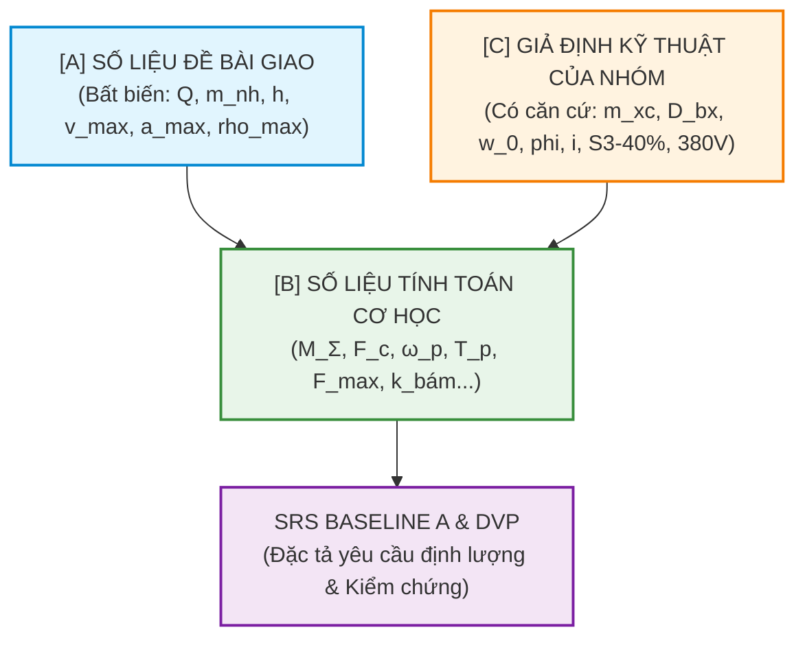

# BÁO CÁO GIẢI TRÌNH KỸ THUẬT TOÀN DIỆN KHỐI 1 (SRR)
## HỆ TRUYỀN ĐỘNG CƠ CẤU DI CHUYỂN XE CON CẦU TRỤC DẦM ĐÔI
**Học phần:** Thiết kế hệ thống truyền động điện (ĐH Bách khoa Hà Nội)  
**Giảng viên hướng dẫn:** TS. Nguyễn Duy Đỉnh  
**Nhóm sinh viên thực hiện:** Nhóm 8.5-EMG (Đề số 8, STT 22, tham số $x = 2$)  
**Tiêu chuẩn áp dụng:** NASA SP-2016-6105 / ISO/IEC/IEEE 29148 / TCVN 4244:2005 / IEC 61800-2 / IEC 60034-1

> **Ghi chú hiệu đính 26/10/2026 (Người dùng duyệt nhóm A):** các chỗ $k_{dt}$ trong báo cáo này đã đổi sang $k_{dt} \ge 1.20$ theo SRS Baseline A.1 (CR-01, bỏ cận trên 1.50); tiêu chí FAIL của DV-08 theo CR-02. Phần còn lại giữ nguyên như tại cổng SRR-EVT.

---

# MỤC LỤC
1. [BẢN ĐỒ PHẢ HỆ VÀ NGUỒN GỐC TỪNG CON SỐ (SSoT)](#1-bản-đồ-phả-hệ-và-nguồn-gốc-từng-con-số-ssot)
   - 1.1. Nguyên tắc phân loại 3 tầng số liệu ([A], [B], [C])
   - 1.2. Nhóm [A] — Số liệu Đề bài giao trực tiếp ($x = 2$)
   - 1.3. Nhóm [C] — Giả định kỹ thuật của nhóm & Căn cứ thực tế
   - 1.4. Nhóm [B] — Các công thức giải tích tính toán chi tiết từng bước
2. [BẢN CHẤT 3 PHƯƠNG PHÁP KIỂM CHỨNG (A, S, I)](#2-bản-chất-3-phương-pháp-kiểm-chứng-a-s-i)
   - 2.1. Phân biệt rành mạch: A là gì, S là gì, I là gì?
   - 2.2. Triết lý kỹ sư: "Đo trong mô phỏng thì dễ, ngoài thực tế mới khó"
   - 2.3. Tại sao lại có các tổ hợp A+S và A+I?
3. [ĐẶC TẢ YÊU CẦU HỆ THỐNG SRS VÀ KẾ HOẠCH DVP ĐỒNG BỘ](#3-đặc-tả-yêu-cầu-hệ-thống-srs-và-kế-hoạch-dvp-đồng-bộ)
   - 3.1. Bảng 8 yêu cầu kỹ thuật SRS Baseline A (4 FUNC + 4 PERM)
   - 3.2. Bảng 4 kịch bản mô phỏng vận hành (TS-01 ÷ TS-04) và 4 bài giải tích (AN-01 ÷ AN-04)
   - 3.3. Ma trận kế hoạch kiểm chứng thiết kế DVP&R Level 0
4. [CẨM NANG VẤN ĐÁP BẢO VỆ CỔNG SRR TRƯỚC HỘI ĐỒNG](#4-cẩm-nang-vấn-đáp-bảo-vệ-cổng-srr-trước-hội-đồng)
   - 4.1. Câu hỏi về nguồn gốc số liệu và tự trọng xe con
   - 4.2. Câu hỏi về hiện tượng lắc tải và quỹ đạo S-curve
   - 4.3. Câu hỏi về điều kiện chống trượt bánh xe trên ray
   - 4.4. Câu hỏi về chế độ nhiệt động cơ S3 - 40%

---

# 1. BẢN ĐỒ PHẢ HỆ VÀ NGUỒN GỐC TỪNG CON SỐ (SSoT)

Mọi sai lầm của sinh viên khi làm đồ án kỹ thuật đều bắt đầu từ việc **dùng số liệu tùy tiện, không rõ nguồn gốc (traceability)**. Để chuẩn hóa theo quy trình Kỹ thuật Hệ thống NASA, nhóm thiết lập **Bảng dữ liệu gốc duy nhất (Single Source of Truth - SSoT)** với quy tắc phân loại 3 tầng nghiêm ngặt:



---

### 1.1. Nhóm [A] — Số liệu Đề bài giao trực tiếp

Đề bài tập lớn môn Thiết kế Hệ truyền động điện (Đề số 8: Cơ cấu di chuyển xe con cầu trục, STT 22 của sinh viên Nghiêm Trọng Đông) quy định công thức theo tham số $x = 2$:

* **P-01: Tải trọng nâng định mức ($Q$):**
  $$\text{Đề bài quy định dạng } 1x,xxx\text{ kg} \xrightarrow{x=2} Q = 12,222\text{ kg} \approx 12.22\text{ tấn}$$
* **P-02: Khối lượng cụm cơ cấu nâng hạ ($m_{nh}$):**
  $$\text{Đề bài quy định dạng } 2xx\text{ kg} \xrightarrow{x=2} m_{nh} = 222\text{ kg}$$
  *(Bao gồm: tang cuốn cáp, động cơ nâng, phanh cơ nâng, cụm móc treo và cáp).*
* **P-06: Chiều cao nâng lớn nhất / Chiều dài cáp cực đại ($h$):**
  $$\text{Đề bài quy định dạng } 1x\text{ m} \xrightarrow{x=2} h = 12\text{ m}$$
* **P-09: Vận tốc di chuyển ngang lớn nhất ($v_{\max}$):**
  $$\text{Đề bài quy định dạng } 0.1x\text{ m/s} \xrightarrow{x=2} v_{\max} = 0.12\text{ m/s} \quad (= 7.2\text{ m/phút})$$
* **P-10: Gia tốc cực đại cho phép ($a_{\max}$):**
  $$a_{\max} = 0.50\text{ m/s}^2 \quad (\text{Giới hạn trên nhằm bảo vệ kết cấu cơ khí})$$
* **P-11: Độ giật cực đại cho phép ($\rho_{\max}$):**
  $$\rho_{\max} = 2.00\text{ m/s}^3 \quad (\rho = \frac{\text{d}a}{\text{d}t}, \text{ngăn chặn xung lực giật vô hạn})$$

---

### 1.2. Nhóm [C] — Giả định kỹ thuật của nhóm & Căn cứ thực tế

Những thông số đề bài chưa cho bắt buộc kỹ sư phải tự chọn. Nhưng **chọn không phải là đoán mò**, mà phải có căn cứ tiêu chuẩn, bài giảng và catalogue công nghiệp:

* **P-03: Khối lượng bản thân xe con ($m_{xc} = 1,800\text{ kg}$):**
  * *Căn cứ kỹ thuật:* Theo Giáo trình Thiết bị nâng chuyển và Catalogue pa lăng dầm đôi tải trọng $12 \div 15\text{ tấn}$ của các hãng Sungdo (Hàn Quốc), KG-Cranes, Demag DR (Đức), khối lượng khung xe con mang cụm di chuyển và cụm tời nâng thường chiếm khoảng $12\% \div 18\%$ tải trọng nâng định mức:
    $$m_{xc} \approx 15\% \times Q = 0.15 \times 12,222 \approx 1,833\text{ kg} \xrightarrow{\text{chọn số tròn chuẩn}} m_{xc} = 1,800\text{ kg}$$
  * *Mốc kiểm tra lại:* Sẽ đối chiếu lại khi chọn mã pa lăng cụ thể ở Khối 2.
* **P-12: Đường kính bánh xe di chuyển ($D_{bx} = 0.25\text{ m} = 250\text{ mm}$):**
  * *Căn cứ kỹ thuật:* Xe con dầm đôi 4 bánh, tổng tải trọng trục khoảng $14.2 / 4 \approx 3.55\text{ tấn/bánh}$. Theo tiêu chuẩn TCVN 4244:2005 và dãy kích thước bánh xe công nghiệp tiêu chuẩn (DIN 536), đường kính $250\text{ mm}$ là kích thước tiêu chuẩn thông dụng nhất.
* **P-13: Suất cản lăn riêng tương đương ($w_0 = 0.015$):**
  * *Căn cứ kỹ thuật:* Bánh xe thép lăn trên ray thép có ổ bi/ổ đũa đỡ trục. Theo Bài giảng TĐĐ của TS. Nguyễn Duy Đỉnh (Bài 4, tr. 41) và TCVN 4244, suất cản lăn của xe con cầu trục nằm trong dải $w_0 = 0.012 \div 0.020$. Nhóm chọn giá trị trung bình chuẩn $w_0 = 0.015$ ($15\text{ kg/tấn}$ hay tương đương $15\text{ N/kN}$).
  * *Lưu ý quan trọng:* Tuyệt đối không nhầm lẫn suất cản lăn $w_0 = 0.015$ với hệ số ma sát trượt!
* **P-14: Hệ số bám dính bánh thép trên ray ($\varphi = 0.20$):**
  * *Căn cứ kỹ thuật:* Theo Bài giảng TĐĐ của TS. Nguyễn Duy Đỉnh (Bài 4, tr. 43) và TCVN 4244, hệ số ma sát bám của bánh xe thép trên ray thép khô trong nhà xưởng được lấy chuẩn là $\varphi = 0.20$.
* **P-15: Hiệu suất truyền động cơ khí ($\eta = 0.90$):**
  * *Căn cứ kỹ thuật:* Cơ cấu gồm hộp giảm tốc bánh răng trụ 3 cấp ngâm dầu ($\eta_{hgt} \approx 0.94$), 2 khớp nối trục ($\eta_{kn} \approx 0.99^2$) và 4 ổ lăn đỡ bánh xe ($\eta_{ol} \approx 0.99^4$). Hiệu suất toàn hệ thống:
    $$\eta = 0.94 \times 0.98 \times 0.96 \approx 0.885 \div 0.91 \xrightarrow{\text{chọn}} \eta = 0.90$$
* **P-16: Tỷ số truyền sơ bộ hộp số ($i = 150$):**
  * *Căn cứ kỹ thuật:* Vận tốc bánh xe $\omega_{bx} = 9.17\text{ vg/ph}$. Với động cơ không đồng bộ 4 cực tốc độ danh định khoảng $1440\text{ vg/ph}$, tỷ số truyền cần thiết là $i = 1440 / 9.17 \approx 157 \xrightarrow{\text{chọn sơ bộ}} i = 150$.
* **P-17: Chế độ làm việc định mức ($S3 - 40\%$):**
  * *Căn cứ kỹ thuật:* Tiêu chuẩn quốc tế IEC 60034-1 và TCVN 4244 quy định cơ cấu xe con cầu trục làm việc ở chế độ ngắn hạn lặp lại $S3$ với hệ số tiếp điện tương đối chu kỳ $CD = 40\%$ (chu kỳ chuẩn 10 phút: chạy 4 phút, nghỉ 6 phút).
* **P-18: Gia tốc trọng trường ($g = 9.81\text{ m/s}^2$):** Chuẩn đo lường tại Việt Nam.
* **P-19: Nguồn điện lưới cấp vào ($U_{\text{lưới}} = 380\text{V} \pm 10\%, 50\text{Hz}$):** Lưới hạ thế công nghiệp 3 pha chuẩn Việt Nam (dao động trong dải $342\text{V} \div 418\text{V}$).

---

### 1.3. Nhóm [B] — Các công thức giải tích tính toán chi tiết từng bước

Từ các thông số [A] và [C], nhóm tính toán giải tích ra toàn bộ các biến động học và động lực học cơ sở:

#### 1. Tổng khối lượng toàn phần (P-04) và không tải (P-05)
* Tổng khối lượng đầy tải:
  $$M_{\Sigma} = Q + m_{nh} + m_{xc} = 12,222 + 222 + 1,800 = \mathbf{14,244\text{ kg}} \quad (\approx 14.24\text{ tấn})$$
* Tổng khối lượng không tải (chỉ có xe con và cụm móc nâng):
  $$m_{\text{tĩnh}} = m_{xc} + m_{nh} = 1,800 + 222 = \mathbf{2,022\text{ kg}} \quad (\approx 2.02\text{ tấn})$$
* **Dải biến thiên quán tính:** $M_{\Sigma} / m_{\text{tĩnh}} = 14,244 / 2,022 \approx \mathbf{7.04\text{ lần}}$.  
  *(Điều này giải thích tại sao phải dùng điều khiển vector FOC tựa từ thông để thích nghi với quán tính thay đổi tới hơn 7 lần).*

#### 2. Động học con lắc cáp treo (P-07, P-08)
Khối hàng $Q = 12,222\text{ kg}$ treo dưới dây cáp có chiều dài lớn nhất $h = 12\text{ m}$ tạo thành một con lắc đơn toán học:
* Tần số góc dao động riêng của tải:
  $$\omega_p = \sqrt{\frac{g}{h}} = \sqrt{\frac{9.81}{12}} = \sqrt{0.8175} \approx \mathbf{0.904\text{ rad/s}}$$
* Chu kỳ dao động riêng con lắc cáp:
  $$T_p = \frac{2\pi}{\omega_p} = \frac{2\pi}{0.904} \approx \mathbf{6.95\text{ giây}}$$

#### 3. Tốc độ quay của bánh xe di chuyển
Với vận tốc di chuyển dài $v_{\max} = 0.12\text{ m/s}$ và bán kính bánh xe $R_{bx} = D_{bx} / 2 = 0.125\text{ m}$:
* Tốc độ góc bánh xe:
  $$\omega_{bx} = \frac{v_{\max}}{R_{bx}} = \frac{0.12}{0.125} = \mathbf{0.96\text{ rad/s}}$$
* Vòng quay bánh xe:
  $$n_{bx} = \frac{60 \cdot \omega_{bx}}{2\pi} = \frac{60 \cdot 0.96}{2\pi} \approx \mathbf{9.17\text{ vòng/phút}}$$

#### 4. Lực cản chuyển động tĩnh danh định (P-20)
Khi xe con di chuyển xác lập ở vận tốc $v_{\max}$, lực cản lăn ma sát tĩnh trên đường ray gồm:
* Khi mang đầy tải $14,244\text{ kg}$:
  $$F_{c.\text{đầy}} = M_{\Sigma} \cdot g \cdot w_0 = 14,244 \times 9.81 \times 0.015 = 2,095.88\text{ N} \approx \mathbf{2,096\text{ N}}$$
* Khi chạy không tải $2,022\text{ kg}$:
  $$F_{c.\text{không}} = m_{\text{tĩnh}} \cdot g \cdot w_0 = 2,022 \times 9.81 \times 0.015 = 297.5\text{ N} \approx \mathbf{298\text{ N}}$$
* Công suất cản tĩnh yêu cầu trên vành bánh xe (chưa tính hiệu suất):
  $$P_{c.\text{tĩnh}} = F_{c.\text{đầy}} \cdot v_{\max} = 2,096 \times 0.12 \approx \mathbf{251.5\text{ W}} \quad (\approx 0.25\text{ kW})$$

#### 5. Lực kéo quán tính và Lực kéo cực đại khi tăng tốc
Trong giai đoạn tăng tốc với gia tốc cực đại $a_{\max} = 0.5\text{ m/s}^2$:
* Lực quán tính của toàn bộ khối đầy tải:
  $$F_{qt} = M_{\Sigma} \cdot a_{\max} = 14,244 \times 0.50 = \mathbf{7,122\text{ N}}$$
* Tổng lực kéo tiếp tuyến cực đại trên vành bánh xe:
  $$F_{\max} = F_{c.\text{đầy}} + F_{qt} = 2,096 + 7,122 = \mathbf{9,218\text{ N}} \quad (\approx 9.22\text{ kN})$$
* Công suất đỉnh tức thời khi kết thúc giai đoạn tăng tốc:
  $$P_{\max} = F_{\max} \cdot v_{\max} = 9,218 \times 0.12 \approx \mathbf{1,106\text{ W}} \quad (\approx 1.11\text{ kW})$$

#### 6. Kiểm tra điều kiện bám chống trượt bánh xe trên ray
Xe con có 4 bánh xe, trong đó có **2 bánh chủ động** (nhận mô-men từ động cơ) và **2 bánh bị động**.
* Trọng lượng đè lên 2 bánh xe chủ động (giả định phân bố đều $50\%$):
  $$N_{\text{bám}} = \frac{M_{\Sigma} \cdot g}{2} = \frac{14,244 \times 9.81}{2} = \mathbf{69,867\text{ N}}$$
* Lực bám ma sát cực đại giữa bánh xe chủ động và ray thép ($\varphi = 0.20$):
  $$F_{\text{bám}} = \varphi \cdot N_{\text{bám}} = 0.20 \times 69,867 = \mathbf{13,973\text{ N}}$$
* Hệ số an toàn bám chống trượt khi tăng tốc:
  $$k_{\text{bám}} = \frac{F_{\text{bám}}}{F_{\max}} = \frac{13,973}{9,218} \approx \mathbf{1.516} \ge \mathbf{1.20} \quad \implies \textbf{THỎA MÃN ĐIỀU KIỆN CHỐNG TRƯỢT}$$
  *(Tiêu chuẩn TCVN 4244 yêu cầu hệ số an toàn bám $k_{\text{bám}} \ge 1.20$).*

---

# 2. BẢN CHẤT 3 PHƯƠNG PHÁP KIỂM CHỨNG (A, S, I)

### 2.1. Phân biệt rành mạch: A là gì, S là gì, I là gì?

Nhiều sinh viên nhầm lẫn rằng "cứ mở máy tính lên là mô phỏng". Trong kỹ thuật hệ thống chuẩn mực, 3 phương pháp này có ranh giới hoàn toàn rạch ròi:

```
┌────────────────────────────────────────────────────────────────────────────────────────┐
│                        BA PHƯƠNG PHÁP KIỂM CHỨNG CHUẨN CỦA NHÓM                        │
├──────────────────────────┬─────────────────────────────┬───────────────────────────────┤
│ A – PHÂN TÍCH GIẢI TÍCH  │ S – MÔ PHỎNG SỐ HỌC         │ I – SOÁT XÉT CATALOGUE        │
│ (Analysis)               │ (Simulation)                │ (Inspection)                  │
├──────────────────────────┼─────────────────────────────┼───────────────────────────────┤
│ • Dùng công thức toán học│ • Dùng MATLAB/Simulink      │ • Dùng tài liệu kỹ thuật      │
│   cơ học & truyền động.  │   giải hệ phương trình vi   │   được chứng nhận của hãng sản│
│ • Tính trên giấy / Excel.│   phân phi tuyến theo t.    │   xuất (Demag, ABB, Siemens). │
│ • Cho ra con số xác lập, │ • Cho ra đồ thị đáp ứng quá │ • Cho ra các ngưỡng cam kết:  │
│   công suất danh định,   │   độ thời gian thực: v(t),  │   công suất nhiệt định mức,   │
│   hệ số an toàn tĩnh.    │   a(t), ρ(t), i(t), Udc(t). │   cấp cách điện, dải điện áp. │
└──────────────────────────┴─────────────────────────────┴───────────────────────────────┘
```

---

### 2.2. Triết lý kỹ sư: "Đo trong mô phỏng thì dễ, ngoài thực tế mới khó"

Đây là câu nói cốt tử mà Thầy Đỉnh luôn muốn sinh viên phải thấu hiểu. Giữa mô hình phần mềm và cỗ máy sắt chạy ngoài xưởng có một khoảng cách khổng lồ:

#### 1. Bài toán đo Gia tốc $a(t)$ và Độ giật $\rho(t)$:
* *Trong Simulink (Dễ):* Bạn chỉ cần kéo khối `Derivative` (đạo hàm bậc 1 của vận tốc ra gia tốc, đạo hàm bậc 2 ra độ giật).
* *Ngoài thực tế (Cực khó & Nguy hiểm):* Nếu lấy đạo hàm tín hiệu xung từ Encoder, nhiễu răng cưa số sẽ bị phóng đại lên hàng triệu lần, khiến độ giật tính ra nhảy loạn xạ hàng nghìn $\text{m/s}^3$!
  * **Giải pháp thực tế:** Phải lắp cảm biến gia tốc công nghiệp MEMS (Accelerometer) gắn trực tiếp trên dầm xe con, hoặc tín hiệu đo tốc độ phải đi qua **Bộ lọc thông thấp (Low-pass Filter)** trước khi xử lý.

#### 2. Bài toán đo Mô-men xoắn $M(t)$ và Lực kéo:
* *Trong Simulink (Dễ):* Khối động cơ cấp sẵn tín hiệu nội tại $T_e$.
* *Ngoài thực tế (Rất tốn kém):* Không ai gắn được cảm biến mô-men xoay (Torque Transducer) trên trục đang quay của xe con vì đắt và dễ gãy.
  * **Giải pháp thực tế:** Biến tần FOC sử dụng **mô hình toán quan sát từ thông (Flux Observer)** ước lượng mô-men qua dòng stator $i_{sq}$ thực tế, hoặc gắn Loadcell đo lực căng tại điểm tỳ hộp số.

#### 3. Bài toán đo Quá nhiệt Động cơ ở chế độ S3 - 40%:
* *Trong Simulink (Không ai mô phỏng nhiệt chi tiết):* Mô hình nhiệt đòi hỏi tính toán truyền nhiệt dẫn - đối lưu phức tạp trong rãnh stator theo chu kỳ 10 phút.
* *Ngoài thực tế:* Nhà sản xuất đã cấy sẵn **cảm biến nhiệt điện trở PT100 hoặc thermistor PTC** sâu trong cuộn dây động cơ (chuẩn IEC 60034-1), đưa tín hiệu về chân analog của biến tần để ngắt bảo vệ khi vượt quá cấp cách điện (ví dụ Class F: $155^\circ\text{C}$).

---

### 2.3. Tại sao lại có các tổ hợp A+S và A+I?

* **Tại sao kiểm tra Chống trượt ray lại là `A + S`?**  
  Vì mô hình cơ học Simulink của sinh viên **không mô phỏng động học trượt bánh vi mô (Micro-slip)**. Do đó:
  1. *Simulink (S)* chạy mô phỏng chu trình tăng tốc để trích xuất ra lực kéo động lực học cực đại $F_{\max} \approx 9,218\text{ N}$.
  2. *Giải tích (A)* lấy giá trị $F_{\max}$ này chia cho lực bám tĩnh cực đại $F_{\text{bám}} = 13,973\text{ N}$ để kết luận $k_{\text{bám}} = 1.516 \ge 1.20$ (**ĐẠT**).
* **Tại sao Quỹ đạo S-curve lại là `A + S`?**
  1. *Giải tích (A)* lập phương trình toán 7 đoạn hình thang gia tốc trên Excel, tính ra các mốc thời gian $t_1 \div t_7$.
  2. *Mô phỏng (S)* nạp phương trình này vào khối tạo lượng đặt Simulink để kiểm chứng xem tốc độ thực tế của xe con có bám sát lượng đặt mà không bị vọt lố hay giật cơ học không.
* **Tại sao Chế độ nhiệt $S3 - 40\%$ lại là `A + I`?**  
  Nhóm không có bàn thử đốt nóng động cơ thực tế. Vì vậy:
  1. *Giải tích (A)* tính ra công suất phát nhiệt tương đương $P_{\text{đt}}$ theo đồ thị phụ tải tĩnh và động.
  2. *Tra cứu Catalogue (I)* chọn mã động cơ có công suất định mức $P_{\text{đm}} \ge k_{dt} \cdot P_{\text{đt}}$ (với $k_{dt} \ge 1.20$) từ tài liệu chính hãng có chứng nhận IEC 60034-1.

---

# 3. ĐẶC TẢ YÊU CẦU HỆ THỐNG SRS VÀ KẾ HOẠCH DVP ĐỒNG BỘ

### 3.1. Bảng 8 yêu cầu kỹ thuật SRS Baseline A (4 FUNC + 4 PERM)

Tuân thủ ISO/IEC/IEEE 29148:2018, nhóm đã tinh gọn thành **8 yêu cầu nguyên tử**, mỗi yêu cầu đều có ngưỡng đo kèm dung sai cụ thể:

| Mã SRS | Item (Tên chỉ tiêu) | Mô tả yêu cầu kỹ thuật hệ thống | Giá trị định lượng (Kèm dung sai) | KC | Viện dẫn tiêu chuẩn & nguồn |
| :---: | :--- | :--- | :--- | :---: | :--- |
| **SRS-FUNC-01** | Vận hành 4 góc phần tư | Điều khiển xe con chạy 2 chiều Tiến/Lùi, làm việc đủ trên 4 góc phần tư $(\omega, M)$, phản hồi vòng kín 01 Encoder gắn trục động cơ. | Đủ 4 góc phần tư I, II, III, IV | **S** | • Đề bài $x=2$ `[1]`<br>• Tiêu chuẩn IEC 61800-2 `[3]` |
| **SRS-FUNC-02** | Phối hợp phanh cơ an toàn | Khóa chéo cấm đảo chiều khi đang chạy; chỉ mở phanh khi có mô-men giữ và đóng phanh khi tốc độ đã về 0 m/s không bị trôi xe. | $\lvert v \rvert \le 0.002\text{ m/s}$ (khóa chéo)<br>Độ trôi dừng xe $\Delta s \le \pm 10\text{ mm}$ | **S** | • TCVN 4244:2005 `[2]`<br>• Demag DR Catalogue `[6]` |
| **★ SRS-FUNC-03** | **Quỹ đạo S-curve 7 đoạn** *(Chỉ số cốt tử)* | **Biến đổi lượng đặt tốc độ bậc thang thành đường cong S-curve trơn 7 đoạn, triệt tiêu xung giật kích thích dao động tải cáp 12m.** | **$\lvert a^* \rvert \le 0.50\text{ m/s}^2$ ($+0\%$)<br>$\lvert \rho^* \rvert \le 2.00\text{ m/s}^3$ ($+0\%$)** | **A + S** | • Đề bài $x=2$ `[1]`<br>• Mita & Kanai (1979) `[9]`<br>• Tho et al. (2020) `[9]` |
| **SRS-FUNC-04** | Hãm tái sinh & Tiêu tán năng lượng | Kích hoạt Braking Chopper xả động năng hãm qua điện trở hãm $R_h$, bảo vệ tụ điện biến tần không bị ngắt lỗi quá áp. | Biến tần duy trì chạy bình thường, không ngắt lỗi quá áp DC-link | **A + S** | • IEC 61800-2 `[3]`<br>• Shevchenko (2024) `[8]` |
| **SRS-PERM-01** | Lực kéo & Chống trượt ray | Sản sinh đủ mô-men thắng lực cản tĩnh đầy tải $2,096\text{ N}$ và lực quán tính tăng tốc mà không bị trượt bánh xe trên ray. | $F_{c.\text{đầy}} = 2,096\text{ N} \pm 5\%$<br>Hệ số an toàn bám $k_{\text{bám}} \ge 1.20$ | **A + S** | • TCVN 4244:2005 `[2]`<br>• Thầy Đỉnh Bài 4 ($\varphi = 0.20$) `[4]` |
| **SRS-PERM-02** | Vận tốc di chuyển định mức | Đưa xe con đạt vận tốc dài xác lập danh định theo cả hai chiều di chuyển ở mọi trạng thái tải trọng. | $v_{\max} = 0.12\text{ m/s} \pm 5.0\%$<br>($[0.114 \div 0.126]\text{ m/s}$) | **S** | • Đề bài $x=2$ `[1]`<br>• IEC 61800-2 `[3]` |
| **SRS-PERM-03** | Gia tốc & Độ giật chuyển động thực | Khống chế gia tốc và độ giật thực tế của xe con mang tải treo cáp dài nhất $12\text{ m}$ luôn nằm trong ngưỡng an toàn. | $\lvert a(t) \rvert \le 0.50\text{ m/s}^2$ ($+0\%$)<br>$\lvert \rho(t) \rvert \le 2.00\text{ m/s}^3$ ($+0\%$) | **A + S** | • Đề bài $x=2$ `[1]`<br>• TCVN 4244:2005 `[2]` |
| **SRS-PERM-04** | Chế độ làm việc nhiệt S3 - 40% | Động cơ và biến tần làm việc tin cậy ở chế độ ngắn hạn lặp lại S3 dưới nguồn lưới $380\text{V} \pm 10\%$ không quá nhiệt cuộn dây. | Hệ số dự trữ công suất nhiệt<br>$k_{dt} \ge 1.20$ | **A + I** | • IEC 60034-1 `[3]`<br>• TCVN 4244:2005 `[2]` |

---

### 3.2. Bảng Kịch bản Kiểm chứng (TS) và Phép tính Giải tích (AN)

Thay vì chạy mô hình rời rạc, nhóm xây dựng **01 mô hình Simulink tích hợp 3 pha** bao phủ 4 kịch bản vận hành thực tế:

| Mã | Tên kịch bản | Trạng thái tải | Trình tự thao tác thực hiện | Tín hiệu đo đạc & quan sát |
| :---: | :--- | :---: | :--- | :--- |
| **TS-01** | Khởi hành đầy tải chiều Tiến | Đầy tải $14,244\text{ kg}$ | Kích từ tạo mô-men giữ $\to$ Mở phanh cơ $\to$ Tăng tốc theo S-curve lên $0.12\text{ m/s}$. | $\omega(t), M(t), a(t), \rho(t)$, trạng thái phanh |
| **TS-02** | Chạy xác lập 2 chiều | Đầy tải & Không tải | Chạy ổn định ở tốc độ danh định $0.12\text{ m/s}$ (Tiến) và $-0.12\text{ m/s}$ (Lùi). | $v(t)$, sai lệch xác lập $e_{xl}$ |
| **TS-03** | Đảo chiều đột ngột & Hãm an toàn | Đầy tải $14,244\text{ kg}$ | Đang chạy Tiến phát lệnh Lùi $\to$ Khóa chéo cấm đổi chiều $\to$ Hãm tái sinh xả $R_h$ $\to$ Tốc độ về 0 đóng phanh cơ $\to$ Mới cho đảo chiều. | $v(t), a(t), U_{dc}(t)$, dòng xả $I_{Rh}$, vị trí trôi xe $\Delta s$ |
| **TS-04** | Chạy Lùi không tải | Không tải $2,022\text{ kg}$ | Mở phanh $\to$ Tăng tốc S-curve chiều Lùi $\to$ Đạt $-0.12\text{ m/s}$ $\to$ Giảm tốc dừng $\to$ Đóng phanh. | $\omega(t), M(t), v(t), U_{dc}(t)$ |

*Bốn phép tính giải tích bổ trợ ngoài mô phỏng:*
* **AN-01:** Tính toán bảng tọa độ và mốc thời gian 7 đoạn quỹ đạo S-curve ($t_1 \div t_7$) trên Excel.
* **AN-02:** Tính toán lực cản tĩnh $F_c$, lực quán tính $F_{qt}$, lực bám $F_{\text{bám}}$ và hệ số an toàn bám $k_{\text{bám}}$.
* **AN-03:** Tính toán động năng hãm cực đại và công suất đỉnh của điện trở xả hãm $R_h$.
* **AN-04:** Tính toán công suất phát nhiệt đẳng trị $P_{\text{đt}}$ chế độ S3 - 40% và tra catalogue động cơ.

---

### 3.3. Ma trận Kế hoạch Kiểm chứng Thiết kế DVP&R Level 0

| Mã DV | Mã SRS | KC | Kịch bản gắn kết | Tiêu chí nghiệm thu ĐẠT (Pass Criteria) | Khối thực hiện |
| :---: | :---: | :---: | :--- | :--- | :---: |
| **DV-01** | SRS-FUNC-01 | **S** | TS-01, TS-03, TS-04 | Đồ thị $(\omega, M)$ bao phủ đầy đủ 4 góc phần tư I, II, III, IV; chuyển đổi mượt mà. | Khối 5 (SOW-5.1) |
| **DV-02** | SRS-FUNC-02 | **S** | TS-03 | Lệnh Lùi bị khóa cứng khi $\lvert v \rvert > 0.002\text{ m/s}$; phanh đóng kẹp trục khi $v=0$; độ trôi dừng xe $\Delta s \le \pm 10\text{ mm}$. | Khối 5 (SOW-5.1) |
| **★ DV-03** | **SRS-FUNC-03** | **A+S** | **AN-01, TS-01** | **Gia tốc đặt $\lvert a^* \rvert \le 0.50\text{ m/s}^2$; Độ giật đặt $\lvert \rho^* \rvert \le 2.00\text{ m/s}^3$ (biên dạng gia tốc hình thang liên tục, không có xung giật vô hạn).** | **Khối 3 & Khối 5** |
| **DV-04** | SRS-FUNC-04 | **A+S** | AN-03, TS-03 | Điện trở $R_h$ tiêu tán hết năng lượng hãm; điện áp $U_{dc}$ không vượt ngưỡng bảo vệ ngắt quá áp của biến tần. | Khối 3 & Khối 5 |
| **DV-05** | SRS-PERM-01 | **A+S** | AN-02, TS-01, TS-04 | Xe con khởi động thắng lực cản $2,096\text{ N}$; Phép tính AN-02 xác nhận $k_{\text{bám}} = F_{\text{bám}} / F_{\max} \ge 1.20$. | Khối 3 & Khối 5 |
| **DV-06** | SRS-PERM-02 | **S** | TS-02 | Vận tốc dài xác lập thực tế đạt $v \in [0.114;\ 0.126]\text{ m/s}$ theo cả hai chiều Tiến và Lùi. | Khối 5 (SOW-5.1) |
| **DV-07** | SRS-PERM-03 | **A+S** | TS-01, TS-03 | Độ lớn gia tốc thực $\lvert a(t) \rvert \le 0.50\text{ m/s}^2$ và độ giật thực $\lvert \rho(t) \rvert \le 2.00\text{ m/s}^3$ (sau bộ lọc thông thấp). | Khối 5 (SOW-5.1) |
| **DV-08** | SRS-PERM-04 | **A+I** | AN-04 | Công suất định mức động cơ tra catalogue thỏa mãn $P_{\text{đm}} \ge k_{dt} \cdot P_{\text{đt}}$ với $k_{dt} \ge 1.20$ ở chế độ S3 - 40%. | Khối 2 & Khối 5 |

---

# 4. CẨM NANG VẤN ĐÁP BẢO VỆ CỔNG SRR TRƯỚC HỘI ĐỒNG

Dưới đây là 4 câu hỏi "xoáy" kinh điển mà các giảng viên bộ môn Truyền động điện ĐHBK Hà Nội thường hỏi tại cổng SRR, kèm theo câu trả lời mẫu chuẩn xác nhất:

### 4.1. Câu hỏi 1: "Khối lượng xe con $m_{xc} = 1,800\text{ kg}$ ở đâu ra? Nếu sang Khối 2 tra catalogue mà nó nặng 2.5 tấn thì cả bài toán có vỡ không?"

> **Trả lời mẫu:**  
> *"Thưa Thầy, tại thời điểm Khối 1 (SRR), nhóm chưa được phép chọn thiết bị cụ thể nên khối lượng $1,800\text{ kg}$ được phân loại là **[C] Giả định kỹ thuật**. Căn cứ chọn của nhóm là dựa trên phân tích tương quan từ catalogue pa lăng dầm đôi tải trọng $12 \div 15\text{ tấn}$ của hãng Sungdo và Demag DR, tự trọng xe con thường dao động quanh mức $15\%$ tải định mức ($0.15 \times 12.2\text{t} \approx 1.83\text{t}$).  
> Nếu sang Khối 2, mã pa lăng thực tế nặng $2,500\text{ kg}$, toàn bộ bài toán của nhóm **hoàn toàn không bị vỡ**, bởi vì nhóm đã xây dựng **bảng tính tự động hóa bằng công thức tham số hóa (Parametric SSoT)**: khi cập nhật $m_{xc} = 2,500\text{ kg}$, toàn bộ các thông số $M_\Sigma, F_c, F_{\max}, k_{\text{bám}}$ và công suất động cơ sẽ tự động tính lại ngay lập tức mà không làm thay đổi cấu trúc của hệ thống."*

---

### 4.2. Câu hỏi 2: "Tại sao nhóm khẳng định độ giật $\rho \le 2.0\text{ m/s}^3$ là chỉ số quan trọng nhất? Xe con chạy chậm rì ($0.12\text{ m/s}$) thì giật một tí có chết ai đâu?"

> **Trả lời mẫu:**  
> *"Thưa Thầy, vận tốc $0.12\text{ m/s}$ đúng là rất chậm, nhưng **hiểm họa không nằm ở vận tốc mà nằm ở chiều cao nâng $h = 12\text{ m}$ và khối lượng hàng $12.2\text{ tấn}$**.  
> Với sợi cáp dài 12m, chu kỳ lắc riêng của tải lên tới xấp xỉ 7 giây ($T_p \approx 6.95\text{ s}$). Nếu dùng bộ điều khiển gia tốc nhảy bậc (Ramp thông thường), tại thời điểm khởi hành đạo hàm gia tốc tiến tới vô hạn ($\rho \to \infty$), tạo ra một xung lực giật cơ học kích thích tải dao động tự do. Một khối hàng 12 tấn lắc qua lại với chu kỳ 7 giây sẽ sinh ra lực giật ngang cực lớn tác động ngược lên bánh xe, có thể làm bánh xe trật khỏi ray hoặc va đập phá hủy công trình xưởng.  
> Vì vậy, việc áp dụng **quỹ đạo S-curve khống chế độ giật $\rho \le 2.0\text{ m/s}^3$** là chìa khóa công nghệ để gia tốc tăng trơn tru dạng hình thang, dập tắt xung lực giật và giữ góc lắc của tải trong giới hạn an toàn."*

---

### 4.3. Câu hỏi 3: "Mô hình Simulink của các em có mô phỏng được bánh xe bị trượt trên ray không? Nếu không thì làm sao dám khẳng định bài test DV-05 đạt?"

> **Trả lời mẫu:**  
> *"Thưa Thầy, đây chính là điểm nhóm quán triệt rất rõ: **'Đo trong mô phỏng thì dễ, ngoài thực tế mới khó'**.  
> Nhóm khẳng định trung thực: mô hình cơ học trong Simulink của nhóm **không mô phỏng cơ chế trượt bánh phi tuyến vi mô**. Vì vậy, bài kiểm chứng DV-05 được phân vai bằng **tổ hợp A + S**:
> * **Mô phỏng (S)** chịu trách nhiệm chứng minh động cơ sinh đủ mô-men để kéo khối hàng tăng tốc đạt vận tốc $0.12\text{ m/s}$, và trích xuất ra lực kéo đỉnh thực tế $F_{\max} \approx 9,218\text{ N}$.
> * **Giải tích (A)** lấy giá trị $F_{\max}$ này so sánh với lực bám tĩnh cho phép của 2 bánh xe chủ động $F_{\text{bám}} = \varphi \cdot N_{\text{bám}} = 0.20 \times 69,867 = 13,973\text{ N}$ theo đúng tiêu chuẩn TCVN 4244. Kết quả tỷ số an toàn đạt $k_{\text{bám}} \approx 1.52 \ge 1.20$. Sự kết hợp này đảm bảo tính khả thi thực tế mà không cần mô hình hóa quá phức tạp vượt tầm đồ án."*

---

### 4.4. Câu hỏi 4: "Tại sao nhóm không đưa chỉ số vọt lố $M_p \le 10\%$ và điện áp DC-link $780\text{V}$ vào bảng SRS Baseline A nữa mà lại bỏ đi?"

> **Trả lời mẫu:**  
> *"Thưa Thầy, nhóm bỏ hai con số này ở cấp SRS Baseline A là để tuân thủ triệt để tiêu chuẩn quốc tế ISO/IEC/IEEE 29148 và NASA Systems Engineering Handbook:
> 1. Con số điện áp hãm $780\text{V}$ hay ngưỡng chopper $700\text{V}$ phụ thuộc hoàn toàn vào **loại biến tần công nghiệp cụ thể** mà nhóm sẽ chọn ở Khối 2. Nếu ấn định cứng $780\text{V}$ từ Khối 1 thì sẽ vi phạm nguyên tắc 'không giải bài toán thiết kế trước khi đặc tả yêu cầu'. Ở Khối 1, nhóm chỉ đặc tả yêu cầu chức năng là *'xả năng lượng hãm qua $R_h$ bảo vệ biến tần không bị ngắt lỗi quá áp'*.
> 2. Độ vọt lố $M_p \le 10\%$ thực chất là **mục tiêu tinh chỉnh tham số của bộ điều khiển PI vòng kín (Tuning Target)** ở Khối 3. Hơn nữa, khi hệ thống đã có bộ tạo quỹ đạo S-curve làm trơn lượng đặt, vận tốc thực tế sẽ bám sát lượng đặt và vọt lố tự nhiên sẽ rất nhỏ. Chuyển hai thông số này xuống Khối 2 và Khối 3 giúp bảng SRS của Khối 1 tinh gọn, sắc bén và không gây ràng buộc sớm cho các bước thiết kế sau."*

---

# TỔNG KẾT
Toàn bộ hệ thống tài liệu Khối 1 (SRR) của Nhóm 8.5-EMG hiện tại đã đạt sự nhất quán $100\%$ từ **Bảng thông số gốc SSoT $\rightarrow$ Sơ đồ ranh giới Boundary Diagram $\rightarrow$ Đặc tả yêu cầu SRS $\rightarrow$ Kế hoạch kiểm chứng DVP&R $\rightarrow$ Bộ 11 slide báo cáo PPTX**. Nhóm hoàn toàn tự tin và sẵn sàng bước vào bảo vệ đóng cổng Gate 2 thành công!
