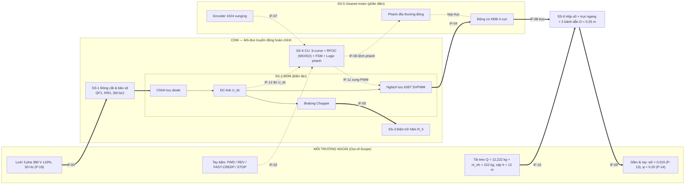

# TÀI LIỆU MÔ TẢ KIẾN TRÚC HỆ THỐNG (SAD) — HỆ TRUYỀN ĐỘNG DI CHUYỂN XE CON CẦU TRỤC DẦM ĐÔI ($x = 2$)

**Học phần:** Thiết kế hệ thống truyền động điện (ĐH Bách khoa Hà Nội)  
**Giảng viên hướng dẫn:** TS. Nguyễn Duy Đỉnh  
**Nhóm thực hiện:** Nhóm 8.5-EMG (STT 22, $x = 2$)  
**Mã tài liệu:** `SAD-8.5EMG-TROLLEY-v1.0` — Gói công việc `SOW-2.1` (Khối 2 — `WBS 2.0`)  
**Ngày phát hành:** 24/10/2026 — **v1.1 (28/10/2026, Người dùng duyệt):** đồng bộ phạm vi môn học (CR-13, CR-16, CR-17): SRS-PERM-04 ở lưới danh định; $F_{\max}$ là giá trị tính toán, bỏ dải nghiệm thu; ngưỡng chopper 700 / 780 / 800 V là tham số mô hình, bỏ dung sai; E-STOP Không áp dụng (QĐ-07)  
**Trạng thái:** **ĐÃ DUYỆT — Cổng G3 (`PDR-EVT`) đóng ngày 24/10/2026** (Người dùng duyệt kiến trúc: 1 động cơ đặt giữa dẫn 2 bánh qua trục ngang, encoder ES7C)  
**Baseline kế thừa (Frozen, không sửa):** `SSoT-8.5EMG-v1.2` (`P-01..P-20`), `SRS-8.5EMG-TROLLEY-v1.2` (Baseline A), `RTM-DVP-8.5EMG-v1.2`, `HOQ v1.1` (`Solution C`)  
**Tài liệu cùng bộ Khối 2:** `02_ICD_Kiem_soat_Giao_dien_v1.0.md`, `03_BOM_So_bo_3_cap_v1.0.md`, `04_DFMEA_L1_v1.0.md`

---

## 0. QUYẾT ĐỊNH ĐẦU VÀO CỦA NGƯỜI DÙNG (ghi nhận ngày 24/10/2026)

Theo `WORKFLOW_RULES.md` §0.5 và §11, các điểm mở sau đã được Người dùng chốt trước khi viết Khối 2:

| # | Điểm mở | Quyết định của Người dùng | Ảnh hưởng |
| :---: | :--- | :--- | :--- |
| QĐ-01 | Cấu hình truyền động cơ khí (`P-16 [C]`, câu hỏi mở số 3 của SSoT) | **Động cơ liền hộp giảm tốc (Geared motor) liền khối** — động cơ, phanh đĩa, encoder gắn sẵn | Trade-off `TO-01` (§3.1); BOM `L3-05` |
| QĐ-02 | Xung đột $k_{dt} \in [1.20; 1.50]$ (`SRS-PERM-04`) với $\lambda_{\max} \ge 2.0$ khi $a \approx 0.5\text{ m/s}^2$ (phát hiện bởi tính toán sơ bộ §5) | **Định cỡ động cơ theo khả năng quá tải mô-men ($\lambda$)**; đề xuất cập nhật `SRS-PERM-04` thành $k_{dt} \ge 1.20$ trong **SRS Baseline A.1** (thực hiện ở Khối 3) | §5.3; `Block 3/04_SRS_A1_...` |
| QĐ-03 | Nguồn thông số catalogue | **Cho phép tra datasheet chính hãng trên web** (chỉ đọc), trích URL + trang, gắn nhãn nguồn `[W-xx]` | §8; BOM |
| QĐ-07 | Phạm vi vận hành | **Chỉ xét điều kiện lý tưởng**: không mất điện, không E-STOP/dừng khẩn, không xét sự cố thiết bị | §6 (M0), §7 (RA-01); DFMEA FM-07, FM-12 |
| QĐ-04 | Thiết bị phần lực (G4) | **SEW DRN80M4 0.75 kW + ABB ACS380-04xS-03A3-4**; chấp nhận biên quá tải 1.03 ở tổ hợp xấu nhất | `Block 3/01_Thuyet_minh_...` §5 |
| QĐ-05 | Trình tự nhả phanh (G4) | Giữ bước thử mô-men giữ khi phanh còn kẹp, $M_B$ = 7 N·m | `Block 3/03_SDD_...` §5 |
| QĐ-06 | Rủi ro trượt bánh KT-29 | Đã bị QĐ-07 thay thế | — |
| QĐ-08 | Cách hiểu QCD-C01 | "150% công suất tính toán" so với $P_{\max}$ = 1.23 kW (trần 1.84 kW) | Excel KT-09 |
| Duyệt cổng | G3 và G4 | **Người dùng duyệt kiến trúc G3 và ký SRS Baseline A.1 (CR-01..CR-07) — đóng G3, G4 ngày 24/10/2026** | `Block 2/05_...` Phụ lục B |

Các quyết định mặc định do Writer đề xuất (Người dùng có thể đổi tại cổng G3): tách thư mục `Block 2/` và `Block 3/` như `Block 0/`, `Block 1/`; yêu cầu dẫn xuất `SRS-Dxx` ghi trong tài liệu riêng `SRS Baseline A.1` ở `Block 3/` (không sửa bản SRS v1.2 đã đóng băng).

---

## 1. MỤC ĐÍCH VÀ PHẠM VI

Tài liệu SAD xác lập **kiến trúc vật lý và chức năng** của hệ truyền động di chuyển xe con theo phương án `Solution C` (Động cơ KĐB rotor lồng sóc + Biến tần điều khiển vector RFOC + Encoder vòng kín + S-curve 7 đoạn + Braking Chopper/$R_h$ + Logic FSM 4 góc phần tư + Phanh cơ điện từ thường đóng), bao gồm:

1. Phân rã hệ thống thành các phân hệ theo cấu trúc **PDS (Power Drive System)** — thuật ngữ `BDM / CDM / PDS` của IEC 61800-2 (xem lưu ý nguồn ở §8.2).
2. Phân tích lựa chọn cấu hình (*Architecture Trade-off*) cho 5 điểm cấu hình chi tiết.
3. Bảng phân bổ **8 yêu cầu `SRS Baseline A`** và **8 thông số Downstream Design Allocation** vào các phân hệ (đáp ứng Checker `K7`).
4. Tính toán định cỡ sơ bộ (để chốt dải thiết bị cho BOM sơ bộ; tính chi tiết ở Khối 3 — `SOW-3.1`).

Phạm vi In-Scope / Out-of-Scope kế thừa nguyên vẹn `SRS Baseline A v1.2` §1 và `02_Boundary_va_P_Diagram.md` Phần 1.

---

## 2. KIẾN TRÚC TỔNG THỂ THEO CẤU TRÚC PDS

### 2.1. Danh mục phân hệ (Subsystem Breakdown)

| Mã phân hệ | Tên phân hệ | Thuộc lớp PDS | Thành phần chính | Chức năng chính |
| :---: | :--- | :---: | :--- | :--- |
| **SS-1** | Nguồn & Khí cụ đóng cắt – bảo vệ | CDM (phần cấp nguồn) | Aptomat MCCB `QF1`, contactor nguồn `KM1`, cuộn kháng/bộ lọc EMC đầu vào (tùy chọn), nút dừng khẩn `E-STOP` (Không áp dụng — QĐ-07) | Cấp nguồn $380\text{ V} \pm 10\%$/50 Hz (`P-19`), cắt ngắn mạch/quá tải, cách ly khi sự cố |
| **SS-2** | Mô-đun biến đổi cơ bản (BDM) | BDM | Chỉnh lưu cầu diode 3 pha, DC-link tụ $C$, nghịch lưu áp IGBT (SVPWM), **Braking Chopper tích hợp** | Biến đổi năng lượng 4 góc phần tư; chặn quá áp DC-link khi hãm tái sinh |
| **SS-3** | Điện trở xả hãm $R_h$ | CDM (phụ trợ) | Điện trở hãm ngoài + rơ-le nhiệt/tiếp điểm nhiệt | Tiêu tán năng lượng hãm (góc II, IV) — `SRS-FUNC-04` |
| **SS-4** | Khối điều khiển trung tâm (CU) | CDM (điều khiển) | (a) Bộ tạo quỹ đạo **S-curve 7 đoạn**; (b) **RFOC**: mạch vòng dòng $i_{sd}, i_{sq}$ (PI–MO), mạch vòng tốc độ (PI–SO), mô hình từ thông; (c) **FSM 4 góc phần tư** + logic phanh + khóa chéo đảo chiều; (d) bảo vệ & giám sát | Biến lệnh người vận hành thành mô-men điện từ có kiểm soát |
| **SS-5** | Cụm Động cơ – Phanh – Encoder (Geared motor, phần điện) | Motor (M) | Động cơ KĐB 3 pha rotor lồng sóc 4 cực, phanh đĩa điện từ thường đóng + bộ chỉnh lưu phanh, Encoder xung tương đối gắn đuôi động cơ | Chuyển đổi điện–cơ, giữ trục khi dừng, đo tốc độ trục động cơ |
| **SS-6** | Truyền động cơ khí xe con (Driven Equipment) | Thiết bị công tác | Hộp giảm tốc bánh răng trụ của geared motor, trục truyền ngang + khớp nối, 2 bánh dẫn (1 bánh/ray) + 2 bánh bị dẫn, khung xe con | Truyền lực kéo tiếp tuyến lên ray, mang tải treo |
| **ENV** | Môi trường ngoài (Out-of-Scope) | — | Lưới điện, tay bấm, dầm & ray, cơ cấu nâng + tải treo cáp $h = 12\text{ m}$ | Điều kiện biên (Boundary Diagram Khối 1) |

### 2.2. Sơ đồ khối kiến trúc (luồng công suất nét liền, luồng tín hiệu nét đứt)



> Mã giao diện `IF-01..IF-10` kế thừa nguyên văn `02_Boundary_va_P_Diagram.md` §1.3; Khối 2 bổ sung các giao diện nội bộ `IF-11..IF-16` (chi tiết trong ICD).

### 2.3. Cấu trúc điều khiển bên trong CU (SS-4)

Kế thừa sơ đồ mạch vòng tại `HOQ v1.1` §8.2 (cấu trúc Shevchenko [R9-06] và Bài giảng 2-3 [R5]):

```
Lệnh HMI ──► [FSM 4 góc phần tư + khóa chéo + logic phanh] ──► v_target ∈ {0, ±v_creep, ±v_max}
                     │ brake_cmd (IF-06)                         │
                     ▼                                           ▼
               Phanh cơ BE                     [S-curve 7 đoạn: |a*| ≤ a_set, |ρ*| ≤ ρ_set]
                                                                 │ v*(t) ──► ω*(t) = v*/k_qđ
                                                                 ▼
                     ω_m (Encoder) ──►(−)── [PI tốc độ – SO] ──► i_sq* ──►(−)── [PI i_sq – MO] ──► u_sq*
                     ψ_r* ──► [i_sd* = ψ_r*/L_m] ──►(−)── [PI i_sd – MO] ──► u_sd* ──► [dq→abc, SVPWM] ──► IGBT
                     i_a, i_b (đo dòng) ──► [Clarke/Park, θ_s từ mô hình từ thông + ω_m] ──► i_sd, i_sq
```

---

## 3. PHÂN TÍCH LỰA CHỌN CẤU HÌNH (ARCHITECTURE TRADE-OFF)

Thang điểm 1–5 (5 = tốt nhất); trọng số lấy theo mức ưu tiên HoQ (`EC-01` điều khiển tốc độ chính xác 22.3%, `EC-06` công suất – nhiệt 10.1%, …) và tiêu chí khả thi mô phỏng của SOW. **Writer chỉ đề xuất; phương án cuối do Người dùng duyệt tại G3** (`WORKFLOW_RULES.md` §0.5).

### 3.1. `TO-01` — Động cơ liền hộp số (Geared motor) hay Động cơ rời + Hộp giảm tốc 3 cấp

| Tiêu chí | Trọng số | A: Geared motor liền khối | B: ĐC rời + HGT 3 cấp + khớp nối |
| :--- | :---: | :---: | :---: |
| Số giao diện cơ khí cần căn chỉnh (khớp nối, bệ) | 0.25 | 5 | 2 |
| Phanh + encoder tích hợp sẵn từ nhà sản xuất ([R9-07]: Demag tích hợp encoder, phanh đĩa) | 0.25 | 5 | 3 |
| Tỷ số truyền $i$ chọn được sát $i_{\text{yc}} \approx 157 \div 159$ | 0.20 | 4 | 4 |
| Mô-men quán tính quy đổi nhỏ (ít khớp nối) | 0.15 | 4 | 3 |
| Chi phí / tính phổ biến | 0.15 | 4 | 4 |
| **Tổng có trọng số** | 1.00 | **4.50** | **3.15** |

**Kết quả:** chọn **A — Geared motor** (đã được Người dùng chốt, QĐ-01). Hiệu suất cơ khí vẫn giữ $\eta = 0.90$ (`P-15 [C]`) cho toàn chuỗi (hộp số + ổ bánh xe + khớp nối trục ngang) — giá trị bảo thủ; hiệu suất riêng của hộp số liền khối tra catalogue ở Khối 3 (`TBD`).

### 3.2. `TO-02` — Phương án bố trí dẫn động bánh xe

| Tiêu chí | Trọng số | A: **1 geared motor đặt giữa + trục ngang dẫn 2 bánh** (1 bánh/ray) | B: 2 geared motor (mỗi bên ray 1 động cơ), chung 1 biến tần | C: 2 geared motor, 2 biến tần |
| :--- | :---: | :---: | :---: | :---: |
| Khớp với `SRS-FUNC-01` (01 Encoder, FOC 1 động cơ) | 0.35 | 5 | 1 (1 biến tần không FOC riêng được 2 ĐC → chỉ V/f) | 3 (2 encoder, cần đồng bộ) |
| Đồng bộ 2 bên ray, chống lệch xe | 0.20 | 5 (cứng cơ khí) | 3 | 3 |
| Độ phức tạp mô phỏng Simulink | 0.20 | 5 | 3 | 2 |
| Khối lượng/chi phí trục ngang (khẩu độ ray 1.4 ÷ 2.8 m [R9-07] tr.9) | 0.15 | 3 | 4 | 4 |
| Dự phòng (redundancy) | 0.10 | 2 | 3 | 4 |
| **Tổng** | 1.00 | **4.55** | **2.40** | **3.05** |

**Đề xuất:** **A** — giữ nguyên giả thiết `2/4 bánh dẫn, k_dẫn = 0.5` của `WORKFLOW_RULES.md` §4.2-B3. *(Cần Người dùng duyệt.)*

### 3.3. `TO-03` — Phương án xử lý năng lượng hãm tái sinh

| Phương án | Ưu | Nhược | Đánh giá |
| :--- | :--- | :--- | :--- |
| **A: Braking Chopper tích hợp + $R_h$ ngoài** | Đơn giản, có sẵn trong biến tần cỡ nhỏ (ABB ACS380: *"Built-in brake chopper as standard"* [W-05] tr.10) | Năng lượng tỏa nhiệt | **Chọn** (đúng `Solution C`) |
| B: Chỉnh lưu tích cực AFE trả về lưới | Tiết kiệm điện | Đắt, quá mức với $P_{\text{hãm}} < 0.5\text{ kW}$ (§5) | Loại |
| C: Chung DC-bus với cơ cấu nâng | Tận dụng năng lượng | Cơ cấu nâng Out-of-Scope | `Không áp dụng vì cơ cấu nâng ngoài phạm vi` |

### 3.4. `TO-04` — Loại Encoder phản hồi tốc độ

Tiêu chí quyết định: phân giải tốc độ ở **tốc độ bò** và ngưỡng logic $|v| \le 0.002\text{ m/s}$ (Downstream #5). Với chu kỳ đo $T_{s,\omega} = 1\text{ ms}$ và bộ đếm 4 sườn, phân giải $\Delta\omega = \frac{2\pi}{4 N_{\text{xung}} T_{s,\omega}}$, quy ra vận tốc dài $\Delta v = \Delta\omega \cdot \frac{D_{bx}}{2 i}$ (với $i \approx 157$):

| Phương án | Số chu kỳ/vòng | $\Delta v$ (mm/s) | So với ngưỡng 2 mm/s | Nguồn |
| :--- | :---: | :---: | :---: | :--- |
| A: Encoder tích hợp SEW EI7C | 24 (tối đa họ EI7) | ≈ 52 | ✗ Không đủ | SEW EI7 family (chưa xác minh trang) |
| **B: Encoder gắn ngoài SEW ES7C — HTL/TTL (RS422), 1024 chu kỳ/vòng, $U_B$ = DC 4.75–30 V, $n_{\max}$ = 6000 min⁻¹, dùng cho DRN../DRU../DR2.71–315** | 1024 | **≈ 1.22** | ✓ Đạt | [W-04] |

**Đề xuất:** **B (ES7C)**; giao tiếp với biến tần qua module **BTAC-02** *"HTL/TTL encoder interface"* của ACS380 [W-05] tr.24.

### 3.5. `TO-05` — Dải công suất động cơ (chốt ở Khối 3)

> **Cập nhật sau G4:** đã chốt DRN80M4 0.75 kW + hộp số R87, $i$ = 155.34 (QĐ-04, `Block 3/02_So_do_Mach_luc_va_BOM_Chinh_thuc_v1.0.md`).

Tính sơ bộ §5 cho thấy động cơ phải định cỡ theo **mô-men cực đại khi tăng tốc**, không theo nhiệt. Hai ứng viên SEW DRN (IE3, 400 V/50 Hz, 4 cực) [W-01] được mang sang Khối 3: **DRN80M4 (0.75 kW)** và **DRN90S4 (1.1 kW)**. Khối 3 sẽ trình bày so sánh, **Người dùng chốt tại G4**.

---

## 4. BẢNG PHÂN BỔ YÊU CẦU VÀO PHÂN HỆ (ALLOCATION MATRIX — Checker K7)

Ký hiệu: **P** = phân hệ chịu trách nhiệm chính; **c** = phân hệ đóng góp; (trống) = không liên quan.

### 4.1. Phân bổ 8 yêu cầu SRS Baseline A

| Mã SRS | Nội dung rút gọn | SS-1 | SS-2 | SS-3 | SS-4 | SS-5 | SS-6 | Thiết kế chi tiết (Khối 3) | DV |
| :---: | :--- | :---: | :---: | :---: | :---: | :---: | :---: | :--- | :---: |
| SRS-FUNC-01 | 4 góc phần tư, phản hồi 01 Encoder | | c | | **P** (RFOC) | c (Encoder ES7C) | | `SOW-3.3` | DV-01 |
| SRS-FUNC-02 | Khóa chéo $v \ne 0$, đồng bộ phanh, $\Delta s \le \pm 10\text{ mm}$ | | | | **P** (FSM) | c (phanh BE) | c | `SOW-3.4` | DV-02 |
| SRS-FUNC-03 | S-curve 7 đoạn, $\lvert a^* \rvert \le 0.5$, $\lvert \rho^* \rvert \le 2.0$ | | | | **P** (S-curve) | | | `SOW-3.3` | DV-03 |
| SRS-FUNC-04 | Tiêu tán năng lượng hãm qua $R_h$, không trip quá áp | | **P** (Chopper) | **P** ($R_h$) | c (giám sát $U_{dc}$) | | | `SOW-3.1`, `SOW-3.2` | DV-04 |
| SRS-PERM-01 | Thắng $F_{c.\text{đầy}} = 2,096\text{ N}$; $k_{\text{bám}} \ge 1.20$ | | c (dòng) | | c (giới hạn $i_{sq}$) | **P** (mô-men) | **P** ($i$, $D_{bx}$, bánh dẫn) | `SOW-3.1` | DV-05 |
| SRS-PERM-02 | $v_{\max} = 0.12\text{ m/s} \pm 5\%$ hai chiều | | c | | **P** (PI–SO) | c (Encoder) | c ($i_{\text{thực}}$) | `SOW-3.1`, `SOW-3.3` | DV-06 |
| SRS-PERM-03 | $\lvert a(t) \rvert \le 0.5$, $\lvert \rho(t) \rvert \le 2.0$ thực tế, $h = 12\text{ m}$ | | | | **P** (S-curve + SO) | c | c (con lắc) | `SOW-3.3` | DV-07 |
| SRS-PERM-04 | Định cỡ nhiệt S3-40%, $k_{dt} \ge 1.20$ (SRS A.1) ở lưới danh định 380 V (CR-13) | c | **P** (định cỡ biến tần) | | | **P** (định cỡ động cơ) | | `SOW-3.1` | DV-08 |

### 4.2. Phân bổ 8 thông số Downstream Design Allocation (`SRS Baseline A v1.2` §4)

| # | Thông số | Giá trị chuyển xuống | Phân hệ nhận | Cách hiện thực (Khối 3) | Mã dẫn xuất dự kiến | Kiểm chứng |
| :---: | :--- | :--- | :---: | :--- | :---: | :---: |
| 1 | Độ quá điều chỉnh tốc độ | $M_p \le 10.0\%$ | SS-4 | PI–SO + lọc lượng đặt / S-curve | `SRS-D07` | DV-06 (S) |
| 2 | Sai lệch tốc độ xác lập | $e_{xl} \le 5.0\%$ | SS-4 | Khâu I của PI–SO ($e_{xl} \to 0$) | `SRS-D08` | DV-06 (S) |
| 3 | DC-link & ngưỡng Chopper | $U_{dc} \le 780\text{ V}$; Chopper ON $700\text{ V}$; trip $800\text{ V}$ | SS-2, SS-3, SS-4 | Chọn $R_h \in [R_{\min}; R_{\max}]$ của biến tần + ngưỡng chopper trong mô hình | `SRS-D05` | DV-04 (A/S) |
| 4 | Thời gian đáp ứng mô-men | $\Delta t_{\text{torque}} \le 10\text{ ms}$ | SS-4, SS-2 | PI dòng – MO; catalogue ACS380 *"Torque step rise time < 10 ms"* [W-05] tr.10 | `SRS-D09` | DV-01 (S) + I |
| 5 | Mô-men giữ & ngưỡng tốc độ logic | $M_{\text{hold}} \in [100\%; 150\%] M_{\text{đm}}$; đóng phanh $\lvert v \rvert \le 0.005$; cấm đảo chiều $\lvert v \rvert > 0.002\text{ m/s}$ | SS-4, SS-5 | Tham số FSM + phân giải encoder §3.4 | `SRS-D10`, `SRS-D11` | DV-02 (S) |
| 6 | Lực kéo cực đại tăng tốc | $F_{\max} = 9,218\text{ N}$ | SS-5, SS-6 | Định cỡ $M_{\max}$ động cơ, $k_{\text{bám}}$ | `SRS-D01` | DV-05 (A) |
| 7 | Bội số mô-men cực đại | $\lambda_{\max} \ge 2.0$ | SS-5 | Tra $M_K/M_N$ catalogue SEW [W-01] | `SRS-D02` | DV-08 (I) |
| 8 | Tốc độ bò | $v_{\text{creep}} = 0.030 \div 0.036\text{ m/s}$ | SS-4 | Mức đặt thứ 2 của FSM/S-curve | `SRS-D12` | DV-06 (S) |

> Mọi 8/8 SRS và 8/8 Downstream đều có phân hệ chủ trì (**P**) và bài kiểm chứng đối ứng → điều kiện `K7` ở cấp kiến trúc được đáp ứng (chờ Checker xác nhận).

---

## 5. TÍNH TOÁN ĐỊNH CỠ SƠ BỘ (làm căn cứ chọn dải thiết bị)

> **Cập nhật sau G4 (25/10/2026):** hộp số đã chốt **SEW R87, $i_{\text{thực}}$ = 155.34** ($M_{a,\max}$ 1,550 N·m) cùng động cơ DRN80M4 (QĐ-04); số liệu chính thức xem `Block 3/00_Tinh_toan_Xe_con_x2_v1.4.xlsx` ($M_{\max}/M_N$ = 2.19, $k_{dt}$ = 3.61 — như v1.2; DRN90S4 dự phòng: 1.78, 5.15 — kết quả v1.2 khi đặt `sel` = 2). *(27/10/2026: đổi nguồn sang Excel v1.4 theo Checker K10-3; không đổi số.)* Các số dưới đây là tính sơ bộ tại cổng G3 với $i \approx 157$, giữ nguyên làm hồ sơ lịch sử.

Công thức theo `WORKFLOW_RULES.md` §4.2 (A, B, C). Tính chi tiết có công thức Excel ở `Block 3/00_Tinh_toan_Xe_con_x2_v1.4.xlsx` (bản hiện hành; các bản v1.2, v1.3 lưu làm lịch sử).

### 5.1. Phụ tải tĩnh & động (kế thừa SSoT)

| Đại lượng | Công thức | Giá trị | Nguồn mã |
| :--- | :--- | :---: | :---: |
| Lực cản tĩnh đầy / không tải | $F_c = M g w_0$ | $2,096 / 298\text{ N}$ | P-20 |
| Công suất tĩnh | $F_{c.\text{đầy}} v_{\max} / \eta$ | $279.5\text{ W}$ | §4.2-A4 |
| Lực kéo cực đại | $F_{c.\text{đầy}} + M_\Sigma a_{\max}$ | $9,218\text{ N}$ | Downstream #6 |
| Công suất đỉnh | $F_{\max} v_{\max} / \eta$ | $1,229\text{ W}$ | §4.2-B2 |
| Hệ số bám (đầy và không tải) | $\varphi \cdot 0.5 \cdot M g / F_{\max}$ | $1.516 / 1.516$ | SRS-PERM-01 |
| Tỷ số truyền yêu cầu (ĐC 4 cực, $n_N \approx 1440 \div 1455\text{ vg/ph}$ [W-01]) | $i_{\text{yc}} = \omega_N / \omega_{bx}$ | $157.1 \div 158.7$ | so `P-16 = 150 [C]` |

*Ghi chú:* tỷ số không tải bằng đúng tỷ số đầy tải ($k_{\text{bám}}$ độc lập khối lượng khi $a$ như nhau) vì cả $F_{\text{bám}}$ và $F_{\max}$ đều tỷ lệ với khối lượng; trị số $1.516 \ge 1.20$ ✓.

### 5.2. Mô-men quy đổi và quá tải (ví dụ ứng viên DRN80M4, $i = 157.1$)

- Hệ số quy đổi $k_{qđ} = \frac{D_{bx}}{2i} = 7.958 \times 10^{-4}\text{ m/rad}$; $M_{c,\text{kéo}} = \frac{F_c k_{qđ}}{\eta} = 1.853\text{ N·m}$.
- Mô-men cực đại khi tăng tốc với $a_{\max} = 0.5\text{ m/s}^2$ ($\delta = 1.15$, $J_{\text{ĐC+phanh}} = 26.2 \times 10^{-4}\text{ kg·m}^2$ [W-02]): $M_{\max} = \frac{(F_c + \delta M_\Sigma a)k_{qđ}}{\eta} + J_{\text{ĐC}}\frac{a}{k_{qđ}} \approx 10.74\text{ N·m}$.
- Bội số yêu cầu $M_{\max}/M_N = 10.74/4.95 = 2.17$; khả năng ở sụt áp −10%, quy về điện áp định mức 400 V của động cơ: $\lambda_{K}(342/400)^2 = 3.4 \times 0.731 = 2.485 \ge 2.17$ ✓ *(v1.0 ghi $0.9^2$ → 2.75; đã sửa theo Checker K6-2)*.

### 5.3. Phát hiện XUNG ĐỘT `K11` (đã trình Người dùng — QĐ-02)

Với chu trình S3-40% giả định (2 hành trình 14 m đầy tải/không tải trong 600 s), mô-men đẳng trị nhiệt chỉ $M_{đt} \approx 1.36\text{ N·m}$ ($P_{đt} \approx 0.21\text{ kW}$) vì pha gia tốc chỉ ≈ 0.52 s mỗi lần. Do đó:

| Ràng buộc | Động cơ cần | $k_{dt} = P_{đm}/P_{đt}$ |
| :--- | :--- | :---: |
| $k_{dt} \in [1.20; 1.50]$ (SRS-PERM-04 v1.2) | $P_{đm} \approx 0.25 \div 0.32\text{ kW}$ → cần $\lambda \approx 6.5$ (không tồn tại) | 1.2 ÷ 1.5 |
| $\lambda_{\max} \ge 2.0$, $a \approx 0.5$ (Downstream #6, #7) | DRN80M4 0.75 kW / DRN90S4 1.1 kW | **3.65 / 5.24** |
| SOW-3.1 "chọn dải 1.5 ÷ 2.2 kW" | DRN90L4 / DRN100LS4 | ≈ 7 ÷ 10 |

**Quyết định Người dùng (QĐ-02):** định cỡ theo $\lambda$; cập nhật `SRS-PERM-04` → $k_{dt} \ge 1.20$ (không giới hạn trên) trong **SRS Baseline A.1** — phù hợp với đề xuất đã có tại `00_Bang_thong_so_goc_SSoT.md` Phần 2 dòng 12 (*"Bỏ việc ép cứng cận trên 1.50"*). Ghi chú ảnh hưởng: `SOW-3.1` (dải 1.5–2.2 kW) và `QCD-C01` (biên kinh tế) cần ghi nhận độ lệch; `DV-08` đổi tiêu chí FAIL "$k_{dt} > 1.50$". Không sửa Block 0/1 — mọi thay đổi ghi ở `Block 3/04_SRS_A1_...`.

---

## 6. CÁC CHẾ ĐỘ VẬN HÀNH (Operating Modes) — đầu vào cho FSM Khối 3

| Chế độ | Góc phần tư | Mô tả | Phanh cơ |
| :---: | :---: | :--- | :---: |
| M0 – OFF | — | Hệ chưa được cấp lệnh chạy (mất nguồn / E-STOP / sự cố: Không áp dụng — QĐ-07) | Đóng |
| M1 – READY | — | Có nguồn, chờ lệnh, ĐC không kích từ | Đóng |
| M2 – MAGNETIZE & TORQUE-PROVE | 0 rpm | Tạo từ thông $\psi_r$, giữ $\omega^* = 0$, kiểm tra khả năng $M_{\text{hold}}$ | Đóng → Mở |
| M3 – RUN FWD | I (tăng tốc/chạy), II (giảm tốc) | S-curve tới $+v_{\max}$ hoặc $+v_{\text{creep}}$ | Mở |
| M4 – RUN REV | III, IV | S-curve tới $-v_{\max}$ hoặc $-v_{\text{creep}}$ | Mở |
| M5 – STOP & HOLD | II/IV → 0 | Giảm tốc S-curve, $\lvert v \rvert \le 0.005\text{ m/s}$ → đóng phanh, giữ mô-men tới khi phanh kẹp | Mở → Đóng |

---

## 7. RỦI RO KIẾN TRÚC CHUYỂN SANG DFMEA L1

`RRM-01..05` (HOQ v1.1 §8.4) và `E-01..E-04` (P-Diagram) được định lượng trong `04_DFMEA_L1_v1.0.md`. Rủi ro kiến trúc mới phát hiện ở Khối 2:

- **RA-01:** Phanh cơ đủ mạnh để giữ đầy tải có thể **làm trượt bánh khi phanh khẩn cấp lúc không tải** ($F_{\text{bám,0}} = 1,984\text{ N}$ → $M_B \le 1.42\text{ N·m}$ quy về trục ĐC). → Biện pháp: dừng thường bằng điện (S-curve), phanh cơ chỉ kẹp khi $|v| \le 0.005\text{ m/s}$; dừng khẩn dùng SS1 (giảm tốc điện rồi mới STO) khi biến tần còn hoạt động. → **Không áp dụng (QĐ-07)**: không xét dừng khẩn/mất điện; phanh chỉ kẹp khi xe đã gần dừng.
- **RA-02:** Biên độ dự trữ pha vòng tốc độ giảm khi quán tính thay đổi 3.2 lần (đầy/không tải quy về trục ĐC) → kiểm tra ở Khối 3 (SDD) và mô phỏng ở Khối 5.

---

## 8. NGUỒN TÀI LIỆU & GHI CHÚ XÁC MINH (Checker K12)

### 8.1. Nguồn web bổ sung ở Khối 2–3 (đã lưu tại `Tài liệu tham khảo/Catalogue web/` ngày 25/10/2026 — xem `00_Danh_muc_nguon_catalogue_web.md`)

| Mã | Tài liệu | Vị trí trích | Nội dung dùng |
| :---: | :--- | :--- | :--- |
| `[W-01]` | SEW-EURODRIVE, Catalog *DRN.. Gearmotors (IE3)*, 24832936/EN – 09/2018 (trích 1 trang: <https://match.kheoos.com/media/medias/k0/46-648c5348d0a1b.pdf>) | §13.4.1, tr.866 | $P_N, M_N, n_N, I_N, \cos\varphi, \eta, I_A/I_N, M_A/M_N, M_K/M_N, M_H/M_N$ — DRN.. 400 V, 50 Hz, 4 cực |
| `[W-02]` | SEW-EURODRIVE, *(E)DRN.. (IE3) Gearmotors – 60 Hz, Revision*, 24772933/EN – 01/2018 (<https://download.sew-eurodrive.com/download/pdf/24772933.pdf>) | §1.4, tr.24–25 | $J_{\text{Mot}}$, $J_{\text{BMot}}$, $m_{\text{Mot}}$, loại phanh BE theo cỡ khung (quán tính không phụ thuộc tần số lưới) |
| `[W-03]` | SEW-EURODRIVE, Addendum *DRN.. Gearmotors (IE3) — 2- and 6-pole*, 22866450/EN – 06/2016 (<https://download.sew-eurodrive.com/download/pdf/22866450.pdf>) | §4.3.2, tr.24–25 | Phanh BE2 có cấp mô-men 14 N·m và 20 N·m (dòng DRN90L2, DRN90S6) |
| `[W-04]` | SEW-EURODRIVE, tài liệu trực tuyến *ES7C, EV7C* (<https://download.sew-eurodrive.com/download/html/31974465/en-EN/39119693963.html>) | Trang dữ liệu | HTL/TTL (RS422), 1024 chu kỳ/vòng, DC 4.75–30 V, 6000 min⁻¹, DRN 71–315 |
| `[W-05]` | ABB, *ACS380 machinery drives catalog*, 3AUA0000187460 REV D EN 22.9.2020 (<https://www.auser.fi/wp-content/uploads/ACS380-katalogi.pdf>) | tr.10 (thông số chung), tr.12 (định mức), tr.24 (BTAC-02), tr.24 (chopper $R_{\min}, R_{\max}, P_{BR}$) | Biến tần, chopper, module encoder, định nghĩa $I_{Hd}$ (150% trong 1 phút/10 phút) |

| `[W-06]` | SEW Drive Selection (<https://kz.sew-eurodrive.com/os/ds/>, ứng dụng xe con, 25/10/2026) | Kết quả đề xuất | Hộp số **R87, $i$ = 155.34**, $M_{a,\max}$ 1,550 N·m, $F_{Ra}$ 17,100 N |
| `[W-07]` | SEW Technical Note B-107-04 *BE Brake – Torques / Spring Combinations / Air Gap* | Bảng BE05–BE11 | BE1: 10/7/5 N·m; BE2: 20/14/10/7/5 N·m |
| `[W-08]` | ABB *ACS380 quick installation and start-up guide* (QISG F) | Bảng cầu chì | 03A3-4: gG OFAF000H6 (6 A), cáp 3×1.5 + 1.5 mm² |
| `[W-09]` | Danotherm CBH 360 C T 406 210R (Partco) | Trang sản phẩm | 210 Ω ±10%, 200 W @40 °C, công tắc nhiệt |
| `[W-10]` | ABB AF09-30-10-13 (plc-direct, theo catalog ABB 1SBC100214C0202) | Trang sản phẩm | AC-3 9 A @400 V, AC-1 25 A |

### 8.2. Ghi chú trung thực về Baseline (chỉ cảnh báo — không sửa Block 0/1)

1. `A54.pdf` trong kho thực chất là bài báo **Valtchev et al., IEEE DAS 2024** (*Increasing the Damping Capacity of Crane Electric Drive Systems…*), **không phải tiêu chuẩn DIN 536/ray A54** như mã `[R9-10]` ghi trong README/WORKFLOW → giá trị $w_0 = 0.015$, $D_{bx} = 0.25\text{ m}$ hiện **chưa có nguồn xác minh trong kho** (vẫn là giả định `[C]` của SSoT).
2. `[R4]` *TIÊU CHUẨN VN VÀ QUỐC TẾ.pdf*: tr.23 đúng là mục chế độ làm việc S1–S10 (IEC 60034-1); **tr.85–92 là nội dung EMC**, trong toàn văn **không có IEC 61800-2** → thuật ngữ PDS/BDM/CDM trong tài liệu này dùng theo hiểu biết chung về IEC 61800-2, **`chưa xác minh` trong kho**.
3. Bài giảng của Thầy Đỉnh: nội dung FOC, tổng hợp mạch vòng dòng $I_{sd}, I_{sq}$ và hãm điện trở nằm ở **`Bài 2.3.pdf`** (slide 29–42, 56–59); tối ưu module/đối xứng ở **`Bài 2.1.pdf`** (slide 26–30); `Bài 3.pdf` là *Tải của truyền động điện* (quy đổi $M, J$); `Bài 4.pdf` là *Phương pháp thiết kế* (slide 43–44: truyền động kéo xe con, hãm điện trở). Ánh xạ `[R5-B3]`, `[R5-B4]` trong WORKFLOW lệch với nội dung tệp → Khối 2/3 trích theo **tên tệp + slide thật**.
4. `tcvn-4244-2005.pdf` là bản scan ảnh (không trích được văn bản) → các điều khoản §1.5.3.3, §1.5.7.2.9, §2.4.5.5.2 được dùng **theo trích dẫn của Baseline**, chưa đối chiếu lại được trong tài liệu này.
