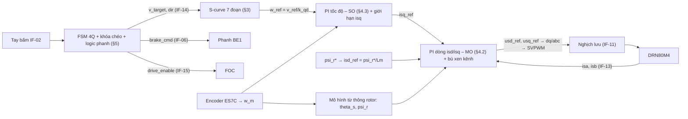
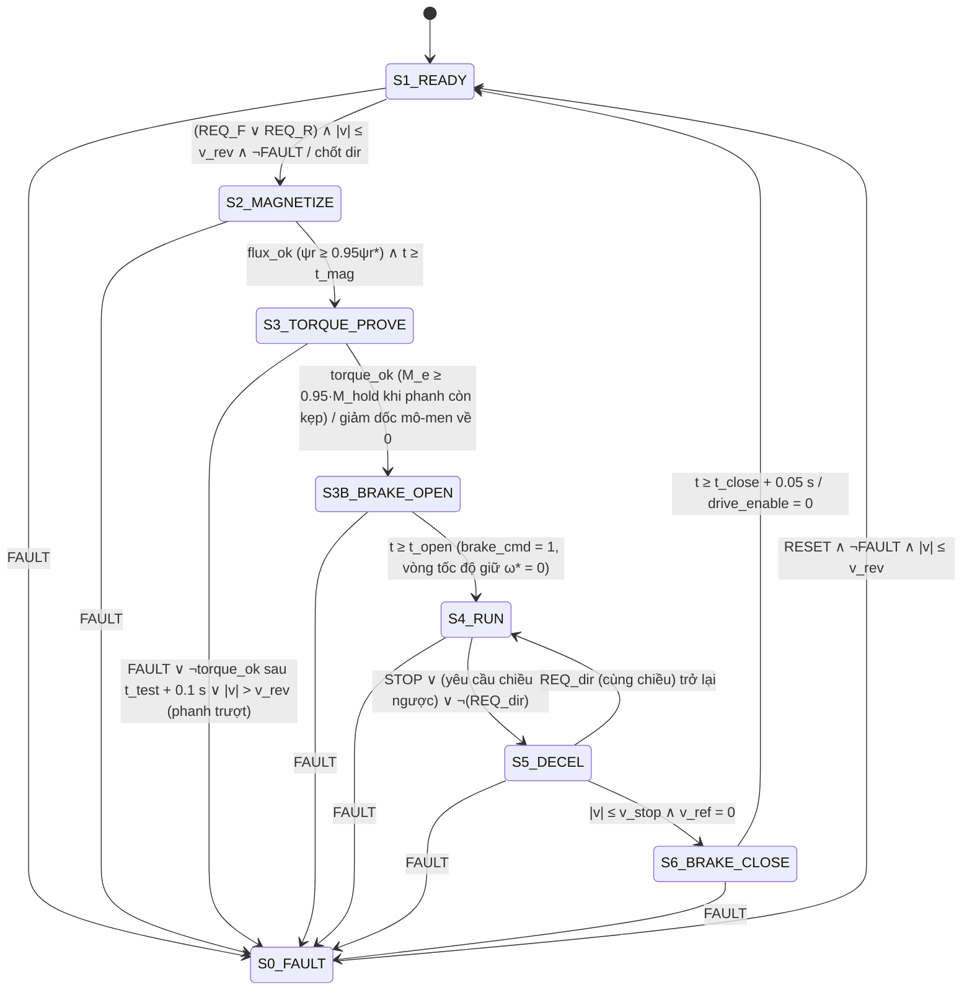

# ĐẶC TẢ THIẾT KẾ ĐIỀU KHIỂN & LOGIC (SDD) — RFOC + S-CURVE 7 ĐOẠN + FSM 4 GÓC PHẦN TƯ ($x = 2$)

**Mã tài liệu:** `SDD-8.5EMG-TROLLEY-v1.0` — Gói `SOW-3.3` (Trần Đỗ Khải) & `SOW-3.4` (Nguyễn Bá Hưng) — Khối 3  
**Ngày:** 24/10/2026 — **Trạng thái:** **ĐÃ DUYỆT — Cổng G4 (`CDR-EVT`) đóng ngày 24/10/2026** — **v1.1** (24/10/2026: xử lý Checker K7-1 thử mô-men giữ khi phanh còn kẹp; K9 tên biến/thời gian giữ; QĐ-05, QĐ-07; v1.0 cùng ngày là bản đầu) — **v1.2** (25/10/2026: số liệu tính lại với hộp số SEW R87, $i_{	ext{thực}}$ = 155.34) — **v1.3** (26/10/2026: bộ thông số mô phỏng nhóm C — mô hình 2 khối lượng §2.1, giảm từ thông theo giới hạn điện áp §4.1, đo tốc độ trong mô phỏng §4.4, mô hình biến tần trung bình & kịch bản rút gọn §7; Người dùng duyệt 26/10/2026)  
**Nguồn số:** `00_Tinh_toan_Xe_con_x2_v1.3.xlsx` (sheet `Tính chọn` khối E, J, K, L, M, N, O, P, Q, R; sheet `Mo_phong`) — ứng viên `sel = 1` (DRN80M4)  
**Ký hiệu/tên biến:** khóa theo `Block 2/02_ICD_Kiem_soat_Giao_dien_v1.0.md` (Checker `K9`)  
**Tài liệu lý thuyết:** Bài giảng 2-1 (tối ưu module/đối xứng, slide 26–30), Bài giảng 2-3 (FOC, mạch vòng $I_{sd}, I_{sq}$, slide 29–42), [R9-06] Shevchenko §2.3 (mạch thay thế), [R9-11] Tho et al. 2020 (S-curve), [R9-01] Mita & Kanai (con lắc).

> **Nguyên tắc trung thực (`WORKFLOW_RULES.md` §7.5):** tài liệu này chỉ chứa thiết kế và kết quả **giải tích (A)**. Mọi chỉ tiêu đo trên Simulink (DV-01..07) ghi `Report: chưa chạy`.

---

## 1. CẤU TRÚC TỔNG THỂ BỘ ĐIỀU KHIỂN (CU)



Chu kỳ tính: vòng dòng `Ts_I` $= 1/f_{sw} = 250\ \mu s$; vòng tốc độ, S-curve, FSM `Ts_w` $= 1$ ms. Ở §3, $a^*, \rho^*$ chỉ **giới hạn đặt** (`a_set`, `rho_set`); trạng thái tức thời của bộ tạo quỹ đạo là `a_ref`, `jerk_ref` (`GiaDinh_K3`). Bước giải mô phỏng `Ts_sim` = 5×10⁻⁵ s cố định (≤ 10⁻⁴ s; `Ts_I` = 5·`Ts_sim`, `Ts_w` = 20·`Ts_sim` — KT-40), nghịch lưu mô phỏng bằng mô hình trung bình (§7).

---

## 2. MÔ HÌNH TOÁN ĐỘNG CƠ — 5 THAM SỐ MẠCH THAY THẾ (khối J)

**Phương pháp** (ước lượng từ dữ liệu bảng tên [W-01], kiểu [R9-06] §2.3): sơ đồ vòng tròn bỏ qua $R_s$ → $I_0 = I_N(\sin\varphi_N - \cos\varphi_N/b)$, $b = \lambda_K + \sqrt{\lambda_K^2 - 1}$; nhánh rotor $I_r' = I_N\cos\varphi_N/\cos\varphi_r$, $\cos\varphi_r = b/\sqrt{1+b^2}$; $R_r' = Z_r\cos\varphi_r s_N$, $X_k = Z_r\sin\varphi_r$; $R_s$ từ cân bằng tổn hao với giả định tổn hao sắt + cơ + phụ = 30% tổng tổn hao `[C]`; $L_{\sigma s} = L_{\sigma r} = X_k/(2\omega_s)$ `[C]`.

| Tham số | Ký hiệu / tên biến | DRN80M4 (sel = 1) | DRN90S4 (sel = 2) | Đơn vị |
| :--- | :---: | :---: | :---: | :---: |
| Điện trở stator | $R_s$ / `Rs` | 8.386 | 5.496 | Ω |
| Điện trở rotor quy đổi | $R_r'$ / `Rr` | 6.976 | 3.634 | Ω |
| Điện cảm tản stator | $L_{\sigma s}$ / `Lls` | 0.04174 | 0.02992 | H |
| Điện cảm tản rotor | $L_{\sigma r}$ / `Llr` | 0.04174 | 0.02992 | H |
| Hỗ cảm | $L_m$ / `Lm` | 0.7483 | 0.5056 | H |
| Số đôi cực / quán tính rotor+phanh | $p$ / $J_{\text{BMot}}$ | 2 / 26.2×10⁻⁴ | 2 / 58.7×10⁻⁴ | — / kg·m² |
| Hệ số tản | $\sigma = 1 - L_m^2/(L_s L_r)$ | 0.1029 | 0.1086 | — |
| Hằng số thời gian rotor | $T_r = L_r/R_r'$ | 0.1133 | 0.1473 | s |
| Điện trở / điện cảm tương đương | $R_e = R_s + k_r^2 R_r'$; $L_\sigma = \sigma L_s$ | 14.64 / 0.08127 | 8.74 / 0.05816 | Ω / H |
| Hằng số thời gian điện từ | $T_e = L_\sigma/R_e$ | 5.55 | 6.66 | ms |
| Dòng từ hóa định mức (biên độ dq) | $i_{sd,N}$ | 1.389 | 2.056 | A |
| Từ thông rotor định mức | $\psi_r = L_m i_{sd,N}$ | 1.040 | 1.040 | Wb |
| Hệ số mô-men | $k_M = \frac{3}{2}p\frac{L_m}{L_r}\psi_r$ | 2.954 | 2.945 | N·m/A |
| Dòng mô-men định mức | $i_{sq,N} = M_N/k_M$ | 1.676 | 2.445 | A |

> ⚠ Tham số là **ước lượng `[B]` từ catalogue + giả định `[C]`**, chưa xác minh bằng thử nghiệm. Khi có động cơ thật dùng chức năng nhận dạng (ID-run) của biến tần. Độ nhạy của RFOC với sai số $T_r$ là nhiễu `N-03` của P-Diagram → kiểm tra bằng mô phỏng ±30% $R_r$ ở Khối 5 (đề xuất kịch bản bổ sung).

**Phương trình mô hình trong hệ $dq$ tựa từ thông rotor** (Bài 2-3 slide 33–34):
$$T_e\frac{di_{sd}}{dt} + i_{sd} = \frac{1}{R_e}\left(u_{sd} + \omega_s L_\sigma i_{sq} + \frac{k_r}{T_r}\psi_r\right),\quad T_e\frac{di_{sq}}{dt} + i_{sq} = \frac{1}{R_e}\left(u_{sq} - \omega_s L_\sigma i_{sd} - k_r\psi_r\, p\,\omega_m\right)$$
$$T_r\frac{d\psi_r}{dt} + \psi_r = L_m i_{sd},\quad \omega_{sl} = \frac{L_m i_{sq}}{T_r\psi_r},\quad M_e = k_M' \psi_r i_{sq},\quad J_\Sigma\frac{d\omega_m}{dt} = M_e - M_c(t)$$

Phương trình chuyển động với $J_\Sigma$ (khối cứng, tải gắn cứng vào xe) chỉ dùng cho **tính chọn** ở Excel (cận trên an toàn theo bài giảng). Mô phỏng dùng mô hình 2 khối lượng ở §2.1.

### 2.1. Mô hình cơ khí 2 khối lượng cho mô phỏng (v1.3 — khối O)

Tải $Q + m_{nh}$ treo trên cáp không gắn cứng vào xe: nó chỉ tác dụng lên xe qua phản lực cáp. Nếu vừa đưa tải vào khối lượng cứng ($M_\Sigma$) vừa cộng phản lực cáp $F_{\text{lắc}}$ thì khối lượng tải bị **tính hai lần**. Vì vậy mô phỏng tách hai khối (quy ước dấu theo ICD IF-10: $\theta > 0$ khi tải ở phía trước xe theo chiều Tiến):

$$J_{rig}\frac{d\omega_m}{dt} = M_e - M_{tải},\qquad J_{rig} = J_{\text{BMot}} + J_{gear} + m_{xc}k_{qđ}^2 = 5.17\times10^{-3}\text{ kg·m}^2$$
$$F_{tải} = F_c\tanh\!\left(\frac{v}{v_{rev}}\right) - m_{pend}\,g\,\theta,\qquad M_{tải} = \begin{cases} F_{tải}k_{qđ}/\eta & F_{tải}\,\omega_m \ge 0 \text{ (ĐC cấp năng lượng)}\\ F_{tải}k_{qđ}\,\eta & F_{tải}\,\omega_m < 0 \text{ (năng lượng về ĐC)}\end{cases}$$
$$\ddot\theta + 2\zeta\omega_p\dot\theta + \frac{g}{h}\sin\theta = -\frac{a(t)}{h}\cos\theta,\qquad a(t) = k_{qđ}\frac{d\omega_m}{dt}$$

| Đại lượng | Tên biến | Đầy tải | Không tải | Ghi chú |
| :--- | :---: | :---: | :---: | :--- |
| Khối lượng cứng | `m_trolley` | 1 800 kg | 1 800 kg | P-03 |
| Khối lượng con lắc | `m_pend_full` / `m_pend_empty` | 12 444 kg | 222 kg | Q + m_nh / m_nh |
| Lực cản lăn $F_c = (m_{xc} + m_{pend})\,g\,w_0$ | — | 2 096 N | 298 N | Trọng lượng tải vẫn đè lên bánh (KT-34) |
| Quán tính hộp số $J_{gear} = (\delta-1)M_\Sigma k^2$ | `J_gear` | 1.38×10⁻³ kg·m² | như đầy tải | Giữ phần $\delta$ của khối C, không đổi theo tải `[C]` |
| Tần số cộng hưởng xe – tải | — | 1.45 rad/s | — | ≪ $\omega_c$ = 190 rad/s (KT-35) |

**Hệ quả nhóm mô phỏng cần biết trước:**
- Vì $t_{acc}$ ≈ 0.52 s ≪ $T_p$ = 6.95 s, khi xe tăng tốc tải gần như chưa chuyển động. Mô-men đỉnh khi tăng tốc chỉ ≈ $J_{rig}\varepsilon^* + M_c$ = **4.76 N·m**, bằng **48%** của 9.93 N·m trong Excel (khối F). Đây là kết quả đúng của mô hình, không phải lỗi.
- Khi chạy đều, cáp dao động với biên độ $\theta_a$ = 0.011 rad (0.63°), phản lực ±1 350 N, nên mô-men dao động quanh $M_c$ = 1.87 N·m, lớn nhất ≈ **3.08 N·m**, chu kỳ ≈ $T_p$.
- Vòng tốc độ có tần số cắt ≫ 1.45 rad/s nên chỉ "thấy" $J_{rig}$ ở cả hai trạng thái tải: $\kappa = J_{tune}/J_{rig}$ = 1.43, nằm trong dải đã kiểm [0.56; 1.79] ⇒ PM ≥ 34.6° (KT-36). Không cần chỉnh lại PI tốc độ.
- Khi dỡ tải giữa kịch bản (§7.3), đổi `m_pend` từ `m_pend_full` sang `m_pend_empty` và đặt lại $\theta = \dot\theta = 0$ (reset tích phân) lúc xe đang đứng yên, phanh kẹp.
- Công tắc `mech_model` = 1 chuyển về khối cứng như Excel ($J_\Sigma$, bỏ $F_{\text{lắc}}$) để chạy trường hợp bảo thủ cho DV-04 (§7.2) và đối chiếu số với Excel.

---

## 3. BỘ TẠO QUỸ ĐẠO S-CURVE 7 ĐOẠN (khối E — `SRS-FUNC-03`, `SRS-D06`)

### 3.1. Tham số

$a^* = 0.45\text{ m/s}^2$ (`SRS-D06a`), $\rho^* = 1.8\text{ m/s}^3$ (`SRS-D06b`) — dự trữ 10% dưới `P-10`, `P-11` để bù trễ bám của vòng tốc độ và dao động tải (SRS-PERM-03 xét **giá trị thực tế**).

### 3.2. Biên dạng chuẩn 0 → $v_{\max}$ → 0 (đủ 7 đoạn)

$T_j = a^*/\rho^* = 0.250$ s; $T_a = v_{\max}/a^* - T_j = 0.0167$ s; $t_{acc} = 0.5167$ s; $s_{acc} = 0.031$ m.

| Đoạn | Khoảng thời gian | $\rho^*(t)$ | $a^*(t)$ | $v^*(t)$ |
| :---: | :--- | :---: | :--- | :--- |
| 1 | $[0; T_j]$ | $+\rho^*$ | $\rho^* t$ | $\rho^* t^2/2$ |
| 2 | $[T_j; T_j+T_a]$ | 0 | $a^*$ | $v_1 + a^*(t - T_j)$ |
| 3 | $[T_j+T_a; t_{acc}]$ | $-\rho^*$ | $a^* - \rho^*(t - t_2)$ | $v_{\max} - \rho^*(t_{acc}-t)^2/2$ |
| 4 | $[t_{acc}; t_{acc}+T_v]$ | 0 | 0 | $v_{\max}$ (chạy đều) |
| 5–7 | đối xứng 1–3 với dấu ngược | $-\rho^*, 0, +\rho^*$ | âm | giảm về 0 |

Với $v_1 = \rho^* T_j^2/2 = 0.05625$ m/s. Điều kiện đủ 3 đoạn: $a^{*2}/\rho^* = 0.1125 < 0.12$ ✓ (KT-20).

**Chuyển cấp nhanh → bò** ($\Delta v = 0.12 - 0.033 = 0.087 < 0.1125$): suy biến 2 đoạn, $a_{\text{peak}} = \sqrt{\Delta v\,\rho^*} = 0.396\text{ m/s}^2$, thời gian $2a_{\text{peak}}/\rho^* = 0.44$ s.

### 3.3. Thuật toán trực tuyến (cho lệnh thay đổi bất kỳ lúc nào — kể cả đảo chiều/dừng giữa chừng)

Trạng thái $(v^*, a^*)$, đích $v_t$ (`v_target`), mỗi chu kỳ $T_{s,\omega}$:

```
dv_brake = a* · |a*| / (2ρ*)          % độ thay đổi vận tốc nếu bắt đầu hạ gia tốc về 0 ngay bây giờ
e = v_t − (v* + dv_brake)
if   |e| ≤ ε_v and |a*| ≤ ρ*·Ts        → ρ_cmd = −sign(a*)·min(ρ*, |a*|/Ts)   % về đúng đích
elif e > 0  → ρ_cmd = +ρ* nếu a* < +a_lim, ngược lại 0
else        → ρ_cmd = −ρ* nếu a* > −a_lim, ngược lại 0
a* ← sat(a* + ρ_cmd·Ts, ±a*_set);   v* ← v* + a*·Ts;   w_ref = v*/k_qd
```

Thuật toán bảo đảm $\lvert\rho^*\rvert \le 1.8$, $\lvert a^*\rvert \le 0.45$ ở mọi thời điểm (giới hạn bão hòa cứng) — đáp ứng `SRS-FUNC-03` theo cấu trúc, kiểm chứng `DV-03` (A/S).

### 3.4. Quan hệ với dao động tải (câu hỏi mở số 5 của SSoT)

$t_{acc} = 0.52\text{ s} \ll T_p = 6.95\text{ s}$ ⇒ với con lắc, lần tăng tốc gần như bước vận tốc; biên độ lắc dư ước lượng $\theta_{\text{dư}} \approx v_{\max}\omega_p/g = 0.63°$ (KT-21, < $\theta_0 = 2.92°$). **Không bắt buộc** đồng bộ $t_{acc}$ với $T_p$; phương án "$t_{acc} = T_p$" (triệt tiêu lắc dư lý thuyết) đòi hỏi $a \approx 0.017\text{ m/s}^2$ — trái với dải QCD-Q03 — nên chỉ ghi nhận làm phương án tham khảo. Mô hình con lắc cho Simulink: xem §2.1 (v1.3 thống nhất dấu theo ICD IF-10: $\ddot\theta + 2\zeta\omega_p\dot\theta + \frac{g}{h}\sin\theta = -\frac{a(t)}{h}\cos\theta$, $F_{\text{lắc}} = m_{pend}\,g\,\theta$; `zeta` = 0 bảo thủ — `[C]`). Ghi chú: với $v_{\max}$ = 0.12 m/s, mọi dạng quỹ đạo có $t_{acc} \ll T_p$ (bước nhảy, dốc tuyến tính, S-curve) đều cho lắc dư ≈ 0.63°; tác dụng của S-curve ở bài này là giới hạn xung mô-men/độ giật, không phải giảm lắc.

---

## 4. TỔNG HỢP BỘ ĐIỀU KHIỂN RFOC (khối K, L — `SRS-D07`, `SRS-D09`)

### 4.1. Mạch vòng từ thông

$\psi_{rN} = 1.040$ Wb, $i_{sd,N} = \psi_{rN}/L_m = 1.389$ A. Từ hóa trước khi nhả phanh trong $t_{mag} = 0.5\text{ s} \ge 3T_r = 0.34$ s `[C]`.

**Giảm từ thông theo giới hạn điện áp (v1.3 — khối P, `SRS-D14`, `SRS-D15`).** Động cơ định mức 400 V/50 Hz chạy trên lưới 380 V. Nghịch lưu chỉ tạo được $U_{1,\lim} = k_u U_{dc}/\sqrt{2}$ (`k_u` = 0.95 `[C]`), trong khi tại $v_{\max}$ ($f_1$ = 48.2 Hz) động cơ cần $U_{1,\text{req}}$ ≈ 385.8 V ở từ thông định mức. Bản v1.2 ghi "không giảm từ thông vì $f_1 \le 52$ Hz" là chưa đúng; v1.3 thay bằng:

$$\psi_r^* = \psi_{rN}\min\!\left(1, \frac{\omega_{fw}}{\lvert\omega_m\rvert}\right),\qquad \omega_{fw} = \frac{U_{1,\lim}}{U_{1,\text{req}}}\,\omega_{m,v\max}\ \text{(tính trực tuyến từ } U_{dc}\text{ đo)}$$

| Lưới | $U_{dc}$ có tải | $U_{1,\lim}$ | $k_\psi = \psi_r^*/\psi_{rN}$ tại $v_{\max}$ | $\omega_{fw}$ | Kiểm tra |
| :---: | :---: | :---: | :---: | :---: | :--- |
| 380 V | 513 V | 344.6 V | 0.893 | 133.2 rad/s | — |
| 342 V (−10%) | 461.7 V | 310.1 V | **0.804** | 119.9 rad/s ($v$ = 0.096 m/s) | $i_{sq}$ cần 2.98 A ≤ 3.52 A (KT-37); $I_s$ = 2.25 A ≤ 3.9 A (KT-38) |

Khi giảm từ thông, $k_M$ giảm theo $k_\psi$; giới hạn `isq_lim` giữ nguyên vì phép kiểm KT-37 đã dùng từ thông nhỏ nhất (bảo thủ). Bão hòa điện áp PI dòng giữ như §4.2 ($\lvert \mathbf{u}_s \rvert \le k_u U_{dc}/\sqrt{3}$).

### 4.2. PI dòng $i_{sd}, i_{sq}$ — Tối ưu Module

Đối tượng (sau bù xen kênh/sđđ bằng feed-forward GFF như Bài 2-3 slide 37–38): $G_I(s) = \dfrac{1}{R_e(1+sT_e)(1+sT_{\mu i})}$, $T_{\mu i} = 1.5/f_{sw} = 375\ \mu s$ (trễ tính toán + ½ chu kỳ PWM `[C]`).

$$R_I(s) = K_{p,I}\left(1 + \frac{1}{sT_{i,I}}\right),\quad T_{i,I} = T_e = 5.55\text{ ms},\quad K_{p,I} = \frac{L_\sigma}{2T_{\mu i}} = \frac{0.08127}{2\times 375\times10^{-6}} = \mathbf{108.4\ V/A}$$

Hàm kín $\approx \dfrac{1}{2T_{\mu i}^2 s^2 + 2T_{\mu i}s + 1}$ → độ quá điều chỉnh 4.3%, thời gian tăng ≈ $4.7T_{\mu i}$ = **1.76 ms ≤ 10 ms** (Downstream #4 — KT-22; catalogue ACS380 cũng cam kết < 10 ms [W-05]). Bão hòa: $\lvert \mathbf{u}_s \rvert \le k_u U_{dc}/\sqrt{3}$ (v1.3: thêm `k_u` = 0.95 `[C]`); chống bão hòa tích phân kiểu kẹp (clamping).

### 4.3. PI tốc độ — Tối ưu Đối xứng có điểm chỉnh $J_{tune}$

Đối tượng: $G_\omega(s) = \dfrac{k_M}{J_\Sigma s}\cdot\dfrac{1}{1 + sT_{\Sigma\omega}}$, $T_{\Sigma\omega} = 2T_{\mu i} + T_{f\omega} = 1.75$ ms.

$$R_\omega(s) = K_{p,\omega}\left(1 + \frac{1}{sT_{i,\omega}}\right),\quad T_{i,\omega} = 4T_{\Sigma\omega} = \mathbf{7.0\ ms},\quad K_{p,\omega} = \frac{J_{tune}}{2k_M T_{\Sigma\omega}} = \mathbf{0.714\ A\cdot s/rad}$$

**Vì sao $J_{tune} = \sqrt{J_\Sigma J_{\Sigma,0}} = 0.00739$ kg·m²?** $J_\Sigma$ đổi 3.21 lần giữa đầy tải (0.01323) và không tải (0.00413). Nếu chỉnh SO theo $J_{\max}$, khi không tải hệ số vòng tăng 3.21 lần → PM còn 29.5°; chỉnh tại trung bình nhân làm hệ số lệch $\kappa = 0.56$ và $1.79$ đối xứng quanh 1 → PM bằng nhau **34.6°** ở cả hai trạng thái (Excel giải $\lvert L(j\omega)\rvert = 1$ bằng Newton: $64y^3 + 64y^2 - 16\kappa^2 y - \kappa^2 = 0$, $y = (T_{\Sigma\omega}\omega_c)^2$; PM $= \arctan 4x - \arctan x$). Tần số cắt: 190 rad/s (đầy tải), 431 rad/s (không tải). KT-23, 24 ✓ (≥ 30°).

**Lượng đặt:** đi qua S-curve (lượng đặt dốc liên tục, hệ SO là hệ vô sai bậc 2 với dốc) và lọc đầu vào tùy chọn $1/(1 + 4T_{\Sigma\omega}s)$ để khử điểm không của SO. Theo lý thuyết chuẩn SO có lọc đầu vào, độ quá điều chỉnh khi $\kappa = 1$ cỡ 8%; với $\kappa \ne 1$ và lượng đặt S-curve, **$M_p \le 10\%$ (Downstream #1, `SRS-D07`) và $e_{xl} \le 5\%$ (`SRS-D08`, khâu I ⇒ $e_{xl} \to 0$) phải kiểm chứng bằng mô phỏng — `Report: chưa chạy` (DV-06)**.

**Giới hạn dòng mô-men:** $\lvert i_{sq}^* \rvert \le i_{sq,\lim} = \min(3.52\text{ A (chống trượt } F_k \le F_{\text{bám}}/1.2);\ \text{giới hạn dòng biến tần})$. Mô-men cần tại $a^* = 0.45$ là 9.93 N·m ⇔ $i_{sq} = 3.36$ A < 3.52 A ✓.

### 4.4. Phân giải đo tốc độ (khối M)

ES7C 1024 chu kỳ/vòng, đếm 4 sườn trong 1 ms: $\Delta\omega = 1.53$ rad/s ⇔ $\Delta v = 1.22$ mm/s < 2 mm/s (ngưỡng cấm đảo chiều — KT-25). Khuyến nghị đo kiểu M/T khi $\lvert v \rvert < 0.01$ m/s để giảm lượng tử.

**Trong mô phỏng (v1.3):** mặc định `enc_model` = 0, tức tốc độ lý tưởng đi qua lọc bậc nhất `Tf_w` = 1 ms. Lý do: nếu mô hình hóa lượng tử ($\Delta\omega$ = 1.53 rad/s mỗi 1 ms), riêng nhiễu này đã gây dao động $i_{sq}$ ≈ $K_{p,\omega}\Delta\omega$ = 1.1 A (≈ 3.2 N·m, ≈ 65% $M_N$) và làm hỏng phép đo độ giật $\rho(t)$ của DV-07. `enc_model` = 1 chỉ dùng cho kịch bản khảo sát nhiễu riêng.

---

## 5. LOGIC VẬN HÀNH — MÁY TRẠNG THÁI FSM 4 GÓC PHẦN TƯ (`SOW-3.4`, `SRS-FUNC-01/02`, `SRS-D10..D13`)

**QĐ-07 (Người dùng, 24/10/2026) — Phạm vi vận hành lý tưởng:** đồ án môn học chỉ cần bảo đảm hệ vận hành đúng trong điều kiện lý tưởng: **không mất điện, không dừng khẩn / E-STOP, không xét sự cố thiết bị** (mất encoder, phanh không nhả…). Các nội dung liên quan được ghi `Không áp dụng vì điều kiện vận hành lý tưởng (QĐ-07)`; QĐ-06 (chấp nhận rủi ro trượt khi mất điện) vì thế không còn cần thiết. Dao động lưới ±10% (`P-19`) vẫn giữ vì là điều kiện làm việc bình thường, không phải sự cố.

### 5.1. Tham số FSM

| Tham số | Tên biến | Giá trị | Nguồn |
| :--- | :--- | :---: | :--- |
| Ngưỡng đóng phanh | `v_stop` | 0.005 m/s | Downstream #5 → `SRS-D11a` |
| Ngưỡng cấm đảo chiều | `v_rev` | 0.002 m/s | Downstream #5 → `SRS-D11b` |
| Mô-men giữ thử (phanh còn kẹp) | `M_hold` | 100% $M_N$ = 4.95 N·m (trong [100; 150]%) | `SRS-D10` |
| Thời gian giữ mô-men thử | `t_test` | 0.2 s (tăng dốc 0.05 s, giữ 0.1 s, giảm dốc 0.05 s) | `[C]` |
| Ngưỡng xác nhận mô-men thử | — | $M_e \ge 0.95\,M_{hold}$ và $\lvert v \rvert \le v_{rev}$ (phanh giữ được) | `[C]` |
| Thời gian từ hóa | `t_mag` | 0.5 s | §4.1 `[C]` |
| Thời gian nhả phanh (chờ cơ khí) | `t_open` | 0.10 s | `[C]` — chưa xác minh BE1 |
| Thời gian kẹp phanh | `t_close` | 0.05 s; ĐC giữ ω* = 0 tổng cộng `t_close` + 0.05 s = 0.1 s | `[C]` — chưa xác minh BE1 |
| Tốc độ đích | `v_max`, `v_creep` | 0.12 / 0.033 m/s | P-09 / `SRS-D12` |
| Giám sát phanh không nhả | `t_bkchk` | Không áp dụng (QĐ-07) | DFMEA FM-12 |

### 5.2. Sơ đồ trạng thái



| Trạng thái | `drive_enable` | `brake_cmd` | `v_target` | Ghi chú |
| :---: | :---: | :---: | :--- | :--- |
| S0 FAULT | 0 | 0 | 0 | Chỉ dùng cho bảo vệ quá áp DC-link / quá dòng phát sinh trong vận hành bình thường; E-STOP, SS1, sự cố thiết bị: Không áp dụng (QĐ-07) |
| S1 READY | 0 | 0 | 0 | Phanh kẹp |
| S2 MAGNETIZE | 1 | 0 | 0 | $i_{sd}^* = i_{sd,N}$, $\omega^* = 0$ |
| S3 TORQUE_PROVE | 1 | **0** | 0 | **Phanh còn kẹp**: chế độ điều khiển mô-men, $i_{sq}^*$ tăng dốc tới $M_{hold}/k_M$ theo chiều `dir`, giữ 0.1 s, đo $M_e$ → `torque_ok`; rồi giảm dốc về 0 |
| S3B BRAKE_OPEN | 1 | **1** | 0 | Vòng tốc độ giữ $\omega^* = 0$ trong `t_open` (cơ cấu ngang, mô-men giữ cần ≈ 0) |
| S4 RUN | 1 | 1 | $dir \cdot (cmd_{fast}\ ?\ v_{\max} : v_{creep})$ | S-curve; góc I/II (dir = +1) hoặc III/IV (dir = −1) |
| S5 DECEL | 1 | 1 | 0 | Hãm tái sinh qua chopper |
| S6 BRAKE_CLOSE | 1 | **0** | 0 | ĐC vẫn giữ $\omega^* = 0$ đến khi phanh kẹp xong ⇒ $\Delta s \approx 0$ |

### 5.3. Hàm logic (Boolean)

$$REQ_F = FWD \wedge \overline{REV},\qquad REQ_R = REV \wedge \overline{FWD}$$
$$PERMIT_{dir} = (\lvert v \rvert \le v_{rev}) \wedge (S1 \vee S0_{reset}),\qquad dir \leftarrow \begin{cases} +1 & REQ_F \wedge PERMIT_{dir} \\ -1 & REQ_R \wedge PERMIT_{dir} \\ dir & \text{khác (giữ nguyên — khóa chéo)} \end{cases}$$
$$REVERSE\_REQ = S4 \wedge \big((dir = +1 \wedge REQ_R) \vee (dir = -1 \wedge REQ_F)\big) \Rightarrow S5$$
$$torque\_ok = flux\_ok \wedge \big(M_e \ge 0.95\,M_{hold} \text{ liên tục } 0.1\text{ s, khi } brake\_cmd = 0\big) \wedge (\lvert v\rvert \le v_{rev}) \wedge \overline{flt\_enc}$$

**QĐ-05 (Người dùng, 24/10/2026): GIỮ bước thử mô-men giữ khi phanh còn kẹp, $M_B$ = 7 N·m.**

*Lý do (Checker K7-1):* `SRS-FUNC-02` và IF-06 yêu cầu "chỉ mở phanh khi động cơ **đã sinh** đủ mô-men giữ" — vì vậy mô-men được phát thật và đo khi phanh còn kẹp, không chỉ kiểm khả năng. Hệ quả: phanh phải chịu được mô-men thử ⇒ $M_B \ge 1.2\,M_{hold} = 5.94$ N·m (`SRS-D13`, $M_B$ = 7 N·m).
$$brake\_cmd = (S3B \vee S4 \vee S5) \wedge \overline{FAULT},\qquad drive\_enable = (S2 \vee \dots \vee S6) \wedge \overline{FAULT}$$
$$FAULT = flt\_ov \vee flt\_oc$$

*(QĐ-07: các cờ `flt_enc`, `flt_oh`, E-STOP và giám sát phanh không nhả — Không áp dụng vì điều kiện vận hành lý tưởng; `flt_ov` giữ lại vì gắn trực tiếp với SRS-FUNC-04.)*

**Khóa chéo đảo chiều** (`SRS-FUNC-02`, TCVN 4244 §1.5.7.2.9 theo Baseline): lệnh ngược chiều trong S4 *không* đổi `dir`; nó chỉ đưa hệ về S5 → S6 → S1. Chiều mới chỉ được chốt khi $\lvert v \rvert \le 0.002$ m/s ở S1 — đúng kịch bản pha 2→3 của `TS` trong DVP v1.2 §3.2.

### 5.4. Ánh xạ 4 góc phần tư

| Góc phần tư | Dấu $\omega_m$ / $M_e$ | Trạng thái FSM | Dòng năng lượng | Thiết bị tham gia |
| :---: | :---: | :--- | :--- | :--- |
| I | + / + | S4 (dir = +1) tăng tốc, chạy đều | Lưới → ĐC | Nghịch lưu |
| II | + / − | S5 (dir = +1) hoặc pha giảm tốc trong S4 | ĐC → DC-link → $R_h$ | Chopper + R1 |
| III | − / − | S4 (dir = −1) | Lưới → ĐC | Nghịch lưu |
| IV | − / + | S5 (dir = −1) | ĐC → DC-link → $R_h$ | Chopper + R1 |

### 5.5. Lưu đồ trình tự một chu kỳ (DV-02)

```
[S1] ─ nhấn FWD ─► kiểm |v| ≤ 0.002? ─ không ─► chờ
                      │ có
                      ▼
            [S2] từ hóa 0.5 s ─► flux_ok?
                      ▼
            [S3] PHANH CÒN KẸP: phát M_hold = 4.95 N·m, đo M_e ≥ 0.95·M_hold trong 0.1 s ─► torque_ok? ─ không ─► FAULT
                      ▼ có — giảm dốc mô-men về 0
            [S3B] brake_cmd = 1, vòng tốc độ giữ ω* = 0, chờ t_open = 0.1 s
                      ▼
            [S4] S-curve 0 → +0.12 m/s (góc I) ─► chạy đều
                      │ nhả FWD / STOP / nhấn REV
                      ▼
            [S5] S-curve → 0 (góc II, chopper xả R_h) ─► |v| ≤ 0.005?
                      ▼
            [S6] brake_cmd = 0, giữ ω* = 0 trong t_close + 0.05 s = 0.1 s ─► drive_enable = 0 ─► [S1]
```

---

## 6. BẢNG THAM SỐ CHUYỂN GIAO CHO KHỐI 4 (`init_params.m` — tên biến theo ICD)

| Nhóm | Biến | Giá trị (sel = 1) | Nguồn ô Excel |
| :--- | :--- | :--- | :--- |
| Cơ | `M_full`, `M_empty`, `D_bx`, `w0`, `phi`, `eta`, `g`, `h`, `k_qd`, `i_gear`, `delta` | 14244, 2022, 0.25, 0.015, 0.20, 0.90, 9.81, 12, 8.047e-4, 155.34 (R87), 1.15 | `Params`, `Tính chọn` C |
| Cơ — 2 khối (v1.3) | `m_trolley`, `m_pend_full`, `m_pend_empty`, `J_gear`, `J_rig`, `zeta`, `mech_model` | 1800, 12444, 222, 1.383e-3, 5.169e-3, 0, 0 | `Tính chọn` O, `GiaDinh_K3` |
| Động cơ | `Rs`, `Rr`, `Lls`, `Llr`, `Lm`, `pp`, `J_Bmot` (rotor + phanh) | 8.386, 6.976, 0.04174, 0.04174, 0.7483, 2, 26.2e-4 | `Tính chọn` J |
| Từ thông (v1.3) | `psi_rN`, `U_N`, `f_N`, `w_fw`, `w_fw_min` | 1.040, 400, 50, 133.2, 119.9 | `Tính chọn` J, P |
| Biến tần | `f_sw`, `Udc_chop_on`, `Udc_max`, `Udc_trip`, `Rh` | 4000, 700, 780, 800, 210 | `GiaDinh_K3` |
| Biến tần trung bình (v1.3) | `U_grid`, `dU_grid`, `k_u`, `C_dc`, `R_src`, `Udc_chop_off` | 380, 0.1, 0.95, 220e-6, 13.42, 680 | `Params`, `GiaDinh_K3`, `Tính chọn` Q |
| S-curve | `a_set`, `rho_set`, `v_max`, `v_creep` | 0.45, 1.8, 0.12, 0.033 | `GiaDinh_K3`, `Tính chọn` N |
| PI dòng | `Kp_i`, `Ti_i` | 108.36, 5.55e-3 | `Tính chọn` K |
| PI tốc độ | `Kp_w`, `Ti_w`, `T_pre`, `isq_lim` | 0.7145, 7.0e-3, 7.0e-3, 3.52 | `Tính chọn` L, J |
| FSM | `v_stop`, `v_rev`, `M_hold`, `t_test`, `t_mag`, `t_open`, `t_close`, `t_hx`, `M_B` | 0.005, 0.002, 4.95, 0.2, 0.5, 0.10, 0.05, 0.05, 7 | `GiaDinh_K3`, §5.1 |
| Đo | `Ts_sim`, `Ts_I`, `Ts_w`, `Tf_w`, `Tf_jerk`, `N_enc`, `enc_model` | 5e-5, 2.5e-4, 1e-3, 1e-3, 0.005, 1024, 0 | `GiaDinh_K3` |
| Kịch bản (v1.3) | `t_cmd`, `T_run`, `T_dwell`, `t_unl`, `t_cmd2`, `T_end`, `t_rev2`, `T_end2` | 0.5, 10, 10, 22.43, 22.93, 44.87, 4.82, 15.43 | `GiaDinh_K3`, `Tính chọn` R |

> Tên biến trong bảng này được đăng ký vào ICD §4.1 (v1.1, bổ sung v1.2). Toàn bộ giá trị gom sẵn ở sheet `Mo_phong` của Excel v1.3.
>
> `init_params.m` thuộc `SOW-4.1` (Cổng G5) — chưa lập trong Khối 3. Mọi số trên phải được đọc từ Excel (sheet `Mo_phong`), không gõ tay (`WORKFLOW_RULES.md` §7.1).

---

## 7. MÔ HÌNH MÔ PHỎNG & KỊCH BẢN RÚT GỌN (v1.3 — chuyển giao Khối 4)

### 7.1. Nghịch lưu: mô hình trung bình thay cho mô hình đóng cắt IGBT

Với `Ts_sim` = 50 µs không mô tả được xung PWM 4 kHz (chu kỳ 250 µs; mô hình đóng cắt cần bước cỡ 1 µs và làm mô phỏng 45 s chậm hàng chục lần). Vì vậy nghịch lưu được mô phỏng bằng **mô hình trung bình**: nguồn áp 3 pha có điều khiển bằng chính $u_{sd}^*, u_{sq}^*$ (sau khâu trễ `Ts_I`), bão hòa $\lvert\mathbf{u}_s\rvert \le k_u U_{dc}/\sqrt{3}$. Các chỉ tiêu cần kiểm (dòng, mô-men, $U_{dc}$, năng lượng hãm) không phụ thuộc gợn sóng PWM. IF-11 (`S_abc`) và thời gian chết: `Không áp dụng` trong mô hình trung bình.

### 7.2. DC-link, chỉnh lưu và chopper (IF-05)

$$C_{dc}\frac{dU_{dc}}{dt} = i_{rect} - i_{inv} - i_{chop},\quad i_{rect} = \max\!\left(0, \frac{\sqrt{2}U_{grid} - U_{dc}}{R_{src}}\right),\quad i_{inv} = \frac{3}{2}\frac{u_{sd}i_{sd} + u_{sq}i_{sq}}{U_{dc}}$$

- Chỉnh lưu diode chỉ cho dòng một chiều ⇒ khi hãm, $U_{dc}$ **tăng được** (nếu dùng nguồn DC lý tưởng thì DV-04 không kiểm chứng được).
- `R_src` = 13.4 Ω chọn để $U_{dc}$ ≈ 1.35·U ở tải định mức `[C]`; `C_dc` = 220 µF `[C]`, `chưa xác minh` (catalogue ACS380 không ghi).
- Chopper: ON khi $U_{dc} \ge$ 700 V, OFF khi $U_{dc} \le$ 680 V; $i_{chop} = U_{dc}/R_h$.
- Tụ hấp thụ được 15.5 J khi $U_{dc}$ tăng từ 591 V (lưới +10%, không tải) lên 700 V.
  - **Khối cứng** (`mech_model` = 1, tải gắn cứng như Excel): năng lượng trả về mỗi lần dừng đầy tải ≈ 60 J (khối H) > 15.5 J ⇒ chopper tác động (KT-39). Đây là trường hợp bảo thủ dùng cho **DV-04**.
  - **2 khối lượng** (`mech_model` = 0, mặc định): tải đang lắc nên chỉ xe con và rotor trả năng lượng về; ước lượng giải tích cho 0–28 J mỗi lần dừng, tùy pha lắc lúc bắt đầu giảm tốc (≈ 8 J với `T_run` = 10 s) ⇒ chopper **có thể không đóng**. Ghi nhận đúng như vậy, không chỉnh `C_dc` để ép kết quả.

### 7.3. Kịch bản TS-01 rút gọn (một lần chạy, DV-01..07)

Thời gian chạy đều `T_run` = 10 s (≥ $T_p$) thay cho 119 s của chu trình nhiệt; chu trình S3 đầy đủ vẫn chỉ dùng cho tính $k_{dt}$ ở Excel (DV-08, phương pháp A/I).

| Thời điểm (s) | Sự kiện | Trạng thái FSM |
| :---: | :--- | :--- |
| 0 | READY, đầy tải (`m_pend_full`), $\theta = 0$ | S1 |
| 0.50 | Nhấn FWD (`t_cmd`) | S2 → S3 → S3B |
| 1.30 | Xe bắt đầu chạy Tiến (`t_go1`) | S4, góc I |
| 1.82 | Bắt đầu chạy đều 0.12 m/s | S4 |
| 11.82 | Nhả FWD, giảm tốc | S5, góc II (chopper) |
| 12.33 | $v$ = 0 → kẹp phanh | S6 → S1 |
| 22.43 | Dỡ tải (`t_unl`): `m_pend` → `m_pend_empty`, reset $\theta, \dot\theta$ = 0 | S1 (phanh kẹp) |
| 22.93 | Nhấn REV (`t_cmd2`) | S2 → S3 → S3B |
| 23.73 | Xe bắt đầu chạy Lùi | S4, góc III |
| 34.77 | $v$ = 0 sau giảm tốc | S5 góc IV → S6 → S1 |
| 44.87 | Kết thúc (`T_end`) | — |

Quãng đường mỗi hành trình 1.26 m; số bước giải ≈ 9.0×10⁵. Các lần chạy đề xuất:

| Lần chạy | `mech_model` | Lưới | Mục đích |
| :---: | :---: | :---: | :--- |
| TS-01a | 0 | 380 V | Kịch bản chính, DV-01..03, 05..07 |
| TS-01b | 0 | 342 V (−10%) | Giảm từ thông, DV-06 ở trường hợp xấu |
| TS-01c | 1 | 418 V (+10%) | DV-04: $U_{dc}$ và chopper ở trường hợp bảo thủ |

### 7.4. Kịch bản TS-02 rút gọn (khóa chéo đảo chiều, DV-02)

Như TS-01 đến lúc chạy đều; tại `t_rev2` = 4.82 s (3 s sau khi bắt đầu chạy đều) nhả FWD và nhấn REV cùng lúc. Kỳ vọng: `dir` không đổi, FSM đi S4 → S5 → S6 → S1, xe không chạy Lùi cho tới khi có lệnh REV mới ở S1. Kết thúc `T_end2` = 15.43 s.

> Kết quả mô phỏng TS-01/TS-02: `Report: chưa chạy`.
