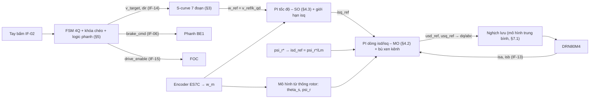
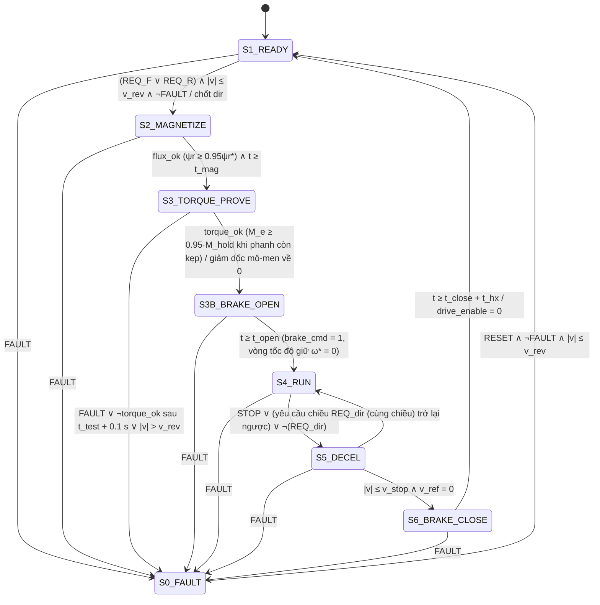

# ĐẶC TẢ THIẾT KẾ ĐIỀU KHIỂN & LOGIC (SDD) — RFOC + S-CURVE 7 ĐOẠN + FSM 4 GÓC PHẦN TƯ ($x = 2$)

**Mã tài liệu:** `SDD-8.5EMG-TROLLEY-v1.5` — Gói `SOW-3.3` (Trần Đỗ Khải) & `SOW-3.4` (Nguyễn Bá Hưng) — Khối 3 *(tên tệp giữ hậu tố v1.0 để không gãy liên kết)*  
**Ngày:** 28/10/2026 — **Trạng thái:** **ĐÃ DUYỆT — Cổng G4 (`CDR-EVT`) đóng ngày 24/10/2026**; v1.5 do Người dùng duyệt ngày 28/10/2026  
**Lịch sử:** v1.0–v1.1 (24/10/2026) bản đầu, xử lý Checker K7-1, K9 · v1.2 (25/10/2026) hộp số SEW R87, $i_{\text{thực}}$ = 155.34 · v1.3 (26/10/2026) mô hình 2 khối lượng, giảm từ thông, biến tần trung bình, kịch bản rút gọn · v1.4 (27/10/2026) nguồn số Excel v1.4 · **v1.5 (28/10/2026)** trình bày lại theo Excel v1.5 và phạm vi môn học CR-08..CR-18: tham số động cơ ước lượng bằng 14 công thức của bài giảng và hiệu chỉnh theo catalogue (§2); vòng tốc độ chỉnh theo $J_{rig}$, kể trễ vòng tốc độ rời rạc (§4.3); giảm từ thông tính ở lưới danh định (§4.1, CR-15); lắc tải chỉ quan sát (§3.4, CR-10); danh sách lần chạy theo CR-12 (§7.3)  
**Nguồn số:** `00_Tinh_toan_Xe_con_x2_v1.5.xlsx` (sheet `UocLuong_TS`; sheet `Tính chọn` khối E, J, K, L, M, N, O, P, Q, R, T; sheet `Mo_phong`) — động cơ SEW DRN80M4  
**Ký hiệu/tên biến:** khóa theo `Block 2/02_ICD_Kiem_soat_Giao_dien_v1.0.md`  
**Tài liệu lý thuyết:** Bài giảng 2-1 (tối ưu module/đối xứng, slide 26–30), Bài giảng 2-3 (FOC, slide 29–42), `Class_3_AC_Motor_Drive` slide 9–11 (14 công thức ước lượng tham số), [R9-11] Tho et al. 2020 (S-curve), [R9-01] Mita & Kanai (con lắc).

> Tài liệu chỉ chứa thiết kế và kết quả **giải tích (A)**. Mọi chỉ tiêu đo trên Simulink (DV-01..07) ghi `Report: chưa chạy`.

---

## 1. CẤU TRÚC TỔNG THỂ BỘ ĐIỀU KHIỂN (CU)



Chu kỳ tính: vòng dòng `Ts_I` $= 1/f_{sw} = 250\ \mu s$; vòng tốc độ, S-curve, FSM `Ts_w` $= 1$ ms. $a^*, \rho^*$ là **giới hạn đặt** (`a_set`, `rho_set`); trạng thái tức thời của bộ tạo quỹ đạo là `a_ref`, `jerk_ref`. Bước giải mô phỏng `Ts_sim` = 5×10⁻⁵ s cố định (`Ts_I` = 5·`Ts_sim`, `Ts_w` = 20·`Ts_sim` — KT-40).

---

## 2. MÔ HÌNH TOÁN ĐỘNG CƠ — THAM SỐ MẠCH THAY THẾ (sheet `UocLuong_TS`, khối J)

**Phương pháp:**
1. Ước lượng bằng **14 công thức** của bài giảng (`Class_3_AC_Motor_Drive` slide 9–11; Báo cáo chuyên đề §1.4) từ nhãn máy DRN80M4 (400 V Y, 1.75 A, 1440 vg/ph, $\cos\varphi_N$ = 0.74).
2. Kiểm chứng bằng mạch thay thế hình T ở $U_N$, $f_N$, $s_N$ theo 4 chỉ tiêu catalogue: $I_N$, $\cos\varphi_N$, $M_N$, $\lambda_K$.
3. Bộ 14 công thức lệch $\lambda_K$ −27% và $M_N$ +17%, nên bộ dùng cho thiết kế là **bộ hiệu chỉnh** (giữ $R_s$ theo cân bằng tổn hao, chỉnh $R_r'$, $L_\sigma$, $L_m$) với sai số lớn nhất 2.0% (KT-44). Ô `sel_mot` = 3.

| Chỉ tiêu (catalogue) | 14 công thức | Sơ đồ vòng tròn (v1.4) | **Hiệu chỉnh (dùng)** |
| :--- | :---: | :---: | :---: |
| $I_N$ (1.75 A) | 1.875 A | 1.535 A | **1.722 A** |
| $\cos\varphi_N$ (0.74) | 0.745 | 0.752 | **0.725** |
| $M$ tại $s_N$ (4.95 N·m) | 5.80 N·m | 4.72 N·m | **5.03 N·m** |
| $\lambda_K$ (3.4) | 2.47 | 2.68 | **3.40** |
| Sai số lớn nhất | 27.4% | 21.1% | **2.0%** |

| Tham số | Ký hiệu / tên biến | Giá trị | Đơn vị |
| :--- | :---: | :---: | :---: |
| Điện trở stator | $R_s$ / `Rs` | 8.386 | Ω |
| Điện trở rotor quy đổi | $R_r'$ / `Rr` | 6.641 | Ω |
| Điện cảm tản stator / rotor | $L_{\sigma s}$, $L_{\sigma r}$ / `Lls`, `Llr` | 0.0294 | H |
| Hỗ cảm | $L_m$ / `Lm` | 0.603 | H |
| Số đôi cực / quán tính rotor + phanh | $p$ / $J_{\text{BMot}}$ | 2 / 26.2×10⁻⁴ | — / kg·m² |
| Hệ số tản | $\sigma = 1 - L_m^2/(L_s L_r)$ | 0.0908 | — |
| Hằng số thời gian rotor | $T_r = L_r/R_r'$ | 0.0952 | s |
| Điện trở / điện cảm tương đương | $R_e = R_s + k_r^2 R_r'$; $L_\sigma = \sigma L_s$ | 14.42 / 0.0574 | Ω / H |
| Hằng số thời gian điện từ | $T_e = L_\sigma/R_e$ | 3.98 | ms |
| Dòng từ hóa định mức (biên độ dq) | $i_{sd,N} = \psi_{r,mh}/L_m$ | 1.562 | A |
| Từ thông rotor định mức | $\psi_{rN}$ | 0.942 | Wb |
| Hệ số mô-men | $k_M = \frac{3}{2}p\frac{L_m}{L_r}\psi_{rN}$ | 2.694 | N·m/A |
| Dòng mô-men định mức | $i_{sq,N} = M_N/k_M$ | 1.838 | A |

$\psi_{rN}$ lấy theo trạng thái xác lập của mạch T ở định mức ($\psi_r = L_m I_m - L_{\sigma r} I_r'$).

**Phương trình mô hình trong hệ $dq$ tựa từ thông rotor** (Bài 2-3 slide 33–34):
$$T_e\frac{di_{sd}}{dt} + i_{sd} = \frac{1}{R_e}\left(u_{sd} + \omega_s L_\sigma i_{sq} + \frac{k_r}{T_r}\psi_r\right),\quad T_e\frac{di_{sq}}{dt} + i_{sq} = \frac{1}{R_e}\left(u_{sq} - \omega_s L_\sigma i_{sd} - k_r\psi_r\, p\,\omega_m\right)$$
$$T_r\frac{d\psi_r}{dt} + \psi_r = L_m i_{sd},\quad \omega_{sl} = \frac{L_m i_{sq}}{T_r\psi_r},\quad M_e = k_M' \psi_r i_{sq},\quad J\frac{d\omega_m}{dt} = M_e - M_c(t)$$

Phương trình chuyển động với $J_\Sigma$ (tải gắn cứng vào xe) chỉ dùng cho **tính chọn** ở Excel (cận trên an toàn). Mô phỏng dùng mô hình 2 khối lượng ở §2.1.

### 2.1. Mô hình cơ khí 2 khối lượng cho mô phỏng (khối O)

Tải $Q + m_{nh}$ treo trên cáp chỉ tác dụng lên xe qua phản lực cáp, nên mô phỏng tách hai khối (quy ước dấu ICD IF-10: $\theta > 0$ khi tải ở phía trước xe theo chiều Tiến):

$$J_{rig}\frac{d\omega_m}{dt} = M_e - M_{tải},\qquad J_{rig} = J_{\text{BMot}} + J_{gear} + m_{xc}k_{qđ}^2 = 5.169\times10^{-3}\text{ kg·m}^2$$
$$F_{tải} = F_c\tanh\!\left(\frac{v}{v_{rev}}\right) - m_{pend}\,g\,\theta,\qquad M_{tải} = \begin{cases} F_{tải}k_{qđ}/\eta & F_{tải}\,\omega_m \ge 0\\ F_{tải}k_{qđ}\,\eta & F_{tải}\,\omega_m < 0\end{cases}$$
$$\ddot\theta + 2\zeta\omega_p\dot\theta + \frac{g}{h}\sin\theta = -\frac{a(t)}{h}\cos\theta,\qquad a(t) = k_{qđ}\frac{d\omega_m}{dt}$$

| Đại lượng | Tên biến | Đầy tải | Không tải | Ghi chú |
| :--- | :---: | :---: | :---: | :--- |
| Khối lượng cứng | `m_trolley` | 1 800 kg | 1 800 kg | P-03 |
| Khối lượng con lắc | `m_pend_full` / `m_pend_empty` | 12 444 kg | 222 kg | Q + m_nh / m_nh |
| Lực cản lăn $F_c = (m_{xc} + m_{pend})\,g\,w_0$ | — | 2 096 N | 298 N | KT-34 |
| Quán tính hộp số $J_{gear} = (\delta-1)M_\Sigma k^2$ | `J_gear` | 1.38×10⁻³ kg·m² | như đầy tải | `[C]` |
| Tần số cộng hưởng xe – tải | — | 1.45 rad/s | — | ≪ $\omega_c$ (KT-35) |

**Hệ quả:**
- $t_{acc}$ ≈ 0.52 s ≪ $T_p$ = 6.95 s: khi xe tăng tốc tải gần như chưa chuyển động. Mô-men đỉnh khi tăng tốc ≈ $J_{rig}\varepsilon^* + M_c$ = **4.76 N·m**, bằng 48% của 9.93 N·m ở mô hình khối cứng (khối F).
- Khi chạy đều, cáp dao động với biên độ $\theta_a$ = 0.011 rad (0.63°), phản lực ±1 350 N; mô-men dao động quanh $M_c$ = 1.87 N·m, lớn nhất ≈ **3.08 N·m**, chu kỳ ≈ $T_p$.
- Vòng tốc độ có tần số cắt ≫ 1.45 rad/s nên chỉ "thấy" $J_{rig}$ ở cả hai trạng thái tải; đây là cơ sở chọn $J_{tune} = J_{rig}$ (§4.3).
- Khi dỡ tải (§7.3), đổi `m_pend` sang `m_pend_empty` và đặt lại $\theta = \dot\theta = 0$ lúc xe đứng yên, phanh kẹp.
- `mech_model` = 1 chuyển về khối cứng ($J_\Sigma$, bỏ $F_{\text{lắc}}$): trường hợp bảo thủ cho DV-04 và DVP-SS-02.

---

## 3. BỘ TẠO QUỸ ĐẠO S-CURVE 7 ĐOẠN (khối E — `SRS-FUNC-03`, `SRS-D06`)

### 3.1. Tham số

$a^* = 0.45\text{ m/s}^2$ (`SRS-D06a`), $\rho^* = 1.8\text{ m/s}^3$ (`SRS-D06b`) — dự trữ 10% dưới cận trên của đề bài ($\le 0.50$, $\le 2.00$) để bù trễ bám của vòng tốc độ (SRS-PERM-03 xét giá trị thực tế).

### 3.2. Biên dạng chuẩn 0 → $v_{\max}$ → 0 (đủ 7 đoạn)

$T_j = a^*/\rho^* = 0.250$ s; $T_a = v_{\max}/a^* - T_j = 0.0167$ s; $t_{acc} = 0.5167$ s; $s_{acc} = 0.031$ m.

| Đoạn | Khoảng thời gian | $\rho^*(t)$ | $a^*(t)$ | $v^*(t)$ |
| :---: | :--- | :---: | :--- | :--- |
| 1 | $[0; T_j]$ | $+\rho^*$ | $\rho^* t$ | $\rho^* t^2/2$ |
| 2 | $[T_j; T_j+T_a]$ | 0 | $a^*$ | $v_1 + a^*(t - T_j)$ |
| 3 | $[T_j+T_a; t_{acc}]$ | $-\rho^*$ | $a^* - \rho^*(t - t_2)$ | $v_{\max} - \rho^*(t_{acc}-t)^2/2$ |
| 4 | $[t_{acc}; t_{acc}+T_v]$ | 0 | 0 | $v_{\max}$ |
| 5–7 | đối xứng 1–3 với dấu ngược | $-\rho^*, 0, +\rho^*$ | âm | giảm về 0 |

Với $v_1 = \rho^* T_j^2/2 = 0.05625$ m/s. Điều kiện đủ 3 đoạn: $a^{*2}/\rho^* = 0.1125 < 0.12$ ✓ (KT-20).

**Chuyển cấp nhanh → bò** ($\Delta v = 0.12 - 0.033 = 0.087 < 0.1125$): suy biến 2 đoạn, $a_{\text{peak}} = \sqrt{\Delta v\,\rho^*} = 0.396\text{ m/s}^2$, thời gian $2a_{\text{peak}}/\rho^* = 0.44$ s.

### 3.3. Thuật toán trực tuyến

Trạng thái $(v^*, a^*)$, đích $v_t$ (`v_target`), mỗi chu kỳ $T_{s,\omega}$:

```
dv_brake = a* · |a*| / (2ρ*)          % độ thay đổi vận tốc nếu bắt đầu hạ gia tốc về 0 ngay bây giờ
e = v_t − (v* + dv_brake)
if   |e| ≤ ε_v and |a*| ≤ ρ*·Ts        → ρ_cmd = −sign(a*)·min(ρ*, |a*|/Ts)
elif e > 0  → ρ_cmd = +ρ* nếu a* < +a_lim, ngược lại 0
else        → ρ_cmd = −ρ* nếu a* > −a_lim, ngược lại 0
a* ← sat(a* + ρ_cmd·Ts, ±a*_set);   v* ← v* + a*·Ts;   w_ref = v*/k_qd
```

Thuật toán bảo đảm $\lvert\rho^*\rvert \le 1.8$, $\lvert a^*\rvert \le 0.45$ ở mọi thời điểm (bão hòa cứng) — `SRS-FUNC-03`, kiểm chứng `DV-03`.

### 3.4. Quan hệ với dao động tải (quan sát, CR-10)

Với $t_{acc} = 0.52\text{ s} \ll T_p = 6.95\text{ s}$, mỗi lần tăng hoặc giảm tốc tác động lên con lắc gần như một bước vận tốc: biên độ lắc khi chạy đều $\theta_a \approx v_{\max}\omega_p/g = 0.63°$. Lắc dư sau khi dừng là tổng hai đáp ứng, phụ thuộc khoảng cách hai lần đổi tốc độ:

$$\theta_{dư} = 2\theta_a\left\lvert\sin\frac{\omega_p(t_{acc} + T_{run})}{2}\right\rvert \in [0;\ 1.27°]$$

- Kịch bản `TS-01` ($T_{run}$ = 10 s): $\theta_{dư}$ = **1.27°** (gần lớn nhất) — `Tính chọn` D235.
- $T_{run} = 2T_p - t_{acc}$ = 13.38 s cho $\theta_{dư}$ = 0 (`Tính chọn` D236).

S-curve ở bài này giới hạn xung mô-men và độ giật, không giảm lắc. Góc lắc $\theta(t)$ chỉ được quan sát và báo cáo, không là tiêu chí nghiệm thu (CR-10); KT-21 ghi "Không áp dụng". Mô hình con lắc: §2.1 (`zeta` = 0, bảo thủ).

---

## 4. TỔNG HỢP BỘ ĐIỀU KHIỂN RFOC (khối K, L — `SRS-D07`, `SRS-D09`)

### 4.1. Mạch vòng từ thông và giảm từ thông (khối P — `SRS-D14`, `SRS-D15`)

$\psi_{rN} = 0.942$ Wb, $i_{sd,N} = 1.562$ A. Từ hóa trước khi nhả phanh trong $t_{mag} = 0.5\text{ s} \ge 3T_r = 0.29$ s `[C]`.

Động cơ định mức 400 V/50 Hz chạy trên lưới 380 V. Nghịch lưu chỉ tạo được $U_{1,\lim} = k_u U_{dc}/\sqrt{2}$ (`k_u` = 0.95 `[C]`), trong khi tại $v_{\max}$ ($f_1$ = 48.2 Hz) động cơ cần $U_{1,\text{req}}$ ≈ 385.8 V ở từ thông định mức. Luật giảm từ thông:

$$\psi_r^* = \psi_{rN}\min\!\left(1, \frac{\omega_{fw}}{\lvert\omega_m\rvert}\right),\qquad \omega_{fw} = \frac{U_{1,\lim}}{U_{1,\text{req}}}\,\omega_{m,v\max}\ \text{(tính trực tuyến từ } U_{dc}\text{ đo)}$$

| Lưới | $U_{dc}$ có tải | $U_{1,\lim}$ | $k_\psi$ tại $v_{\max}$ | $\omega_{fw}$ | Kiểm tra |
| :---: | :---: | :---: | :---: | :---: | :--- |
| 380 V | 513 V | 344.6 V | **0.893** | 133.2 rad/s ($v$ = 0.107 m/s) | $i_{sq}$ cần 2.38 A ≤ 3.86 A (KT-37); $I_s$ = 1.95 A ≤ 3.9 A (KT-38) |

Lưới −10% chỉ kiểm quá tải mô-men bằng tính toán (KT-05); không tính giảm từ thông ở lưới −10% (CR-15). Luật trực tuyến vẫn tự áp dụng nếu chạy lần tùy chọn `TS-01b`.

### 4.2. PI dòng $i_{sd}, i_{sq}$ — Tối ưu Module

Đối tượng (sau bù xen kênh/sđđ bằng tiền điều khiển, Bài 2-3 slide 37–38): $G_I(s) = \dfrac{1}{R_e(1+sT_e)(1+sT_{\mu i})}$, $T_{\mu i} = 1.5/f_{sw} = 375\ \mu s$ `[C]`.

$$R_I(s) = K_{p,I}\left(1 + \frac{1}{sT_{i,I}}\right),\quad T_{i,I} = T_e = 3.98\text{ ms},\quad K_{p,I} = \frac{L_\sigma}{2T_{\mu i}} = \frac{0.0574}{2\times 375\times10^{-6}} = \mathbf{76.6\ V/A}$$

Hàm kín $\approx \dfrac{1}{2T_{\mu i}^2 s^2 + 2T_{\mu i}s + 1}$ → quá điều chỉnh 4.3%, thời gian tăng ≈ $4.7T_{\mu i}$ = **1.76 ms ≤ 10 ms** (KT-22). Bão hòa $\lvert \mathbf{u}_s \rvert \le k_u U_{dc}/\sqrt{3}$; chống bão hòa tích phân kiểu kẹp.

### 4.3. PI tốc độ — Tối ưu Đối xứng

Đối tượng: $G_\omega(s) = \dfrac{k_M}{J s}\cdot\dfrac{1}{1 + sT_{\Sigma\omega}}$ với tổng hằng số thời gian nhỏ kể cả trễ của vòng tốc độ rời rạc:

$$T_{\Sigma\omega} = 2T_{\mu i} + T_{f\omega} + k_{T\omega}T_{s,\omega} = 0.75 + 1 + 1.5\times1 = 3.25\text{ ms}$$

($k_{T\omega}$ = 1.5: giữ mẫu ½ chu kỳ + trễ tính toán 1 chu kỳ, `GiaDinh_K3` D61 `[C]`).

$$R_\omega(s) = K_{p,\omega}\left(1 + \frac{1}{sT_{i,\omega}}\right),\quad T_{i,\omega} = 4T_{\Sigma\omega} = \mathbf{13\ ms},\quad K_{p,\omega} = \frac{J_{tune}}{2k_M T_{\Sigma\omega}} = \mathbf{0.295\ A\cdot s/rad},\quad J_{tune} = J_{rig}$$

**Vì sao $J_{tune} = J_{rig}$:** tần số cắt vòng tốc độ ≫ tần số cộng hưởng xe – tải (1.45 rad/s), nên đối tượng thực mà vòng điều khiển nhìn thấy là $J_{rig}$ ở cả hai trạng thái tải (§2.1). Mô hình khối cứng ($J_\Sigma$, $J_{\Sigma,0}$) chỉ là trường hợp kiểm tra độ bền.

| Đối tượng | $\kappa = J_{tune}/J$ | $\omega_c$ (rad/s) | PM (Excel, gộp khâu) | PM (tính số, tách khâu + trễ) |
| :--- | :---: | :---: | :---: | :---: |
| $J_{rig}$ (mô hình 2 khối lượng) | 1.00 | 154 | 36.9° | 34.3° |
| $J_\Sigma$ khối cứng đầy tải | 0.391 | 80 | **31.6°** (KT-23) | 31.6° |
| $J_{\Sigma,0}$ khối cứng không tải | 1.253 | 181 | **36.5°** (KT-24) | 31.9° |

Mọi trường hợp ≥ 30° (`PM_min`). Excel giải $\lvert L(j\omega)\rvert = 1$ bằng Newton: $64y^3 + 64y^2 - 16\kappa^2 y - \kappa^2 = 0$, $y = (T_{\Sigma\omega}\omega_c)^2$; PM $= \arctan 4x - \arctan x$.

**Lượng đặt:** đi qua S-curve và lọc đầu vào $1/(1 + T_{pre}s)$, $T_{pre} = 4T_{\Sigma\omega}$ = 13 ms, để khử điểm không của SO. $M_p \le 10\%$ (`SRS-D07`) và $e_{xl} \le 5\%$ (`SRS-D08`) kiểm chứng bằng mô phỏng — `Report: chưa chạy` (DV-06).

**Giới hạn dòng mô-men:** $\lvert i_{sq}^* \rvert \le i_{sq,\lim}$ = **3.86 A** (chống trượt $F_k \le F_{\text{bám}}/1.2$). Mô-men cần tại $a^* = 0.45$ theo khối cứng là 9.93 N·m ⇔ $i_{sq}$ = 3.69 A < 3.86 A ✓.

### 4.4. Phân giải đo tốc độ (khối M)

ES7C 1024 chu kỳ/vòng, đếm 4 sườn trong 1 ms: $\Delta\omega = 1.53$ rad/s ⇔ $\Delta v = 1.23$ mm/s < 2 mm/s (KT-25). Khuyến nghị đo kiểu M/T khi $\lvert v \rvert < 0.01$ m/s.

**Trong mô phỏng:** mặc định `enc_model` = 0 (tốc độ lý tưởng qua lọc bậc nhất `Tf_w` = 1 ms). Nếu mô hình hóa lượng tử, dao động $i_{sq}$ ≈ $K_{p,\omega}\Delta\omega$ = 0.45 A (≈ 1.2 N·m, 25% $M_N$) và làm nhiễu phép đo $\rho(t)$ của DV-07; `enc_model` = 1 chỉ dùng cho khảo sát nhiễu.

---

## 5. LOGIC VẬN HÀNH — MÁY TRẠNG THÁI FSM 4 GÓC PHẦN TƯ (`SOW-3.4`, `SRS-FUNC-01/02`, `SRS-D10..D13`)

**Phạm vi (QĐ-07):** chỉ xét điều kiện vận hành lý tưởng — không mất điện, không dừng khẩn / E-STOP, không xét sự cố thiết bị.

### 5.1. Tham số FSM

| Tham số | Tên biến | Giá trị | Nguồn |
| :--- | :--- | :---: | :--- |
| Ngưỡng đóng phanh | `v_stop` | 0.005 m/s | `SRS-D11a` |
| Ngưỡng cấm đảo chiều | `v_rev` | 0.002 m/s | `SRS-D11b` |
| Mô-men giữ thử (phanh còn kẹp) | `M_hold` | 100% $M_N$ = 4.95 N·m ⇔ $i_{sq}$ = 1.84 A | `SRS-D10` |
| Thời gian thử mô-men giữ | `t_test` | 0.2 s (tăng dốc 0.05 s, giữ 0.1 s, giảm dốc 0.05 s) | `[C]` |
| Ngưỡng xác nhận mô-men thử | — | $M_e \ge 0.95\,M_{hold}$ và $\lvert v \rvert \le v_{rev}$ | `[C]` |
| Thời gian từ hóa | `t_mag` | 0.5 s | §4.1 `[C]` |
| Thời gian nhả phanh (chờ cơ khí) | `t_open` | 0.10 s | `[C]` |
| Thời gian kẹp phanh | `t_close` | 0.05 s; ĐC giữ ω* = 0 thêm `t_hx` = 0.05 s | `[C]` |
| Tốc độ đích | `v_max`, `v_creep` | 0.12 / 0.033 m/s | P-09 / `SRS-D12` |

### 5.2. Sơ đồ trạng thái



| Trạng thái | `drive_enable` | `brake_cmd` | `v_target` | Ghi chú |
| :---: | :---: | :---: | :--- | :--- |
| S0 FAULT | 0 | 0 | 0 | Quá áp DC-link / quá dòng |
| S1 READY | 0 | 0 | 0 | Phanh kẹp |
| S2 MAGNETIZE | 1 | 0 | 0 | $i_{sd}^* = i_{sd,N}$, $\omega^* = 0$ |
| S3 TORQUE_PROVE | 1 | **0** | 0 | Phanh còn kẹp: điều khiển mô-men, $i_{sq}^*$ tăng dốc tới $M_{hold}/k_M$ theo chiều `dir`, giữ 0.1 s, đo $M_e$ → `torque_ok`; rồi giảm dốc về 0 |
| S3B BRAKE_OPEN | 1 | **1** | 0 | Vòng tốc độ giữ $\omega^* = 0$ trong `t_open` |
| S4 RUN | 1 | 1 | $dir \cdot (cmd_{fast}\ ?\ v_{\max} : v_{creep})$ | S-curve; góc I/II (dir = +1) hoặc III/IV (dir = −1) |
| S5 DECEL | 1 | 1 | 0 | Hãm tái sinh qua chopper |
| S6 BRAKE_CLOSE | 1 | **0** | 0 | ĐC vẫn giữ $\omega^* = 0$ đến khi phanh kẹp xong ⇒ $\Delta s \approx 0$ |

### 5.3. Hàm logic

$$REQ_F = FWD \wedge \overline{REV},\qquad REQ_R = REV \wedge \overline{FWD}$$
$$PERMIT_{dir} = (\lvert v \rvert \le v_{rev}) \wedge (S1 \vee S0_{reset}),\qquad dir \leftarrow \begin{cases} +1 & REQ_F \wedge PERMIT_{dir} \\ -1 & REQ_R \wedge PERMIT_{dir} \\ dir & \text{khác (giữ nguyên — khóa chéo)} \end{cases}$$
$$REVERSE\_REQ = S4 \wedge \big((dir = +1 \wedge REQ_R) \vee (dir = -1 \wedge REQ_F)\big) \Rightarrow S5$$
$$torque\_ok = flux\_ok \wedge \big(M_e \ge 0.95\,M_{hold} \text{ liên tục } 0.1\text{ s, khi } brake\_cmd = 0\big) \wedge (\lvert v\rvert \le v_{rev})$$
$$brake\_cmd = (S3B \vee S4 \vee S5) \wedge \overline{FAULT},\qquad drive\_enable = (S2 \vee \dots \vee S6) \wedge \overline{FAULT},\qquad FAULT = flt\_ov \vee flt\_oc$$

**QĐ-05:** giữ bước thử mô-men giữ khi phanh còn kẹp, vì `SRS-FUNC-02` yêu cầu "chỉ mở phanh khi động cơ **đã sinh** đủ mô-men giữ". Hệ quả: $M_B \ge 1.2\,M_{hold} = 5.94$ N·m (`SRS-D13`, $M_B$ = 7 N·m).

**Khóa chéo đảo chiều** (`SRS-FUNC-02`): lệnh ngược chiều trong S4 không đổi `dir`; nó chỉ đưa hệ về S5 → S6 → S1. Chiều mới chỉ được chốt khi $\lvert v \rvert \le 0.002$ m/s ở S1.

### 5.4. Ánh xạ 4 góc phần tư

| Góc phần tư | Dấu $\omega_m$ / $M_e$ | Trạng thái FSM | Dòng năng lượng | Thiết bị tham gia |
| :---: | :---: | :--- | :--- | :--- |
| I | + / + | S4 (dir = +1) tăng tốc, chạy đều | Lưới → ĐC | Nghịch lưu |
| II | + / − | S5 (dir = +1) hoặc pha giảm tốc trong S4 | ĐC → DC-link → $R_h$ | Chopper + R1 |
| III | − / − | S4 (dir = −1) | Lưới → ĐC | Nghịch lưu |
| IV | − / + | S5 (dir = −1) | ĐC → DC-link → $R_h$ | Chopper + R1 |

### 5.5. Lưu đồ trình tự một chu kỳ (DV-02)

```
[S1] ─ nhấn FWD ─► kiểm |v| ≤ 0.002? ─ không ─► chờ
                      │ có
                      ▼
            [S2] từ hóa 0.5 s ─► flux_ok?
                      ▼
            [S3] PHANH CÒN KẸP: phát M_hold = 4.95 N·m, đo M_e ≥ 0.95·M_hold trong 0.1 s ─► torque_ok? ─ không ─► FAULT
                      ▼ có — giảm dốc mô-men về 0
            [S3B] brake_cmd = 1, vòng tốc độ giữ ω* = 0, chờ t_open = 0.1 s
                      ▼
            [S4] S-curve 0 → +0.12 m/s (góc I) ─► chạy đều
                      │ nhả FWD / STOP / nhấn REV
                      ▼
            [S5] S-curve → 0 (góc II, chopper xả R_h) ─► |v| ≤ 0.005?
                      ▼
            [S6] brake_cmd = 0, giữ ω* = 0 trong t_close + t_hx = 0.1 s ─► drive_enable = 0 ─► [S1]
```

---

## 6. BẢNG THAM SỐ CHUYỂN GIAO CHO KHỐI 4 (`init_params.m` — tên biến theo ICD)

| Nhóm | Biến | Giá trị | Nguồn ô Excel |
| :--- | :--- | :--- | :--- |
| Cơ | `M_full`, `M_empty`, `D_bx`, `w0`, `phi`, `eta`, `g`, `h`, `k_qd`, `i_gear`, `delta` | 14244, 2022, 0.25, 0.015, 0.20, 0.90, 9.81, 12, 8.047e-4, 155.34, 1.15 | `Params`, `Tính chọn` C |
| Cơ — 2 khối | `m_trolley`, `m_pend_full`, `m_pend_empty`, `J_gear`, `J_rig`, `zeta`, `mech_model` | 1800, 12444, 222, 1.383e-3, 5.169e-3, 0, 0 | `Tính chọn` O, `GiaDinh_K3` |
| Động cơ | `Rs`, `Rr`, `Lls`, `Llr`, `Lm`, `pp`, `J_Bmot` | 8.386, 6.641, 0.0294, 0.0294, 0.603, 2, 26.2e-4 | `UocLuong_TS` (sel_mot = 3) |
| Từ thông | `psi_rN`, `U_N`, `f_N`, `w_fw` | 0.9417, 400, 50, 133.2 | `Tính chọn` J, P |
| Biến tần | `f_sw`, `Udc_chop_on`, `Udc_max`, `Udc_trip`, `Rh` | 4000, 700, 780, 800, 210 | `GiaDinh_K3` |
| Biến tần trung bình | `U_grid`, `dU_grid`, `k_u`, `C_dc`, `R_src`, `Udc_chop_off` | 380, 0.1, 0.95, 220e-6, 13.42, 680 | `Params`, `GiaDinh_K3`, `Tính chọn` Q |
| S-curve | `a_set`, `rho_set`, `v_max`, `v_creep` | 0.45, 1.8, 0.12, 0.033 | `GiaDinh_K3`, `Tính chọn` N |
| PI dòng | `Kp_i`, `Ti_i` | 76.58, 3.982e-3 | `Tính chọn` K |
| PI tốc độ | `Kp_w`, `Ti_w`, `T_pre`, `isq_lim` | 0.2952, 13.0e-3, 13.0e-3, 3.865 | `Tính chọn` L, J |
| FSM | `v_stop`, `v_rev`, `M_hold`, `t_test`, `t_mag`, `t_open`, `t_close`, `t_hx`, `M_B` | 0.005, 0.002, 4.95, 0.2, 0.5, 0.10, 0.05, 0.05, 7 | `GiaDinh_K3`, §5.1 |
| Đo | `Ts_sim`, `Ts_I`, `Ts_w`, `Tf_w`, `Tf_jerk`, `N_enc`, `enc_model` | 5e-5, 2.5e-4, 1e-3, 1e-3, 0.005, 1024, 0 | `GiaDinh_K3` |
| Kịch bản | `t_cmd`, `T_run`, `T_dwell`, `t_unl`, `t_cmd2`, `T_end`, `t_rev2`, `T_end2` | 0.5, 10, 10, 22.43, 22.93, 44.87, 4.82, 15.43 | `GiaDinh_K3`, `Tính chọn` R |

Toàn bộ giá trị gom sẵn ở sheet `Mo_phong` của Excel v1.5; cột G sinh sẵn dòng lệnh MATLAB, chép vùng **G2:G75**. `init_params.m` thuộc `SOW-4.1` (Cổng G5); mọi số phải đọc từ Excel, không gõ tay (`WORKFLOW_RULES.md` §7.1).

---

## 7. MÔ HÌNH MÔ PHỎNG & KỊCH BẢN RÚT GỌN (chuyển giao Khối 4)

### 7.1. Nghịch lưu: mô hình trung bình

Với `Ts_sim` = 50 µs không mô tả được xung PWM 4 kHz, nên nghịch lưu là **nguồn áp 3 pha điều khiển bằng** $u_{sd}^*, u_{sq}^*$ (sau khâu trễ `Ts_I`), bão hòa $\lvert\mathbf{u}_s\rvert \le k_u U_{dc}/\sqrt{3}$. Các chỉ tiêu cần kiểm (dòng, mô-men, $U_{dc}$, năng lượng hãm) không phụ thuộc gợn sóng PWM. IF-11 (`S_abc`) và thời gian chết: Không áp dụng.

### 7.2. DC-link, chỉnh lưu và chopper (IF-05)

$$C_{dc}\frac{dU_{dc}}{dt} = i_{rect} - i_{inv} - i_{chop},\quad i_{rect} = \max\!\left(0, \frac{\sqrt{2}U_{grid} - U_{dc}}{R_{src}}\right),\quad i_{inv} = \frac{3}{2}\frac{u_{sd}i_{sd} + u_{sq}i_{sq}}{U_{dc}}$$

- Chỉnh lưu diode chỉ cho dòng một chiều ⇒ khi hãm, $U_{dc}$ tăng được.
- `R_src` = 13.4 Ω chọn để $U_{dc}$ ≈ 1.35·U ở tải định mức `[C]`; `C_dc` = 220 µF `[C]`, chưa xác minh.
- Chopper (tham số mô hình, CR-17): ON khi $U_{dc} \ge$ 700 V, OFF khi $U_{dc} \le$ 680 V; $i_{chop} = U_{dc}/R_h$; ngắt quá áp 800 V.
- Tụ hấp thụ được 22.2 J khi $U_{dc}$ tăng từ 537 V (lưới danh định, không tải) lên 700 V (15.5 J nếu từ 591 V ở lưới +10%).
  - **Khối cứng** (`mech_model` = 1): năng lượng trả về mỗi lần dừng đầy tải ≈ 59 J > 22.2 J ⇒ chopper tác động (KT-39). Dùng cho **DV-04**.
  - **2 khối lượng** (`mech_model` = 0): tải đang lắc nên chỉ xe con và rotor trả năng lượng về; ước lượng 0–28 J mỗi lần dừng tùy pha lắc ⇒ chopper có thể không đóng. Ghi nhận đúng như vậy, không chỉnh `C_dc` để ép kết quả.

### 7.3. Kịch bản TS-01 rút gọn (DV-01..07)

Thời gian chạy đều `T_run` = 10 s (≥ $T_p$) thay cho 119 s của chu trình nhiệt; chu trình S3 đầy đủ chỉ dùng cho tính $k_{dt}$ ở Excel (DV-08, A/I).

| Thời điểm (s) | Sự kiện | Trạng thái FSM |
| :---: | :--- | :--- |
| 0 | READY, đầy tải (`m_pend_full`), $\theta = 0$ | S1 |
| 0.50 | Nhấn FWD (`t_cmd`) | S2 → S3 → S3B |
| 1.30 | Xe bắt đầu chạy Tiến (`t_go1`) | S4, góc I |
| 1.82 | Bắt đầu chạy đều 0.12 m/s | S4 |
| 11.82 | Nhả FWD, giảm tốc | S5, góc II (chopper) |
| 12.33 | $v$ = 0 → kẹp phanh | S6 → S1 |
| 22.43 | Dỡ tải (`t_unl`): `m_pend` → `m_pend_empty`, đặt lại $\theta, \dot\theta$ = 0 | S1 (phanh kẹp) |
| 22.93 | Nhấn REV (`t_cmd2`) | S2 → S3 → S3B |
| 23.73 | Xe bắt đầu chạy Lùi | S4, góc III |
| 34.77 | $v$ = 0 sau giảm tốc | S5 góc IV → S6 → S1 |
| 44.87 | Kết thúc (`T_end`) | — |

Quãng đường mỗi hành trình 1.26 m; số bước giải ≈ 9.0×10⁵.

| Lần chạy | `mech_model` | Lưới | Mục đích | Bắt buộc (CR-12) |
| :---: | :---: | :---: | :--- | :---: |
| TS-01a | 0 | 380 V | Kịch bản chính, DV-01..03, 05..07 | Có |
| TS-01c | 1 | 380 V | DV-04 ($U_{dc}$, chopper); DVP-SS-02 ở $J_\Sigma$, $J_{\Sigma,0}$; đối chiếu số với Excel | Có |
| TS-02 | 0 | 380 V | Khóa chéo đảo chiều, DV-02 (§7.4) | Có |
| TS-01b | 0 | 342 V | Giảm từ thông ở lưới −10% (DVP-SS-06) | Tùy chọn |
| TS-03 | 0 | 380 V | Đối chứng S-curve với dốc tuyến tính | Tùy chọn |

### 7.4. Kịch bản TS-02 rút gọn (khóa chéo đảo chiều, DV-02)

Như TS-01 đến lúc chạy đều; tại `t_rev2` = 4.82 s (3 s sau khi bắt đầu chạy đều) nhả FWD và nhấn REV cùng lúc. Kỳ vọng: `dir` không đổi, FSM đi S4 → S5 → S6 → S1, xe không chạy Lùi cho tới khi có lệnh REV mới ở S1. Kết thúc `T_end2` = 15.43 s.

> Kết quả mô phỏng TS-01/TS-02: `Report: chưa chạy`.
