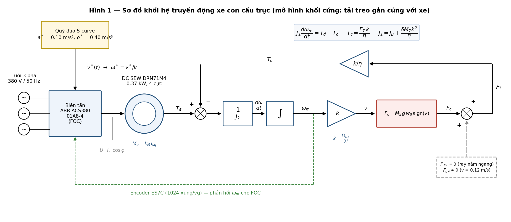
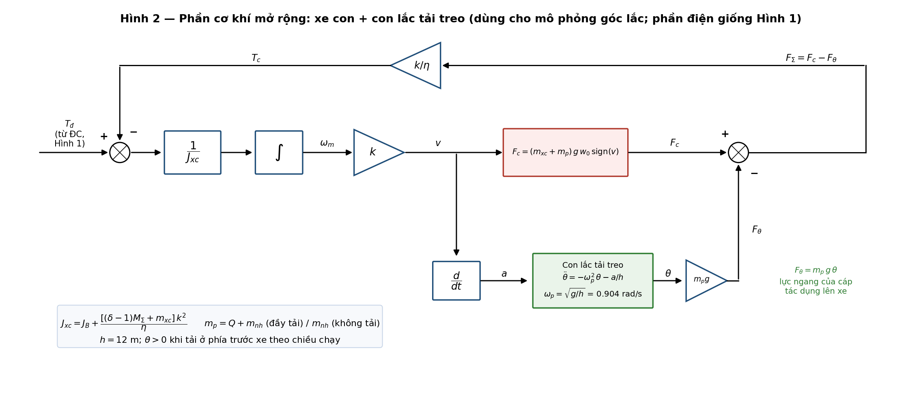

# MÔ HÌNH TOÁN VÀ SƠ ĐỒ KHỐI HỆ TRUYỀN ĐỘNG XE CON CẦU TRỤC ($x = 2$)

**Học phần:** Thiết kế hệ thống truyền động điện (EE4332) — GVHD: TS. Nguyễn Duy Đỉnh
**Nhiệm vụ:** bước 4 trên bảng của thầy — *Xây dựng mô hình hệ truyền động* (sau: ☑ chọn động cơ, ☑ ước lượng tham số, ☑ mô phỏng kiểm chứng động cơ).
**Nguồn số liệu:** `Block 3/00_Tinh_toan_Xe_con_x2_v2.0_rut_gon.xlsx` (DRN71M4 0.37 kW, ACS380-04xS-01A8-4, lượng đặt $a^*$ = 0.10 m/s², $\rho^*$ = 0.40 m/s³ theo CR-19).
**Ngày:** 04/11/2026

---

## 1. Đối chiếu với ví dụ xe máy điện trên lớp

Thầy dựng mô hình xe máy điện theo chuỗi: nguồn → động cơ → $T$ → $\Sigma(T - T_c)$ → $1/J$ → $\int$ → $\omega$ → $r$ → $v$ → các lực cản → $\times r$ → $T_c$ quay về điểm cộng. Xe con cầu trục dùng đúng chuỗi đó, chỉ thay các khối sau:

| Thành phần | Xe máy điện (trên lớp) | Xe con cầu trục (đồ án) | Lý do |
| :--- | :--- | :--- | :--- |
| Nguồn | Lưới 220 V / 50 Hz | Lưới 380 V / 50 Hz → biến tần ACS380 (FOC) | Động cơ KĐB 3 pha điều khiển vector |
| Quy đổi tốc độ | $v = r\,\omega$ (bánh xe gắn trục) | $v = k\,\omega_m$, $k = \dfrac{D_{bx}}{2i}$ | Có hộp số $i$ = 155.34 giữa động cơ và bánh xe |
| Quy đổi lực → mô-men | $T = F\,r$ | $T_c = \dfrac{F\,k}{\eta}$ | Thêm hiệu suất cơ khí $\eta$ = 0.90 của hộp số, ổ, khớp nối |
| Lực cản lăn $R_r$ | $R_r$ | $F_c = M_\Sigma\,g\,w_0\,\mathrm{sign}(v)$ | $w_0$ = 0.015 (bánh thép trên ray thép) |
| Lực dốc $F_t$ | $m g \sin\alpha$ | **0** | Ray nằm ngang |
| Lực khí động $F_a$ | $\tfrac12 \rho\, C_d A\, v^2$ | **≈ 0** | $v$ = 0.12 m/s: với $C_d A$ ≈ 5 m² thì $F_a$ ≈ 0.04 N, không đáng kể so với $F_c$ ≈ 2,096 N |
| Khối lượng | $m$ | $\delta\,M_\Sigma$ ($\delta$ = 1.15 kể quán tính hộp số, khớp nối) | Tải 12.2 t + cơ cấu nâng + xe con |
| Thành phần mới | — | Con lắc tải treo cáp $h$ = 12 m (Hình 2) | Tải treo mềm, gây lực ngang lên xe |

---

## 2. Hệ phương trình — mô hình khối cứng (tải gắn cứng với xe)

**(1) Phương trình chuyển động trên trục động cơ** (công thức thầy viết trên bảng):

$$J_\Sigma \frac{d\omega_m}{dt} = T_{đ} - T_c$$

**(2) Động học — từ tốc độ động cơ ra vận tốc xe:**

$$v = k\,\omega_m, \qquad k = \frac{D_{bx}}{2i} = \frac{0.25}{2 \cdot 155.34} = 8.047\times10^{-4}\ \text{m/rad}$$

**(3) Tổng lực cản tác dụng lên xe:**

$$F_\Sigma = F_c + F_{dốc} + F_{gió} = M_\Sigma\, g\, w_0\, \mathrm{sign}(v) + 0 + 0$$

- Đầy tải: $F_c = 14{,}244 \cdot 9.81 \cdot 0.015 = 2{,}096$ N
- Không tải: $F_{c,0} = 2{,}022 \cdot 9.81 \cdot 0.015 = 298$ N

**(4) Quy đổi lực cản về trục động cơ** (dạng $T = F\,r$ của thầy, thêm hộp số và hiệu suất):

$$T_c = \frac{F_\Sigma\, k}{\eta}$$

- Đầy tải: $T_c = 2096 \cdot 8.047\times10^{-4} / 0.9 = 1.874$ N·m; không tải: 0.266 N·m.
- Khi hãm tái sinh (năng lượng đi ngược từ tải về động cơ) dùng $T_c = F_\Sigma\,k\,\eta$. Với $a^*$ = 0.10 m/s² trường hợp này gần như không xảy ra (Excel `Phu_tai` mục D).

**(5) Định luật 2 Newton dạng tịnh tiến** (hai dòng cuối trên bảng):

$$F_x = F_{đ} - F_c = \delta M_\Sigma\, a \quad\Longrightarrow\quad F_{đ} = F_c + \delta M_\Sigma \frac{dv}{dt}$$

**(6) Mô-men quán tính quy đổi về trục động cơ:**

$$J_\Sigma = J_B + \frac{\delta\, M_\Sigma\, k^2}{\eta}$$

- $J_B$ = 26.2×10⁻⁴ kg·m² (động cơ + phanh; cận trên `[C]`, xem Excel `Catalogue`).
- Đầy tải: $J_\Sigma$ = 0.00262 + 0.01179 = **0.01441 kg·m²**; không tải: **0.00429 kg·m²** (thay đổi 3.4 lần).

**(7) Kiểm tra: (1)–(6) là cùng một phương trình.** Thay (2), (4), (6) vào (1):

$$T_{đ} = \frac{F_c\,k}{\eta} + \left(J_B + \frac{\delta M_\Sigma k^2}{\eta}\right)\frac{a}{k} = \underbrace{\frac{k}{\eta}\Big(F_c + \delta M_\Sigma a\Big)}_{\text{(5) quy về trục ĐC}} + J_B\frac{a}{k}$$

Với $a^*$ = 0.10 m/s², đầy tải: $T_{đ,\max}$ = 1.874 + 0.01441·0.10/8.047×10⁻⁴ = **3.664 N·m** — trùng với `Phu_tai` mục D của Excel.

**(8) Giới hạn bám ray** (điều kiện phụ, không nằm trong vòng kín):

$$F_{đ} \le F_{bám} = \varphi\, k_{dẫn}\, M_\Sigma\, g = 0.20 \cdot 0.5 \cdot 14{,}244 \cdot 9.81 = 13{,}973\ \text{N}$$

---

## 3. Sơ đồ khối — Hình 1

*(Bản vector: `02_So_do_khoi_khoi_cung.svg`)*

| Khối | Phương trình | Ghi chú |
| :--- | :--- | :--- |
| Quỹ đạo S-curve | $v^*(t)$: 7 đoạn, $a^*$ = 0.10 m/s², $\rho^*$ = 0.40 m/s³ | Lượng đặt cho biến tần; $\omega^* = v^*/k$ |
| Biến tần + ĐC (FOC) | $T_{đ} = k_M\, i_{sq}$ (mục 5) | Đo $U$, $I$, $\cos\varphi$ như trên bảng |
| $\Sigma$ mô-men | $T_{đ} - T_c$ | Phương trình (1) |
| $1/J_\Sigma$, $\int$ | $\omega_m = \int \dfrac{T_{đ} - T_c}{J_\Sigma}\,dt$ | $J_\Sigma$ đổi theo tải |
| $k$ | $v = k\,\omega_m$ | Phương trình (2) |
| Lực cản | $F_c = M_\Sigma g w_0\,\mathrm{sign}(v)$; $F_{dốc} = 0$; $F_{gió} \approx 0$ | Phương trình (3) |
| $k/\eta$ | $T_c = F_\Sigma k/\eta$ | Phương trình (4), đường phản hồi phía trên |
| Encoder ES7C | phản hồi $\omega_m$ cho vòng tốc độ FOC | Đường nét đứt màu xanh lá |

Khi mô phỏng nên dùng $\mathrm{sign}(v)$ có vùng chết nhỏ (ví dụ $|v| < 10^{-4}$ m/s thì $F_c$ = 0) để tránh dao động số quanh $v = 0$. Khi xe đứng yên, phanh BE1 (5 N·m) giữ trục.

---

## 4. Mở rộng: xe con + con lắc tải treo — Hình 2

Mô hình khối cứng coi tải gắn chặt vào xe. Thực tế tải treo trên cáp $h$ = 12 m nên có thể lắc. Mô hình hai khối lượng tách tải ra thành con lắc:

**(9) Phương trình con lắc** (tuyến tính hóa góc nhỏ, $\theta > 0$ khi tải ở phía trước xe theo chiều chạy):

$$\ddot\theta = -\omega_p^2\,\theta - \frac{a}{h}, \qquad \omega_p = \sqrt{g/h} = 0.904\ \text{rad/s}, \quad T_p = 6.95\ \text{s}$$

**(10) Lực ngang của cáp tác dụng lên xe:**

$$F_\theta = m_p\, g\, \theta, \qquad m_p = Q + m_{nh} = 12{,}444\ \text{kg (đầy tải)},\ \ 222\ \text{kg (không tải)}$$

**(11) Tổng lực cản và quán tính phía xe:**

$$F_\Sigma = F_c - F_\theta, \qquad F_c = (m_{xc} + m_p)\, g\, w_0\, \mathrm{sign}(v)$$

$$J_{xc} = J_B + \frac{[(\delta - 1) M_\Sigma + m_{xc}]\,k^2}{\eta} = 0.00262 + 0.00283 = 0.00545\ \text{kg·m}^2$$

Trọng lượng tải vẫn đè lên bánh xe nên lực cản lăn tính với khối lượng đầy đủ. Còn quán tính phía động cơ chỉ còn xe, cụm nâng gắn trên xe và hộp số: tải treo chỉ tác dụng qua $F_\theta$. Khi tăng tốc, tải bị trễ lại ($\theta < 0$) nên $F_\theta < 0$, làm $F_\Sigma$ tăng: cáp kéo ngược xe lại.

*(Bản vector: `03_So_do_khoi_con_lac.svg`)*

**Khi nào dùng mô hình nào:**
- **Hình 1 (khối cứng):** chọn động cơ, kiểm tra quá tải và phát nhiệt; khớp với toàn bộ Excel v2.0.
- **Hình 2 (con lắc):** quan sát góc lắc $\theta(t)$ (SRS: chỉ quan sát, không nghiệm thu) và lực cáp. Mô-men đỉnh theo Hình 2 nhỏ hơn Hình 1, vì trong khoảng 1.45 s tăng tốc tải chưa kịp lệch nhiều. Đây không phải lỗi mô hình.

---

## 5. Mô hình động cơ trong FOC (khối "Biến tần + ĐC")

Với điều khiển vector tựa từ thông rotor (RFOC), mô-men điện từ tách thành hai kênh độc lập:

$$T_{đ} = \frac{3}{2}\, p\, \frac{L_m}{L_r}\, \psi_r\, i_{sq} = k_M\, i_{sq}, \qquad T_r \frac{d\psi_r}{dt} + \psi_r = L_m\, i_{sd}$$

Tham số lấy từ bộ hiệu chỉnh của DRN71M4 (Excel `Tham_so_DC`): $R_s$ = 17.25 Ω, $R_r'$ = 17.31 Ω, $L_{\sigma s} = L_{\sigma r}$ = 0.0731 H, $L_m$ = 0.905 H.

| Đại lượng | Công thức | Giá trị |
| :--- | :--- | :---: |
| Điện cảm rotor | $L_r = L_m + L_{\sigma r}$ | 0.978 H |
| Hằng số thời gian rotor | $T_r = L_r / R_r'$ | 0.0565 s |
| Hệ số tản | $\sigma = 1 - L_m^2/(L_s L_r)$ | 0.144 |
| Dòng từ hóa định mức (biên độ dq) | từ mạch thay thế tại điểm định mức | $i_{sd,N}$ = 1.00 A |
| Từ thông rotor định mức | $\psi_r = L_m\, i_{sd,N}$ | 0.907 Wb |
| Hệ số mô-men | $k_M = \tfrac32 p\, (L_m/L_r)\,\psi_r$ | 2.52 N·m/A |
| Dòng $i_{sq}$ ứng $M_N$ = 2.5 N·m | $i_{sq} = M_N / k_M$ | 0.99 A |

Kiểm tra: tại điểm định mức mô hình cho $T_{đ}$ = 2.54 N·m, so với catalogue 2.50 N·m (lệch 1.6%).

---

## 6. Bảng thông số cho mô phỏng

| Ký hiệu | Ý nghĩa | Đầy tải | Không tải | Nguồn |
| :---: | :--- | :---: | :---: | :--- |
| $M_\Sigma$ | Khối lượng tịnh tiến | 14,244 kg | 2,022 kg | SSoT P-04, P-05 |
| $k$ | Hệ số quy đổi $D/(2i)$ | 8.047×10⁻⁴ m/rad | ← | Excel `Phu_tai` B |
| $\eta$ | Hiệu suất cơ khí | 0.90 | ← | SSoT P-15 |
| $J_\Sigma$ | Quán tính quy đổi (Hình 1) | 0.01441 kg·m² | 0.00429 kg·m² | (6) |
| $J_{xc}$ | Quán tính phía xe (Hình 2) | 0.00545 kg·m² | ← | (11) |
| $m_p$ | Khối lượng con lắc (Hình 2) | 12,444 kg | 222 kg | (10) |
| $T_c$ | Mô-men cản khi chạy đều | 1.874 N·m | 0.266 N·m | (4) |
| $T_{đ,\max}$ | Mô-men đỉnh khi tăng tốc ($a^*$ = 0.10) | 3.664 N·m | 0.800 N·m | (7) |
| $h$, $\omega_p$ | Chiều dài cáp, tần số con lắc | 12 m; 0.904 rad/s | ← | SSoT P-06, P-07 |
| $k_M$ | Hệ số mô-men FOC | 2.52 N·m/A | ← | Mục 5 |

---

## 7. Việc tiếp theo

1. Dựng mô hình Simulink theo đúng Hình 1. Khối "Biến tần + ĐC" lúc đầu thay bằng nguồn mô-men lý tưởng $T_{đ} = k_M i_{sq}$ có bộ PI tốc độ, để kiểm chứng phần cơ khí trước.
2. Chạy kịch bản một hành trình đầy tải (`Phu_tai` mục G), so $T_{đ}(t)$ với đồ thị phụ tải của Excel.
3. Thay phần cơ khí bằng Hình 2 để quan sát góc lắc $\theta(t)$.
4. Thông số đưa vào `init_params.m` lấy từ mục 6. Không gõ tay hằng số trong mô hình.

> **Lưu ý:** lượng đặt $a^*$ = 0.10 m/s², $\rho^*$ = 0.40 m/s³ đang được cân nhắc đổi sang 0.06 / 0.24 cho khớp TCVN 4244:2005 Bảng 2.1.2.3.1.1. Nếu đổi, chỉ khối S-curve và các số $T_{đ,\max}$ thay đổi; cấu trúc mô hình giữ nguyên.
