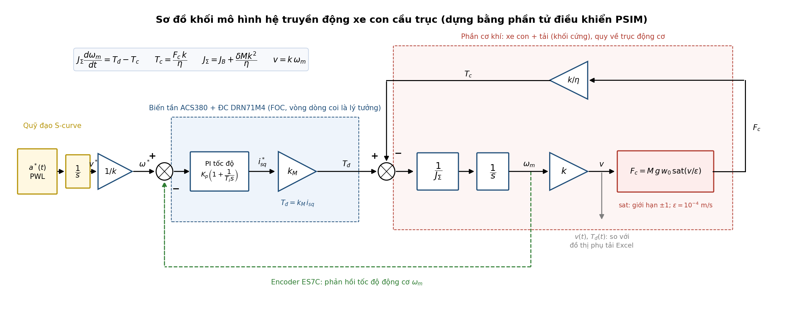

# MÔ HÌNH TOÁN VÀ SƠ ĐỒ KHỐI HỆ TRUYỀN ĐỘNG XE CON CẦU TRỤC ($x = 2$)

**Học phần:** Thiết kế hệ thống truyền động điện (EE4332) — GVHD: TS. Nguyễn Duy Đỉnh
**Nhiệm vụ:** bước 4 — *Xây dựng mô hình hệ truyền động* để chạy mô phỏng (sau: ☑ chọn động cơ, ☑ ước lượng tham số, ☑ mô phỏng kiểm chứng động cơ).
**Nguồn công thức và số liệu:** `Block 3/00_Tinh_toan_Xe_con_x2_v2.0_rut_gon.xlsx`, sheet `Phu_tai` (mã dòng ghi trong ngoặc vuông, ví dụ `[Phu_tai.Mc]`). Thiết bị: SEW DRN71M4 0.37 kW + ABB ACS380-04xS-01A8-4; lượng đặt $a^*$ = 0.10 m/s², $\rho^*$ = 0.40 m/s³ (CR-19).
**Nguyên tắc:** mô hình giữ đơn giản nhất có thể mà vẫn khớp file Excel, để dựng được bằng các phần tử điều khiển cơ bản của **PSIM** (không cần Motor Drive Module).
**Ngày:** 04/11/2026

---

## 1. Cơ sở lý thuyết

Mô hình dùng hai công thức chung của bài giảng `[R5]` (Class_1_Introduction, slide 28 và 31–32):

- **Phương trình động học:** $J \dfrac{d\omega}{dt} = T_{đ} - T_c$
- **Quy đổi lực và quán tính về trục động cơ** qua bộ truyền có tỉ số $i$, hiệu suất $\eta$.

Theo phân loại tải ở cùng bài giảng (slide 22), cơ cấu di chuyển xe con là **tải ma sát khô**: mô-men cản không phụ thuộc tốc độ, chỉ đổi dấu theo chiều chạy.

---

## 2. Giả định

| Mã | Giả định | Hệ quả trong mô hình | Căn cứ |
| :---: | :--- | :--- | :--- |
| GT-01 | Ray nằm ngang, xe chạy trong nhà xưởng | Không có lực dốc, không có lực gió | SRS §1 `[C]` |
| GT-02 | Mọi lực cản di chuyển gộp vào suất cản $w_0$ = 0.015 | $F_c = M g w_0$, không phụ thuộc $v$ | SSoT P-13, Phần 1b |
| GT-03 | Tốc độ thấp $v$ = 0.12 m/s | Bỏ qua lực cản khí động (≈ 0.04 N so với 2,096 N) | SSoT P-09 |
| GT-04 | Bánh thép không biến dạng, không trượt trên ray | $v = k\,\omega_m$, bán kính lăn = $D_{bx}/2$ | SSoT P-12; KT-04 |
| GT-05 | Hộp số $i$ = 155.34; một hiệu suất $\eta$ = 0.90 cho cả chuỗi và cả hai chiều năng lượng | $T_c = F_c k/\eta$ | `[Params.iin]`, SSoT P-15 |
| GT-06 | Quán tính phần quay của hộp số, khớp nối kể bằng $\delta$ = 1.15; quán tính động cơ + phanh $J_B$ cộng riêng | $J_\Sigma = J_B + \delta M k^2/\eta$ | `[Params.delta]`, `[Catalogue.JB]` |
| GT-07 | Tải gắn cứng với xe (không xét lắc) | Một khối lượng $M$ duy nhất | Như toàn bộ Excel v2.0 |
| GT-08 | Biến tần FOC có vòng dòng nhanh hơn nhiều so với cơ khí | Động cơ coi là nguồn mô-men lý tưởng $T_{đ} = k_M\, i_{sq}$ | Excel `Tham_so_DC` |
| GT-09 | Phanh cơ chỉ đóng khi xe đã dừng | Không đưa phanh vào mô hình khi xe chạy | SRS-FUNC-02 |

GT-05, GT-07 và GT-08 là ba giả định đơn giản hóa để mô hình chạy được bằng khối cơ bản. Ảnh hưởng của chúng:
- **GT-05:** khi hãm tái sinh, đúng ra phải nhân $\eta$ thay vì chia. Với $a^*$ = 0.10 m/s² điều này chỉ xảy ra lúc giảm tốc không tải, mô-men rất nhỏ (−0.27 N·m), nên sai số không đáng kể.
- **GT-07:** không mô phỏng được góc lắc. Góc lắc theo SRS chỉ để quan sát, không phải tiêu chí nghiệm thu.
- **GT-08:** bỏ qua quá trình quá độ vài mili giây của vòng dòng, rất ngắn so với 1.45 s tăng tốc.

---

## 3. Hệ phương trình (theo Excel v2.0)

**(1) Lực cản di chuyển** (GT-01, GT-02, GT-03):

$$F_c = M\, g\, w_0\, \mathrm{sign}(v)$$

Đầy tải ($M$ = 14,244 kg): 2,096 N `[Phu_tai.Fc]`; không tải ($M$ = 2,022 kg): 298 N `[Phu_tai.Fc0]`.

**(2) Quy đổi tốc độ** (GT-04):

$$k = \frac{D_{bx}}{2i} = \frac{0.25}{2 \cdot 155.34} = 8.047\times10^{-4}\ \text{m/rad}, \qquad v = k\,\omega_m$$

Khi $v$ = 0.12 m/s: $\omega_m$ = 149.1 rad/s `[Phu_tai.wm]`.

**(3) Mô-men cản quy về trục động cơ** (GT-05):

$$T_c = \frac{F_c\, k}{\eta}$$

Đầy tải 1.874 N·m `[Phu_tai.Mc]`; không tải 0.266 N·m `[Phu_tai.Mc0]`.

**(4) Mô-men động khi xe có gia tốc $a$** (GT-06), đúng công thức `[Phu_tai.Mdg]`:

$$M_{đg} = \frac{\delta\, M\, a\, k}{\eta} + J_B\,\frac{a}{k}$$

**(5) Viết (4) thành phương trình động học** để vẽ sơ đồ khối. Thay $a = k\,\dfrac{d\omega_m}{dt}$:

$$J_\Sigma\,\frac{d\omega_m}{dt} = T_{đ} - T_c, \qquad J_\Sigma = J_B + \frac{\delta\, M\, k^2}{\eta}$$

Đầy tải $J_\Sigma$ = 0.00262 + 0.01179 = **0.01441 kg·m²**; không tải **0.00429 kg·m²**.

**(6) Mô-men động cơ** (GT-08): $T_{đ} = k_M\, i_{sq}$, với $k_M$ = 2.52 N·m/A (mục 5).

**Kiểm tra khớp Excel:** từ (3) và (5), khi tăng tốc đầy tải với $a^*$ = 0.10 m/s²:

$$T_{đ} = 1.874 + 0.01441 \cdot \frac{0.10}{8.047\times10^{-4}} = 3.664\ \text{N·m}$$

Kết quả trùng `[Phu_tai.Mkd]`. Khi chạy đều $T_{đ}$ = 1.874 N·m `[Phu_tai.Mc]`, khi giảm tốc $T_{đ}$ = 0.084 N·m `[Phu_tai.Mh]`.

> **Cần sửa trong Excel:** dòng `[Phu_tai.Jl]` đang ghi $J_{tải} = \delta M k^2$ = 0.0106 kg·m² (không chia $\eta$), trong khi công thức (4) ở `[Phu_tai.Mdg]` có chia $\eta$. Dòng này không được công thức nào dùng nên kết quả chọn thiết bị không đổi, nhưng nên sửa thành $\delta M k^2/\eta$ và thêm dòng $J_\Sigma$ cho thống nhất với (5).

---

## 4. Sơ đồ khối

*(Bản vector: `02_So_do_khoi_mo_phong.svg`; vẽ lại bằng `ve_so_do_khoi.py`)*

### 4.1. Phần tử PSIM cho từng khối

Toàn bộ sơ đồ dựng trong **mạch điều khiển** của PSIM (thư viện *Elements → Control* và *Sources*). Tín hiệu điều khiển trong PSIM không có đơn vị, nên mọi đại lượng nhập theo đơn vị SI như bảng mục 6.

| Khối trên sơ đồ | Nội dung | Phần tử PSIM | Thông số nhập |
| :--- | :--- | :--- | :--- |
| $a^*(t)$ PWL | Gia tốc đặt hình thang (S-curve có đúng dạng này) | Piecewise Linear Voltage Source (nối đất) | Các điểm ở mục 4.2 |
| $1/s$ (S-curve) | $v^* = \int a^*\,dt$ | Integrator (I) | Hệ số 1, giá trị đầu 0 |
| $1/k$ | $\omega^* = v^*/k$ | Proportional (P) | $1/k$ = 1242.7 |
| Σ tốc độ | $\omega^* - \omega_m$ | Summer (2 đầu vào, dấu + và −) | — |
| PI tốc độ | $i_{sq}^* = k\,\dfrac{1 + sT}{sT}\,(\omega^* - \omega_m)$ | PI controller | $k = K_p$, $T = T_i$ (chưa chốt, mục 8) |
| $k_M$ | $T_{đ} = k_M\, i_{sq}$ (GT-08) | Proportional (P) | 2.52 |
| Σ mô-men | $T_{đ} - T_c$ | Summer (+, −) | — |
| $1/J_\Sigma$ | (5) | Proportional (P) | 69.40 (đầy tải) / 233.1 (không tải) |
| $1/s$ (cơ khí) | $\omega_m = \int d\omega_m$ | Integrator (I) | Hệ số 1, giá trị đầu 0 |
| $k$ | $v = k\,\omega_m$ | Proportional (P) | 8.047×10⁻⁴ |
| $F_c$ | $M g w_0\,\mathrm{sat}(v/\varepsilon)$ thay cho $\mathrm{sign}(v)$ | Proportional (P) $1/\varepsilon$ → Limiter (±1) → Proportional (P) $M g w_0$ | $1/\varepsilon$ = 10,000; $M g w_0$ = 2,096 / 297.5 |
| $k/\eta$ | $T_c = F_c k/\eta$ | Proportional (P) | 8.941×10⁻⁴ |
| Phản hồi $\omega_m$ | Encoder | Dây nối từ đầu ra Integrator về Summer | — |
| Quan sát | $v$, $T_{đ}$, $\omega_m$, $i_{sq}^*$ | Voltage Probe (đo tín hiệu điều khiển) | — |

**Vì sao dùng $\mathrm{sat}(v/\varepsilon)$:** khi $|v|$ lớn hơn $\varepsilon = 10^{-4}$ m/s, khâu giới hạn bão hòa ở ±1 nên $F_c = M g w_0$ đúng như (1). Gần $v = 0$, lực cản giảm tuyến tính về 0, tránh dao động số khi xe vừa khởi động hoặc vừa dừng. Cả ba phần tử (P, Limiter, P) đều là phần tử cơ bản.

Tên phần tử có thể khác nhau đôi chút giữa các phiên bản PSIM; nếu nhóm đã có sẵn khối nào tương đương thì dùng khối đó.

### 4.2. Cài đặt mô phỏng một hành trình

Gia tốc đặt của S-curve 7 đoạn có dạng hình thang, nên nhập đúng bằng nguồn tuyến tính từng đoạn. Đoạn chạy đều được rút ngắn còn 3 s cho gọn.

| Thời điểm (s) | 0 | 0.25 | 1.20 | 1.45 | 4.45 | 4.70 | 5.65 | 5.90 |
| :--- | :---: | :---: | :---: | :---: | :---: | :---: | :---: | :---: |
| $a^*$ (m/s²) | 0 | 0.10 | 0.10 | 0 | 0 | −0.10 | −0.10 | 0 |

Các mốc thời gian lấy từ Excel: $T_j$ = 0.25 s `[Phu_tai.Tj]`, $T_a$ = 0.95 s `[Phu_tai.Ta]`, $t_{acc}$ = 1.45 s `[Phu_tai.tacc]`. Diện tích một hình thang = 0.10 × (0.95 + 0.25) = 0.12 m/s, đúng $v_{\max}$.

**Simulation Control:** bước thời gian 1×10⁻⁴ s; tổng thời gian 7 s.

**Kết quả mong đợi (đầy tải):** $v$ lên 0.12 m/s trong 1.45 s; $T_{đ}$ ≈ 3.66 N·m trong đoạn gia tốc không đổi, 1.874 N·m khi chạy đều, ≈ 0.08 N·m khi giảm tốc. Đây là các giá trị của đồ thị phụ tải trong `Phu_tai` (cột I..M). Bộ PI sẽ làm $T_{đ}$ lệch một chút ở chỗ chuyển đoạn.

Chạy hai lần: đầy tải và không tải. Mỗi lần chỉ đổi hai hệ số $1/J_\Sigma$ và $M g w_0$.

---

## 5. Hệ số mô-men $k_M$ của động cơ

Với FOC, khi từ thông rotor giữ ở định mức:

$$T_{đ} = \frac{3}{2}\, p\, \frac{L_m}{L_r}\, \psi_r\, i_{sq} = k_M\, i_{sq}$$

Tham số lấy từ bộ hiệu chỉnh của DRN71M4 ở `Tham_so_DC` mục C ($L_m$ = 0.905 H, $L_{\sigma r}$ = 0.0731 H, $R_r'$ = 17.31 Ω):

| Đại lượng | Công thức | Giá trị |
| :--- | :--- | :---: |
| Điện cảm rotor | $L_r = L_m + L_{\sigma r}$ | 0.978 H |
| Dòng từ hóa định mức (biên độ dq) | từ mạch thay thế hình T tại điểm định mức | $i_{sd,N}$ = 1.00 A |
| Từ thông rotor định mức | $\psi_r = L_m\, i_{sd,N}$ | 0.907 Wb |
| Hệ số mô-men | $k_M = \tfrac32 p\,(L_m/L_r)\,\psi_r$ | 2.52 N·m/A |

Kiểm tra: với $i_{sq}$ = 1.01 A tại điểm định mức, $T_{đ}$ = 2.54 N·m, catalogue 2.50 N·m (lệch 1.6%).

---

## 6. Bảng thông số cho mô phỏng

| Ký hiệu | Ý nghĩa | Đầy tải | Không tải | Nguồn |
| :---: | :--- | :---: | :---: | :--- |
| $M$ | Khối lượng tịnh tiến | 14,244 kg | 2,022 kg | SSoT P-04, P-05 |
| $g$, $w_0$ | Gia tốc trọng trường, suất cản lăn | 9.81 m/s²; 0.015 | ← | SSoT P-18, P-13 |
| $k$ | Hệ số quy đổi $D/(2i)$ | 8.047×10⁻⁴ m/rad | ← | `[Phu_tai.k]` |
| $\eta$ | Hiệu suất cơ khí | 0.90 | ← | SSoT P-15 |
| $J_B$ | Quán tính động cơ + phanh | 0.00262 kg·m² | ← | `[Catalogue.JB]` |
| $\delta$ | Hệ số quán tính phần quay | 1.15 | ← | `[Params.delta]` |
| $J_\Sigma$ | Quán tính quy đổi | 0.01441 kg·m² | 0.00429 kg·m² | (5) |
| $k_M$ | Hệ số mô-men | 2.52 N·m/A | ← | Mục 5 |
| $a^*$, $\rho^*$ | Lượng đặt S-curve | 0.10 m/s²; 0.40 m/s³ | ← | `[Params.aset]`, `[Params.rset]` |
| $T_c$ | Mô-men cản khi chạy đều (kết quả mong đợi) | 1.874 N·m | 0.266 N·m | `[Phu_tai.Mc]` |
| $T_{đ,\max}$ | Mô-men đỉnh khi tăng tốc (kết quả mong đợi) | 3.664 N·m | 0.800 N·m | `[Phu_tai.Mkd]` |

---

## 7. Khác biệt so với ví dụ xe máy điện trên lớp

Chỉ dùng lại cấu trúc chung ở mục 1. Các thành phần cụ thể khác nhau:

| Thành phần | Xe máy điện | Xe con cầu trục | Giả định |
| :--- | :--- | :--- | :---: |
| Nối động cơ – bánh | Trực tiếp, $v = r\,\omega$, bán kính lốp $r_{eff}$ | Qua hộp số, $v = k\,\omega_m$, $k = D/(2i)$ | GT-04, GT-05 |
| Quy đổi lực → mô-men | $T = F\,r$ | $T = F\,k/\eta$ | GT-05 |
| Lực cản | Lăn + dốc + khí động ($\propto v^2$) | Chỉ ma sát khô $F_c = M g w_0$ | GT-01..03 |
| Nguồn cấp | Lưới trực tiếp | Biến tần FOC, có vòng tốc độ bám S-curve | GT-08 |

---

## 8. Việc tiếp theo và câu hỏi cần chốt

1. Sửa dòng `[Phu_tai.Jl]` trong Excel theo ghi chú ở mục 3.
2. Dựng mạch PSIM theo bảng mục 4.1. Có thể khai báo các hệ số bằng phần tử *Parameter File* của PSIM (lấy số từ bảng mục 6) để không gõ tay hằng số trong từng khối.
3. Chạy một hành trình đầy tải và một hành trình không tải (mục 4.2), so $v(t)$, $T_{đ}(t)$ với Excel.

**Cần nhóm chốt trước khi dựng mạch PSIM:**
- **Cách chỉnh PI tốc độ:** theo tối ưu đối xứng (bài giảng Bài 2.1) hay chỉnh tay cho đơn giản? Lưu ý $J_\Sigma$ đổi 3.4 lần giữa đầy tải và không tải, nên phải chọn chỉnh theo trạng thái tải nào.
- **Lượng đặt:** giữ $a^*$ = 0.10 / $\rho^*$ = 0.40, hay đổi sang 0.06 / 0.24 cho khớp TCVN 4244:2005 Bảng 2.1.2.3.1.1? Cấu trúc sơ đồ không đổi, chỉ đổi số.
- **Động cơ trong PSIM:** sơ đồ trên coi động cơ + FOC là khâu khuếch đại $k_M$ (GT-08), dựng được với PSIM bản thường. Nếu ở bước "mô phỏng kiểm chứng động cơ" nhóm đã dùng phần tử động cơ không đồng bộ của PSIM (Motor Drive Module), có thể nối phần cơ khí ở đây vào động cơ đó sau; cần nhóm xác nhận đã dùng cách nào.
