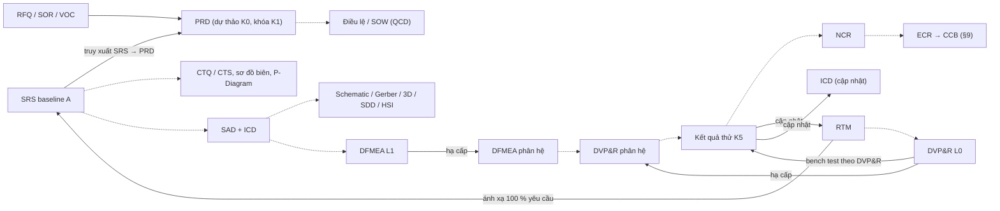

# PHÂN TÍCH LƯU ĐỒ EVLEP003_HBK — 5 GÓC NHÌN

> **Nguồn đầu vào duy nhất:** [FLOW_TRANSCRIPT.md](FLOW_TRANSCRIPT.md) (bản chép nguyên văn lưu đồ `EVLEP003_HBK` v1.8.2 — Chờ duyệt). Chưa đối chiếu với nội dung văn bản HBK §/Bảng.
>
> **Quy ước nhãn:**
> - `[Từ lưu đồ]` — có chữ/nét vẽ tương ứng trên lưu đồ (qua bản chép).
> - `[Suy luận]` — diễn giải của AI, **cần kiểm** với HBK hoặc người hướng dẫn (tương đương nhãn `[AI bổ sung – cần kiểm]` trong SE_RULES §3).
> - `[Chuẩn: tên, URL]` — kiến thức phổ quát dẫn từ chuẩn/tài liệu ngành.
>
> Mỗi góc nhìn chia **A. Đọc từ lưu đồ** và **B. Suy luận** — không trộn lẫn.

---

## GÓC NHÌN 1 — BẢNG KHỐI × CỔNG

### 1A. Đọc từ lưu đồ

Toàn bộ các ô trong bảng dưới đây đều là `[Từ lưu đồ]` (chép từ nhãn khối, nhãn cổng, nhãn nhánh và Ghi chú 4).

| Khối vào cổng | Cổng | Người phê duyệt | Câu hỏi xét duyệt | Kết quả ghi trên nhánh đi tiếp | Đi tiếp tới | KHÔNG ĐẠT → quay về | Nhãn nhánh KHÔNG ĐẠT | TRL (Ghi chú 4) |
|---|---|---|---|---|---|---|---|---|
| 0 · Tiền khả thi (Pre-A) §4.2, §4.3, §5.1 | MCR | CTO | Bài toán KD có đáng đầu tư? → Điều lệ hiệu lực | ĐẠT hoặc ĐẠT CÓ ĐIỀU KIỆN — Điều lệ có hiệu lực | Khối 1 | Khối 0 | cập nhật BCA / Điều lệ | 1–2 |
| 1 · Yêu cầu hệ thống §5.2 | SRR-EVT | SE Lead | Yêu cầu đã đủ & đo được chưa? → Đóng băng SRS | ĐẠT hoặc ĐẠT CÓ ĐIỀU KIỆN | Khối 2 | Khối 1 | sửa SRS / RTM | 3 |
| 2 · Kiến trúc §5.3 | PDR-EVT | SE Lead | Kiến trúc đã chốt & khả thi chưa? → Đóng băng SAD/ICD | ĐẠT hoặc ĐẠT CÓ ĐIỀU KIỆN | Khối 3 | Khối 2 | sửa kiến trúc / tối ưu BOM | 3–4 |
| 3 · Thiết kế chi tiết §5.4 | CDR-EVT | PE Lead | Đủ chín để đặt chế tạo mẫu chưa? → Đóng băng TK chi tiết | ĐẠT hoặc ĐẠT CÓ ĐIỀU KIỆN | Khối 4 | Khối 3 | ⚠ không có nhãn sát đỉnh (xem ⚠1) | 4 |
| 4 · Chuẩn bị thử nghiệm §5.5 | TRR-EVT | QE Lead | Đủ điều kiện an toàn để bắt đầu đo? → Cấp quyền đo kiểm | ĐẠT — được phép bắt đầu đo kiểm | Khối 5 | Khối 4 | hiệu chuẩn lại, bổ sung đồ gá | 4 |
| 5 · Tích hợp & thử nghiệm §5.6 | SIR-EVT | PM | Tích hợp đã đạt tiền kiểm chưa? | ĐẠT | Cổng SAR-EVT | Khối 5 | sửa mạch / FW, tích hợp và tiền kiểm lại | 4–5 |
| (từ SIR-EVT) | SAR-EVT | CTO | Nghiệm thu EVT, cho sang DVT? | ĐẠT — nghiệm thu mẫu EVT | GIAI ĐOẠN DVT (Mẫu chu kỳ B) | Khối 3 (⚠ xem ⚠1) | sửa thiết kế, chế tạo lại mẫu, đo lại từ TRR | 5 |
| (từ SAR-EVT) | — | CTO | — | HỦY DỰ ÁN — CTO quyết định | TẠM DỪNG / HỦY DỰ ÁN §8.3 · §8.4 | — | — | — |

Quan sát thêm, chỉ từ lưu đồ:
- `[Từ lưu đồ]` Nhánh "ĐẠT CÓ ĐIỀU KIỆN" chỉ được ghi ở 4 cổng MCR, SRR-EVT, PDR-EVT, CDR-EVT; ba cổng TRR-EVT, SIR-EVT, SAR-EVT chỉ ghi "ĐẠT".
- `[Từ lưu đồ]` Ghi chú (1): Bảng 7 có bốn kết quả cổng — Thông qua · Thông qua có điều kiện · KHÔNG ĐẠT (soát xét lại, §8.2) · Hủy dự án (§8.4); nhánh Hủy áp dụng tại mọi cổng do CTO quyết định, nhưng chỉ được vẽ tại SAR-EVT.
- `[Từ lưu đồ]` SIR-EVT là cổng duy nhất không có dòng "→ …" (sản phẩm đầu ra của cổng) dưới câu hỏi; SAR-EVT cũng không có dòng "→ …".
- `[Từ lưu đồ]` Không có khối công việc nào nằm giữa SIR-EVT và SAR-EVT; hai cổng nối thẳng với nhau.

**⚠1 — Mâu thuẫn nhãn ở vòng quay về Khối 3** `[Từ lưu đồ]`: hai đường đứt cùng cắm vào đáy Khối 3 — đường từ đỉnh trái CDR-EVT (không có nhãn sát đỉnh) và đường từ đỉnh trên SAR-EVT. Gần hai đường có hai nhãn: "KHÔNG ĐẠT — sửa thiết kế chi tiết" (sát đáy Khối 3) và "KHÔNG ĐẠT — sửa thiết kế, chế tạo lại mẫu, đo lại từ TRR" (dưới CDR-EVT, cạnh đường của SAR-EVT). Lưu đồ không chỉ rõ nhãn nào thuộc đường nào → **CHƯA RÕ – cần hỏi**.

### 1B. Suy luận

- `[Suy luận]` Ghép nhãn hợp lý nhất cho ⚠1: "sửa thiết kế chi tiết" thuộc CDR-EVT (vòng ngắn, chưa có mẫu), còn "sửa thiết kế, chế tạo lại mẫu, đo lại từ TRR" thuộc SAR-EVT (đã có mẫu nên mới phải chế tạo lại).
- `[Suy luận]` Nhãn của SAR-EVT viết "đo lại từ TRR" nhưng mũi tên lại về Khối 3; như vậy sau khi sửa ở Khối 3 có thể phải đi lại qua CDR-EVT, cũng có thể được đi thẳng vào TRR-EVT. Lưu đồ không giải quyết điểm này → cần hỏi xem có phải họp lại CDR không.
- `[Suy luận]` Việc chỉ ba cổng cuối ghi "ĐẠT" có thể là chủ ý: khi đã cấp quyền đo kiểm hoặc nghiệm thu mẫu thì không chấp nhận "có điều kiện" vì lý do an toàn/nghiệm thu. Cũng có thể chỉ là lược bớt cho gọn hình. Mâu thuẫn với Ghi chú (1) (Bảng 7 áp dụng chung) → **CHƯA RÕ – cần hỏi**.
- `[Suy luận]` SIR-EVT và SAR-EVT không có dòng "→ …" có lẽ vì đây là cổng nghiệm thu kết quả, không phải cổng đóng băng một tài liệu cụ thể.

---

## GÓC NHÌN 2 — CHUỖI TÀI LIỆU & BASELINE

### 2A. Đọc từ lưu đồ

| Khối | Tài liệu / sản phẩm được tạo ra (theo gạch đầu dòng) | Nguồn |
|---|---|---|
| 0 | Mã dự án; quyết định lập CFT (CTO ký); BCA sơ bộ kèm TRL; tuyên bố khả thi SX kèm MRL; PRD dự thảo; Điều lệ; SOW (mục tiêu QCD đo được); sổ RRM (≥ 5 rủi ro kỹ thuật/tiến độ) | `[Từ lưu đồ]` |
| 1 | SRS baseline A; PRD được khóa; truy xuất SRS → PRD; DVP&R L0; RTM (ánh xạ 100 % yêu cầu); sơ đồ biên; P-Diagram; CTQ / CTS sơ bộ | `[Từ lưu đồ]` |
| 2 | SAD + ICD (đủ 7 sơ đồ kỹ thuật cốt lõi); BOM sơ bộ 3 cấp; danh sách linh kiện độc cung, đơn đặt long-lead; DFMEA L1 (xử lý hết AP = Cao); phân tích trade-off kiến trúc; phân tích Creepage / Clearance | `[Từ lưu đồ]` |
| 3 | Schematic, Gerber, 3D vỏ & đồ gá, SDD, HSI; WCCA, SI/PI, mô phỏng nhiệt; DFMEA cấp phân hệ; DVP&R cấp phân hệ; RTM bao phủ 100 %; bảng ánh xạ V-Model | `[Từ lưu đồ]` |
| 4 | Kế hoạch thử chi tiết; hồ sơ hiệu chuẩn thiết bị đo; biên bản nghiệm thu đồ gá, kiểm kê mẫu thử; đánh giá rủi ro thử nghiệm + kế hoạch dự phòng sự cố; xác nhận cấu hình mẫu đúng baseline đã khóa (PE Lead ký) | `[Từ lưu đồ]` |
| 5 | Mẫu EVT đã tích hợp; kết quả bench test theo DVP&R; kết quả chạy liên tục ≥ T_min giờ; số đo hotspots; kết quả tiền kiểm SFC, EMC pre-scan (biên ≥ 6 dB); NCR (đóng hết NCR trọng yếu chu kỳ A); RTM, ICD cập nhật | `[Từ lưu đồ]` |

| Cổng | Thứ bị khóa / có hiệu lực (dòng "→ …" hoặc nhãn nhánh ĐẠT) | Nguồn |
|---|---|---|
| MCR | Điều lệ hiệu lực | `[Từ lưu đồ]` |
| SRR-EVT | Đóng băng SRS | `[Từ lưu đồ]` |
| PDR-EVT | Đóng băng SAD/ICD | `[Từ lưu đồ]` |
| CDR-EVT | Đóng băng TK chi tiết | `[Từ lưu đồ]` |
| TRR-EVT | Cấp quyền đo kiểm (không phải tài liệu) | `[Từ lưu đồ]` |
| SIR-EVT | (không ghi) | `[Từ lưu đồ]` |
| SAR-EVT | Nghiệm thu mẫu EVT → sang DVT (Mẫu chu kỳ B) | `[Từ lưu đồ]` |

- `[Từ lưu đồ]` Khối 1 ghi rõ thứ tự: "Khóa PRD **trước khi** đóng băng SRS".
- `[Từ lưu đồ]` Các cụm từ về baseline xuất hiện trên lưu đồ: "SRS baseline A" (Khối 1), "baseline đã khóa" (Khối 4), "chu kỳ A" (Khối 5), "Mẫu chu kỳ B" (DVT).
- `[Từ lưu đồ]` Khối 5 *cập nhật* RTM và ICD, tức là sửa cả ICD, thứ đã bị đóng băng tại PDR-EVT.

### 2B. Suy luận

- `[Suy luận]` Chuỗi baseline tích lũy theo thời gian: **Điều lệ/SOW (MCR) → PRD khóa + SRS (SRR) → SAD/ICD (PDR) → TK chi tiết = Schematic/Gerber/3D/SDD/HSI (CDR) → cấu hình mẫu (TRR)**. Mỗi baseline sau dựa trên baseline trước.
- `[Suy luận]` "Baseline đã khóa" mà PE Lead đối chiếu ở Khối 4 nhiều khả năng là baseline TK chi tiết vừa đóng băng ở CDR-EVT.
- `[Suy luận]` Việc Khối 5 cập nhật ICD đã đóng băng hàm ý phải có cơ chế thay đổi có kiểm soát; theo Ghi chú (3) đó là ECR trình CCB (§9). Điểm này cần xác nhận với HBK §9.
- `[Suy luận]` "Baseline A / chu kỳ A" (EVT) và "chu kỳ B" (DVT) gợi ý mỗi giai đoạn mẫu có một bộ baseline riêng được đặt tên theo chữ cái.
- `[Chuẩn: NASA Systems Engineering Handbook (SP-2016-6105 Rev 2), https://www.nasa.gov/reference/systems-engineering-handbook/]` Cách đặt baseline tại các cổng soát xét (SRR, PDR, CDR…), rồi sau đó chỉ thay đổi qua quản lý cấu hình, là thông lệ của kỹ thuật hệ thống.

---

## GÓC NHÌN 3 — CHUỖI TRUY XUẤT & V-MODEL

### 3A. Đọc từ lưu đồ

Các mối liên kết có chữ trên lưu đồ:
- `[Từ lưu đồ]` "I: RFQ · SOR · VOC hoặc ý tưởng nội bộ" là đầu vào của Khối 0 (trong đó có PRD dự thảo).
- `[Từ lưu đồ]` "truy xuất SRS → PRD" (Khối 1).
- `[Từ lưu đồ]` "Lập DVP&R L0 + RTM ánh xạ 100 % yêu cầu" (Khối 1).
- `[Từ lưu đồ]` "Hạ DFMEA và DVP&R xuống cấp phân hệ; RTM bao phủ 100 %" (Khối 3).
- `[Từ lưu đồ]` "chạy bench test theo DVP&R" (Khối 5).
- `[Từ lưu đồ]` "Đóng hết NCR trọng yếu chu kỳ A; cập nhật RTM, ICD" (Khối 5).
- `[Từ lưu đồ]` "Nộp bảng ánh xạ V-Model: mỗi khối có phép thử đối xứng" (Khối 3). **Lưu đồ không trình bày nội dung bảng này.**

Sơ đồ truy xuất (nét liền = có chữ trên lưu đồ `[Từ lưu đồ]`; nét đứt = `[Suy luận]`):

### 3B. Suy luận — Bảng ánh xạ V-Model đề xuất

Toàn bộ bảng dưới đây là `[Suy luận]`. Tên phép thử nào có trên lưu đồ thì được đánh dấu "(LĐ)" để biết nó xuất hiện ở đâu, còn việc ghép cặp hai vế là do AI đề xuất.

| Nhánh trái (định nghĩa / thiết kế) | Khối | Phép thử đối xứng ở nhánh phải | Nơi kiểm / cổng |
|---|---|---|---|
| Nhu cầu KD, PRD, mục tiêu QCD | 0–1 | Nghiệm thu mẫu EVT có đáp ứng mục đích sử dụng không (validation) | SAR-EVT "Nghiệm thu EVT" (LĐ) |
| SRS baseline A, CTQ/CTS | 1 | Bench test cấp hệ thống theo DVP&R L0 (LĐ); chạy liên tục ≥ T_min (LĐ); EMC pre-scan biên ≥ 6 dB (LĐ); tiền kiểm SFC (LĐ) | Khối 5 → SIR-EVT |
| SAD + ICD, Creepage/Clearance | 2 | Thử tích hợp và giao diện; cập nhật ICD theo thực tế (LĐ); đo hotspots (LĐ) đối chứng phân tích nhiệt/kiến trúc | Khối 5 → SIR-EVT |
| Schematic / Gerber / SDD / HSI, WCCA, SI/PI, mô phỏng nhiệt | 3 | Thử theo DVP&R cấp phân hệ (LĐ); đo nhiệt và điện thực tế để đối chứng WCCA / mô phỏng | Khối 5 (bench test) |
| DFMEA L1 / phân hệ | 2–3 | Phép thử trong DVP&R dùng làm biện pháp phát hiện cho các mode lỗi AP cao | Khối 5; NCR nếu trượt |

- `[Suy luận]` Kiểm nhanh: nếu một dòng trong SRS không có phép thử tương ứng trong DVP&R thì RTM sẽ không đạt "100 %". Vì vậy RTM là chỗ chứng minh V-Model khép kín.
- `[Chuẩn: ISO/IEC/IEEE 29148:2018, https://www.iso.org/standard/72089.html]` Yêu cầu tốt phải kiểm chứng được (verifiable). Điều này khớp với câu hỏi SRR "đo được chưa?" và dòng "mọi yêu cầu phải đo được".
- `[Chuẩn: NASA Systems Engineering Handbook Rev 2, https://www.nasa.gov/reference/systems-engineering-handbook/]` Mô hình chữ V (Vee): nhánh trái phân rã và định nghĩa, nhánh phải tích hợp và kiểm chứng (verification), thẩm định (validation) ở cùng cấp.

---

## GÓC NHÌN 4 — VAI TRÒ NGƯỜI KÝ

### 4A. Đọc từ lưu đồ

| Vai | Ký / quyết định ở đâu | Nguồn |
|---|---|---|
| CTO | Cổng MCR; cổng SAR-EVT; nhánh HỦY DỰ ÁN ("CTO quyết định"); ký quyết định lập CFT (Khối 0) | `[Từ lưu đồ]` |
| CTO | Hủy áp dụng tại mọi cổng do CTO quyết định — Ghi chú (1) | `[Từ lưu đồ]` |
| CTO | §5.2.2(d) và §5.3.2(h) còn quy định chữ ký CTO tại SRR-EVT / PDR-EVT, "cần đối chiếu khi ký biên bản" — Ghi chú (2) | `[Từ lưu đồ]` |
| CTO | Vượt ngưỡng vòng lặp mẫu EVT ≤ 2 thì CTO đánh giá lại tính khả thi (§4.1.5c) — Ghi chú (3) | `[Từ lưu đồ]` |
| CTO | Khung tên: Phê duyệt "CTO · [chờ ký]" | `[Từ lưu đồ]` |
| SE Lead | Cổng SRR-EVT; cổng PDR-EVT | `[Từ lưu đồ]` |
| PE Lead | Cổng CDR-EVT; ký xác nhận cấu hình mẫu đúng baseline đã khóa (Khối 4) | `[Từ lưu đồ]` |
| QE Lead | Cổng TRR-EVT; khung tên: Soát xét "QE Lead · [chờ ký]" | `[Từ lưu đồ]` |
| PM | Cổng SIR-EVT | `[Từ lưu đồ]` |

- `[Từ lưu đồ]` Ghi chú (2): "Thẩm quyền ghi trong hình lấy theo Bảng 5".
- `[Từ lưu đồ]` Lưu đồ **không** viết đầy đủ tên chức danh PE, QE → nghĩa đầy đủ là **CHƯA RÕ – cần hỏi**.

### 4B. Suy luận — vì sao đúng vai

- `[Suy luận]` **CTO tại MCR, SAR-EVT và Hủy:** đây là các quyết định về đầu tư và vòng đời dự án (bắt đầu chi tiền, cho sang giai đoạn tốn kém hơn là DVT, dừng hẳn). Đó là quyết định quản trị chứ không phải kỹ thuật thuần túy, nên do cấp cao nhất về kỹ thuật/kinh doanh ký.
- `[Suy luận]` **SE Lead tại SRR/PDR:** hai cổng này xét yêu cầu và kiến trúc toàn hệ thống, đúng phạm vi của kỹ sư hệ thống: tính đầy đủ, đo được, truy xuất, phân rã giao diện (ICD).
- `[Suy luận]` **PE Lead tại CDR và xác nhận cấu hình mẫu:** CDR xét "đủ chín để đặt chế tạo", tức là thiết kế chi tiết có làm ra được không. Đây là việc của trưởng kỹ thuật sản phẩm/thiết kế (PE có thể là Product Engineering, **cần hỏi**). Cùng người đó xác nhận mẫu đúng baseline là hợp lý vì họ sở hữu baseline thiết kế.
- `[Suy luận]` **QE Lead tại TRR:** câu hỏi "đủ điều kiện an toàn để bắt đầu đo?" liên quan hiệu chuẩn, đồ gá, rủi ro thử, tức là độ tin cậy của phép đo. Đây là việc của chất lượng (QE có thể là Quality Engineering, **cần hỏi**). Người kiểm độc lập với người thiết kế giúp tránh "tự chấm bài".
- `[Suy luận]` **PM tại SIR:** tích hợp và tiền kiểm là mốc tổng hợp nhiều nhóm (phần cứng, FW, cơ khí, thử nghiệm) và ảnh hưởng tiến độ/chi phí, nên người điều phối dự án nghiệm thu trước khi trình CTO.
- `[Suy luận]` Có một độ vênh cần làm rõ: lưu đồ ghi SE Lead ký SRR/PDR, nhưng Ghi chú (2) nói HBK còn yêu cầu chữ ký CTO ở hai cổng này. Có thể là đồng ký (SE Lead chủ trì, CTO phê duyệt) → **CHƯA RÕ – cần hỏi**.
- `[Chuẩn: NASA Systems Engineering Handbook Rev 2, https://www.nasa.gov/reference/systems-engineering-handbook/]` Nguyên tắc tách vai giữa người chủ trì kỹ thuật cổng soát xét và người có thẩm quyền quyết định (decision authority) cho phép đi tiếp là thông lệ trong quản lý vòng đời dự án.

---

## GÓC NHÌN 5 — NHỊP LẶP (VÒNG QUAY LẠI)

### 5A. Đọc từ lưu đồ

| # | Vòng | Từ cổng → về | Nội dung sửa (nhãn) | Nguồn |
|---|---|---|---|---|
| L1 | MCR → Khối 0 | MCR → K0 | cập nhật BCA / Điều lệ | `[Từ lưu đồ]` |
| L2 | SRR → Khối 1 | SRR-EVT → K1 | sửa SRS / RTM | `[Từ lưu đồ]` |
| L3 | PDR → Khối 2 | PDR-EVT → K2 | sửa kiến trúc / tối ưu BOM | `[Từ lưu đồ]` |
| L4 | CDR → Khối 3 | CDR-EVT → K3 | ⚠1 (nhãn chưa chắc) | `[Từ lưu đồ]` |
| L5 | TRR → Khối 4 | TRR-EVT → K4 | hiệu chuẩn lại, bổ sung đồ gá | `[Từ lưu đồ]` |
| L6 | SIR → Khối 5 | SIR-EVT → K5 | sửa mạch / FW, tích hợp và tiền kiểm lại | `[Từ lưu đồ]` |
| L7 | SAR → Khối 3 | SAR-EVT → K3 (vòng dài, vượt qua 1 cung vượt) | sửa thiết kế, chế tạo lại mẫu, đo lại từ TRR (⚠1) | `[Từ lưu đồ]` |
| H | Hủy | SAR-EVT (và mọi cổng theo Ghi chú 1) → TẠM DỪNG / HỦY §8.3 · §8.4 | CTO quyết định | `[Từ lưu đồ]` |

- `[Từ lưu đồ]` Ghi chú (3): vòng lặp mẫu EVT ≤ 2 (Bảng 2); mỗi vòng mới phải mở ECR trình CCB (§9); vượt ngưỡng thì CTO đánh giá lại tính khả thi (§4.1.5c).
- `[Từ lưu đồ]` Khối 2 có "đặt long-lead", tức là việc đặt hàng diễn ra *trước* cổng PDR-EVT.

### 5B. Suy luận — rẻ hay đắt

Xếp hạng chi phí (1 = rẻ nhất), toàn bộ là `[Suy luận]`:

| Hạng | Vòng | Lý do |
|---|---|---|
| 1 | L2 (SRR→K1) | Chỉ sửa giấy tờ (SRS/RTM), chưa có phần cứng; tác động lan truyền nhỏ. |
| 2 | L1 (MCR→K0) | Rẻ về tiền nhưng có thể làm trễ cả dự án (Điều lệ chưa hiệu lực thì chưa được làm EVT). |
| 3 | L5 (TRR→K4) | Muộn trong luồng nhưng **rẻ**: không đụng thiết kế, chỉ hiệu chuẩn hoặc bổ sung đồ gá. Ví dụ cho thấy vòng muộn chưa chắc đã đắt. |
| 4 | L3 (PDR→K2) | Sửa kiến trúc kéo theo SAD/ICD/BOM/DFMEA L1; **có thể đã mất tiền** nếu long-lead đã đặt ở Khối 2 mà kiến trúc bị đổi. |
| 5 | L4 (CDR→K3) | Sửa schematic/Gerber/3D/SDD; chưa chế tạo mẫu nên chưa tốn vật tư. |
| 6 | L6 (SIR→K5) | Đã có mẫu: rework mạch, đổi FW, tích hợp và tiền kiểm lại; tốn giờ máy thử và tiến độ. |
| 7 | L7 (SAR→K3) | Đắt nhất trong các vòng lặp: sửa thiết kế + chế tạo lại mẫu + đo lại; nhiều khả năng tính là một "vòng lặp mẫu EVT" trong hạn mức ≤ 2 và cần ECR/CCB. |
| — | H (Hủy) | Không phải vòng lặp; chi phí chìm toàn bộ, nhưng có thể là lựa chọn rẻ nhất về dài hạn nếu bài toán KD không còn đứng vững. |

- `[Suy luận]` Lưu đồ không nói rõ vòng nào được tính vào hạn mức "vòng lặp mẫu EVT ≤ 2". Nhiều khả năng là các vòng phải **chế tạo lại mẫu** (L7, có thể cả L6) → **CHƯA RÕ – cần hỏi** (Bảng 2).
- `[Suy luận]` Bài học thiết kế quy trình: các cổng sớm (SRR, PDR) càng chặt thì càng giảm xác suất phải đi vòng L6/L7 đắt đỏ. Đó là lý do SRR hỏi "đo được chưa?" và CDR có WCCA, SI/PI, mô phỏng nhiệt trước khi chế tạo.
- `[Chuẩn: Stecklein et al., "Error Cost Escalation Through the Project Life Cycle", NASA 2004, https://ntrs.nasa.gov/citations/20100036670]` Chi phí sửa lỗi tăng mạnh khi lỗi được phát hiện ở giai đoạn càng muộn so với giai đoạn yêu cầu/thiết kế.

---

## TỔNG HỢP CÂU HỎI CẦN HỎI (CHƯA RÕ – cần hỏi)

1. ⚠1: nhãn nào thuộc vòng CDR→K3, nhãn nào thuộc vòng SAR→K3; sau vòng SAR có phải họp lại CDR không.
2. TRR/SIR/SAR có được phép "ĐẠT CÓ ĐIỀU KIỆN" không (mâu thuẫn hình với Ghi chú 1).
3. SRR-EVT/PDR-EVT: SE Lead ký một mình hay đồng ký với CTO (Ghi chú 2, §5.2.2(d), §5.3.2(h)).
4. Nghĩa đầy đủ của PE Lead, QE Lead trong EVSELab.
5. Vòng nào được tính vào hạn mức "vòng lặp mẫu EVT ≤ 2" (Bảng 2).
6. Thay đổi ICD ở Khối 5 sau khi đã đóng băng tại PDR có bắt buộc qua ECR/CCB không.
